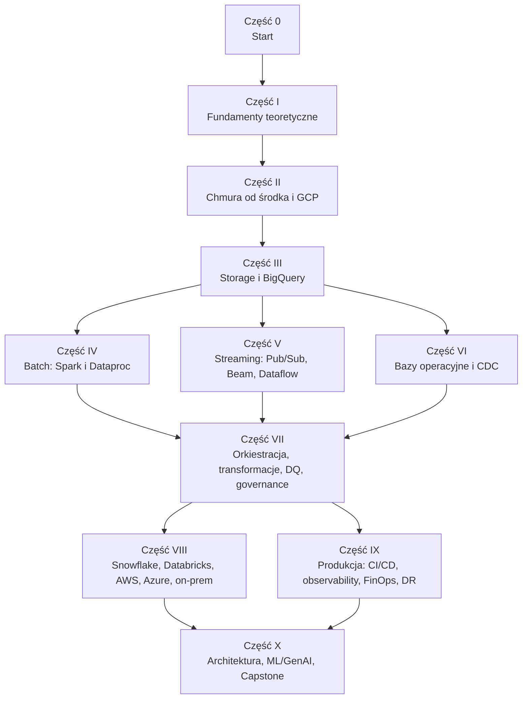

# Advanced Data Engineering — od fundamentów do architektury platform danych w chmurze

> Kompleksowy kurs zaawansowanej inżynierii danych z naciskiem na **Google Cloud Platform**, z systematycznymi porównaniami do **AWS**, **Azure**, **Snowflake**, **Databricks** i rozwiązań **on-premise**.
> Kurs tłumaczy nie tylko *jak* używać narzędzi, ale przede wszystkim **co siedzi pod maską** i *dlaczego* działają tak, a nie inaczej.

---

## Spis treści

- [O kursie](#o-kursie)
- [Dla kogo jest ten kurs](#dla-kogo-jest-ten-kurs)
- [Filozofia kursu](#filozofia-kursu)
- [Przykład przewodni: NovaCart](#przykład-przewodni-novacart)
- [Budowa modułu](#budowa-modułu)
- [Struktura repozytorium](#struktura-repozytorium)
- [Mapa kursu](#mapa-kursu)
- [Ścieżki nauki](#ścieżki-nauki)
- [Lista modułów](#lista-modułów)
- [Szczegółowy konspekt](#szczegółowy-konspekt)
  - [Część 0 — Start](#część-0--start)
  - [Część I — Fundamenty teoretyczne](#część-i--fundamenty-teoretyczne)
  - [Część II — Chmura od środka i fundamenty GCP](#część-ii--chmura-od-środka-i-fundamenty-gcp)
  - [Część III — Storage i hurtownia danych w GCP](#część-iii--storage-i-hurtownia-danych-w-gcp)
  - [Część IV — Przetwarzanie wsadowe](#część-iv--przetwarzanie-wsadowe)
  - [Część V — Przetwarzanie strumieniowe](#część-v--przetwarzanie-strumieniowe)
  - [Część VI — Bazy operacyjne i integracja danych](#część-vi--bazy-operacyjne-i-integracja-danych)
  - [Część VII — Orkiestracja, transformacje, jakość i governance](#część-vii--orkiestracja-transformacje-jakość-i-governance)
  - [Część VIII — Inne platformy i porównania](#część-viii--inne-platformy-i-porównania)
  - [Część IX — Produkcja i operacje](#część-ix--produkcja-i-operacje)
  - [Część X — Architektura i projekt końcowy](#część-x--architektura-i-projekt-końcowy)
- [Dodatki](#dodatki)
- [Wymagania techniczne i koszty](#wymagania-techniczne-i-koszty)
- [Konwencje](#konwencje)
- [Status kursu](#status-kursu)

---

## O kursie

Większość materiałów o data engineeringu kończy się na poziomie „kliknij tu, uruchom to”. Ten kurs idzie o kilka warstw głębiej. Gdy mówimy o BigQuery, rozbieramy Dremela, Colossusa, Capacitora i rozproszony shuffle. Przy partycjonowaniu pokazujemy, co dokładnie dzieje się z plikami i metadanymi i dlaczego dany wzorzec zapytania jest tani albo drogi. Przy streamingu zaczynamy od teorii watermarków i triggerów, a dopiero potem przechodzimy do API Dataflow.

Każdy temat omawiamy na trzech poziomach:

1. **Koncepcja.** Jaki problem rozwiązujemy i jaki model myślowy warto mieć w głowie.
2. **Pod maską.** Jak to jest zaimplementowane: struktury danych, algorytmy, architektura i kompromisy projektowe.
3. **Praktyka.** Kod, konfiguracja, antywzorce, koszty, a na końcu zadanie do samodzielnego wykonania.

Kurs jest **GCP-first**, ale nie **GCP-only**. Każdy istotny komponent porównujemy z odpowiednikami w AWS, Azure, Snowflake i Databricks oraz z rozwiązaniami on-premise/open-source. Dzięki temu łatwiej zrozumieć, co jest uniwersalną zasadą inżynierii, a co decyzją konkretnego dostawcy.

**Język:** materiały są po polsku, ale terminy techniczne zostawiamy po angielsku wszędzie tam, gdzie tłumaczenie byłoby sztuczne albo mylące (np. *shuffle*, *watermark*, *slot*, *partition pruning*, *exactly-once*). Przy pierwszym użyciu terminu podajemy krótkie wyjaśnienie. Pełny słownik znajduje się w [Dodatku A](#dodatki).

---

## Dla kogo jest ten kurs

**Kurs jest dla Ciebie, jeśli:**

- pracujesz jako data engineer, analytics engineer, platform engineer albo architekt danych i chcesz zrozumieć narzędzia, których używasz na co dzień, a nie tylko z nich korzystać;
- znasz SQL i Pythona, budowałeś pipeline'y i chcesz wejść na poziom projektowania platform;
- przygotowujesz się do roli senior/staff/architekta albo do rozmów z system designu danych;
- przygotowujesz się do certyfikacji (np. Google Cloud Professional Data Engineer) i chcesz zrozumieć materiał, a nie wykuć go na pamięć;
- migrujesz między platformami (on-prem → cloud, Snowflake ↔ BigQuery, Hadoop → lakehouse) i potrzebujesz rzetelnego porównania.

**Wymagania wstępne:**

| Obszar | Oczekiwany poziom |
|---|---|
| SQL | Swobodnie: JOIN-y, window functions, CTE, agregacje |
| Python | Swobodnie: funkcje, klasy, pakiety, virtualenv, podstawy testów |
| Linux / shell | Podstawy: nawigacja, zmienne środowiskowe, skrypty |
| Git | Podstawy: branch, commit, pull request |
| Chmura | Mile widziane podstawy dowolnej chmury, ale nie są wymagane |
| Docker | Mile widziane podstawy, omawiamy je w module 36 |

---

## Filozofia kursu

1. **Najpierw zrozumienie, potem narzędzie.** Narzędzia się zmieniają, a zasady zostają. Tabele Iceberg, Delta i Hudi łatwo zrozumieć, gdy znasz problem, który rozwiązują (atomowość na object storage).
2. **Pod maską, ale przystępnie.** Gdy omawiamy algorytm albo strukturę danych, zaczynamy od intuicji i analogii, potem pokazujemy diagram, a na końcu szczegóły. Nie zakładamy wiedzy akademickiej.
3. **Kompromisy zamiast „najlepszych rozwiązań”.** Każda decyzja architektoniczna ma swoją cenę. Uczymy, jak te kompromisy rozpoznawać i nazywać.
4. **Koszty to cecha architektury.** W chmurze każde zapytanie, bajt i godzina workera mają cenę. W każdym module omawiamy model kosztowy.
5. **Porównania budują głębsze zrozumienie.** Gdy widzisz, jak ten sam problem rozwiązują BigQuery, Snowflake, Databricks i Hadoop, zaczynasz rozumieć, dlaczego każde z tych rozwiązań wygląda tak, a nie inaczej.
6. **Praktyka zamyka każdy temat.** Każdy moduł kończy się zadaniem o realistycznym zakresie, z kryteriami oceny i (docelowo) przykładowym rozwiązaniem.
7. **Źródła pierwotne.** Tam, gdzie to możliwe, odwołujemy się do publikacji naukowych (Dremel, Spanner, MapReduce, Dataflow Model, Snowflake, Delta Lake…) i oficjalnych specyfikacji. Pełna lista znajduje się w [Dodatku B](#dodatki).

---

## Przykład przewodni: NovaCart

Przez cały kurs przewija się jedna fikcyjna firma: **NovaCart**, marketplace e-commerce działający w kilku krajach Europy. Dzięki temu kolejne moduły budują spójną całość, a projekt końcowy jest naturalnym zwieńczeniem pracy.

**Źródła danych NovaCart:**

| Źródło | Charakterystyka | Wykorzystywane w modułach |
|---|---|---|
| Baza transakcyjna (PostgreSQL / Cloud SQL) | Zamówienia, klienci, produkty, sprzedawcy; ciągłe zmiany (CDC) | 7, 25, 26, 28 |
| Clickstream (aplikacja web/mobile) | Duży wolumen zdarzeń, duplikaty, zdarzenia spóźnione i nieuporządkowane | 21–24 |
| Pliki od partnerów logistycznych | CSV/JSON dostarczane wsadowo do GCS, zmienne schematy | 4, 13, 17 |
| API płatności (zewnętrzne) | Paginacja, rate limiting, dane wrażliwe (PII) | 11, 26 |
| Katalog produktów i opisy | Dane nieustrukturyzowane: tekst, obrazy | 42 |

**Generator danych:** w katalogu [`datasets/`](datasets/) znajduje się generator syntetycznych danych NovaCart. Ma skalę od MB do setek GB, skośność rozkładu (*data skew*), duplikaty, zdarzenia spóźnione i nieuporządkowane, fikcyjne dane PII oraz anomalie do wykrycia. Wszystkie źródła są ze sobą spójne, a wynik jest deterministyczny: ten sam `--seed` daje identyczne pliki. Generator ma też tryb strumieniowy (Pub/Sub, Kafka), mock API płatności i odtwarzanie zmian na PostgreSQL jako źródło CDC. Każde zadanie wskazuje, jakich parametrów użyć.

```bash
cd datasets && uv sync
uv run novacart generate --scale s -o ../data/s   # ~25 tys. zamówień, ~1,9 mln zdarzeń, kilka sekund
```

---

## Budowa modułu

Każdy moduł ma tę samą strukturę, żeby łatwo było się w nim poruszać. Szablony modułu, lekcji i zadania oraz przewodnik autora (styl, konwencje, *definition of done*) znajdują się w [`templates/`](templates/README.md).

| Sekcja | Zawartość |
|---|---|
| 🎯 **Cele modułu** | Co będziesz umieć po ukończeniu modułu, w formie mierzalnych umiejętności |
| 📋 **Wymagania** | Moduły, które warto znać wcześniej |
| 📖 **Teoria** | Koncepcje, modele myślowe, kontekst historyczny |
| 🔍 **Pod maską** | Architektura, algorytmy, struktury danych i decyzje projektowe |
| ⚖️ **Porównanie platform** | GCP vs AWS vs Azure vs Snowflake vs Databricks vs on-prem/OSS |
| 💻 **Przykłady kodu** | Działający kod (Python, SQL, Terraform, YAML) z komentarzami |
| ⚠️ **Antywzorce i pułapki** | Typowe błędy, ich objawy i sposoby naprawy |
| 💰 **Koszty** | Model kosztowy i dźwignie optymalizacji |
| 🧠 **Pytania kontrolne** | Pytania sprawdzające zrozumienie, w stylu rozmowy technicznej |
| 🧪 **Zadanie końcowe** | Praktyczne zadanie z kryteriami akceptacji |
| 📚 **Dalsza lektura** | Papers, dokumentacja, książki, wystąpienia konferencyjne |

---

## Struktura repozytorium

```text
advanced-data-engineering/
├── README.md                     # ten plik: konspekt i mapa kursu
├── templates/                    # szablony modułu/lekcji/zadania + przewodnik autora
├── datasets/                     # generator danych NovaCart (pakiet Pythona, CLI `novacart`)
│   ├── README.md                 # dokumentacja: skale, schematy, reguły, anomalie
│   ├── src/novacart_datagen/     # kod generatora
│   └── tests/
├── setup/                        # przygotowanie środowiska (GCP, narzędzia, budżety)
├── modules/
│   ├── 00-wprowadzenie/
│   │   ├── README.md             # wprowadzenie do modułu, cele, mapa lekcji
│   │   ├── 01-<lekcja>.md        # lekcje: teoria + pod maską + porównania
│   │   ├── 02-<lekcja>.md
│   │   ├── examples/             # przykłady kodu do lekcji
│   │   └── exercise/
│   │       ├── README.md         # treść zadania i kryteria akceptacji
│   │       ├── starter/          # kod startowy
│   │       └── solution/         # przykładowe rozwiązanie z omówieniem
│   ├── 01-ewolucja-architektur-danych/
│   └── ...
├── capstone/                     # projekt końcowy
├── appendices/                   # słownik, papers, mapowanie usług, certyfikacje
└── data/                         # (ignorowany przez git) lokalnie wygenerowane dane
```

---

## Mapa kursu



---

## Ścieżki nauki

Kurs najlepiej przechodzić po kolei, ale jeśli masz konkretny cel, możesz wybrać jedną ze ścieżek. **Moduły 0–7 (fundamenty) są wspólne dla wszystkich ścieżek** i bardzo zachęcamy, żeby ich nie pomijać, bo na nich opiera się zrozumienie reszty.

| Ścieżka | Moduły (poza fundamentami 0–7) | Dla kogo |
|---|---|---|
| 🏗️ **GCP Data Platform Engineer** | 8–18, 19–20, 22–23, 27–30, 36–40 | Budowa i utrzymanie platformy danych na GCP |
| 📊 **Analytics Engineer / Warehouse Expert** | 9, 11, 13–18, 28–30, 31, 39 | Hurtownia, modelowanie, transformacje, koszty |
| ⚡ **Streaming Specialist** | 9–10, 13, 17, 21–26, 38, 40 | Systemy czasu rzeczywistego |
| 🌐 **Multi-platform Architect** | 8–12, 14, 19, 31–35, 39–41 | Porównania platform, migracje, decyzje architektoniczne |
| 🤖 **Data for AI** | 13–18, 22–23, 28–30, 42 | Dane dla ML i GenAI |
| 🎓 **Google Professional Data Engineer** | Mapowanie w [Dodatku E](#dodatki) | Przygotowanie do certyfikacji |

---

## Lista modułów

Szacowany czas obejmuje lekturę, przykłady i zadanie końcowe.

| # | Moduł | Czas | Wymaga |
|---|---|---|---|
| **0** | **[Start](#część-0--start)** | | |
| 00 | [Wprowadzenie, środowisko i bezpieczne korzystanie z chmury](modules/00-wprowadzenie/README.md) | 9 h | — |
| **I** | **[Fundamenty teoretyczne](#część-i--fundamenty-teoretyczne)** | | |
| 01 | [Ewolucja architektur danych](modules/01-ewolucja-architektur-danych/README.md) | 15 h | 00 |
| 02 | Systemy rozproszone dla data engineera | 8 h | 01 |
| 03 | Storage od podstaw: od dysku do object storage | 6 h | 02 |
| 04 | Formaty plików i kodowanie danych | 7 h | 03 |
| 05 | Open table formats: Iceberg, Delta Lake, Hudi i katalogi | 8 h | 04 |
| 06 | Jak działa silnik zapytań | 8 h | 04 |
| 07 | Modelowanie danych w erze kolumnowych hurtowni | 8 h | 06 |
| **II** | **[Chmura od środka i fundamenty GCP](#część-ii--chmura-od-środka-i-fundamenty-gcp)** | | |
| 08 | Pod maską Google: infrastruktura, na której stoi GCP | 4 h | 02, 03 |
| 09 | Hierarchia zasobów, IAM i tożsamość | 6 h | 08 |
| 10 | Sieć dla data engineera | 6 h | 09 |
| 11 | Bezpieczeństwo i ochrona danych | 7 h | 09, 10 |
| 12 | Infrastructure as Code z Terraform | 7 h | 09 |
| **III** | **[Storage i hurtownia danych w GCP](#część-iii--storage-i-hurtownia-danych-w-gcp)** | | |
| 13 | Cloud Storage pod maską | 6 h | 03, 12 |
| 14 | BigQuery: architektura i silnik Dremel | 7 h | 06, 08 |
| 15 | BigQuery: storage, partycjonowanie i clustering | 7 h | 14 |
| 16 | BigQuery: compute, sloty, wydajność i koszty | 8 h | 15 |
| 17 | BigQuery: ingestion, CDC i eksport | 6 h | 15 |
| 18 | BigQuery: funkcje zaawansowane i ekosystem | 6 h | 16, 17 |
| **IV** | **[Przetwarzanie wsadowe](#część-iv--przetwarzanie-wsadowe)** | | |
| 19 | Apache Spark pod maską | 10 h | 06 |
| 20 | Dataproc i Spark w GCP | 6 h | 19, 13 |
| **V** | **[Przetwarzanie strumieniowe](#część-v--przetwarzanie-strumieniowe)** | | |
| 21 | Teoria przetwarzania strumieniowego | 7 h | 02 |
| 22 | Messaging: Pub/Sub i Kafka pod maską | 8 h | 21 |
| 23 | Apache Beam i Dataflow | 10 h | 21, 22 |
| 24 | Architektury czasu rzeczywistego end-to-end | 6 h | 17, 23 |
| **VI** | **[Bazy operacyjne i integracja danych](#część-vi--bazy-operacyjne-i-integracja-danych)** | | |
| 25 | Bazy operacyjne w GCP pod maską | 8 h | 02, 03 |
| 26 | CDC i integracja danych | 7 h | 25, 22 |
| **VII** | **[Orkiestracja, transformacje, jakość i governance](#część-vii--orkiestracja-transformacje-jakość-i-governance)** | | |
| 27 | Orkiestracja: Airflow i Cloud Composer pod maską | 8 h | 12 |
| 28 | Transformacje: dbt, Dataform, SQLMesh | 7 h | 07, 16 |
| 29 | Jakość danych, testowanie i data contracts | 6 h | 28 |
| 30 | Governance, metadane i lineage | 6 h | 11, 29 |
| **VIII** | **[Inne platformy i porównania](#część-viii--inne-platformy-i-porównania)** | | |
| 31 | Snowflake pod maską | 8 h | 14–17 |
| 32 | Databricks pod maską | 8 h | 05, 19 |
| 33 | AWS i Azure z perspektywy inżyniera GCP | 7 h | 09–17 |
| 34 | On-premise, hybryda i migracje do chmury | 7 h | 19, 20 |
| 35 | Silniki open source i real-time OLAP | 6 h | 06 |
| **IX** | **[Produkcja i operacje](#część-ix--produkcja-i-operacje)** | | |
| 36 | Kontenery i Kubernetes dla data engineera | 7 h | 09, 10 |
| 37 | CI/CD, testowanie i DataOps | 7 h | 12, 28 |
| 38 | Observability i SLO dla platform danych | 6 h | 27 |
| 39 | FinOps: inżynieria kosztów | 6 h | 16, 20, 23 |
| 40 | Niezawodność, disaster recovery i incydenty | 6 h | 13–25 |
| **X** | **[Architektura i projekt końcowy](#część-x--architektura-i-projekt-końcowy)** | | |
| 41 | Wzorce architektoniczne i system design platform danych | 8 h | wszystkie powyżej |
| 42 | Data engineering dla ML i GenAI | 8 h | 18, 23, 28 |
| 43 | Projekt końcowy (capstone) | 30–60 h | całość |

**Łączny czas:** około 300–350 godzin.

---

# Szczegółowy konspekt

---

## Część 0 — Start

### Moduł 00 — Wprowadzenie, środowisko i bezpieczne korzystanie z chmury

> 🎯 **Cel:** przygotować kompletne, bezpieczne kosztowo środowisko pracy i zrozumieć, jak korzystać z kursu.

📂 **Materiały:** [modules/00-wprowadzenie](modules/00-wprowadzenie/README.md)

**Lekcje**

1. **Jak korzystać z kursu.** Struktura modułów, ścieżki nauki, konwencje oznaczeń, praca z zadaniami i rozwiązaniami.
2. **Konto i projekt GCP.** Free tier i kredyty, billing account, pierwszy projekt, BigQuery Sandbox (bez karty kredytowej) i jego ograniczenia.
3. **Bezpieczeństwo kosztowe od pierwszego dnia.** Budżety i alerty, `maximum_bytes_billed`, custom quotas w BigQuery, etykiety (*labels*), skrypty sprzątające, zasada „wszystko przez Terraform, wszystko da się zniszczyć jednym poleceniem”.
4. **Narzędzia lokalne.** `gcloud` CLI, Application Default Credentials (ADC), Terraform/OpenTofu, Python (`uv`), Docker, DuckDB, `bq` CLI, VS Code z rozszerzeniami.
5. **Emulatory i praca offline.** Emulator Pub/Sub, emulatory Bigtable/Spanner/Firestore, lokalny Spark, lokalny Kafka (Docker Compose), DuckDB jako lokalny substytut hurtowni.
6. **Konta próbne innych platform.** Snowflake trial, Databricks Free Edition, AWS Free Tier, Azure free account: kiedy je zakładać, żeby trial nie wygasł przed odpowiednim modułem.
7. **Generator danych NovaCart.** Instalacja, parametry, schematy danych.

**💻 Przykłady kodu:** skrypt bootstrapujący projekt (`gcloud`), Terraform z budżetem i alertem, konfiguracja ADC, pierwsze zapytanie BigQuery z `--dry_run`.

**🧪 Zadanie końcowe:** skonfiguruj projekt GCP z budżetem i alertem e-mail, ustaw custom quota na BigQuery (np. 1 TiB/dzień), uruchom generator NovaCart w skali „S”, załaduj dane do GCS i wykonaj zapytanie na tabeli zewnętrznej. Na koniec udokumentuj, ile kosztowały wszystkie operacje, korzystając z billing reports.

---

## Część I — Fundamenty teoretyczne

> Ta część jest celowo **niezależna od platformy**. Daje język i modele myślowe, które pozwolą zrozumieć każdą technologię omawianą później.

### Moduł 01 — Ewolucja architektur danych

> 🎯 **Cel:** zrozumieć, *dlaczego* dzisiejsze architektury wyglądają tak, jak wyglądają. Każda epoka rozwiązywała problemy poprzedniej i wprowadzała własne.

📂 **Materiały:** [modules/01-ewolucja-architektur-danych](modules/01-ewolucja-architektur-danych/README.md)

**Lekcje**

1. **OLTP vs OLAP.** Dwa światy obciążeń: wzorce dostępu, wymagania, dlaczego jedna baza „do wszystkiego” nie działa (i dlaczego HTAP próbuje to zmienić).
2. **Era hurtowni danych (lata 90. i 2000.).** Inmon vs Kimball, appliance'y MPP (Teradata, Netezza, Exadata), narzędzia ETL (Informatica, DataStage), architektura shared-nothing.
3. **Era Big Data (2004–2015).** Papers GFS i MapReduce, Hadoop, HDFS, Hive, schema-on-read, data lake i jego degeneracja w *data swamp*.
4. **Era cloud data warehouse (2010+).** BigQuery (2010), Redshift (2012), Snowflake (2014). Separacja storage i compute i dlaczego stała się możliwa dopiero przy odpowiedniej przepustowości sieci.
5. **Era lakehouse (2019+).** Open table formats, „warehouse na object storage”, paper *Lakehouse* (CIDR 2021), konwergencja hurtowni i jezior danych.
6. **Kierunki organizacyjne i nowe trendy.** Data mesh (2019), data fabric, zero-ETL, streaming-first, composable data stack, dane dla AI.
7. **Architektury równoległego przetwarzania.** Shared-memory, shared-disk, shared-nothing, shared-data (*disaggregated storage*). Te same idee wracają w nowych opakowaniach.
8. **Role w zespołach danych.** Data engineer, analytics engineer, platform engineer, ML engineer: zakresy odpowiedzialności i punkty styku.

**⚖️ Porównanie:** tabela epok obejmująca typowy stack, model kosztowy, skalowanie, główny problem rozwiązany i główny problem wprowadzony.

**🧪 Zadanie końcowe:** dla NovaCart naszkicuj architekturę w trzech wariantach: (a) on-prem 2010 (Hadoop + hurtownia MPP), (b) cloud data warehouse, (c) lakehouse. Dla każdego opisz przepływ danych, punkty awarii, skalowanie i model kosztowy, a na koniec uzasadnij, który wariant wybrałbyś dziś i dlaczego (format ADR, *Architecture Decision Record*).

---

### Moduł 02 — Systemy rozproszone dla data engineera

> 🎯 **Cel:** zbudować intuicję systemów rozproszonych potrzebną, by rozumieć zachowanie BigQuery, Sparka, Kafki, Spannera czy Dataflow. Bez matematyki dla samej matematyki.

**Lekcje**

1. **Dlaczego rozpraszamy.** Scale-up vs scale-out, prawo Amdahla i Gustafsona, koszt koordynacji. *Fallacies of distributed computing*.
2. **Partycjonowanie (sharding).** Hash, range, consistent hashing, virtual nodes. Hot spots i skew: skąd się biorą i jak je wykrywać.
3. **Replikacja.** Single-leader, multi-leader, leaderless. Quorum (`R + W > N`), replication lag i jego skutki dla odczytów.
4. **Modele spójności.** Linearizability, sequential, causal, eventual, read-your-writes, monotonic reads. External consistency w Spannerze. Jak to przekłada się na doświadczenie użytkownika.
5. **CAP i PACELC.** Co CAP naprawdę mówi (i czego nie mówi). Dlaczego PACELC lepiej opisuje rzeczywiste systemy.
6. **Czas w systemach rozproszonych.** Clock skew, NTP, zegary Lamporta, vector clocks, Hybrid Logical Clocks, TrueTime. Dlaczego event time w streamingu jest trudny.
7. **Konsensus.** Paxos i Raft intuicyjnie: wybór lidera, log replikowany, quorum. Gdzie spotkasz konsensus: Spanner, etcd (Kubernetes), Kafka KRaft, ZooKeeper, FoundationDB.
8. **Transakcje rozproszone.** ACID, poziomy izolacji i anomalie (dirty read, lost update, write skew), MVCC, snapshot isolation, optimistic vs pessimistic concurrency control, 2PC, sagas.
9. **Semantyki dostarczania.** At-most-once, at-least-once, exactly-once (i dlaczego to zawsze „effectively-once”). Idempotencja, deduplikacja, klucze idempotencji.
10. **Awarie i ich obsługa.** Stragglers i *tail latency* („The Tail at Scale”), retry z exponential backoff i jitterem, thundering herd, backpressure, circuit breaker, timeouts.
11. **Shuffle: serce przetwarzania rozproszonego.** Dlaczego przesuwanie danych między maszynami dominuje koszt. Model myślowy, do którego wracamy przy Sparku, BigQuery i Dataflow.

**🔍 Pod maską:** krok po kroku wybór lidera w Raft, mechanika quorum, jak MVCC realizuje snapshot isolation.

**💻 Przykłady kodu:** symulacja consistent hashing w Pythonie z wizualizacją rozkładu kluczy, symulacja skew przy hash partitioning, idempotentny konsument z tabelą deduplikacji, retry z jitterem.

**📚 Dalsza lektura:** *Designing Data-Intensive Applications* (M. Kleppmann), Raft paper, „The Tail at Scale”, Dynamo paper.

**🧪 Zadanie końcowe:** zaimplementuj w Pythonie symulator klastra key-value z replikacją leaderless i konfigurowalnym quorum. Wstrzykuj awarie węzłów i opóźnienia sieci, a następnie zmierz odsetek nieaktualnych odczytów dla różnych `R/W/N`. Raport z wykresami i wnioskami.

---

### Moduł 03 — Storage od podstaw: od dysku do object storage

> 🎯 **Cel:** zrozumieć fizykę i abstrakcje przechowywania danych, od sektora na dysku po rozproszony object storage, oraz ich konsekwencje dla wydajności pipeline'ów.

**Lekcje**

1. **Hierarchia pamięci i liczby, które każdy powinien znać.** Latencje: cache CPU → RAM → NVMe → SSD → HDD → sieć w DC → sieć między regionami. Przepustowość vs IOPS vs latencja.
2. **Dyski.** HDD (seek, rotacja), SSD/NVMe (strony, bloki, FTL, write amplification, garbage collection), dostęp sekwencyjny vs losowy.
3. **System operacyjny i I/O.** Page cache, `fsync`, `O_DIRECT`, mmap, read-ahead. Dlaczego „zapisałem” nie zawsze znaczy „zapisane”.
4. **Struktury danych na dysku.** B-tree (bazy OLTP) vs LSM-tree (Bigtable, Cassandra, RocksDB): memtable, SSTable, compaction (size-tiered, leveled), bloom filters, read/write/space amplification.
5. **Block vs file vs object storage.** Semantyka POSIX vs semantyka obiektowa: niemutowalność obiektów, brak atomowego `rename`, listowanie, metadane. Konsekwencje dla Hadoopa i Sparka.
6. **Rozproszone systemy plików.** GFS i jego następca Colossus, HDFS (NameNode, DataNode, bloki, replikacja 3×), problem małych plików i pamięci NameNode.
7. **Replikacja vs erasure coding.** Reed-Solomon intuicyjnie, narzut storage vs koszt odbudowy. Dlaczego chmury przechowują dane taniej, niż wynikałoby z 3× replikacji.
8. **Storage blokowy i plikowy w chmurze.** Persistent Disk, Hyperdisk, Local SSD, Filestore, Parallelstore. Odpowiedniki: EBS, EFS, FSx, Azure Managed Disks, Azure Files/NetApp.

**⚖️ Porównanie:** HDFS vs GCS vs S3 vs ADLS Gen2 vs MinIO/Ceph pod względem modelu spójności, operacji atomowych, kosztu, latencji i skalowalności metadanych.

**💻 Przykłady kodu:** benchmark `fio` (sekwencyjny vs losowy odczyt), minimalny LSM-tree w Pythonie (memtable + flush + compaction + bloom filter), pomiar wpływu rozmiaru obiektów na przepustowość odczytu z GCS.

**🧪 Zadanie końcowe:** rozbuduj minimalny LSM-tree o compaction leveled i bloom filtry, a następnie zmierz read/write amplification dla różnych proporcji odczytów i zapisów. Dodatkowo zmierz w GCS czas odczytu 1 GB danych zapisanych jako 10 000 małych plików vs 10 dużych plików i wyjaśnij różnicę.

---

### Moduł 04 — Formaty plików i kodowanie danych

> 🎯 **Cel:** rozumieć formaty plików na poziomie bajtów: dlaczego Parquet jest szybki, kiedy Avro jest lepszy i jak decyzje o zapisie wpływają na koszt każdego późniejszego zapytania.

**Lekcje**

1. **Row vs columnar.** Wzorce dostępu analitycznego, projekcja kolumn, kompresja kolumn jednorodnych, przetwarzanie wektorowe i SIMD.
2. **Formaty tekstowe i ich pułapki.** CSV (escaping, encoding, brak typów, nagłówki), JSON i JSON Lines (koszt parsowania, brak schematu), problemy z typami dat i liczb.
3. **Avro i Protobuf.** Schemat w nagłówku vs w rejestrze, ewolucja schematu (backward/forward/full compatibility), sync markers i splittability, Schema Registry. Dlaczego Avro dominuje w streamingu.
4. **Parquet pod maską.**
   - struktura: file → row groups → column chunks → pages; footer i metadane;
   - zagnieżdżone dane: algorytm *record shredding* z papera Dremel (repetition i definition levels), krok po kroku na przykładzie;
   - kodowania: PLAIN, dictionary, RLE/bit-packing hybrid, DELTA_BINARY_PACKED, DELTA_BYTE_ARRAY, BYTE_STREAM_SPLIT;
   - statystyki (min/max, null count), page index, bloom filtry i ich rola w *predicate pushdown*;
   - typy logiczne vs fizyczne (DECIMAL, TIMESTAMP, INT96 legacy).
5. **ORC.** Stripes, indeksy, ACID w Hive. Porównanie z Parquet.
6. **Kompresja.** Snappy, LZ4, gzip, zstd (poziomy), kompromis CPU vs ratio, splittability. Dlaczego sortowanie danych przed zapisem bywa ważniejsze niż wybór kodeka.
7. **Capacitor.** Co wiemy o kolumnowym formacie BigQuery i czym różni się od Parquet (reordering wierszy, kodowania dobierane na podstawie danych).
8. **Apache Arrow.** Format in-memory, zero-copy, Arrow IPC, Arrow Flight, ADBC. Arrow jako lingua franca (BigQuery Storage Read API, Spark, DuckDB, Polars, pandas 2.x).
9. **Nowe formaty.** Lance, Vortex, Nimble: dlaczego powstają i jakie problemy Parquetu adresują (random access, ML, szerokie tabele).
10. **Problem małych plików i optymalny rozmiar pliku.** Narzut metadanych, listowania i otwierania plików, docelowe rozmiary dla różnych silników.

**💻 Przykłady kodu:** `pyarrow`: zapis Parquet z różnymi kodowaniami, rozmiarami row group i sortowaniem, inspekcja metadanych (`ParquetFile.metadata`), DuckDB `parquet_metadata()` i `parquet_schema()`, ręczne „rozbieranie” pliku Parquet bajt po bajcie, ewolucja schematu Avro z `fastavro`.

**🧪 Zadanie końcowe:** zapisz zbiór zamówień NovaCart (skala M) w formatach CSV, JSON Lines, Avro, Parquet (snappy/zstd, posortowany i nieposortowany) i ORC. Zmierz rozmiar, czas zapisu, czas zapytania selektywnego i agregującego (DuckDB + BigQuery external table) oraz liczbę przeczytanych bajtów. Przygotuj raport z rekomendacjami dla każdej warstwy data lake'a NovaCart.

---

### Moduł 05 — Open table formats: Iceberg, Delta Lake, Hudi i katalogi

> 🎯 **Cel:** zrozumieć, jak na niemutowalnym object storage zbudować transakcyjne tabele z time travel i ewolucją schematu, i jak wybrać format oraz katalog.

**Lekcje**

1. **Problem.** Data lake bez transakcji: częściowe zapisy, czytanie w trakcie zapisu, kosztowne listowanie katalogów, brak schematu, brak usuwania pojedynczych wierszy (RODO!).
2. **Hive table format i jego ograniczenia.** Katalogi jako partycje, metastore, `MSCK REPAIR`, brak atomowości.
3. **Apache Iceberg pod maską.**
   - drzewo metadanych: catalog → `metadata.json` → manifest list → manifest files → data files;
   - snapshoty, atomowa podmiana wskaźnika w katalogu, optimistic concurrency i retry przy konflikcie;
   - hidden partitioning, partition evolution, schema evolution oparta na identyfikatorach kolumn;
   - delete files (position i equality), format v3: deletion vectors, row lineage, typ `variant`, wartości domyślne;
   - branches i tags (WAP, *Write-Audit-Publish*);
   - utrzymanie: expire snapshots, rewrite data files, rewrite manifests, remove orphan files.
4. **Delta Lake pod maską.** `_delta_log`, commity JSON, checkpointy Parquet, protokół i *table features*, OCC oparty o atomowy put-if-absent, deletion vectors, liquid clustering, Change Data Feed, UniForm.
5. **Apache Hudi pod maską.** Timeline, Copy-on-Write vs Merge-on-Read, indeksy rekordów, incremental queries.
6. **Copy-on-Write vs Merge-on-Read.** Ogólny kompromis zapis vs odczyt, który wraca w wielu systemach.
7. **Katalogi.** Hive Metastore, Iceberg REST Catalog spec, AWS Glue Data Catalog, Unity Catalog (OSS), Apache Polaris, Nessie (git-like), BigLake metastore. Dlaczego katalog stał się nowym polem walki dostawców.
8. **Interoperacyjność.** Apache XTable, Delta UniForm, „wojna formatów” i jej realny stan.
9. **Table formats w chmurach.** Tabele Iceberg zarządzane przez BigQuery (BigLake), BigLake external tables, S3 Tables, Snowflake Iceberg tables, Databricks Unity Catalog + Iceberg, Microsoft Fabric/OneLake. Także DuckLake jako alternatywne podejście (metadane w bazie SQL).

**⚖️ Porównanie:** Iceberg vs Delta vs Hudi pod względem modelu metadanych, concurrency, ekosystemu, wsparcia w GCP/AWS/Azure/Snowflake/Databricks oraz typowych zastosowań.

**💻 Przykłady kodu:** PyIceberg z lokalnym katalogiem SQL (SQLite): tworzenie tabeli, append, delete, ewolucja schematu i partycji, time travel. Inspekcja plików `metadata.json` i manifestów (Avro). `delta-rs`: analiza `_delta_log`. Spark + Iceberg: procedury maintenance.

**🧪 Zadanie końcowe:** zbuduj tabelę Iceberg z zamówieniami NovaCart i wykonaj scenariusz: ładowanie początkowe → codzienne appendy → usunięcie danych klienta (RODO) → dodanie kolumny → zmiana partycjonowania z dziennego na godzinowe → compaction → expire snapshots. Po każdym kroku udokumentuj, jakie pliki powstały, i narysuj drzewo metadanych. Wykaż, że usunięte dane rzeczywiście zniknęły z storage.

---

### Moduł 06 — Jak działa silnik zapytań

> 🎯 **Cel:** rozumieć drogę od tekstu SQL do wyniku, czytać plany wykonania w dowolnym silniku i przewidywać, które zapytania będą drogie.

**Lekcje**

1. **Cykl życia zapytania.** Parsing → AST → analiza/binding → plan logiczny → optymalizacja → plan fizyczny → wykonanie → zwrot wyników.
2. **Algebra relacyjna w praktyce.** Selekcja, projekcja, join, agregacja i ich przekształcenia równoważne.
3. **Optymalizacja regułowa.** Predicate pushdown, projection pruning, constant folding, subquery decorrelation, partition pruning, dynamic filtering.
4. **Optymalizacja kosztowa (CBO).** Statystyki, histogramy, estymacja kardynalności (i dlaczego jest zwykle błędna), kolejność joinów, programowanie dynamiczne vs heurystyki.
5. **Optymalizacja adaptacyjna.** Zmiana planu w trakcie wykonania (Spark AQE, dynamiczne planowanie BigQuery).
6. **Modele wykonania.** Volcano/iterator, wykonanie wektorowe (MonetDB/X100), kompilacja zapytań i code generation (HyPer, whole-stage codegen w Sparku), push vs pull, morsel-driven parallelism.
7. **Algorytmy joinów.** Nested loop, hash join (build/probe), sort-merge join, broadcast vs partitioned (shuffle) join, obsługa skew.
8. **Agregacje.** Hash aggregation, sort aggregation, agregacja dwufazowa (partial/final), algorytmy przybliżone (HyperLogLog++, KLL/t-digest, Theta sketches).
9. **Przetwarzanie MPP.** Operator exchange, stage'y, fragmenty planu, shuffle, serving tree w Dremelu i jego ewolucja.
10. **Pamięć i spill.** Co się dzieje, gdy dane nie mieszczą się w pamięci. External sort, grace hash join.
11. **Cache.** Cache wyników, metadanych i danych: gdzie występują i kiedy są unieważniane.

**⚖️ Porównanie:** jak czytać plan w DuckDB (`EXPLAIN ANALYZE`), BigQuery (execution graph), Spark (`explain("formatted")`, Spark UI), Snowflake (Query Profile), Databricks (Query Profile), Trino (`EXPLAIN ANALYZE`).

**💻 Przykłady kodu:** implementacja w Pythonie hash join, sort-merge join i agregacji dwufazowej, porównanie złożoności. HyperLogLog od zera. Analiza tego samego zapytania w DuckDB, BigQuery i Sparku.

**🧪 Zadanie końcowe:** dostajesz 8 zapytań analitycznych NovaCart. Dla każdego przeanalizuj plan wykonania w DuckDB i BigQuery, wskaż najdroższy operator, zaproponuj przepisanie i zmierz efekt. Dodatkowo zaimplementuj w Pythonie broadcast i partitioned join na symulowanym klastrze 4 workerów i zmierz wolumen shuffle dla różnych rozmiarów tabel.

---

### Moduł 07 — Modelowanie danych w erze kolumnowych hurtowni

> 🎯 **Cel:** opanować klasyczne i nowoczesne techniki modelowania oraz rozumieć, jak architektura silnika zmienia rachunek kosztów przy wyborze modelu.

**Lekcje**

1. **Normalizacja i denormalizacja.** Postacie normalne (1NF–BCNF) w pigułce. Kiedy denormalizacja jest optymalizacją, a kiedy długiem technicznym.
2. **Kimball w praktyce.** Proces czterech kroków, granularność (*grain*), typy faktów (transaction, periodic snapshot, accumulating snapshot, factless), conformed dimensions, bus matrix, surrogate keys, junk/degenerate/role-playing dimensions.
3. **Slowly Changing Dimensions.** Typy 0, 1, 2, 3, 4, 6 i 7: implementacja, koszty, pułapki (late-arriving dimensions, early-arriving facts).
4. **Inmon i Corporate Information Factory.** Kiedy podejście top-down ma sens.
5. **Data Vault 2.0.** Hubs, links, satellites, hash keys, raw vault vs business vault, PIT i bridge tables. Kiedy warto (audytowalność, wiele źródeł), a kiedy to przerost formy.
6. **One Big Table (OBT) i wide tables.** Dlaczego w silnikach kolumnowych działają lepiej, niż sugeruje intuicja z OLTP.
7. **Modelowanie w BigQuery.** Typy zagnieżdżone i powtarzalne (`STRUCT`, `ARRAY`), kiedy zagnieżdżać zamiast JOIN-ować, typ `JSON`, klucze główne i obce jako wskazówki dla optymalizatora (*unenforced*).
8. **Warstwy danych.** Medallion (bronze/silver/gold) vs staging/intermediate/marts. Warstwy a modelowanie to dwie różne rzeczy.
9. **Modelowanie zdarzeń.** Activity schema, event sourcing, modelowanie sesji, tabele snapshotów stanu.
10. **Semantic layer (wprowadzenie).** Metryki jako kod, rozwinięte w module 41.

**⚖️ Porównanie:** koszt JOIN-ów i denormalizacji w BigQuery vs Snowflake vs Databricks vs Redshift vs klasyczny RDBMS. Rola distribution keys (Redshift, Synapse) vs automatyczne decyzje (BigQuery, Snowflake).

**💻 Przykłady kodu:** SCD typ 2 przez `MERGE` w BigQuery, model Data Vault z hash keys, tabela zagnieżdżona zamówień z `ARRAY<STRUCT>` i zapytania z `UNNEST`.

**🧪 Zadanie końcowe:** zamodeluj domenę sprzedaży NovaCart w trzech podejściach: (a) gwiazda Kimballa z SCD2, (b) Data Vault 2.0 + warstwa informacyjna, (c) OBT z typami zagnieżdżonymi w BigQuery. Zaimplementuj wszystkie trzy na tych samych danych, uruchom zestaw 10 zapytań biznesowych i porównaj bytes processed, slot-ms, złożoność SQL i łatwość utrzymania. Wnioski zapisz jako ADR.

---

## Część II — Chmura od środka i fundamenty GCP

### Moduł 08 — Pod maską Google: infrastruktura, na której stoi GCP

> 🎯 **Cel:** poznać wewnętrzne systemy Google, na których zbudowane są usługi danych GCP. To klucz do zrozumienia ich zachowania, limitów i cen.

**Lekcje**

1. **Fizyczna infrastruktura.** Regiony, strefy, data center, domeny awarii, globalna sieć prywatna Google, punkty obecności, Premium vs Standard network tier.
2. **Jupiter.** Sieć wewnątrz data center o przepustowości bisekcji rzędu petabitów na sekundę. To ona umożliwiła separację storage i compute i in-memory shuffle w BigQuery.
3. **Andromeda.** Software-defined networking pod VPC.
4. **Borg.** Zarządzanie klastrem i przodek Kubernetesa. Jak przydziela zasoby usługom typu BigQuery i Dataflow.
5. **Colossus.** Następca GFS: architektura metadanych (curators, skalowalna warstwa metadanych), D-servers, erasure coding. Wspólny fundament GCS, BigQuery, Bigtable, Spannera.
6. **Spanner i Chubby.** Globalne metadane i koordynacja.
7. **Od papera do produktu.** MapReduce → Dataproc, Bigtable → Cloud Bigtable, Dremel → BigQuery, Flume/MillWheel → Dataflow/Beam, Spanner → Cloud Spanner, Borg → GKE, Monarch → Cloud Monitoring.

**⚖️ Porównanie:** model regionów i stref w GCP vs AWS (AZ jako osobne DC, Nitro) vs Azure (paired regions, availability zones). Konsekwencje dla projektowania HA.

**📚 Dalsza lektura:** papers GFS, Borg, Jupiter Rising, Andromeda, Spanner, Monarch.

**🧪 Zadanie końcowe:** przygotuj „drzewo genealogiczne” usług danych GCP: paper → wewnętrzny system Google → usługa GCP → odpowiednik open source → odpowiednik AWS/Azure. Dla trzech wybranych usług wyjaśnij, jak cecha wewnętrznej architektury przekłada się na obserwowalne zachowanie (np. limit, model cenowy, gwarancję spójności).

---

### Moduł 09 — Hierarchia zasobów, IAM i tożsamość

> 🎯 **Cel:** zaprojektować bezpieczną i skalowalną strukturę organizacji GCP dla platformy danych z zasadą najmniejszych uprawnień i bez kluczy service account.

**Lekcje**

1. **Hierarchia zasobów.** Organization → folders → projects → resources. Dziedziczenie polityk, labels vs tags (tagi warunkowe w IAM i org policies).
2. **Model IAM.** Principals (users, groups, service accounts, workload identity pools, domeny), role (basic, predefined, custom), polityki zezwalające, deny policies, IAM Conditions, Principal Access Boundary.
3. **Service accounts pod maską.** Tożsamość vs zasób, krótkotrwałe tokeny, metadata server, impersonacja i łańcuch delegacji, service agents (Google-managed SA), dlaczego klucze JSON to zło konieczne, którego można uniknąć.
4. **Workload Identity Federation.** GitHub Actions, GitLab, AWS, Azure i OIDC/SAML bez kluczy. Workload Identity Federation dla GKE.
5. **Organization policies.** Kluczowe ograniczenia dla platform danych: lokalizacje zasobów, zakaz tworzenia kluczy SA, domain-restricted sharing, wymuszenie CMEK, publiczny dostęp do bucketów.
6. **Projektowanie landing zone dla platformy danych.** Projekty per środowisko × domena, projekty storage vs compute, project factory, Shared VPC host/service projects.
7. **Quotas, APIs i billing.** Jak działają kwoty, quota projects w ADC, billing accounts i sub-accounts.
8. **Audyt uprawnień.** Policy Analyzer, IAM Recommender, Policy Troubleshooter, Asset Inventory.

**⚖️ Porównanie:** GCP (org/folders/projects) vs AWS (Organizations, OU, accounts, SCP, IAM roles, STS AssumeRole) vs Azure (Entra ID, management groups, subscriptions, resource groups, RBAC, managed identities) vs Snowflake (hierarchia ról, DAC + RBAC) vs Databricks (account/workspace, Unity Catalog grants) vs on-prem (LDAP/AD, Kerberos, Apache Ranger).

**💻 Przykłady kodu:** Terraform: folders, projekty, IAM bindings z warunkami. Python: impersonacja SA (`google.auth.impersonated_credentials`). GitHub Actions z WIF.

**⚠️ Antywzorce:** role basic (`roles/editor`) na produkcji, jedna SA dla wszystkiego, klucze SA w repo, uprawnienia nadawane użytkownikom zamiast grupom.

**🧪 Zadanie końcowe:** zaprojektuj i wdroż (Terraform) hierarchię dla NovaCart: foldery per środowisko, projekty per domena danych, dedykowane SA per pipeline z minimalnymi uprawnieniami, impersonację dla developerów, WIF dla CI oraz organization policies blokujące klucze SA i zasoby poza UE. Udowodnij least privilege testami (próby niedozwolonych operacji).

---

### Moduł 10 — Sieć dla data engineera

> 🎯 **Cel:** zrozumieć, jak usługi danych komunikują się w sieci, jak zabezpieczyć dane przed eksfiltracją i jak sieć wpływa na koszty.

**Lekcje**

1. **VPC w GCP.** Globalny VPC, regionalne subnety, routing, firewall rules vs hierarchical firewall policies vs network firewall policies.
2. **Jak usługi zarządzane łączą się z Twoją siecią.** Private Google Access, Private Service Connect (dla API Google i usług producentów), Private Services Access (VPC peering, np. Cloud SQL), Serverless VPC Access vs Direct VPC egress.
3. **Wyjście do internetu.** Cloud NAT, workery Dataflow/Dataproc bez publicznych IP.
4. **Shared VPC vs VPC peering vs Network Connectivity Center.** Topologie dla organizacji.
5. **VPC Service Controls pod maską.** Perimetry, access levels, ingress/egress rules, dry-run mode, bridges. Ochrona przed eksfiltracją dla BigQuery i GCS i typowe problemy, które VPC-SC powoduje w pipeline'ach.
6. **Łączność hybrydowa.** HA VPN, Dedicated/Partner Interconnect, Cross-Cloud Interconnect, Cloud Router i BGP.
7. **DNS.** Cloud DNS, private zones, DNS dla PSC.
8. **Koszty transferu danych.** Egress do internetu, między regionami, między strefami. Architektura świadoma kosztów sieciowych i ukryte koszty multi-cloud.

**⚖️ Porównanie:** AWS (VPC regionalny, gateway/interface endpoints, PrivateLink, Transit Gateway, Direct Connect) vs Azure (VNet, Service Endpoints, Private Endpoints, ExpressRoute) vs Snowflake (PrivateLink/PSC, network policies/rules) vs Databricks (VPC injection, PSC/PrivateLink, serverless egress control).

**💻 Przykłady kodu:** Terraform: VPC z prywatnymi subnetami, Cloud NAT, PGA, endpoint PSC dla API Google, perimetr VPC-SC w trybie dry-run.

**🧪 Zadanie końcowe:** zbuduj (Terraform) sieć dla platformy NovaCart: Dataproc i Dataflow bez publicznych IP, dostęp do API przez PSC, perimetr VPC-SC wokół projektów z danymi. Przeprowadź test eksfiltracji: spróbuj skopiować tabelę BigQuery do projektu poza perimetrem i przeanalizuj logi naruszeń w trybie dry-run i enforced.

---

### Moduł 11 — Bezpieczeństwo i ochrona danych

> 🎯 **Cel:** chronić dane na każdym poziomie (szyfrowanie, kontrola dostępu do wierszy i kolumn, maskowanie, DLP) i spełnić wymagania RODO w systemach analitycznych.

**Lekcje**

1. **Szyfrowanie w spoczynku pod maską.** Envelope encryption (DEK/KEK), domyślne szyfrowanie Google, CMEK (Cloud KMS, Cloud HSM, rotacja, wersje kluczy), Cloud EKM i Key Access Justifications, CSEK. Autokey.
2. **Szyfrowanie w tranzycie.** TLS, ALTS wewnątrz Google, Confidential Computing.
3. **Secret Manager.** Przechowywanie, wersjonowanie, rotacja, dostęp z pipeline'ów.
4. **Kontrola dostępu w BigQuery.** Uprawnienia na dataset/tabelę/routine, authorized views, authorized datasets, authorized routines, row-level access policies, column-level security (policy tags), dynamic data masking (reguły maskowania, własne routines).
5. **Szyfrowanie na poziomie kolumny.** Funkcje AEAD w BigQuery, deterministic encryption, crypto-shredding (usunięcie klucza = usunięcie danych).
6. **Sensitive Data Protection (dawniej Cloud DLP).** Inspekcja, discovery (profilowanie całych organizacji), de-identyfikacja: tokenizacja, format-preserving encryption, date shifting, k-anonymity.
7. **Audit logs.** Admin Activity, Data Access, System Event, Policy Denied. Access Transparency.
8. **RODO w praktyce data engineera.** Prawo do bycia zapomnianym vs niemutowalny storage, time travel, backupy i snapshoty. Pseudonimizacja vs anonimizacja, retencja, data residency, wzorzec „vault” dla PII.

**⚖️ Porównanie:** Snowflake (masking policies, row access policies, tag-based policies, Tri-Secret Secure) vs Databricks Unity Catalog (row filters, column masks, ABAC) vs AWS (Lake Formation, Macie, KMS) vs Azure (Purview, Key Vault, dynamic data masking w SQL) vs on-prem (Ranger, Kerberos, TDE).

**💻 Przykłady kodu:** Terraform: policy tags i taxonomies, row access policy, CMEK na datasecie. SQL: AEAD i crypto-shredding. Python: de-identyfikacja przez DLP API.

**🧪 Zadanie końcowe:** zabezpiecz dane klientów NovaCart. Uruchom discovery DLP, nałóż policy tags z maskowaniem (analityk widzi hash e-maila, zespół fraud widzi pełne dane), dodaj row-level security według kraju, ustaw CMEK i zaimplementuj workflow „prawa do bycia zapomnianym” z crypto-shreddingiem. Udowodnij, że dane klienta są nieodzyskiwalne również z time travel.

---

### Moduł 12 — Infrastructure as Code z Terraform

> 🎯 **Cel:** zarządzać całą infrastrukturą platformy danych jako kodem, rozumiejąc, jak Terraform działa wewnętrznie.

**Lekcje**

1. **Dlaczego IaC.** Deklaratywność vs imperatywność, drift, powtarzalność, review zmian infrastruktury.
2. **Terraform pod maską.** Architektura core i providerów (pluginy gRPC), graf zależności, `plan` jako diff stanu pożądanego i aktualnego, `refresh`, równoległość, cykl życia zasobu.
3. **State.** Co zawiera (również sekrety!), backend GCS z blokadą, `import`, `moved`, `removed`, `terraform state` operations, podział stanu.
4. **Struktura kodu.** Moduły, kompozycja, środowiska (katalogi vs workspaces), wersjonowanie modułów, Terragrunt, stacks.
5. **Provider Google.** `google` vs `google-beta`, uwierzytelnianie, impersonacja, Cloud Foundation Fabric (FAST), Cloud Foundation Toolkit.
6. **Jakość i testowanie.** `validate`, `fmt`, tflint, checkov/trivy, `terraform test`, policy as code (OPA/Conftest).
7. **Alternatywy.** OpenTofu, Pulumi, Config Connector (Kubernetes-native), Infrastructure Manager (zarządzany Terraform w GCP), Crossplane.
8. **IaC dla platform danych.** Zasoby BigQuery (datasety, tabele, rezerwacje), granica między IaC a narzędziami do schematów (dbt/Dataform), providery Snowflake i Databricks.

**⚖️ Porównanie:** Terraform vs CloudFormation/CDK (AWS) vs Bicep/ARM (Azure) vs Pulumi.

**🧪 Zadanie końcowe:** stwórz reużywalny moduł Terraform `data-domain`, który dla nowej domeny danych NovaCart tworzy projekt, datasety BigQuery (raw/staging/marts), buckety GCS z lifecycle, SA z uprawnieniami i etykiety kosztowe. Dodaj testy (`terraform test`), politykę Conftest (np. zakaz bucketów bez UBLA) i pipeline CI uruchamiający `plan` na pull request.

---

## Część III — Storage i hurtownia danych w GCP

### Moduł 13 — Cloud Storage pod maską

> 🎯 **Cel:** rozumieć GCS na poziomie architektury, by projektować wydajne i tanie data lake'i.

**Lekcje**

1. **Model danych.** Bucket, obiekt, generation i metageneration, preconditions (`ifGenerationMatch`) jako narzędzie współbieżności, flat namespace vs hierarchical namespace (foldery, atomowy `rename`).
2. **Architektura.** Colossus jako storage danych, metadane w systemie opartym na Spannerze, a stąd silna spójność globalna (read-after-write, listowanie).
3. **Lokalizacje.** Region, dual-region (predefiniowane i konfigurowalne), multi-region, turbo replication (RPO 15 min).
4. **Klasy storage i cykl życia.** Standard, Nearline, Coldline, Archive: minimalny czas przechowywania, opłaty za odczyt. Lifecycle rules, Autoclass i kiedy się opłaca.
5. **Wydajność.** Początkowe limity żądań i auto-skalowanie, hotspotting przy sekwencyjnych nazwach obiektów, parallel composite uploads, resumable uploads, sliced downloads, `gcloud storage` vs `gsutil`, Cloud Storage FUSE (cache), Anywhere Cache.
6. **Ochrona danych.** Versioning, soft delete, retention policies, bucket lock (WORM), object holds.
7. **Kontrola dostępu.** Uniform bucket-level access vs ACL, public access prevention, signed URLs, managed folders.
8. **Integracje zdarzeniowe.** Pub/Sub notifications, Eventarc, wzorce event-driven ingestion.
9. **Narzędzia skali.** Storage Transfer Service, Transfer Appliance, Storage Insights (inventory reports, datasets), batch operations.

**⚖️ Porównanie:** GCS vs S3 (silna spójność od 2020, limity per prefiks, S3 Express One Zone, S3 Tables, Intelligent-Tiering) vs ADLS Gen2 (hierarchical namespace, ABFS, ACL POSIX) vs HDFS vs MinIO/Ceph on-prem.

**💻 Przykłady kodu:** Python client: resumable upload, composite objects, preconditions dla bezpiecznej współbieżności, listowanie z prefix/delimiter. Terraform: bucket z lifecycle, Autoclass, soft delete, notyfikacjami.

**🧪 Zadanie końcowe:** zaprojektuj layout data lake'a NovaCart (landing/raw/curated/archive) z konwencją nazewnictwa odporną na hotspotting, politykami lifecycle i analizą kosztów (Autoclass vs ręczne reguły dla zadanego wzorca dostępu). Zbuduj event-driven ingestion: nowy plik od partnera → notyfikacja Pub/Sub → walidacja → przeniesienie do raw. Zmierz przepustowość uploadu dla różnych strategii.

---

### Moduł 14 — BigQuery: architektura i silnik Dremel

> 🎯 **Cel:** rozumieć, co dzieje się od wysłania zapytania do otrzymania wyniku w BigQuery, i umieć czytać plan wykonania.

**Lekcje**

1. **Historia.** Paper Dremel (2010), „Dremel: A Decade of Interactive SQL Analysis at Web Scale” (2020), ewolucja z read-only do pełnego DML.
2. **Komponenty.** Dremel (wykonanie), Colossus (storage), Capacitor (format), Jupiter (sieć), Borg (zasoby), rozproszona warstwa in-memory shuffle.
3. **Czym naprawdę jest slot.** Jednostka współbieżnego wykonania (CPU + pamięć + sieć), jak sloty są przydzielane do stage'ów i dlaczego liczba slotów nie przekłada się liniowo na czas.
4. **Wykonanie zapytania.** Stage'y, workery, shuffle między stage'ami, dynamiczne planowanie (zmiana liczby workerów i strategii joinu w trakcie), repartycjonowanie.
5. **Managed storage.** Write-optimized storage (Vortex — strumieniowy silnik storage z papera z 2024), konwersja w tle do formatu Capacitor, background compaction.
6. **Metadane na dużą skalę.** Paper „Big Metadata”: metadane bloków jako dane kolumnowe, jak umożliwiają pruning na tabelach z milionami plików.
7. **Transakcje i współbieżność.** Snapshot isolation, multi-statement transactions, kolejkowanie mutujących DML, konflikty.
8. **Czytanie planu wykonania.** Execution details: stage'y, timeline, wait/read/compute/write, avg vs max (wykrywanie skew), shuffle bytes, spilled bytes, records read/written.
9. **INFORMATION_SCHEMA.** Przegląd widoków: JOBS, JOBS_TIMELINE, TABLE_STORAGE, PARTITIONS, RESERVATIONS i inne.

**⚖️ Porównanie:** BigQuery (serverless, współdzielona pula, shuffle in-memory) vs Snowflake (warehouses na VM, local SSD cache) vs Redshift (leader node, RA3 managed storage, distribution keys) vs Synapse dedicated pool (60 dystrybucji) vs Databricks SQL (Photon na Delta). Konsekwencje dla izolacji obciążeń, cold startu i współbieżności.

**💻 Przykłady kodu:** pobranie planu zapytania przez API (`job.query_plan`) i jego wizualizacja w Pythonie, zapytania do `INFORMATION_SCHEMA.JOBS_TIMELINE`.

**📚 Dalsza lektura:** Dremel (2010, 2020), Big Metadata (2021), Vortex (2024).

**🧪 Zadanie końcowe:** uruchom zestaw zapytań na publicznych datasetach (np. `bigquery-public-data.stackoverflow`, `github_repos`) i NovaCart (skala L). Dla każdego przygotuj „autopsję”: co działo się w każdym stage'u, gdzie był bottleneck (CPU, shuffle, skew, I/O), jak zachowywało się wykorzystanie slotów w czasie. Następnie wprowadź świadomie skew i pokaż jego objawy w planie.

---

### Moduł 15 — BigQuery: storage, partycjonowanie i clustering

> 🎯 **Cel:** projektować tabele BigQuery tak, by zapytania czytały minimum danych, a koszt storage był optymalny.

**Lekcje**

1. **Modele rozliczania storage.** Logical vs physical (compressed), active vs long-term, wpływ time travel i fail-safe na physical billing. Jak policzyć, który model się opłaca.
2. **Time travel i fail-safe.** Okno 2–7 dni, `FOR SYSTEM_TIME AS OF`, odtwarzanie usuniętych tabel, fail-safe.
3. **Partycjonowanie pod maską.**
   - typy: kolumna czasowa (HOUR/DAY/MONTH/YEAR), ingestion-time (`_PARTITIONTIME`), integer range;
   - limity liczby partycji i modyfikacji, `require_partition_filter`, partition expiration;
   - pruning statyczny vs dynamiczny: kiedy filtr *nie* przycina partycji (funkcje na kolumnie, subzapytania, joiny).
4. **Clustering pod maską.** Sortowanie bloków według maksymalnie 4 kolumn, metadane bloków, block pruning, automatyczny reclustering w tle, znaczenie kolejności kolumn. Dlaczego dry run nie uwzględnia clusteringu i co z tego wynika.
5. **Partycjonowanie vs clustering: drzewo decyzyjne.** Kardynalność, rozmiar partycji, wzorce filtrów, koszty DML.
6. **Snapshoty, klony, kopie.** Table snapshots, table clones (copy-on-write, płacisz za różnicę), kopie cross-region.
7. **Materialized views.** Incremental refresh, smart tuning (automatyczne przepisywanie zapytań), `max_staleness`, non-incremental MVs, ograniczenia.
8. **Indeksy i akceleracja.** Search indexes (`SEARCH()`), indeksy wektorowe (wprowadzenie), BI Engine, klucze główne/obce i ich wpływ na optymalizację joinów.
9. **Schemat i jego ewolucja.** Typy zagnieżdżone, `JSON`, `RANGE`, dodawanie i relaksowanie kolumn, zmiana typów, collation, wartości domyślne.
10. **Tabele zewnętrzne.** External tables na GCS, BigLake tables (metadata caching, fine-grained security), object tables.

**⚖️ Porównanie:** BigQuery partycjonowanie + clustering vs Snowflake (mikropartycje, clustering keys, automatic clustering, search optimization) vs Databricks (partycje, Z-order, liquid clustering) vs Redshift (sort keys, dist keys) vs Hive (partycje katalogowe, bucketing).

**💻 Przykłady kodu:** DDL wszystkich typów partycjonowania, eksperymenty z pruningiem (te same zapytania z różnymi filtrami), `INFORMATION_SCHEMA.PARTITIONS` i `TABLE_STORAGE`, kalkulator logical vs physical billing.

**🧪 Zadanie końcowe:** dla tabeli clickstream NovaCart (skala L) i podanego zestawu 15 zapytań produkcyjnych dobierz strategię partycjonowania, clusteringu i materialized views. Zmierz bytes billed i slot-ms przed i po, przeanalizuj, które filtry nie przycinają danych i dlaczego, oraz policz roczny koszt storage w obu modelach rozliczeń.

---

### Moduł 16 — BigQuery: compute, sloty, wydajność i koszty

> 🎯 **Cel:** optymalizować zapytania i świadomie wybierać model zakupu mocy obliczeniowej.

**Lekcje**

1. **Modele cenowe.** On-demand ($/TiB przeskanowanych danych) vs BigQuery editions (Standard, Enterprise, Enterprise Plus): sloty, baseline, autoscaling (skoki co 50 slotów, minimalne okresy naliczania), commitments.
2. **Rezerwacje pod maską.** Reservations, assignments (per projekt/folder/organizacja, per typ joba), idle slot sharing, fair scheduling między projektami, priorytety (interactive vs batch), query queues i współbieżność.
3. **Diagnostyka.** `INFORMATION_SCHEMA.JOBS` (total_slot_ms, total_bytes_billed, cache_hit), administrative resource charts, slot estimator, rekomendacje partycjonowania i clusteringu.
4. **Optymalizacja zapytań: zasady i dlaczego działają.**
   - `SELECT *` i projekcja kolumn, a także dlaczego `LIMIT` nie obniża kosztu;
   - wczesne filtrowanie, kolejność i typ joinów, joiny na kolumnach `INT64` vs `STRING`;
   - CTE wykonywane wielokrotnie vs tabele tymczasowe;
   - funkcje przybliżone (`APPROX_COUNT_DISTINCT`, HLL++);
   - skew w `JOIN` i `GROUP BY`: wykrywanie i techniki obejścia;
   - UDF JavaScript vs SQL, window functions z dużymi partycjami, `ORDER BY` bez `LIMIT`.
5. **Mechanizmy przyspieszające.** Cache wyników (24 h, warunki unieważnienia), history-based optimizations, short query optimized mode (zapytania bez tworzenia joba), BI Engine.
6. **Guardrails.** `maximum_bytes_billed`, custom quotas per użytkownik i projekt, dry run w CI.
7. **Strategia zakupowa.** Analiza historycznego obciążenia → symulacja kosztu on-demand vs editions → mieszane modele (projekty interaktywne on-demand, ETL na rezerwacji).

**⚖️ Porównanie:** BigQuery on-demand/editions vs Snowflake (kredyty, rozmiary warehouse, auto-suspend, multi-cluster, Gen2) vs Databricks SQL Warehouses (DBU, serverless) vs Redshift Serverless (RPU) vs Synapse serverless ($/TB). Kiedy który model jest tańszy przy danym profilu obciążenia.

**💻 Przykłady kodu:** zestaw zapytań diagnostycznych do JOBS (najdroższe zapytania, użytkownicy, trendy, wykorzystanie rezerwacji), skrypt symulujący koszt editions na podstawie historii, Terraform dla rezerwacji i assignments.

**🧪 Zadanie końcowe:** dostajesz 12 „złych” zapytań NovaCart oraz eksport 30 dni historii jobów. (1) Zoptymalizuj każde zapytanie i udokumentuj zysk. (2) Na podstawie historii zaprojektuj model zakupu mocy (on-demand vs editions, baseline, max slots, podział na rezerwacje) z uzasadnieniem kosztowym. (3) Wdroż guardrails, które zapobiegną powtórzeniu najdroższych błędów.

---

### Moduł 17 — BigQuery: ingestion, CDC i eksport

> 🎯 **Cel:** dobrać właściwy mechanizm zasilania BigQuery i rozumieć jego gwarancje.

**Lekcje**

1. **Load jobs.** Formaty, darmowa współdzielona pula slotów (i jej ograniczenia), atomowość, write dispositions, autodetekcja schematu i jej pułapki, limity, ładowanie do partycji (`table$YYYYMMDD`).
2. **Storage Write API pod maską.**
   - typy streamów: default, committed, pending, buffered;
   - exactly-once przez offsety, protobuf, gRPC, połączenia multipleksowane;
   - gdzie trafiają dane (write-optimized storage) i kiedy są widoczne.
3. **Legacy streaming (`insertAll`).** Best-effort deduplikacja przez `insertId`, streaming buffer i jego ograniczenia dla DML. Dlaczego warto migrować.
4. **CDC natywnie w BigQuery.** Pseudokolumna `_CHANGE_TYPE` (UPSERT/DELETE), klucze główne, `max_staleness`, aplikowanie zmian w tle i jego koszty.
5. **DML pod maską.** Jak działa `MERGE` (przepisywanie bloków/plików), koszty DML na dużych tabelach, DML na partycjach, limity współbieżności.
6. **Storage Read API.** Sesje odczytu, streamy, formaty Arrow/Avro, projekcja i filtrowanie po stronie serwera. Podstawa konektorów Spark, Dataflow i pandas.
7. **Zapytania federacyjne.** `EXTERNAL_QUERY` do Cloud SQL, AlloyDB, Spannera, external datasets.
8. **BigQuery Data Transfer Service.** SaaS, S3/Azure Blob, migracje z Redshift/Teradata, scheduled queries.
9. **Eksport.** `EXPORT DATA`, extract jobs, sharding plików, eksport do Bigtable, Spanner i Pub/Sub (reverse ETL).

**⚖️ Porównanie:** BigQuery vs Snowflake (`COPY INTO`, Snowpipe, Snowpipe Streaming) vs Databricks (Auto Loader, `COPY INTO`, Zerobus) vs Redshift (`COPY`, streaming ingestion z Kinesis/MSK).

**💻 Przykłady kodu:** Python: Storage Write API z pending stream i offsetami (exactly-once), committed stream, load job z kontrolą schematu, CDC upsert przez Storage Write API, odczyt przez Storage Read API do Arrow/pandas.

**🧪 Zadanie końcowe:** zbuduj trzy ścieżki ingestu zamówień NovaCart: (a) wsadowy load job co godzinę, (b) streaming przez Storage Write API, (c) CDC upsert z kluczem głównym. Wstrzykuj awarie (restart w połowie batcha, retry) i udowodnij brak duplikatów tam, gdzie powinien być. Porównaj latencję, koszt i złożoność, a wnioski zapisz w tabeli decyzyjnej.

---

### Moduł 18 — BigQuery: funkcje zaawansowane i ekosystem

> 🎯 **Cel:** poznać BigQuery jako platformę wykraczającą poza hurtownię: lakehouse, multi-cloud, współdzielenie danych, ML i streaming SQL.

**Lekcje**

1. **BigLake i lakehouse w BigQuery.** BigLake tables (GCS/S3/Azure), zarządzane tabele Iceberg w BigQuery, BigLake metastore i interoperacyjność z Sparkiem.
2. **BigQuery Omni.** Architektura (silnik BigQuery uruchomiony w AWS/Azure), zapytania cross-cloud, transfery i materialized views cross-cloud, ograniczenia.
3. **Współdzielenie danych.** BigQuery sharing (Analytics Hub): exchanges, listings, linked datasets, data clean rooms, egress controls.
4. **Programowalność.** UDF (SQL, JavaScript, Python), remote functions (Cloud Run), procedury składowane, scripting, procedury Spark w BigQuery.
5. **Continuous queries.** Streaming SQL w BigQuery z wyjściem do Pub/Sub, Bigtable, Spannera i BigQuery: działanie i ograniczenia.
6. **BigQuery ML pod maską.** Trenowanie modeli w bazie, typy modeli, import/eksport, remote models (Vertex AI), funkcje AI (`AI.GENERATE` i pokrewne).
7. **BigQuery DataFrames.** API pandas/scikit-learn z pushdownem do BigQuery, czyli jak Python jest tłumaczony na SQL.
8. **BigQuery Studio.** Notebooki, pipelines, integracja z Dataform, asystent Gemini.

**⚖️ Porównanie:** Analytics Hub vs Snowflake Secure Data Sharing/Marketplace vs Delta Sharing. BigQuery ML vs Snowflake Cortex/Snowpark ML vs Databricks ML vs Redshift ML. Omni vs podejścia multi-cloud Snowflake i Databricks.

**🧪 Zadanie końcowe:** NovaCart udostępnia partnerowi logistycznemu dane o dostawach w modelu data clean room (partner widzi tylko agregaty spełniające próg anonimowości). Dodatkowo zbuduj remote function wzbogacającą adresy, model BQML prognozujący wolumen zamówień oraz continuous query wysyłające alerty o anomaliach do Pub/Sub.

---

## Część IV — Przetwarzanie wsadowe

### Moduł 19 — Apache Spark pod maską

> 🎯 **Cel:** rozumieć Sparka na tyle głęboko, by diagnozować i naprawiać problemy wydajnościowe na podstawie Spark UI i planów wykonania.

**Lekcje**

1. **Od MapReduce do Sparka.** Paper RDD (2012), Spark SQL (2015), Spark 3.x i 4.x (ANSI SQL domyślnie, `VARIANT`, Spark Connect).
2. **Architektura.** Driver, executory, cluster manager (Standalone, YARN, Kubernetes), SparkSession, Spark Connect (architektura klient-serwer).
3. **Model wykonania.** Lazy evaluation, DAG, job → stage → task, narrow vs wide dependencies, fault tolerance oparta na lineage.
4. **Catalyst.** Analiza, optymalizacja logiczna (reguły), planowanie fizyczne, CBO, rozszerzenia.
5. **Tungsten.** Zarządzanie pamięcią off-heap, format UnsafeRow, whole-stage code generation.
6. **Adaptive Query Execution.** Łączenie partycji shuffle, zmiana strategii joinu w locie, optymalizacja skew joinów, dynamic partition pruning.
7. **Shuffle pod maską.** Sort-based shuffle, pliki shuffle i indeksy, external shuffle service, push-based shuffle, remote shuffle services (Apache Celeborn).
8. **Zarządzanie pamięcią.** Unified memory (execution vs storage), memory overhead, spill, typowe przyczyny OOM na driverze i executorach.
9. **Partycjonowanie.** `spark.sql.shuffle.partitions`, `repartition` vs `coalesce`, `maxPartitionBytes`, bucketing, rozmiar plików wyjściowych.
10. **Joiny i skew.** Broadcast hash join, shuffle hash join, sort-merge join, salting, AQE skew join, isolowanie gorących kluczy.
11. **Python w Sparku.** Py4J, koszt Python UDF, Arrow i pandas UDF, Python Data Source API, PySpark w Spark Connect.
12. **Spark UI w praktyce.** Jak czytać zakładki Jobs, Stages, SQL, Executors, Storage oraz typowe sygnatury problemów.
13. **Natywne silniki wykonawcze.** Photon (Databricks), Apache Gluten + Velox, DataFusion Comet, Lightning Engine (Google). Dlaczego JVM przestaje wystarczać.

**💻 Przykłady kodu:** PySpark: `explain("formatted")` dla różnych strategii joinów, demonstracja AQE on/off, salting, pandas UDF vs Python UDF (benchmark), konfiguracja pamięci.

**📚 Dalsza lektura:** papers RDD, Spark SQL, Photon. *Spark: The Definitive Guide*, *Learning Spark* (2nd ed.).

**🧪 Zadanie końcowe:** dostajesz celowo „zepsuty” job PySpark przetwarzający clickstream NovaCart (skew na popularnych produktach, tysiące małych plików, Python UDF, nieoptymalny join, zbyt mało partycji shuffle). Zdiagnozuj każdy problem na podstawie Spark UI (zrzuty ekranu + interpretacja), napraw je i udokumentuj przyspieszenie każdej zmiany osobno.

---

### Moduł 20 — Dataproc i Spark w GCP

> 🎯 **Cel:** uruchamiać Sparka w GCP optymalnie kosztowo i operacyjnie oraz wiedzieć, kiedy wybrać Dataproc, kiedy Serverless, a kiedy BigQuery.

**Lekcje**

1. **Dataproc on Compute Engine.** Architektura klastra (master, primary i secondary workers), wersje obrazów, komponenty opcjonalne, initialization actions, custom images.
2. **Skalowanie i koszty.** Autoscaling policies (oparte na YARN), graceful decommissioning, spot VMs jako secondary workers, Enhanced Flexibility Mode (shuffle odporny na utratę workerów).
3. **Klastry efemeryczne vs długożyjące.** Workflow templates, scheduled deletion, wzorzec „klaster per job”.
4. **Serverless Spark (Google Cloud Serverless for Apache Spark).** Batches i interactive sessions, autoscaling, tiery, Lightning Engine, persistent history server, kiedy się opłaca.
5. **Dataproc on GKE.**
6. **Konektory pod maską.** GCS connector (emulacja HDFS i problem `rename`, committery), BigQuery connector (Storage Read/Write API, pushdown), konektory Spanner, Bigtable, Pub/Sub.
7. **Metastore.** Dataproc Metastore (zarządzany Hive Metastore) vs BigLake metastore, Iceberg na Dataproc.
8. **Spark w ekosystemie BigQuery.** Procedury Spark, notebooki w BigQuery Studio.

**⚖️ Porównanie:** Dataproc vs AWS EMR (EC2, EKS, Serverless) vs Azure (Synapse Spark, Fabric Spark, HDInsight legacy) vs Databricks vs on-prem YARN/Cloudera. Decyzja Spark vs BigQuery SQL dla tego samego problemu.

**💻 Przykłady kodu:** Terraform: klaster z autoscaling policy i spot workers, workflow template. `gcloud dataproc batches submit`. PySpark czytający i zapisujący BigQuery i Iceberg.

**🧪 Zadanie końcowe:** zoptymalizowany job z modułu 19 uruchom na trzy sposoby: (a) efemeryczny klaster Dataproc ze spot VMs, (b) Serverless Spark, (c) przepisany na BigQuery SQL. Porównaj czas, koszt (z billing export), wysiłek operacyjny i odporność na awarie. Przygotuj rekomendację dla NovaCart.

---

## Część V — Przetwarzanie strumieniowe

### Moduł 21 — Teoria przetwarzania strumieniowego

> 🎯 **Cel:** opanować pojęcia i modele myślowe streamingu niezależnie od narzędzia. Bez tego Beam, Flink i Spark Structured Streaming pozostają czarną skrzynką.

**Lekcje**

1. **Dane ograniczone i nieograniczone.** Batch jako szczególny przypadek streamingu. Tabele i strumienie jako dwie strony tej samej monety (*stream-table duality*).
2. **Event time vs processing time.** Skew i jego zmienność, źródła opóźnień (mobile offline, retry, partycjonowanie).
3. **Okna.** Fixed/tumbling, sliding/hopping, session, global. Okna wyrównane vs niewyrównane.
4. **Watermarki.** Watermarki doskonałe vs heurystyczne, propagacja przez pipeline, idle sources, watermark holds, wpływ na latencję i kompletność.
5. **Triggery i tryby akumulacji.** Early/on-time/late firings, discarding vs accumulating vs accumulating & retracting. Pytania „what / where / when / how” z modelu Dataflow.
6. **Spóźnione dane.** Allowed lateness, side outputs, korekty wyników.
7. **Stan i timery.** Keyed state, backendy stanu (in-memory, RocksDB, zdalne), TTL, event-time i processing-time timers.
8. **Fault tolerance.** Checkpointing (algorytm Chandy-Lamport, asynchronous barrier snapshots we Flinku, aligned vs unaligned), exactly-once end-to-end: źródła z replay, idempotentne sinki, sinki transakcyjne (2PC).
9. **Backpressure.** Propagacja, wykrywanie, skutki.
10. **Joiny strumieniowe.** Stream-stream (okienkowe, interval joins), stream-table (temporal joins, lookup, enrichment), pułapki stanu.
11. **Lambda vs Kappa.** Historia, kompromisy i dlaczego unified batch/streaming wygrywa.

**📚 Dalsza lektura:** „The Dataflow Model” (2015), MillWheel (2013), *Streaming Systems* (Akidau, Chernyak, Lax), „Lightweight Asynchronous Snapshots for Distributed Dataflows”.

**💻 Przykłady kodu:** symulator w czystym Pythonie: okna, watermarki heurystyczne, triggery i tryby akumulacji na strumieniu z opóźnieniami i nieuporządkowanymi zdarzeniami, z wizualizacją wyników w czasie.

**🧪 Zadanie końcowe:** dla zadanego strumienia zdarzeń NovaCart (z opóźnieniami do 2 h) oblicz najpierw „na papierze”, a potem w symulatorze, wyniki sesyjnych okien przy czterech konfiguracjach triggerów i trybów akumulacji. Wyjaśnij różnice, a następnie zaproponuj konfigurację spełniającą wymagania biznesowe: wynik wstępny w ciągu 1 minuty i korekta do 99,9% kompletności w ciągu 3 h.

---

### Moduł 22 — Messaging: Pub/Sub i Kafka pod maską

> 🎯 **Cel:** rozumieć wewnętrzne działanie systemów messagingu i świadomie wybierać między Pub/Sub, Kafką i alternatywami.

**Lekcje**

1. **Wzorce messagingu.** Kolejka vs log, pub/sub, fan-out, competing consumers, replay.
2. **Kafka pod maską.**
   - log segmentowany, indeksy offsetów, partycje jako jednostka równoległości i uporządkowania;
   - replikacja: leader/followers, ISR, `acks`, `min.insync.replicas`, unclean leader election;
   - idempotent producer i transakcje (exactly-once semantics);
   - consumer groups, rebalancing (eager vs cooperative), nowy protokół konsumenta, commit offsetów;
   - log compaction, retencja, KRaft (bez ZooKeepera), tiered storage;
   - Kafka Connect, Schema Registry.
3. **Pub/Sub pod maską.**
   - architektura globalna: publishing forwarders, subscribing forwarders, przechowywanie wiadomości;
   - topics i subscriptions, retencja, seek i snapshoty;
   - pull, streaming pull, push; ack deadlines, lease management, flow control;
   - ordering keys i ich koszt, exactly-once delivery (regionalnie), dead-letter topics, retry policy, filtry;
   - schematy (Avro/Protobuf) i ich ewolucja;
   - subskrypcje eksportowe: BigQuery i Cloud Storage; Single Message Transforms;
   - import topics (z Kinesis, MSK, Confluent, Event Hubs, GCS).
4. **Managed Service for Apache Kafka w GCP.** Architektura, kiedy zamiast Pub/Sub, integracje.
5. **Decyzja Pub/Sub vs Kafka.** Model partycji vs model bez partycji, uporządkowanie, replay, ekosystem, koszt, przenośność.

**⚖️ Porównanie:** Pub/Sub vs Kafka (self-managed, Confluent Cloud, MSK, Managed Kafka na GCP) vs Kinesis Data Streams (shardy) vs Azure Event Hubs (protokół Kafka) vs SQS/SNS/Service Bus vs Redpanda, Apache Pulsar, WarpStream (Kafka na object storage).

**💻 Przykłady kodu:** Python: publisher z batchingiem i ordering keys, subscriber z flow control i exactly-once, obsługa DLQ. Kafka (Docker): idempotent producer, transakcyjny consume-transform-produce, obserwacja rebalancingu.

**🧪 Zadanie końcowe:** zbuduj szynę zdarzeń clickstream NovaCart: generator z duplikatami i zdarzeniami nieuporządkowanymi → Pub/Sub ze schematem → BigQuery subscription + DLQ. Symuluj awarie konsumentów i błędne wiadomości. Powtórz scenariusz na lokalnej Kafce, porównaj gwarancje, zachowanie przy awariach, opóźnienia i koszt przy 10k, 100k i 1M zdarzeń/s (estymacja).

---

### Moduł 23 — Apache Beam i Dataflow

> 🎯 **Cel:** budować produkcyjne pipeline'y batch i streaming w Beam oraz rozumieć, jak Dataflow je optymalizuje, skaluje i zapewnia exactly-once.

**Lekcje**

1. **Model programowania Beam.** Pipeline, PCollection, PTransform, ParDo i cykl życia DoFn (setup, start_bundle, process, finish_bundle, teardown), GroupByKey, CoGroupByKey, Combine i CombineFn, Flatten, Partition, transformacje złożone, schematy.
2. **Okna i triggery w Beam.** Przełożenie teorii z modułu 21 na API.
3. **Wejścia i wyjścia.** Side inputs (i ich koszt), side outputs (tagged outputs), konektory I/O, Splittable DoFn.
4. **Stateful processing.** State i timers, deduplikacja, buforowanie, wzorce sesji i timeoutów.
5. **Beam SQL, Beam YAML, cross-language transforms.**
6. **Dataflow pod maską: optymalizacja grafu.** Fusion (i kiedy ją przerwać przez `Reshuffle`), combiner lifting, graf wykonania vs graf logiczny.
7. **Dataflow pod maską: wykonanie.** Workery, Runner v2 i kontenery SDK harness, Dataflow Shuffle (batch), Streaming Engine, dynamic work rebalancing, autoskalowanie horyzontalne i wertykalne, right fitting.
8. **Gwarancje.** Bundles i retry (w batch ograniczona liczba prób, w streaming nieskończona), exactly-once w streamingu (deduplikacja, checkpointing stanu w Streaming Engine), tryb at-least-once i kiedy go wybrać.
9. **Cykl życia jobów.** Drain vs cancel, update z zachowaniem stanu (kompatybilność grafu), snapshoty.
10. **Templates.** Classic vs Flex templates, gotowe szablony Google, Dataflow Prime, GPU, RunInference.
11. **Monitoring.** Job graph, data freshness, system lag, watermark, hot keys, logi workerów, profilowanie.

**⚖️ Porównanie:** Dataflow vs Apache Flink (Managed Service for Apache Flink w AWS, Confluent Flink, Flink na GKE) vs Spark Structured Streaming (micro-batch, real-time mode) vs Kafka Streams vs Azure Stream Analytics vs Databricks Lakeflow Declarative Pipelines. Beam jako warstwa przenośności i jej realne ograniczenia.

**💻 Przykłady kodu:** Beam Python: batch pipeline z CombineFn, streaming pipeline z sesjami i triggerami, stateful DoFn do deduplikacji, testy z `TestPipeline` i `TestStream`, Flex template z Dockerfile.

**🧪 Zadanie końcowe:** zbuduj streamingowy pipeline Dataflow dla clickstream NovaCart: Pub/Sub → parsowanie i walidacja (błędy do DLQ) → deduplikacja (stateful) → wzbogacenie o katalog produktów (side input odświeżany cyklicznie) → okna sesyjne z early i late firings → BigQuery (Storage Write API) + Bigtable (agregaty dla aplikacji). Napisz testy z `TestStream` symulujące spóźnione dane, a następnie wykonaj update pipeline'u z nową logiką bez utraty stanu.

---

### Moduł 24 — Architektury czasu rzeczywistego end-to-end

> 🎯 **Cel:** projektować systemy czasu rzeczywistego od źródła do konsumenta z kontrolą latencji, kosztu i poprawności.

**Lekcje**

1. **Wymagania „real-time”.** Real-time vs near-real-time vs micro-batch, budżet latencji end-to-end i rozkład na komponenty, freshness vs latency.
2. **Wzorce zasilania hurtowni w czasie rzeczywistym.** Pub/Sub → BigQuery subscription, Dataflow → Storage Write API, CDC → BigQuery, continuous queries, materialized views na danych strumieniowych.
3. **Streaming lakehouse.** Zapis strumieniowy do Iceberg/Delta, problem małych plików i compaction, Flink + Iceberg, Apache Paimon, Apache Fluss.
4. **Warstwa serwowania.** Bigtable, Memorystore, Spanner, AlloyDB jako serving dla aplikacji, dashboardy real-time (Looker, Grafana).
5. **Deklaratywne pipeline'y strumieniowe.** Snowflake Dynamic Tables, Databricks streaming tables i materialized views, BigQuery continuous queries, Materialize/RisingWave (incremental view maintenance).
6. **Poprawność end-to-end.** Gdzie mogą powstać duplikaty lub straty, reconciliation batch vs stream, okresowe korekty.

**⚖️ Porównanie:** referencyjne architektury real-time na GCP, AWS (Kinesis → Managed Flink → Redshift/S3 Tables), Azure (Event Hubs → Stream Analytics/Fabric Real-Time Intelligence), Snowflake (Snowpipe Streaming + Dynamic Tables) i Databricks (Structured Streaming + Lakeflow).

**🧪 Zadanie końcowe:** zaprojektuj i zaimplementuj dashboard „live” NovaCart (sprzedaż, konwersja, top produkty) z SLO świeżości 60 sekund. Zmierz latencję każdego etapu, zidentyfikuj wąskie gardło, wdroż proces reconciliation porównujący wyniki strumieniowe z batchowymi i oszacuj koszt miesięczny przy 3 wariantach architektury.

---

## Część VI — Bazy operacyjne i integracja danych

### Moduł 25 — Bazy operacyjne w GCP pod maską

> 🎯 **Cel:** rozumieć bazy operacyjne, które są źródłami i celami pipeline'ów, oraz projektować schematy odporne na hotspoty.

**Lekcje**

1. **Fundamenty OLTP.** WAL, MVCC, indeksy B-tree, izolacja, replikacja fizyczna vs logiczna. Powtórka z modułów 2 i 3 w kontekście baz.
2. **Cloud SQL.** Architektura (VM + persistent disk), HA przez regionalny dysk, read replicas, edycja Enterprise Plus, ograniczenia skalowania.
3. **AlloyDB.** Dezagregacja compute i storage, log processing service, columnar engine (HTAP), AlloyDB Omni, ScaNN dla wektorów.
4. **Spanner pod maską.** TrueTime i external consistency, grupy Paxos, splits i automatyczny resharding, interleaved tables, projektowanie kluczy (hotspoty, UUID vs sekwencje, bit-reversed sequences), change streams, Data Boost, edycje, interfejs PostgreSQL, Spanner Graph.
5. **Bigtable pod maską.** Tablety, SSTable, LSM, Colossus, rozdzielenie węzłów od storage, **projektowanie row key** (najważniejsza decyzja), hotspoty, Key Visualizer, replikacja i profile aplikacji, garbage collection policies, Data Boost, SQL w Bigtable.
6. **Firestore i Memorystore.** Kiedy pojawiają się w architekturze danych.
7. **HTAP i zero-ETL.** AlloyDB columnar engine, Spanner Data Boost + federacja BigQuery, external datasets. Porównanie: Aurora zero-ETL → Redshift, Snowflake Hybrid Tables, Databricks Lakebase.

**⚖️ Porównanie:** Cloud SQL/AlloyDB vs Aurora vs Azure Database for PostgreSQL. Spanner vs CockroachDB vs YugabyteDB vs Cosmos DB. Bigtable vs DynamoDB vs HBase vs Cassandra.

**💻 Przykłady kodu:** projekt schematu Spanner z interleaving, generator obciążenia Bigtable z dobrym i złym row key, zapytanie federacyjne BigQuery → Spanner, change streams.

**🧪 Zadanie końcowe:** (a) Zaprojektuj row key Bigtable dla telemetrii urządzeń kurierskich NovaCart (zapis 50k zdarzeń/s, odczyt ostatnich N zdarzeń urządzenia i zakresów czasowych), przetestuj złe i dobre warianty i pokaż różnice w Key Visualizer. (b) Zaprojektuj schemat Spanner dla systemu zamówień, zidentyfikuj potencjalne hotspoty i uruchom analitykę przez Data Boost bez wpływu na OLTP.

---

### Moduł 26 — CDC i integracja danych

> 🎯 **Cel:** niezawodnie pobierać dane ze źródeł (baz, API, SaaS, plików) z poprawną obsługą zmian, usunięć i ewolucji schematu.

**Lekcje**

1. **Wzorce ekstrakcji.** Full load, incremental po kolumnie watermark (i dlaczego gubi usunięcia i zmiany z opóźnionym commitem), CDC log-based, trigger-based, porównanie snapshotów.
2. **CDC pod maską.** PostgreSQL logical decoding (WAL, replication slots, `pgoutput`, ryzyko rozrostu WAL), MySQL binlog (row format, GTID), Oracle (LogMiner/XStream), SQL Server CDC.
3. **Debezium.** Architektura (Kafka Connect, Debezium Server), snapshoty początkowe i incremental snapshots, sygnalizacja, format zdarzeń (before/after/op/source), outbox pattern.
4. **Datastream.** Źródła i cele, backfill, tryby merge vs append-only w BigQuery, kontrola staleness, obsługa zmian schematu, prywatna łączność.
5. **Aplikowanie zmian.** `MERGE` z deduplikacją po LSN/pozycji w logu, kolejność zdarzeń, soft vs hard deletes, budowa SCD2 z CDC.
6. **Ingest z API.** Paginacja, rate limiting, incremental sync, idempotencja, framework `dlt`.
7. **Narzędzia integracyjne.** Cloud Data Fusion (CDAP), BigQuery Data Transfer Service, Storage Transfer Service, Database Migration Service, Application Integration. Fivetran, Airbyte, dlt.
8. **Reverse ETL.** Zasilanie systemów operacyjnych z hurtowni (Census, Hightouch, eksport BigQuery do Pub/Sub, Spanner, Bigtable).

**⚖️ Porównanie:** Datastream vs AWS DMS vs Azure Data Factory/Fabric Mirroring vs Snowflake Openflow/konektory vs Databricks Lakeflow Connect vs Debezium (self-managed).

**🧪 Zadanie końcowe:** replikuj bazę zamówień NovaCart (Cloud SQL PostgreSQL) do BigQuery dwiema drogami: (a) Datastream z trybem merge, (b) Debezium → Pub/Sub → Dataflow → BigQuery z historią SCD2. Przetestuj inserty, update'y, delete'y, zmianę schematu (dodanie kolumny), restart konektora i długą transakcję. Porównaj latencję, koszt, poprawność i wysiłek operacyjny.

---

## Część VII — Orkiestracja, transformacje, jakość i governance

### Moduł 27 — Orkiestracja: Airflow i Cloud Composer pod maską

> 🎯 **Cel:** projektować niezawodne, idempotentne przepływy pracy i rozumieć wewnętrzną architekturę Airflow.

**Lekcje**

1. **Orkiestracja vs scheduling vs choreografia.** Kiedy potrzebujesz orkiestratora, a kiedy wystarczą zdarzenia.
2. **Pojęcia kluczowe.** DAG, idempotencja i determinizm zadań, data interval i logical date, backfill, catchup, retries, SLA, zależności czasowe vs oparte na danych (assets).
3. **Airflow pod maską.**
   - komponenty: scheduler, DAG processor, triggerer, executor, workery, API server, baza metadanych;
   - Airflow 3: Task SDK i Task Execution API (izolacja workerów od bazy), wersjonowanie DAG-ów, assets i scheduling oparty na zdarzeniach, backfill zarządzany przez scheduler;
   - pętla schedulera, maszyna stanów task instance, pools, priority weights, współbieżność;
   - executory: Local, Celery, Kubernetes, Edge; hybrydowe;
   - XCom (i jego granice), deferrable operators i triggerer, dynamic task mapping, TaskFlow API.
4. **Antywzorce.** Kod na poziomie modułu DAG, duże dane w XCom, Airflow jako silnik przetwarzania, niejawne zależności, nieidempotentne zadania.
5. **Cloud Composer pod maską.** Architektura Composer 3 (GKE w projekcie tenanta, Cloud SQL, bucket z DAG-ami i synchronizacja), sizing środowisk, Private IP, strategie aktualizacji, koszty.
6. **Lżejsze alternatywy w GCP.** Workflows, Cloud Scheduler, Eventarc, workflowy Dataform, scheduled queries, pipelines w BigQuery.
7. **Inne orkiestratory.** Dagster (software-defined assets), Prefect, Temporal, Kestra, Argo Workflows. Kiedy który.

**⚖️ Porównanie:** Composer vs MWAA vs Astronomer vs Azure Data Factory/Fabric Data Factory vs AWS Step Functions vs Databricks Lakeflow Jobs vs Snowflake Tasks.

**💻 Przykłady kodu:** DAG w TaskFlow API z dynamic task mapping, deferrable sensor, KubernetesPodOperator, asset-aware scheduling, testy DAG-ów (`dag.test()`, testy integralności), lokalne środowisko w Dockerze.

**🧪 Zadanie końcowe:** zbuduj DAG orkiestrujący dzienny pipeline NovaCart: ingest plików partnerów → load do BigQuery → transformacje (dbt/Dataform) → testy jakości → publikacja (zamiana widoku) → powiadomienie. Wymagania: pełna idempotencja (ponowne uruchomienie dowolnego dnia daje ten sam wynik), backfill 30 dni, alerty, brak przetwarzania danych w workerach Airflow. Uruchom lokalnie i na Composer.

---

### Moduł 28 — Transformacje: dbt, Dataform, SQLMesh

> 🎯 **Cel:** budować warstwę transformacji jako dobrze przetestowany kod i rozumieć SQL, który narzędzia generują pod spodem.

**Lekcje**

1. **ETL vs ELT vs EtLT.** Gdzie wykonywać transformacje i dlaczego ELT wygrał w chmurze.
2. **dbt pod maską.**
   - projekt, `manifest.json`, graf zależności z `ref`/`source`, kompilacja Jinja, adaptery;
   - materializacje: view, table, incremental, ephemeral, materialized view;
   - strategie incremental w BigQuery: `merge`, `insert_overwrite` (statyczne vs dynamiczne partycje), `microbatch`, wraz z analizą generowanego SQL i kosztów;
   - snapshots (SCD2), testy (generic, singular, unit tests), model contracts, wersje modeli;
   - makra, pakiety, `state:modified` i `--defer` (slim CI);
   - dbt Fusion engine: nowy silnik w Rust, statyczna analiza SQL.
3. **Dataform.** SQLX, JavaScript, asercje, tabele incremental, workflow i release configurations, integracja z BigQuery Studio i Composer.
4. **SQLMesh.** Virtual data environments, plany, kategoryzacja zmian, column-level lineage przez SQLGlot.
5. **SQLGlot.** Parsowanie i transpilacja SQL między dialektami, czyli fundament nowoczesnych narzędzi.
6. **Transformacje w Pythonie.** BigQuery DataFrames, Snowpark, PySpark, dbt Python models: kiedy SQL nie wystarcza.
7. **Organizacja projektu.** Staging → intermediate → marts, konwencje nazewnictwa, modularyzacja, dbt Mesh i projekty między domenami.

**⚖️ Porównanie:** dbt vs Dataform vs SQLMesh vs Databricks Lakeflow Declarative Pipelines vs Snowflake Dynamic Tables jako podejścia do transformacji.

**🧪 Zadanie końcowe:** zaimplementuj model wymiarowy NovaCart z modułu 7 w dbt na BigQuery: modele incremental z `insert_overwrite` i `microbatch`, snapshot klientów (SCD2), testy generyczne, unit tests i kontrakty, slim CI z `--defer`. Odtwórz fragment w Dataform i porównaj wygenerowany SQL, koszty uruchomień i ergonomię pracy.

---

### Moduł 29 — Jakość danych, testowanie i data contracts

> 🎯 **Cel:** traktować jakość danych jako właściwość systemu, wymuszaną na każdym etapie, a nie jako jednorazowe sprawdzenie.

**Lekcje**

1. **Wymiary jakości.** Accuracy, completeness, consistency, timeliness/freshness, uniqueness, validity. Jak je mierzyć.
2. **Gdzie testować.** Źródło, ingest, transformacje, warstwa serwowania. Shift-left i koszt wykrycia błędu na każdym etapie.
3. **Narzędzia.** Testy dbt, Great Expectations (GX), Soda, Dataplex data quality i data profiling, Elementary, narzędzia data observability (Monte Carlo i podobne).
4. **Wzorce architektoniczne.** Write-Audit-Publish (z gałęziami Iceberg, z tabelami staging i zamianą widoków w BigQuery, z klonami), circuit breakers, tabele kwarantanny.
5. **Data contracts.** Definicja i zakres, Open Data Contract Standard (ODCS), egzekwowanie po stronie producenta (CI, schema registry), wersjonowanie i proces zmian.
6. **Wykrywanie anomalii.** Metody statystyczne (z-score, sezonowość), `ML.DETECT_ANOMALIES` w BigQuery, monitorowanie wolumenu i rozkładów.
7. **Testy regresji danych.** Data diff między środowiskami i wersjami modeli.

**⚖️ Porównanie:** Dataplex data quality vs Databricks expectations i Lakehouse Monitoring vs Snowflake data metric functions vs AWS Glue Data Quality vs narzędzia open source.

**🧪 Zadanie końcowe:** dodaj kompleksową warstwę jakości do pipeline'u NovaCart: kontrakt danych dla zdarzeń clickstream z walidacją w CI producenta, testy dbt, skan Dataplex data quality, WAP przed publikacją warstwy gold i detekcję anomalii wolumenu. Przeprowadź eksperyment z celowo zepsutymi danymi (zmiana schematu, duplikaty, brakujący dzień, przesunięcie rozkładu) i udowodnij, że każdy problem został wykryty, zanim dotarł do konsumentów.

---

### Moduł 30 — Governance, metadane i lineage

> 🎯 **Cel:** zbudować warstwę metadanych, która pozwala odkrywać dane, rozumieć je, kontrolować dostęp i śledzić pochodzenie.

**Lekcje**

1. **Rodzaje metadanych.** Techniczne, biznesowe, operacyjne. Pasywne vs aktywne metadane.
2. **Dataplex Universal Catalog.** Entries, aspects, entry groups, wyszukiwanie, business glossary, profilowanie i discovery, data products. Historia: Data Catalog → Dataplex.
3. **Lineage.** Specyfikacja OpenLineage (runs, jobs, datasets, facets), Dataplex data lineage API, lineage na poziomie kolumn, Marquez.
4. **Klasyfikacja i polityki.** Automatyczna klasyfikacja PII, policy tags, powiązanie klasyfikacji z kontrolą dostępu.
5. **Governance w data mesh.** Federated computational governance, data products, własność danych, platforma self-serve.
6. **Współdzielenie danych jako governance.** Powiązanie z modułem 18 (Analytics Hub).

**⚖️ Porównanie:** Dataplex vs Unity Catalog vs Snowflake Horizon vs AWS Glue Data Catalog / SageMaker Catalog (DataZone) vs Microsoft Purview vs open source (DataHub, OpenMetadata) vs on-prem (Apache Atlas).

**🧪 Zadanie końcowe:** skataloguj platformę NovaCart: glossary z definicjami metryk, aspekty z właścicielami i SLA, automatyczna klasyfikacja PII z policy tags, lineage end-to-end (Composer + dbt + Dataflow) przez OpenLineage. Odpowiedz na pytanie audytora: „Skąd pochodzi kolumna `customer_ltv` w raporcie zarządu i kto ma dostęp do danych źródłowych?”.

---

## Część VIII — Inne platformy i porównania

### Moduł 31 — Snowflake pod maską

> 🎯 **Cel:** rozumieć architekturę Snowflake równie dobrze jak BigQuery i umieć rzetelnie porównać obie platformy.

**Lekcje**

1. **Architektura (paper „The Snowflake Elastic Data Warehouse”, 2016).** Cloud services layer (metadane w FoundationDB, optymalizator, bezpieczeństwo, transakcje), virtual warehouses (compute na VM z lokalnym cache SSD), storage (mikropartycje w S3/GCS/Blob).
2. **Mikropartycje.** Rozmiar, układ kolumnowy, metadane min/max, pruning, naturalny clustering, clustering keys, automatic clustering, clustering depth.
3. **Cache.** Result cache, metadata cache, lokalny cache warehouse'u. Jak wpływają na wydajność i koszty.
4. **Virtual warehouses.** Rozmiary i kredyty, auto-suspend/resume, multi-cluster (polityki skalowania), Gen2, Snowpark-optimized, Query Acceleration Service, Search Optimization Service.
5. **Time Travel, Fail-safe, zero-copy cloning, UNDROP.** Wszystko jako operacje na metadanych.
6. **Ingest.** `COPY INTO`, Snowpipe, Snowpipe Streaming, Openflow.
7. **Przetwarzanie przyrostowe.** Streams (offsety, change tracking) i Tasks, Dynamic Tables (target lag, incremental vs full refresh).
8. **Programowalność.** Snowpark (Python/Java/Scala), UDF, procedury, Snowpark Container Services, Native Apps.
9. **Otwartość.** Tabele Iceberg (zarządzane i zewnętrzne), Apache Polaris / Snowflake Open Catalog, Horizon Catalog.
10. **Współdzielenie i AI.** Secure Data Sharing, Marketplace, Cortex AI.
11. **Snowflake na GCP.** Specyfika wdrożenia, łączność (PSC), integracje z GCS i BigQuery.

**⚖️ Porównanie szczegółowe Snowflake vs BigQuery:** architektura compute, model cenowy, izolacja obciążeń, współbieżność, cache, clustering, dane półstrukturalne (`VARIANT` vs `JSON`), transakcje, governance, współdzielenie, ekosystem, typowe scenariusze, w których każda platforma wygrywa.

**🧪 Zadanie końcowe:** zaimplementuj pipeline transformacji NovaCart z modułu 28 w Snowflake (trial), w wersji ze Streams i Tasks oraz w wersji z Dynamic Tables. Uruchom ten sam zestaw zapytań co w BigQuery, porównaj wydajność i koszt przy kilku rozmiarach warehouse'u. Napisz ADR „BigQuery czy Snowflake dla NovaCart” uwzględniający koszty, kompetencje zespołu i lock-in.

> 💰 Zadanie zaprojektowano tak, by zmieściło się w darmowych kredytach triala Snowflake.

---

### Moduł 32 — Databricks pod maską

> 🎯 **Cel:** rozumieć platformę Databricks i lakehouse w jej wydaniu oraz umieć porównać ją z natywnym stackiem GCP.

**Lekcje**

1. **Historia i filozofia.** Twórcy Sparka, paper Lakehouse, otwarte formaty jako strategia.
2. **Architektura.** Control plane vs compute plane (classic w koncie klienta vs serverless), workspace'y, account console, specyfika Databricks na GCP.
3. **Delta Lake w Databricks.** `OPTIMIZE`, Z-order → liquid clustering, predictive optimization, deletion vectors, auto compaction, optimized writes, UniForm.
4. **Photon.** Wektorowy silnik w C++ (paper SIGMOD 2022): jak współpracuje ze Sparkiem i kiedy pomaga.
5. **Compute.** All-purpose vs jobs compute, SQL warehouses (classic/pro/serverless), serverless compute dla notebooków i jobów, model DBU.
6. **Unity Catalog.** Metastore, katalogi i schematy, external locations, storage credentials, lineage, ABAC, Lakehouse Federation, wersja open source.
7. **Lakeflow.** Lakeflow Connect (ingest), Lakeflow Declarative Pipelines (dawniej DLT; expectations, streaming tables, materialized views; otwarte jako Spark Declarative Pipelines), Lakeflow Jobs.
8. **Ingest i streaming.** Auto Loader (directory listing vs file notification), Structured Streaming w Databricks.
9. **ML, AI i bazy.** MLflow, Mosaic AI, Vector Search, Lakebase (zarządzany PostgreSQL).
10. **CI/CD.** Databricks Asset Bundles, Terraform provider.

**⚖️ Porównanie:** Databricks vs Dataproc + BigQuery + Dataplex (natywny GCP) vs Snowflake: model kosztowy, otwartość, krzywa uczenia, scenariusze (ML-heavy, SQL-heavy, streaming).

**🧪 Zadanie końcowe:** zbuduj pipeline medallion NovaCart w Databricks (Free Edition): Auto Loader (bronze) → Lakeflow Declarative Pipelines z expectations (silver) → materialized views (gold), z Unity Catalog i lineage. Udostępnij tabelę gold do BigQuery (przez Iceberg/UniForm lub Delta Sharing). Porównaj rozwiązanie z wersją GCP-native w ADR.

---

### Moduł 33 — AWS i Azure z perspektywy inżyniera GCP

> 🎯 **Cel:** swobodnie poruszać się w AWS i Azure, rozumiejąc różnice filozofii, a nie tylko nazwy usług.

**Lekcje**

1. **Filozofie platform.** AWS: dużo klocków i maksimum konfigurowalności. Azure: integracja z ekosystemem Microsoft i zunifikowana platforma Fabric. GCP: serverless analytics i globalna infrastruktura.
2. **Stack danych AWS.** S3 i S3 Tables, Glue (Data Catalog, ETL na Sparku, crawlers), Athena (silnik oparty na Trino), Redshift (RA3, Serverless, architektura, dist/sort keys, concurrency scaling, zero-ETL), EMR, Kinesis, MSK, Lake Formation, DMS, Step Functions, MWAA, SageMaker Unified Studio.
3. **Redshift pod maską.** Leader node i compute nodes, slices, managed storage, AQUA, automatyczne strojenie (paper „Amazon Redshift Re-invented”, 2022).
4. **Stack danych Azure.** ADLS Gen2, Synapse Analytics (dedicated SQL pools: MPP z 60 dystrybucjami; serverless SQL), Microsoft Fabric (OneLake, Delta wszędzie, capacities, Warehouse, Lakehouse, Real-Time Intelligence z Eventhouse/KQL), Data Factory, Event Hubs, Stream Analytics, Azure Databricks, Purview, Cosmos DB.
5. **Microsoft Fabric pod maską.** OneLake jako „OneDrive dla danych”, shortcuts, mirroring, model capacity i smoothing/throttling.
6. **Mapa usług.** Pełna tabela odpowiedników (patrz [Dodatek C](#dodatki)) z omówieniem miejsc, w których odpowiedniki *nie są* równoważne.
7. **Multi-cloud w praktyce.** Realne powody (M&A, regulacje, best-of-breed) vs mity, koszty egress, Iceberg jako wspólny format, BigQuery Omni, Snowflake i Databricks jako warstwa abstrakcji.

**🧪 Zadanie końcowe:** przetłumacz docelową architekturę NovaCart na AWS i Azure (diagramy, wybór usług z uzasadnieniem, estymacja TCO, lista różnic funkcjonalnych i ryzyk). Opcjonalnie: zaimplementuj warstwę ingestu i zapytań w AWS (S3 Tables + Athena) i porównaj z GCP.

---

### Moduł 34 — On-premise, hybryda i migracje do chmury

> 🎯 **Cel:** rozumieć świat on-premise, z którego przychodzi wiele organizacji, i planować migracje do chmury.

**Lekcje**

1. **Ekosystem Hadoop pod maską.** HDFS (NameNode, DataNode, block reports, HA, federation), YARN (ResourceManager, NodeManager, ApplicationMaster, kontenery, Capacity/Fair Scheduler), Hive (HiveServer2, Metastore, Tez, LLAP), HBase, Impala, Oozie, Ranger, Kerberos.
2. **Nowoczesne on-prem.** Kubernetes + Spark/Trino/Flink + MinIO/Ceph + Iceberg, Cloudera Data Platform, Starburst. Lakehouse poza chmurą publiczną.
3. **Kiedy on-prem ma sens.** TCO, data gravity, regulacje i suwerenność danych, przewidywalne obciążenia, repatriacja z chmury. Rzetelna analiza bez marketingu.
4. **Hybryda.** Interconnect, Google Distributed Cloud, GKE Enterprise, BigQuery Omni, wzorce „dane on-prem, analityka w chmurze”.
5. **Metodyka migracji.** Strategie 6R, assessment (BigQuery Migration Assessment), fale migracyjne, dual-run, cutover, rollback.
6. **Narzędzia migracji.** BigQuery Migration Service (translacja SQL batch/interaktywna/API), Storage Transfer Service z agentami on-prem, Transfer Appliance, Data Validation Tool (DVT), Database Migration Service.
7. **Typowe ścieżki.** Hadoop → Dataproc (lift-and-shift vs modernizacja), HDFS → GCS (spójność, `rename`, committery), Hive → BigQuery/BigLake, Teradata/Oracle/Netezza → BigQuery, Snowflake/Redshift → BigQuery.
8. **TCO.** Model kosztów on-prem (sprzęt, licencje, ludzie, energia, DC) vs chmura i ukryte koszty po obu stronach.

**🧪 Zadanie końcowe:** przygotuj plan migracji fikcyjnej platformy Hadoop NovaCart (dostarczony inwentarz: 400 TB w HDFS, 2000 tabel Hive, 300 jobów Oozie, Spark 2.4) do GCP: assessment, strategia dla każdej grupy obciążeń, fale migracji, translacja 10 przykładowych zapytań HiveQL do BigQuery z użyciem translatora (z analizą ręcznych poprawek), plan walidacji z DVT, plan rollbacku i porównanie TCO.

---

### Moduł 35 — Silniki open source i real-time OLAP

> 🎯 **Cel:** znać silniki spoza głównych platform i wiedzieć, kiedy są lepszym wyborem.

**Lekcje**

1. **Trino/Presto.** Coordinator/workers, konektory, pipelined execution, fault-tolerant execution, Starburst, Athena jako zarządzane Trino.
2. **DuckDB.** In-process OLAP, wykonanie wektorowe, morsel-driven parallelism, out-of-core, rozszerzenia, DuckLake, MotherDuck. Ruch „small data”: kiedy jedna maszyna wystarcza.
3. **Composable data stack.** Apache Arrow, DataFusion, Velox, Substrait, Polars. Silniki jako klocki.
4. **ClickHouse.** MergeTree, sparse primary index, merge'owanie partów, materialized views, projekcje. Dlaczego jest tak szybki do agregacji.
5. **Apache Druid i Apache Pinot.** Segmenty, real-time ingestion, indeksy (bitmap, star-tree). Analityka user-facing.
6. **StarRocks/Doris.** MPP z naciskiem na zapytania na tabelach otwartych.
7. **Macierz decyzyjna.** Wolumen, współbieżność, latencja, świeżość, koszt, kompetencje zespołu.

**🧪 Zadanie końcowe:** benchmark na danych NovaCart (skala L) i zestawie zapytań w stylu TPC-H: DuckDB (laptop), BigQuery, Trino na GKE/Dataproc (dane w Iceberg na GCS), ClickHouse (Docker/VM). Porównaj czasy, koszt, łatwość wdrożenia i zachowanie przy współbieżności, a w raporcie zarekomenduj silnik dla trzech scenariuszy: analityk ad hoc, dashboard dla 1000 użytkowników, analityka osadzona w aplikacji.

---

## Część IX — Produkcja i operacje

### Moduł 36 — Kontenery i Kubernetes dla data engineera

> 🎯 **Cel:** rozumieć kontenery i Kubernetes na tyle, by uruchamiać obciążenia danych na GKE i serverless w świadomy sposób.

**Lekcje**

1. **Kontenery pod maską.** Namespaces, cgroups, warstwy obrazów, OCI. Dobre praktyki obrazów dla danych (zależności Pythona, `uv`, multi-stage builds, rozmiar, bezpieczeństwo).
2. **Artifact Registry.** Repozytoria obrazów i pakietów, skanowanie podatności.
3. **Kubernetes dla danych.** Pods, Jobs, CronJobs, requests/limits (i dlaczego OOMKilled), node pools, autoskalowanie (HPA, cluster autoscaler), operatory.
4. **GKE.** Standard vs Autopilot, Workload Identity Federation, spot pods, GPU, compute classes.
5. **Obciążenia danych na Kubernetes.** Spark on Kubernetes (Kubeflow Spark Operator), Flink Kubernetes Operator, Airflow KubernetesExecutor i KubernetesPodOperator, Trino na Kubernetes.
6. **Serverless.** Cloud Run (services i jobs), Cloud Run functions, Batch. Kiedy serverless, a kiedy Kubernetes.

**⚖️ Porównanie:** GKE vs EKS vs AKS. Cloud Run vs AWS Fargate/Lambda vs Azure Container Apps/Functions.

**🧪 Zadanie końcowe:** skonteneryzuj ingest z API płatności NovaCart (API → GCS → BigQuery) i uruchom go jako (a) Cloud Run job wyzwalany przez Cloud Scheduler oraz (b) CronJob na GKE Autopilot. Uruchom job Spark przez Spark Operator na GKE. Porównaj koszt, czas startu, obserwowalność i wysiłek operacyjny.

---

### Moduł 37 — CI/CD, testowanie i DataOps

> 🎯 **Cel:** wdrażać zmiany w pipeline'ach i danych bezpiecznie, szybko i powtarzalnie.

**Lekcje**

1. **Zasady DataOps.** Środowiska (dev/stg/prod), promocja kodu vs promocja danych, wersjonowanie danych.
2. **Organizacja repozytoriów.** Monorepo vs polyrepo dla platform danych, struktura, CODEOWNERS.
3. **Piramida testów dla danych.** Testy jednostkowe (pytest, Beam TestPipeline, PySpark z `chispa`, dbt unit tests), integracyjne (emulatory, Testcontainers, efemeryczne datasety), end-to-end, data diff.
4. **Pipeline'y CI/CD.** Cloud Build vs GitHub Actions (z WIF), wdrażanie Terraform, Flex templates Dataflow, DAG-ów Composera, projektów dbt/Dataform.
5. **Efemeryczne środowiska.** Dataset per PR, klony tabel BigQuery, zero-copy clones w Snowflake, gałęzie Iceberg/Nessie, branching baz (Lakebase/Neon).
6. **Strategie wydań dla danych.** Blue/green na poziomie tabel (zamiana widoków), canary, feature flags w pipeline'ach, migracje schematów.
7. **Jakość kodu.** ruff, mypy, sqlfluff, pre-commit, konwencje commitów.

**🧪 Zadanie końcowe:** zbuduj pełny CI/CD dla repozytorium NovaCart: lint i testy jednostkowe, `terraform plan` z komentarzem w PR, efemeryczne środowisko BigQuery per PR (klony tabel + uruchomienie dbt + data diff z produkcją), automatyczny deploy po merge, rollback jednym poleceniem.

---

### Moduł 38 — Observability i SLO dla platform danych

> 🎯 **Cel:** wiedzieć, że coś jest nie tak, zanim dowie się o tym użytkownik, i mieć narzędzia do szybkiej diagnozy.

**Lekcje**

1. **Observability systemów i danych.** Logi, metryki, trace'y oraz filary data observability: freshness, volume, schema, distribution, lineage.
2. **Cloud Logging pod maską.** Log Router, sinks, log buckets, Log Analytics (zapytania SQL na logach), wykluczenia i koszty.
3. **Cloud Monitoring.** Kluczowe metryki usług danych (Dataflow: system lag, data freshness; Pub/Sub: oldest unacked message age, backlog; BigQuery: sloty, kolejki; Composer: scheduler heartbeat), metryki niestandardowe, log-based metrics, alerting policies.
4. **Audit logs jako dane.** Eksport do BigQuery, analiza dostępu do danych i kosztów.
5. **SLI/SLO dla danych.** Freshness, completeness, correctness, error budget. Jak negocjować SLO z konsumentami danych.
6. **OpenTelemetry w pipeline'ach.** Tracing przez komponenty.
7. **Zarządzanie incydentami.** Runbooki, on-call, komunikacja, postmortemy bez szukania winnych (*blameless*).

**⚖️ Porównanie:** Cloud Monitoring/Logging vs CloudWatch vs Azure Monitor. Snowflake (ACCOUNT_USAGE, event tables) vs Databricks (system tables). Narzędzia zewnętrzne (Datadog, Grafana).

**🧪 Zadanie końcowe:** zbuduj observability dla platformy NovaCart: dashboard zdrowia platformy, SLO świeżości dla tabel gold z alertami na spalanie error budgetu, alerty na backlog Pub/Sub i lag Dataflow, analizę audit logów (kto czytał dane PII w ostatnim tygodniu) i runbook dla trzech najczęstszych incydentów. Przeprowadź symulowany incydent i napisz postmortem.

---

### Moduł 39 — FinOps: inżynieria kosztów

> 🎯 **Cel:** rozumieć, mierzyć i optymalizować koszty platformy danych oraz przypisywać je zespołom i produktom.

**Lekcje**

1. **Anatomia kosztów chmury.** Compute, storage, sieć, licencje i usługi zarządzane. Unit economics: koszt na zapytanie, pipeline, klienta, produkt danych.
2. **Billing export do BigQuery.** Standard vs detailed vs pricing export, struktura danych, etykiety i tagi, alokacja kosztów współdzielonych.
3. **Modele kosztowe usług danych GCP.** BigQuery (compute + storage), GCS (klasy, operacje, egress), Dataflow (vCPU, pamięć, shuffle, Streaming Engine), Dataproc, Pub/Sub, Composer, Bigtable, Spanner.
4. **Dźwignie optymalizacji.** Committed use discounts (resource-based i spend-based), spot VMs, autoskalowanie, right-sizing, lifecycle storage, wygasanie partycji, optymalizacja zapytań, rezerwacje.
5. **Guardrails.** Budżety i alerty, programowe powiadomienia budżetowe → automatyczne działania (kill switch), custom quotas, polityki organizacyjne.
6. **Showback i chargeback.** Model dla domen danych, kultura odpowiedzialności za koszty.

**⚖️ Porównanie:** Snowflake (kredyty, resource monitors, budgets) vs Databricks (DBU, budget policies, `system.billing`) vs AWS (CUR, Cost Explorer) vs Azure (Cost Management) vs on-prem (TCO, amortyzacja).

**🧪 Zadanie końcowe:** na podstawie billing exportu z całego kursu zbuduj model kosztów NovaCart: showback per domena i pipeline (etykiety + przypisanie jobów BigQuery), dashboard, 10 rekomendacji optymalizacyjnych z wyliczonym zyskiem oraz automatyczny kill switch dla projektu sandbox (budżet → Pub/Sub → Cloud Run function wyłączająca billing lub zasoby).

---

### Moduł 40 — Niezawodność, disaster recovery i incydenty

> 🎯 **Cel:** projektować platformę odporną na awarie i błędy ludzkie oraz udowodnić to testami.

**Lekcje**

1. **Pojęcia.** RPO, RTO, SLA vs SLO, matematyka dostępności (składanie SLA zależności), domeny awarii.
2. **Zasięg usług.** Które usługi są strefowe, regionalne, multi-regionalne i co to znaczy dla architektury.
3. **BigQuery.** Niezmienność lokalizacji datasetu, replikacja datasetów między regionami, managed disaster recovery (Enterprise Plus, failover rezerwacji), time travel i snapshoty jako backup.
4. **Storage i messaging.** GCS dual-region i turbo replication, soft delete, versioning, Backup and DR Service. Pub/Sub, Dataflow i Composer w scenariuszach awarii regionu.
5. **Bazy.** Cloud SQL HA i repliki cross-region, Spanner multi-region, Bigtable replication.
6. **Odporność pipeline'ów.** Idempotencja, replay (Pub/Sub seek, offsety Kafki), strategie backfillu i reprocessingu, reprocessing w lakehouse z time travel.
7. **Ochrona przed błędem ludzkim i ransomware.** Bucket lock, retention, separacja uprawnień, chronione backupy.
8. **Testowanie odporności.** Chaos engineering, game days, ćwiczenia DR.

**⚖️ Porównanie:** Snowflake (replication i failover groups, Client Redirect) vs Databricks (deep clone, wzorce multi-region) vs S3 CRR / Redshift snapshots vs Azure (geo-redundant storage, paired regions) vs on-prem (backupy, drugie DC).

**🧪 Zadanie końcowe:** przygotuj plan DR dla NovaCart (RPO/RTO per komponent, uzasadnione biznesowo i kosztowo). Wdroż replikację cross-region kluczowych datasetów i bucketów, a następnie przeprowadź game day: (a) przypadkowe usunięcie tabeli gold, (b) błędny deploy nadpisujący dane z 7 dni, (c) symulowana niedostępność regionu. Zmierz rzeczywiste RTO/RPO i opisz wnioski.

---

## Część X — Architektura i projekt końcowy

### Moduł 41 — Wzorce architektoniczne i system design platform danych

> 🎯 **Cel:** projektować kompletne platformy danych, świadomie dobierać wzorce i bronić decyzji w rozmowie z biznesem i inżynierami.

**Lekcje**

1. **Katalog wzorców.** Lambda, Kappa, medallion, lakehouse, streaming lakehouse, data mesh (cztery zasady), data fabric, hub-and-spoke, event-driven, reverse ETL.
2. **Semantic layer i headless BI.** Looker (LookML), dbt Semantic Layer (MetricFlow), Cube. Metryki jako kod i warstwa dla agentów AI.
3. **Data products i platforma self-serve.** Interfejsy, SLA, własność, odkrywalność.
4. **Proces podejmowania decyzji.** ADR, macierze decyzyjne, build vs buy, ocena vendor lock-in, strategia wyjścia (*exit strategy*).
5. **Metodyka system design.** Wymagania funkcjonalne i niefunkcjonalne, obliczenia „na kopercie” (*back-of-the-envelope*: wolumeny, przepustowości, koszty), komponenty, przepływy, kompromisy, ewolucja.
6. **Studia przypadków.**
   - analityka e-commerce (NovaCart),
   - telemetria IoT i flota pojazdów,
   - wykrywanie fraudu w czasie rzeczywistym (fintech),
   - ad-tech: miliardy zdarzeń dziennie, atrybucja,
   - analityka platformy streamingu wideo (QoE, rekomendacje, raportowanie dla partnerów),
   - dane medyczne z restrykcyjnym PII,
   - multi-tenant SaaS z analityką osadzoną,
   - platforma cech ML dla wielu zespołów.

**🧪 Zadanie końcowe:** dla dwóch wybranych studiów przypadków przygotuj pełny dokument projektowy: wymagania, obliczenia skali, diagram architektury (GCP), alternatywę na innej platformie, estymację kosztów, analizę ryzyk i ADR dla trzech kluczowych decyzji. Przedstaw projekt w formie prezentacji design review.

---

### Moduł 42 — Data engineering dla ML i GenAI

> 🎯 **Cel:** dostarczać dane dla systemów ML i GenAI: poprawne w czasie, wydajne, zarządzane i gotowe do produkcji.

**Lekcje**

1. **Rola data engineera w cyklu życia ML.** Cechy, zbiory treningowe, point-in-time correctness (wyciek danych z przyszłości), training-serving skew, reprodukowalność.
2. **Feature stores.** Vertex AI Feature Store (oparty na BigQuery, online serving), Feast, Databricks Feature Engineering, Tecton. Wzorce offline/online.
3. **Pipeline'y danych dla ML.** BigQuery ML, Vertex AI Pipelines, Dataflow ML (RunInference), formaty dla treningu.
4. **Dane nieustrukturyzowane.** Object tables, przetwarzanie dokumentów (Document AI), dane multimodalne w BigQuery.
5. **Embeddingi i wyszukiwanie wektorowe pod maską.** Generowanie embeddingów (`ML.GENERATE_EMBEDDING`), `VECTOR_SEARCH`, indeksy wektorowe (IVF, TreeAH/ScaNN), kompromis recall vs latencja. AlloyDB z ScaNN, Vertex AI Vector Search.
6. **Pipeline'y RAG.** Ingest dokumentów, chunking, embeddingi, przyrostowe odświeżanie indeksów, metadane i kontrola dostępu, ewaluacja jakości wyszukiwania.
7. **LLM w pipeline'ach danych.** Funkcje AI w BigQuery (klasyfikacja, ekstrakcja, generowanie strukturalne), batch vs online, koszty, ewaluacja, determinizm.
8. **Dane dla agentów AI.** Warstwa semantyczna, MCP Toolbox for Databases, conversational analytics, bezpieczeństwo dostępu agentów do danych.
9. **Governance danych dla AI.** Pochodzenie danych treningowych, prawa do danych, PII w embeddingach.

**⚖️ Porównanie:** BigQuery + Vertex AI vs Snowflake Cortex vs Databricks Mosaic AI i Vector Search vs AWS (Bedrock, OpenSearch, S3 Vectors) vs Azure (AI Foundry, AI Search).

**🧪 Zadanie końcowe:** (a) Zbuduj pipeline cech dla modelu przewidywania churnu klientów NovaCart z poprawnym point-in-time join i udowodnij brak wycieku danych. (b) Zbuduj pipeline RAG nad opisami produktów i regulaminami NovaCart: GCS → chunking → embeddingi w BigQuery → indeks wektorowy → zapytania, z przyrostowym odświeżaniem po zmianie dokumentów i prostą ewaluacją jakości wyszukiwania.

---

### Moduł 43 — Projekt końcowy (capstone)

> 🎯 **Cel:** zaprojektować, zbudować i obronić kompletną, produkcyjnej jakości platformę danych NovaCart, łącząc wiedzę z całego kursu.

**Zakres funkcjonalny**

| Obszar | Wymagania |
|---|---|
| Ingest | CDC z bazy zamówień, streaming clickstream, pliki partnerów, API płatności |
| Storage | Data lake (GCS + Iceberg) i hurtownia (BigQuery) z uzasadnionym podziałem |
| Przetwarzanie | Batch (BigQuery/Spark) i streaming (Dataflow) |
| Modelowanie | Model wymiarowy + warstwa semantyczna z kluczowymi metrykami |
| Orkiestracja | Composer/Airflow lub uzasadniona alternatywa |
| Jakość | Kontrakty danych, testy, WAP, detekcja anomalii |
| Governance | Katalog, lineage, klasyfikacja PII, RLS/CLS, proces RODO |
| Serving | Dashboard real-time (SLO 60 s), dashboardy dzienne, dane dla ML |
| ML/AI | Feature pipeline lub pipeline RAG |

**Wymagania niefunkcjonalne:** cała infrastruktura w Terraform, CI/CD z efemerycznymi środowiskami, observability z SLO, plan DR z przetestowanym odtwarzaniem, model kosztów z showback, bezpieczeństwo (VPC-SC, brak kluczy SA, least privilege).

**Rezultaty do oddania**

1. Repozytorium z kodem, infrastrukturą i dokumentacją.
2. Dokument architektury: diagramy, ADR-y, analiza kosztów, model zagrożeń.
3. Runbooki operacyjne i plan DR z wynikami game day.
4. Analiza porównawcza: jak zmieniłaby się architektura na Snowflake, Databricks oraz AWS lub Azure.
5. Prezentacja design review (20–30 min).

**Kryteria oceny (rubryka):** poprawność i kompletność, jakość decyzji architektonicznych i ich uzasadnienie, niezawodność i bezpieczeństwo, efektywność kosztowa, jakość kodu i testów, operacyjność, jakość dokumentacji.

**Warianty rozszerzone:** wersja multi-cloud (część obciążeń w Snowflake lub Databricks), wersja z pełnym open-source stackiem na GKE, wersja z migracją z dostarczonego środowiska „legacy”.

> 💰 Capstone jest zaprojektowany tak, by zmieścić się w budżecie kilkudziesięciu USD przy skali danych „M” i rygorystycznym sprzątaniu zasobów. Szczegółowa estymacja znajdzie się w [`capstone/`](capstone/).

---

## Dodatki

| Dodatek | Zawartość |
|---|---|
| **A. Słownik pojęć** | Terminy polsko-angielskie z definicjami i odnośnikami do modułów: *shuffle*, *slot*, *watermark*, *pruning*, *skew*, *idempotencja*… |
| **B. Biblioteka publikacji** | Uporządkowana lista kluczowych papers z krótkim streszczeniem i wskazaniem modułu, np.: GFS (2003), MapReduce (2004), Bigtable (2006), Chubby (2006), Dynamo (2007), Dremel (2010), Kafka (2011), RDD (2012), Spanner (2012), MillWheel (2013), The Tail at Scale (2013), Raft (2014), Mesa (2014), Borg (2015), Jupiter Rising (2015), The Dataflow Model (2015), Spark SQL (2015), Lightweight Asynchronous Snapshots (2015), Snowflake Elastic DW (2016), Spanner: Becoming a SQL System (2017), Andromeda (2018), F1 Query (2018), Presto: SQL on Everything (2019), Procella (2019), Dremel: A Decade (2020), Delta Lake (2020), Building an Elastic Query Engine on Disaggregated Storage (2020), Monarch (2020), Lakehouse (2021), Napa (2021), Big Metadata (2021), Photon (2022), Velox (2022), Amazon Redshift Re-invented (2022), Vortex (2024); a także klasyki wykonania zapytań: Volcano (1994), MonetDB/X100 (2005), Morsel-Driven Parallelism (2014) |
| **C. Mapa usług** | Duża tabela odpowiedników: GCP ↔ AWS ↔ Azure ↔ Snowflake ↔ Databricks ↔ open source/on-prem, z adnotacjami o różnicach |
| **D. Książki i źródła** | *Designing Data-Intensive Applications*, *Streaming Systems*, *Fundamentals of Data Engineering*, *The Data Warehouse Toolkit*, *Database Internals*, *Google BigQuery: The Definitive Guide*, *Spark: The Definitive Guide*, blogi inżynierskie i konferencje (VLDB, SIGMOD, CIDR, Data Council, Current) |
| **E. Mapowanie na certyfikaty** | Google Cloud Professional Data Engineer, Databricks Data Engineer Associate/Professional, SnowPro Core/Advanced Data Engineer, AWS Certified Data Engineer – Associate, Microsoft DP-700 (Fabric Data Engineer): które moduły pokrywają które obszary egzaminu |
| **F. Bank pytań** | Pytania rekrutacyjne i system design z poziomami trudności, zebrane z sekcji „Pytania kontrolne” wszystkich modułów |
| **G. Ściągawki** | Jednostronicowe podsumowania: optymalizacja BigQuery, strojenie Sparka, wybór usługi streamingowej, drzewo decyzyjne partycjonowania, checklista bezpieczeństwa platformy |

---

## Wymagania techniczne i koszty

**Oprogramowanie:**

- Python 3.12+ z `uv`
- Google Cloud CLI (`gcloud`, `bq`)
- Terraform 1.9+ lub OpenTofu
- Docker (Desktop lub Colima)
- Git
- Opcjonalnie: Java 17+ (lokalny Spark), `kubectl`, DuckDB CLI

**Koszty chmury:**

- Większość zadań da się wykonać w ramach darmowych kredytów GCP i free tier, pod warunkiem rygorystycznego sprzątania zasobów.
- Każde zadanie zawiera **szacowany koszt** (💰) oraz skrypt sprzątający.
- Moduły z platformami zewnętrznymi (Snowflake, Databricks, AWS, Azure) korzystają z kont próbnych i darmowych edycji.
- **Zasada nadrzędna:** budżet z alertem ustawiasz w module 00, zanim uruchomisz cokolwiek innego.

> ⚠️ **Aktualność:** usługi chmurowe zmieniają się szybko (nazwy, limity, ceny, funkcje w preview). Każda lekcja zawiera datę ostatniej weryfikacji. Przy rozbieżnościach rozstrzyga oficjalna dokumentacja dostawcy, a zgłoszenia poprawek są mile widziane.

---

## Konwencje

| Element | Konwencja |
|---|---|
| Język | Polski; terminy techniczne po angielsku, gdy tłumaczenie byłoby nienaturalne (przy pierwszym użyciu z wyjaśnieniem) |
| SQL | GoogleSQL (BigQuery), chyba że zaznaczono inaczej; słowa kluczowe wielkimi literami |
| Python | 3.12+, typowanie, formatowanie `ruff` |
| Terraform | Moduły w `modules/`, zmienne opisane, etykiety kosztowe na każdym zasobie |
| Nazewnictwo zasobów | `novacart-<env>-<domena>-<zasób>`, np. `novacart-dev-sales-raw` |
| Diagramy | Mermaid w Markdown (renderowane przez GitHub/GitLab) |
| Oznaczenia | 🔍 pod maską · ⚖️ porównanie · 💻 kod · ⚠️ pułapka · 💰 koszty · 🧪 zadanie · 📚 lektura · 🧠 pytania kontrolne |

---

## Status kursu

| Część | Status |
|---|---|
| Konspekt (ten dokument) | ✅ Gotowy |
| Szablony modułu i przewodnik autora | ✅ Gotowe |
| Generator danych NovaCart | ✅ Gotowy (v0.1.0) |
| Część 0 — Start | ✅ Gotowa (moduł 00) |
| Część I — Fundamenty teoretyczne | 🚧 W trakcie (moduł 01 gotowy, 02–07 planowane) |
| Część II — Chmura od środka i fundamenty GCP | 📝 Planowana |
| Część III — Storage i hurtownia danych w GCP | 📝 Planowana |
| Część IV — Przetwarzanie wsadowe | 📝 Planowana |
| Część V — Przetwarzanie strumieniowe | 📝 Planowana |
| Część VI — Bazy operacyjne i integracja danych | 📝 Planowana |
| Część VII — Orkiestracja, transformacje, jakość i governance | 📝 Planowana |
| Część VIII — Inne platformy i porównania | 📝 Planowana |
| Część IX — Produkcja i operacje | 📝 Planowana |
| Część X — Architektura i projekt końcowy | 📝 Planowana |
| Dodatki | 📝 Planowane |
