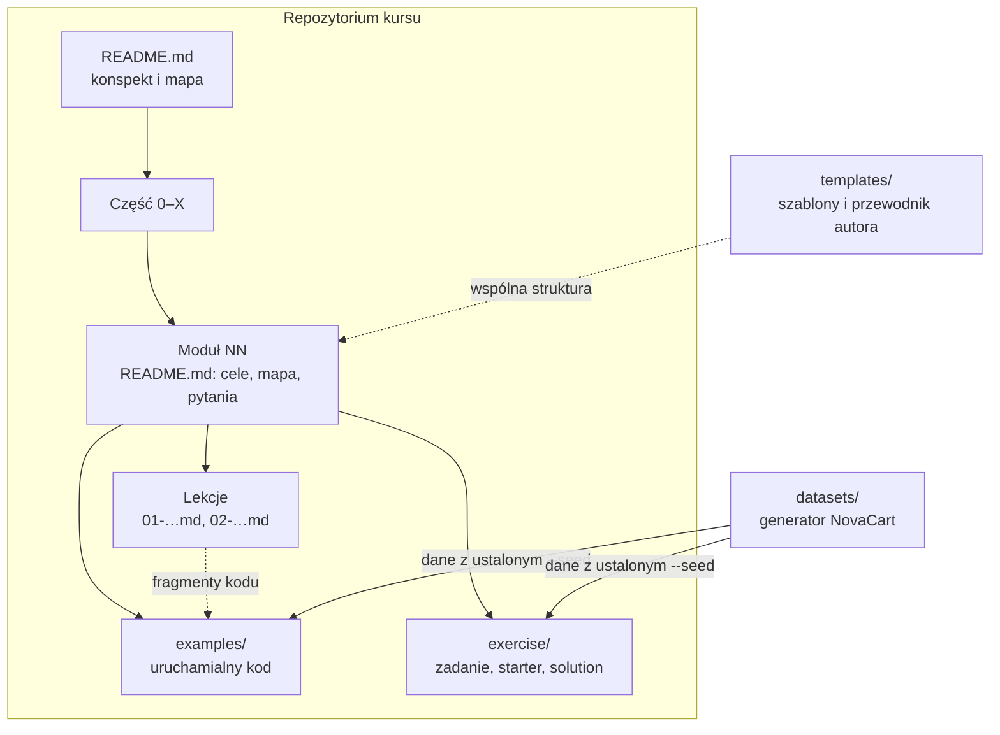
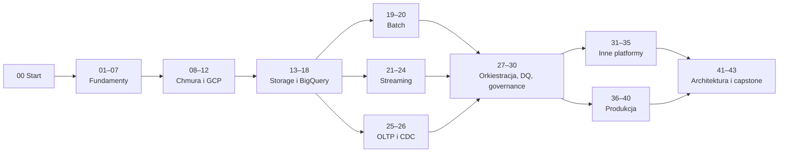
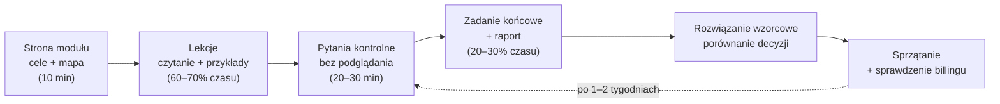

# 00.01 — Jak korzystać z kursu

> **Czas:** ~40 min · **Wymaga:** — · **Ostatnia weryfikacja:** 2026-11-07

**W tej lekcji:**

- poznasz budowę kursu: części, moduły, lekcje, przykłady i zadania, oraz zależności między nimi;
- zrozumiesz „drabinę głębokości”, według której napisana jest każda lekcja, i dowiesz się, jak z niej korzystać przy czytaniu;
- nauczysz się czytać oznaczenia i bloki wyróżnione, żeby szybko odróżnić intuicję, szczegół implementacyjny, pułapkę i ostrzeżenie o koszcie;
- zobaczysz, dlaczego dane w kursie są syntetyczne i deterministyczne, i sprawdzisz to samodzielnie;
- ułożysz rytm nauki, który pozwoli przejść 300+ godzin materiału bez wypalenia i bez niespodzianek na rachunku.

---

## 1. Problem

Wyobraź sobie, że właśnie dołączasz do zespołu platformy danych **NovaCart**, marketplace'u działającego w sześciu krajach Europy. W pierwszym tygodniu słyszysz na spotkaniach: „zapytanie skanuje cały `clickstream`, bo filtr nie trafia w partycję”, „sloty się skończyły o 9:00”, „Dataflow ma *watermark* opóźniony o godzinę”, „CDC z Postgresa gubi zmiany przy *failoverze*”. Znasz SQL i Pythona, budowałeś(-aś) pipeline'y, ale każde z tych zdań wymaga zrozumienia mechanizmu, a nie tylko nazwy usługi.

Kursy, które uczą „kliknij tu, uruchom to”, nie przygotowują na takie rozmowy. Kurs, który próbuje nauczyć mechanizmów, ma inny problem: jest długi. Ten ma ponad 40 modułów i około 300–350 godzin pracy. Wiadomo, jak kończą się takie przedsięwzięcia, jeśli brakuje planu:

- uczestnik czyta lekcje jak powieść, nie uruchamia przykładów i po miesiącu nie pamięta prawie nic;
- przeskakuje „nudne” fundamenty (moduły 01–07) i w module o BigQuery nie rozumie, skąd biorą się koszty *shuffle'u*;
- zagląda do rozwiązania zadania po dziesięciu minutach i traci najcenniejszą część nauki, czyli własne błędne podejścia;
- zostawia w chmurze klaster albo zbiór danych, a pierwszy rachunek ucina motywację szybciej niż trudny materiał.

Ta lekcja nie uczy jeszcze inżynierii danych. Daje Ci mapę, legendę do niej i plan podróży.

## 2. Intuicja

> [!TIP]
> **Intuicja.** Ten kurs przypomina naukę mechaniki samochodowej, a nie kurs prawa jazdy. Kierowca wie, że trzeba wcisnąć sprzęgło. Mechanik wie, *dlaczego*, i potrafi zdiagnozować, co się stanie, gdy sprzęgło się ślizga. Każda lekcja prowadzi od objawu („auto szarpie”) przez model działania („tarcza cierna, docisk, koło zamachowe”) do praktycznych wniosków („nie trzymaj nogi na sprzęgle w korku”).

Analogia ma granice. Samochód z 2010 roku działa prawie tak samo jak ten z 2025, a usługi chmurowe zmieniają się co kwartał: nazwy, limity, ceny, domyślne ustawienia. Dlatego kurs mocno oddziela **mechanizmy** (te są trwałe: kolumnowy format pliku, *shuffle*, *quorum*, *watermark*) od **konfiguracji konkretnej usługi** (ta jest ulotna i zawsze ma datę weryfikacji). Ucząc się, inwestuj głównie w mechanizmy. Konfigurację zawsze możesz doczytać w dokumentacji, a mechanizmu w dokumentacji zwykle nie znajdziesz.

## 3. Koncepcja

### 3.1. Pojęcia

| Pojęcie | Znaczenie |
|---|---|
| Część | Grupa modułów o wspólnym temacie, np. „Część III — Storage i hurtownia danych w GCP”. Kurs ma 11 części (0–X). |
| Moduł | Zamknięta jednostka nauki na 3–10 godzin. Ma cele, lekcje, przykłady, pytania kontrolne i zadanie końcowe. |
| Lekcja | Jeden spójny temat na 30–90 minut lektury, napisany według drabiny głębokości. |
| Przykład | Uruchamialny plik w `examples/` modułu. Fragmenty kodu w lekcjach zawsze pochodzą z tych plików. |
| Zadanie końcowe | Realistyczne zadanie z kontekstem biznesowym NovaCart, mierzalnymi kryteriami akceptacji, kosztem i sprzątaniem. |
| Rozwiązanie wzorcowe | Omówienie decyzji, alternatyw i typowych błędów w `exercise/solution/`. Czytasz je po własnej próbie. |
| Ścieżka nauki | Podzbiór modułów dopasowany do celu (np. streaming, analytics engineering, certyfikacja). |
| Drabina głębokości | Stała kolejność omawiania tematu: problem → intuicja → model → pod maską → konsekwencje → praktyka. |
| *Seed* (ziarno losowości) | Liczba, od której generator danych zaczyna losowanie. Ten sam *seed* daje identyczne dane. |

### 3.2. Jak zbudowany jest kurs — widok z lotu ptaka



*Rysunek 1.1. Każdy moduł ma tę samą budowę, a przykłady i zadania korzystają z jednego, wspólnego generatora danych.*

Zacznij od strony modułu (`README.md` w jego katalogu). Znajdziesz tam cele, czyli listę umiejętności, które będą sprawdzane, mapę lekcji z czasem i najważniejszymi pojęciami oraz zbiorcze porównanie platform. Potem czytasz lekcje po kolei. Przykłady uruchamiasz w trakcie lektury, nie po niej. Na końcu przychodzą pytania kontrolne i zadanie.

Fizycznie wygląda to tak:

```text
modules/14-bigquery-architektura/
├── README.md                    # strona modułu: cele, mapa lekcji, pytania kontrolne
├── 01-dremel-i-drzewo-wykonania.md
├── 02-…md
├── examples/
│   ├── README.md                # indeks przykładów + sprzątanie
│   ├── pyproject.toml           # zależności przykładów (uv)
│   └── 01_…sql / 02_…py
└── exercise/
    ├── README.md                # treść zadania, kryteria akceptacji, ocena
    ├── starter/                 # kod startowy z TODO(zadanie)
    └── solution/                # rozwiązanie wzorcowe z omówieniem decyzji
```

### 3.3. Anatomia lekcji

Każda lekcja ma te same sekcje. Gdy któraś nie pasuje do tematu, lekcja to mówi i wyjaśnia dlaczego. Tak jest i w tej lekcji: sekcję porównania platform zastępuje opis tego, jak kurs porównuje platformy.

| Sekcja | Szczebel drabiny | Czego szukać | Jak czytać |
|---|---|---|---|
| 1. Problem | Problem | Scenariusz NovaCart, objaw, liczby | Zanim przeczytasz dalej, zastanów się, jak sam(a) byś to rozwiązał(a) |
| 2. Intuicja | Intuicja | Analogia i jej granice | Zapamiętaj obraz, ale przeczytaj, gdzie przestaje działać |
| 3. Koncepcja | Model | Pojęcia, diagram architektury | Po przeczytaniu narysuj diagram z pamięci |
| 4. 🔍 Pod maską | Pod maską | Struktury danych, algorytmy, przepływ krok po kroku | Czytaj wolno, z kartką; to najcenniejsza część kursu |
| bloki „Co z tego wynika w praktyce” | Konsekwencje | Reguły projektowe | Przepisz je do własnych notatek |
| 5. 💻 W praktyce | Praktyka | Kod z `examples/`, pomiar przed i po | Uruchom, zmień parametr, zmierz ponownie |
| 6. ⚖️ Porównanie | — | Jak inne platformy rozwiązują ten sam problem | Szukaj różnic architektonicznych, nie nazw usług |
| 7. ⚠️ Antywzorce | Konsekwencje | Objaw → przyczyna → naprawa | Przydatne jako lista kontrolna przy code review |
| 8. 💰 Koszty | Konsekwencje | Model kosztowy, przykładowe wyliczenie | Policz na własnych liczbach |
| 🧠 Sprawdź się | — | Pytania z ukrytymi odpowiedziami | Odpowiedz na głos lub na piśmie, zanim rozwiniesz odpowiedź |
| 📚 Źródła | — | Dokumentacja z datą dostępu, papers | Źródło rozstrzyga spory |

### 3.4. Bloki wyróżnione i oznaczenia

Kurs używa pięciu typów bloków. Każdy ma **stałe znaczenie**, więc po kilku lekcjach rozpoznasz je kątem oka.

> [!TIP]
> **Intuicja.** Analogia lub uproszczony model myślowy. Dobry punkt zaczepienia, ale nie zastępuje modelu.

> [!NOTE]
> **Pod maską — dla dociekliwych.** Dygresja techniczna: szczegół z publikacji, historia decyzji projektowej. Możesz ją pominąć bez utraty wątku i wrócić przy powtórce.

> [!IMPORTANT]
> **Kluczowy wniosek.** Jedna rzecz, którą trzeba zapamiętać z sekcji. W lekcji jest ich mało, i to celowo.

> [!WARNING]
> **Pułapka.** Typowy błąd, jego objaw i sposób uniknięcia.

> [!CAUTION]
> **Koszt!** Operacja, która może wygenerować istotny rachunek albo jest nieodwracalna. Zatrzymaj się i przeczytaj dwa razy.

Oprócz bloków w tekście pojawiają się emoji sekcji:

| Oznaczenie | Znaczenie |
|---|---|
| 🎯 | Cele modułu |
| 📋 | Co przygotować przed modułem |
| 🔍 | Pod maską |
| ⚖️ | Porównanie platform |
| 💻 | Kod |
| ⚠️ | Antywzorzec / pułapka |
| 💰 | Koszty |
| 🧠 | Pytania kontrolne |
| 🧪 | Zadanie końcowe |
| 📚 | Lektura i źródła |
| ★☆☆ / ★★☆ / ★★★ | Trudność pytania: przypomnienie / zastosowanie / projekt i kompromisy |
| **(Preview)** | Funkcja usługi w fazie *preview* (podgląd): może się zmienić, zwykle bez SLA |

### 3.5. Konwencje w tekście i kodzie

- **Terminy angielskie** zostają po angielsku tam, gdzie tak mówi branża. Przy pierwszym użyciu w lekcji są pisane kursywą i wyjaśnione, np. *partition pruning* (pomijanie partycji, które nie mogą zawierać wyników). Później piszemy je już zwykłym tekstem.
- **Nazwy usług, poleceń i parametrów** zapisujemy tak jak w dokumentacji: `BigQuery`, `gcloud`, `maximum_bytes_billed`.
- **SQL** jest w dialekcie GoogleSQL (BigQuery), chyba że blok mówi inaczej (`-- duckdb`, `-- snowflake`). Słowa kluczowe piszemy wielkimi literami.
- **Python** 3.12+, typowanie, formatowanie `ruff`. Każdy katalog `examples/` ma własny `pyproject.toml`, więc uruchamiasz kod przez `uv run`.
- **Terraform** ma przypięte wersje providerów i etykiety na każdym zasobie.
- **Etykiety zasobów:** każdy zasób w chmurze tworzony w kursie ma etykiety `course=ade` i `module=NN`. Dzięki nim posprzątasz po module jednym poleceniem i zobaczysz jego koszt w raportach billingu (lekcja [00.03](03-bezpieczenstwo-kosztowe.md)).
- **Nazewnictwo zasobów:** `novacart-<env>-<domena>-<zasób>`, np. `novacart-dev-sales-raw`.
- **Liczby** w tekście zapisujemy po polsku (`1,5 GB`, `10 000`), w kodzie tak, jak wymaga składnia.
- **Jednostki:** gdy różnica ma znaczenie, odróżniamy jednostki dziesiętne (GB = 10⁹ B) od binarnych (GiB = 2³⁰ B). BigQuery rozlicza zapytania w TiB, czyli w 2⁴⁰ B, a to prawie 10% więcej niż TB.

### 3.6. Ścieżki nauki i zależności

Kurs najlepiej przechodzić po kolei. Moduły 00–07 są wspólne dla wszystkich ścieżek, bo budują język, którego używają pozostałe. Zależności między modułami są podane w tabeli w głównym [README](../../README.md#lista-modułów). Uproszczona mapa:



*Rysunek 1.2. Fundamenty są wspólne. Za nimi ścieżki się rozchodzą, a w części X znowu spotykają.*

Jeśli masz konkretny cel, wybierz ścieżkę z tabeli w README (np. „⚡ Streaming Specialist”). Nie pomijaj jednak modułu 02 (systemy rozproszone). Wraca w niemal każdym kolejnym module.

## 4. 🔍 Pod maską

W tej lekcji „pod maską” oznacza: **jak zbudowany jest sam kurs i dlaczego tak**. Te decyzje wpływają na to, jak warto się uczyć.

### 4.1. Dlaczego dane są syntetyczne i deterministyczne

Wszystkie przykłady i zadania korzystają z danych fikcyjnej firmy NovaCart, generowanych przez pakiet w katalogu [`datasets/`](../../datasets/README.md). Na tym wyborze opiera się cały kurs:

1. **Prawdziwe dane firmowe odpadają.** Zawierają dane osobowe i tajemnice handlowe, nie wolno ich publikować. Publiczne zbiory (np. `bigquery-public-data`) są dobre do ćwiczeń z SQL, ale nie mają cech, które sprawiają kłopot w produkcji: spóźnionych zdarzeń, duplikatów, zmiany schematu bez zapowiedzi, plików w Windows-1250, skośnego rozkładu kluczy.
2. **Generator jest „brudny” w kontrolowany sposób.** Każdy problem z danymi ma parametr (np. `--duplicate-rate 0.01`), opis i zapis w `_manifest.json`. Możesz więc najpierw wykryć problem samodzielnie, a potem sprawdzić, czy znalazłeś(-aś) wszystko.
3. **Wynik jest deterministyczny.** Ten sam `--seed` i te same parametry dają pliki identyczne **bajt w bajt**, niezależnie od liczby procesów generatora. Dzięki temu zadanie może mieć kryterium akceptacji typu „tabela `orders` w skali S ma dokładnie 24 506 wierszy”, a Ty możesz porównać wynik z innymi uczestnikami.

Jak osiągnąć determinizm przy generowaniu równoległym? Naiwne podejście, czyli jeden generator liczb losowych przechodzący przez dane po kolei, przestaje działać, gdy dni generuje kilka procesów naraz, bo kolejność losowań zależy wtedy od tego, który proces był szybszy. Generator NovaCart tworzy więc **osobny strumień losowości dla każdej jednostki pracy**, wyprowadzony z *seeda*, numeru strumienia i klucza (np. dnia):

```text
seed=42 ──┬── strumień ORDERS,      dzień 2025-11-28 ──► zawsze te same zamówienia z Black Friday
          ├── strumień CLICKSTREAM, dzień 2025-11-28 ──► zawsze te same sesje
          └── strumień CUSTOMERS                     ──► zawsze ci sami klienci

proces 1: dni 1–20    proces 2: dni 21–40    proces 3: dni 41–61
   │                      │                      │
   └─ każdy dzień liczony z własnego strumienia, więc kolejność wykonania nie ma znaczenia
```

To ten sam pomysł, który zobaczysz później w systemach rozproszonych: jeśli wynik zadania zależy wyłącznie od jego wejścia (a nie od kolejności, czasu czy stanu innych węzłów), zadanie można bezpiecznie powtórzyć albo rozdzielić między maszyny. Spark ponownie oblicza utracone partycje z ich *lineage* (zapisu, z czego i jak powstały), a Dataflow ponawia nieudane pakiety pracy (*bundles*). Oba mechanizmy wymagają, żeby przetwarzanie było deterministyczne albo idempotentne (moduły 02, 19, 23).

> [!IMPORTANT]
> **Co z tego wynika w praktyce:** generuj dane zawsze z parametrami podanymi w zadaniu (szczególnie `--scale` i `--seed`). Wtedy Twoje liczby da się porównać z kryteriami akceptacji i z rozwiązaniem wzorcowym. Gdy wynik się nie zgadza, pierwsze podejrzenie to inne parametry generatora, a nie błąd w Twoim zapytaniu.

### 4.2. Dlaczego każda lekcja idzie po drabinie głębokości

Kolejność problem → intuicja → model → pod maską → konsekwencje → praktyka nie jest przypadkowa. Wynika z tego, jak ludzie uczą się złożonych systemów:

- **Problem przed rozwiązaniem.** Mechanizm, który rozwiązuje znany Ci ból, zapamiętujesz znacznie lepiej niż mechanizm podany „na sucho”. Dlatego każda lekcja zaczyna się od objawu w NovaCart, najlepiej z liczbami.
- **Intuicja przed szczegółami.** Szczegół potrzebuje „haczyka”, na którym się zawiesi. Analogia daje taki haczyk, a akapit o jej granicach chroni przed błędnymi uogólnieniami.
- **Pod maską, a zaraz potem konsekwencje.** Wiedza o tym, że BigQuery przechowuje dane kolumnowo w formacie Capacitor, to ciekawostka. Wiedza, że *z tego powodu* `SELECT *` kosztuje proporcjonalnie do wszystkich kolumn, a `LIMIT 10` nie zmniejsza rachunku, to umiejętność. Dlatego po każdej podsekcji „pod maską” jest obowiązkowy blok „Co z tego wynika w praktyce”.
- **Praktyka z pomiarem.** Przykłady pokazują zwykle wersję „przed” i „po” z liczbami (bajty, czas, koszt). Pomiar zamienia teorię w przekonanie, a przekonanie zostaje w głowie dłużej niż zdanie z podręcznika.

Sekcje „Pod maską” zawierają dwa rodzaje twierdzeń i kurs zawsze je rozróżnia:

| Rodzaj | Przykład sformułowania | Skąd pochodzi |
|---|---|---|
| Fakt | „Według papera *Dremel* (VLDB 2010)…”, „Dokumentacja podaje…” | Publikacja, specyfikacja, oficjalna dokumentacja (link w Źródłach) |
| Wniosek | „Z tego wynika…”, „Można przypuszczać, że…” | Rozumowanie autora na podstawie faktów lub pomiarów |

To ważne, bo dostawcy chmur publikują tylko część informacji o wnętrzu usług. O Dremelu wiemy sporo z publikacji Google, ale szczegóły dzisiejszej implementacji BigQuery są niejawne. Gdy kurs pisze „można przypuszczać”, traktuj to jako hipotezę zgodną z obserwacjami, a nie gwarancję.

> [!NOTE]
> **Pod maską — dla dociekliwych.** Kurs często odsyła do publikacji naukowych (lista w Dodatku B). Do czytania papers przydaje się metoda „trzech przejść” S. Keshava. Pierwsze przejście to 5–10 minut na tytuł, abstrakt, wstęp, nagłówki i wnioski; potem wiesz, *o czym* jest tekst. Drugie to około godziny na całość z pominięciem dowodów; potem potrafisz streścić główne idee. Trzecie to dokładna rekonstrukcja, potrzebna tylko wtedy, gdy chcesz paper naprawdę zrozumieć lub go podważyć. W kursie zwykle wystarczy drugie przejście.

> [!IMPORTANT]
> **Co z tego wynika w praktyce:** czytając sekcję „pod maską”, po każdej podsekcji zamknij tekst i zapisz własnymi słowami regułę praktyczną. Potem porównaj ją z blokiem „Co z tego wynika w praktyce”. Jeśli się różnią, wróć do mechanizmu: albo coś pominąłeś(-aś), albo znalazłeś(-aś) wniosek, którego w tekście brakuje (zgłoś go!).

### 4.3. Jak działają zadania końcowe i ich ocena

Zadanie końcowe nie jest testem pamięci, tylko symulacją pracy. Ma stałą budowę:

```text
exercise/
├── README.md       # kontekst biznesowy → cel → dane (z --seed) → wymagania → kryteria akceptacji
│                   # → rezultaty → podpowiedzi (stopniowane) → ocena → rozszerzenia → sprzątanie
├── starter/        # boilerplate + miejsca TODO(zadanie); sprawdzenia na starcie NIE przechodzą
└── solution/       # rozwiązanie wzorcowe: decyzje, odrzucone alternatywy, pomiary, typowe błędy
```

Kilka zasad wynika z tej budowy:

1. **Kryteria akceptacji są mierzalne.** Nie „zrób wydajnie”, tylko „zapytanie przetwarza mniej niż 2 GB (dry run)”. Odhaczasz je samodzielnie. Jeśli któregoś nie da się zmierzyć, to błąd w zadaniu (zgłoś go).
2. **Podpowiedzi są stopniowane.** Pierwsza wskazuje kierunek, druga narzędzie, trzecia prawie zdradza rozwiązanie. Otwieraj je po kolei i dopiero wtedy, gdy przez 20–30 minut stoisz w miejscu.
3. **Ocena ma wagi.** Poprawność to 30%, jakość decyzji 25%, wydajność i koszt 20%, kod i IaC 15%, raport 10%. Działający kod daje więc mniej niż połowę punktów. Reszta to uzasadnienie, pomiar i komunikacja, czyli to, czego oczekuje się od seniora.
4. **Raport jest częścią rezultatu.** Szablon: podsumowanie → architektura → decyzje i alternatywy → pomiary → ograniczenia. Ten sam format przyda Ci się w pracy przy *design docs* i ADR (*Architecture Decision Record*, moduł 01).
5. **Rozwiązanie wzorcowe czytasz po swojej próbie.** Nawet nieudana próba jest cenna, bo rozwiązanie czytane po zmaganiach z problemem zapamiętujesz zupełnie inaczej niż czytane zamiast nich.

> [!IMPORTANT]
> **Co z tego wynika w praktyce:** zarezerwuj na zadanie tyle czasu, ile podaje jego nagłówek, i zacznij od raportu: zapisz, jak zamierzasz zmierzyć sukces. Zadanie bez pomiaru i raportu jest zrobione w połowie, nawet jeśli kod działa.

### 4.4. Dlaczego każda lekcja ma datę weryfikacji

Usługi chmurowe zmieniają się szybciej niż jakakolwiek książka. W ciągu roku potrafią się zmienić:

- **ceny i model rozliczeń** (np. w 2023 r. BigQuery zastąpił model flat-rate edycjami);
- **limity i wartości domyślne** (np. domyślny okres *soft delete*, czyli przechowywania usuniętych obiektów, w Cloud Storage);
- **programy darmowe** (np. w lipcu 2025 r. AWS zastąpił dla nowych kont 12-miesięczny Free Tier kredytami i planem darmowym na 6 miesięcy, więcej w lekcji [00.06](06-konta-innych-platform.md));
- **nazwy usług** (np. Vertex AI pojawia się w dokumentacji Google pod nową nazwą *Gemini Enterprise Agent Platform*);
- **adresy dokumentacji** (dokumentacja Google Cloud przeszła z `cloud.google.com/...` na `docs.cloud.google.com/...`, a stare linki przekierowują).

Dlatego każda lekcja ma w nagłówku pole **„Ostatnia weryfikacja”**, a każde twierdzenie o cenie, limicie lub zachowaniu usługi ma w sekcji „Źródła” link do dokumentacji z datą dostępu. Ceny podajemy jako rząd wielkości („około 6,25 USD za TiB w modelu on-demand, stan na …”), nigdy jako stałą prawdę.

> [!IMPORTANT]
> **Co z tego wynika w praktyce:** gdy liczba w lekcji różni się od dokumentacji, **rozstrzyga dokumentacja**. Mechanizm opisany w lekcji zwykle pozostaje aktualny, a zmienia się konfiguracja. Przed zadaniem, które coś kosztuje, zawsze sprawdź aktualny cennik.

## 5. 💻 W praktyce

### 5.1. Sprawdź determinizm generatora

Przygotowanie środowiska omawiają lekcje [00.04](04-narzedzia-lokalne.md) i [00.07](07-generator-danych-novacart.md). Jeśli masz już `uv`, możesz od razu zobaczyć determinizm w działaniu. Wygeneruj najmniejszą skalę trzy razy: dwa razy z tym samym *seedem*, ale inną liczbą procesów, i raz z innym *seedem*. Potem porównaj skróty (*hash*) wszystkich plików:

```bash
cd datasets
uv sync
uv run novacart generate --scale xs --seed 42 --workers 1 -o ../data/det-a
uv run novacart generate --scale xs --seed 42 --workers 4 -o ../data/det-b
uv run novacart generate --scale xs --seed 7              -o ../data/det-c

# skrót ze skrótów wszystkich plików (bez manifestu, który zawiera m.in. liczbę procesów)
for d in det-a det-b det-c; do
  (cd ../data/$d && find . -type f -not -name _manifest.json | sort \
     | xargs shasum -a 256 | shasum -a 256 | cut -c1-16)
done
```

**Wynik** (skala XS, generator v0.1.0):

```text
c8f43eb72a85051a
c8f43eb72a85051a
ab53d84f33e296b8
```

Pierwsze dwa skróty są identyczne, mimo że dane liczył jeden proces, a potem cztery. Inny *seed* daje inne dane. Po eksperymencie usuń katalogi: `rm -rf ../data/det-*`.

### 5.2. Ułóż rytm nauki

Kurs ma około 300–350 godzin. Kilka wariantów tempa:

| Tempo | Godziny tygodniowo | Czas przejścia całości | Dla kogo |
|---|---|---|---|
| Spokojne | 5 h | ~15–16 miesięcy | Nauka obok pełnego etatu i życia |
| Regularne | 8 h | ~9–10 miesięcy | Wieczór w tygodniu + pół weekendu |
| Intensywne | 15 h | ~5 miesięcy | Przygotowanie do zmiany roli lub certyfikacji |
| Ścieżka | zależnie od wyboru | 100–180 h | Konkretny cel (np. streaming) |

Sprawdzony rytm pracy z jednym modułem:



*Rysunek 1.3. Powrót do pytań kontrolnych po tygodniu lub dwóch to najtańszy sposób utrwalenia wiedzy.*

Kilka praktycznych rad:

- **Prowadź dziennik nauki** (zwykły plik Markdown w prywatnym repozytorium): data, moduł, trzy najważniejsze wnioski, pytania otwarte, koszt w chmurze. Po kilku miesiącach to najlepsza ściągawka, jaką będziesz mieć.
- **Uruchamiaj przykłady w trakcie lektury.** Zmień jeden parametr i przewidź wynik *przed* uruchomieniem. Pomyłka w przewidywaniu oznacza, że właśnie czegoś się uczysz.
- **Odpowiadaj na pytania kontrolne pisemnie albo na głos**, zanim rozwiniesz odpowiedź. Rozpoznanie odpowiedzi to nie to samo co jej przypomnienie.
- **Sprzątaj po każdej sesji, nie po każdym module.** Zostawienie zasobów „do jutra” to najczęstsza przyczyna niespodziewanych kosztów.

### 5.3. Jak zgłaszać błędy i propozycje

Kurs na pewno zawiera błędy: literówki, nieaktualne limity, nieprecyzyjne uproszczenia, niedziałające linki. Dobre zgłoszenie (*issue* w repozytorium) zawiera:

```markdown
**Miejsce:** modules/15-bigquery-storage/02-partycjonowanie.md, sekcja 4.2
**Rodzaj:** nieaktualny fakt | błąd merytoryczny | błąd w kodzie | niejasność | propozycja
**Obserwacja:** Lekcja podaje limit X partycji na tabelę.
**Oczekiwane:** Dokumentacja podaje Y (link, data dostępu).
**Jak odtworzyć (dla kodu):** polecenie, wersje narzędzi, skala danych i seed, pełny komunikat błędu.
```

Zgłoszenie z linkiem do źródła i datą da się zweryfikować w kilka minut. „Coś nie działa w module 15” wymaga kilku rund pytań.

## 6. ⚖️ Jak kurs porównuje platformy

W tej lekcji nie ma klasycznej tabeli porównawczej, bo nie omawia ona żadnego mechanizmu technicznego. Zamiast tego wyjaśnia, **jak** porównania działają w całym kursie.

Kurs jest *GCP-first*, ale nie *GCP-only*. GCP jest platformą, na której robisz zadania. Pozostałe platformy pełnią rolę punktu odniesienia:

| Platforma | Rola w kursie | Gdzie szczególnie | Dostęp (lekcja 00.06) |
|---|---|---|---|
| GCP | Platforma główna, wszystkie zadania | Cały kurs | Konto z free trial / własny billing |
| AWS | Porównania w lekcjach; moduł 33 przekłada wiedzę z GCP na AWS | 13–17, 22, 33 | Free plan z kredytami |
| Azure | Jak AWS; dodatkowo Microsoft Fabric jako platforma zintegrowana | 13–17, 33 | Konto darmowe z kredytem |
| Snowflake | Główny konkurent BigQuery; inny model compute | 14–16, 31 | Trial 30 dni |
| Databricks | Lakehouse, Spark, Delta Lake, Unity Catalog | 05, 19–20, 32 | Free Edition |
| On-prem / OSS | Punkt odniesienia: Hadoop, Spark, Kafka, Trino, PostgreSQL, ClickHouse | 01, 19, 22, 34–35 | Lokalnie (Docker) |

Każda tabela porównawcza w kursie ma stałe kolumny (GCP | AWS | Azure | Snowflake | Databricks | On-prem/OSS) i odpowiada na pytanie **„jak ten sam problem rozwiązuje inna platforma i dlaczego inaczej?”**. Lista „BigQuery = Redshift = Synapse” nie jest porównaniem, bo te systemy mają różne architektury, modele kosztowe i ograniczenia. Pod każdą tabelą znajdziesz wnioski, które oddzielają różnice **fundamentalne** (architektura, np. czy moc obliczeniowa jest współdzielona, czy przydzielona na wyłączność) od **kosmetycznych** (nazewnictwo, konsola).

**Wnioski:** porównania nie służą do wyłonienia „najlepszej” platformy. Ich zadanie to pokazać, które cechy wynikają z fizyki (sieć, dysk, koordynacja), a które z decyzji biznesowych dostawcy. Gdy to rozróżniasz, szybciej uczysz się kolejnych platform i lepiej argumentujesz przy wyborze.

## 7. ⚠️ Antywzorce i pułapki

| Antywzorzec | Objaw | Dlaczego tak się dzieje | Jak naprawić |
|---|---|---|---|
| Czytanie bez uruchamiania | Po tygodniu nie pamiętasz, co robi `maximum_bytes_billed` | Pamięć bierna (rozpoznanie) jest znacznie słabsza od czynnej (przypomnienie) | Uruchamiaj przykłady w trakcie lektury, przewiduj wynik przed uruchomieniem |
| Pomijanie fundamentów | Moduły o BigQuery i Sparku wydają się zbiorem „magicznych” reguł | Reguły wynikają z mechanizmów z modułów 02–06 | Przejdź 01–07, nawet jeśli znasz narzędzia |
| Szybkie zaglądanie do rozwiązania | Zadanie „zrobione” w godzinę, wiedza nie zostaje | Bez własnej próby nie ma błędów, z których można się uczyć | Najpierw pełna próba i raport, potem podpowiedzi po kolei, rozwiązanie na końcu |
| Uczenie się nazw usług | Umiesz wymienić 30 usług, nie potrafisz wybrać między dwiema | Nazwy się zmieniają, kompromisy zostają | Przy każdej usłudze zapisz: jaki problem rozwiązuje, jaki kompromis wybiera, za co płacisz |
| Inne parametry generatora | Liczby nie zgadzają się z kryteriami akceptacji | Inny `--scale`, `--seed` albo komponenty | Kopiuj polecenie generatora z treści zadania; sprawdź `_manifest.json` |
| Sprzątanie „na koniec modułu” | Rachunek za zasoby, o których zapomniałeś(-aś) | Moduł trwa tydzień, a zasoby kosztują co godzinę | Sprzątaj po każdej sesji; korzystaj z etykiet i `examples/99_cleanup.sh` |
| Ufanie liczbom z lekcji bardziej niż dokumentacji | Zaskoczenie limitem lub ceną | Usługi się zmieniają | Data weryfikacji w nagłówku; przy rozbieżności rozstrzyga dokumentacja |

> [!WARNING]
> **Pułapka.** Najdroższy błąd początkujących nie wynika z trudnego materiału. Wynika z zasobu, który działa w tle, gdy nikt na niego nie patrzy: klastra Dataproc, środowiska Composer, joba Dataflow w trybie streaming, instancji Cloud SQL. Dlatego lekcję [00.03](03-bezpieczenstwo-kosztowe.md) trzeba przerobić **przed** uruchomieniem czegokolwiek w chmurze.

## 8. 💰 Koszty

Kurs zaprojektowano tak, żeby większość zadań mieściła się w darmowych limitach (BigQuery: 1 TiB zapytań i 10 GiB storage miesięcznie) i kredytach próbnych, **pod warunkiem rygorystycznego sprzątania**. Rząd wielkości kosztów:

| Rodzaj modułów | Przykłady | Typowy koszt zadania |
|---|---|---|
| Lokalne / teoretyczne | 01–07 (DuckDB, Python) | 0 |
| Storage i BigQuery w małej skali | 00, 13–18 (skale S–M) | zwykle 0 (mieści się w Free Tier), najwyżej kilka USD |
| Zasoby rozliczane za czas działania | Dataproc, Dataflow, Composer, Cloud SQL, Spanner, Bigtable (moduły 20, 23, 25–27) | od kilku do kilkudziesięciu USD; więcej, jeśli zasoby zostaną zostawione |
| Inne platformy | 31–33 | 0 w ramach triali, jeśli zmieścisz się w ich oknie czasowym |

Każde zadanie podaje szacowany koszt i polecenie sprzątające, a rozwiązanie wzorcowe podaje koszt faktyczny z datą pomiaru.

> [!CAUTION]
> **Koszt!** Budżet z alertem w GCP **nie zatrzymuje** wydatków. Tylko informuje, i to z kilkugodzinnym opóźnieniem. Zanim uruchomisz cokolwiek poza tym modułem, skonfiguruj bezpieczniki z lekcji [00.03](03-bezpieczenstwo-kosztowe.md).

## 9. Podsumowanie

- Kurs składa się z 11 części i ponad 40 modułów. Każdy moduł ma tę samą budowę: stronę z celami, lekcje, przykłady w `examples/` oraz zadanie z kodem startowym i rozwiązaniem.
- Każda lekcja prowadzi po drabinie głębokości: problem → intuicja → model → pod maską → konsekwencje → praktyka. Najcenniejsze są sekcje „Pod maską” i bloki „Co z tego wynika w praktyce”.
- Bloki wyróżnione mają stałe znaczenie: TIP to intuicja, NOTE to dygresja dla dociekliwych, IMPORTANT to kluczowy wniosek, WARNING to pułapka, a CAUTION to koszt albo operacja nieodwracalna.
- Dane NovaCart są syntetyczne, celowo „brudne” i deterministyczne. Ten sam `--seed` daje identyczne pliki niezależnie od liczby procesów, dlatego kryteria akceptacji mogą podawać dokładne liczby.
- Fakty o usługach mają datę weryfikacji i źródło, a przy rozbieżności rozstrzyga aktualna dokumentacja.
- Ocena zadania w ponad połowie zależy od decyzji, pomiarów i raportu, a nie od samego działającego kodu.
- Sprzątanie i bezpieczniki kosztowe to umiejętność inżynierska, a nie formalność.

## 🧠 Sprawdź się

<details>
<summary><b>Twoje zapytanie zwraca 24 391 zamówień, a kryterium akceptacji mówi o 24 506. Co sprawdzasz najpierw?</b></summary>

Parametry generatora: `--scale`, `--seed`, okres (`--days`, `--end-date`) i ewentualne nadpisania. Wszystkie są zapisane w `_manifest.json` w katalogu z danymi. Dane są deterministyczne, więc przy tych samych parametrach liczba wierszy musi się zgadzać co do sztuki. Dopiero gdy parametry są zgodne, szukasz błędu w zapytaniu (np. filtr na partycji, który gubi pierwszy lub ostatni dzień).

</details>

<details>
<summary><b>Czym różni się blok NOTE od bloku IMPORTANT i co zrobić z każdym z nich przy pierwszym czytaniu?</b></summary>

NOTE to dygresja dla dociekliwych: szczegół, który pogłębia zrozumienie, ale można go pominąć bez utraty wątku. Przy pierwszym czytaniu wolno go przeskoczyć. IMPORTANT to kluczowy wniosek sekcji, często reguła praktyczna wynikająca z mechanizmu („Co z tego wynika w praktyce”). Tego bloku nie pomijasz. Najlepiej przepisać go do notatek własnymi słowami.

</details>

<details>
<summary><b>Dlaczego generowanie danych przez jeden wspólny generator liczb losowych nie byłoby deterministyczne przy pracy równoległej?</b></summary>

Gdy kilka procesów pobiera kolejne liczby z jednego strumienia, to, która liczba trafi do którego dnia, zależy od kolejności, w jakiej procesy kończą pracę. Ta kolejność zależy od obciążenia maszyny i planisty systemu, więc zmienia się między uruchomieniami. Rozwiązaniem są niezależne strumienie wyprowadzone z `(seed, strumień, klucz)`: wynik dla danego dnia zależy wtedy tylko od tych wartości. Ta sama zasada (deterministyczne, niezależne jednostki pracy) pozwala Sparkowi i Dataflow bezpiecznie powtarzać zadania po awarii.

</details>

<details>
<summary><b>Lekcja podaje cenę 6,25 USD za TiB, a cennik Google pokazuje inną kwotę. Która liczba jest prawdziwa i co z tego wynika dla lekcji?</b></summary>

Prawdziwa jest liczba z aktualnego cennika. Lekcja podaje cenę jako rząd wielkości z datą weryfikacji w nagłówku. Mechanizm (rozliczanie za przetworzone bajty, minimalna opłata, wpływ wybranych kolumn) pozostaje aktualny, zmieniła się tylko stawka. Warto zgłosić rozbieżność z linkiem do cennika i datą dostępu.

</details>

<details>
<summary><b>Kolega proponuje: „Przeczytajmy najpierw wszystkie lekcje modułu, a przykłady i zadanie zrobimy w weekend”. Co odpowiesz?</b></summary>

Przykłady uruchamiane w trakcie lektury budują przekonanie poprzez pomiar i pozwalają sprawdzić własne przewidywania. Odłożone na później zamieniają się w mechaniczne przeklejanie. Lepszy rytm: lekcja → przykłady z tej lekcji (z przewidywaniem wyniku) → kolejna lekcja. Zadanie i pytania kontrolne na końcu. Jeśli przykłady tworzą zasoby w chmurze, sprzątasz je po każdej sesji, a nie w weekend.

</details>

## 📚 Źródła

1. Szablony i przewodnik autora kursu: [`templates/README.md`](../../templates/README.md).
2. Dokumentacja generatora NovaCart: [`datasets/README.md`](../../datasets/README.md).
3. S. Keshav, „How to Read a Paper”, *ACM SIGCOMM Computer Communication Review* 37(3), 2007.
4. AWS, [AWS Free Tier now offers $200 in credits and 6-month free plan](https://aws.amazon.com/about-aws/whats-new/2025/07/aws-free-tier-credits-month-free-plan/) (lipiec 2025).
5. Google Cloud, [Free cloud features and trial offer](https://docs.cloud.google.com/free/docs/free-cloud-features) — dostęp 2026-11-07.
6. Google Cloud, [Manage spend cap budgets](https://docs.cloud.google.com/billing/docs/how-to/budgets-spend-caps) (nazwa *Gemini Enterprise Agent Platform*, dawniej Vertex AI) — dostęp 2026-11-07.

---

<sub>[Moduł 00](README.md) · [Konto i projekt GCP](02-konto-i-projekt-gcp.md) →</sub>
