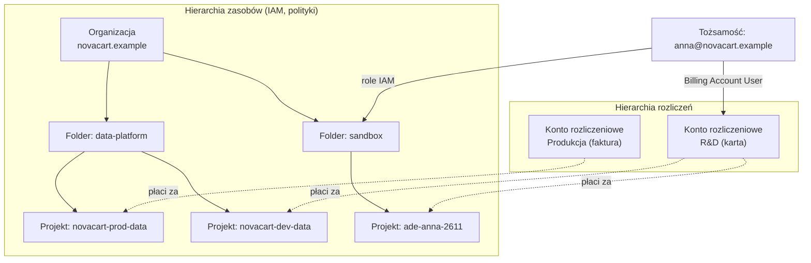
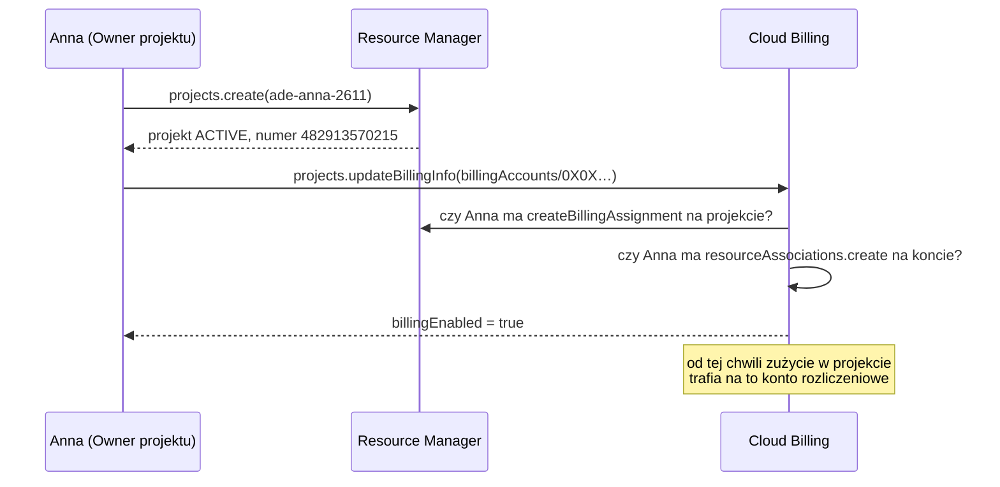

# 00.02 — Konto i projekt GCP

> **Czas:** ~60 min · **Wymaga:** [Lekcja 00.01](01-jak-korzystac-z-kursu.md) · **Ostatnia weryfikacja:** 2026-11-07

**W tej lekcji:**

- zrozumiesz trzy różne „konta” w Google Cloud: tożsamość, konto rozliczeniowe i projekt, oraz to, kto za co odpowiada;
- poznasz dwie niezależne hierarchie: zasobów (organizacja → foldery → projekty) i rozliczeń (konto rozliczeniowe → projekty);
- dowiesz się, czym różnią się *free trial*, *Free Tier* i *BigQuery Sandbox* i kiedy który wybrać;
- zobaczysz, co dzieje się „pod maską”, gdy tworzysz projekt, podpinasz billing i włączasz API, i dlaczego projekt ma aż trzy identyfikatory;
- założysz projekt kursu skryptem, który można bezpiecznie uruchomić wiele razy.

---

## 1. Problem

Anna, nowa data engineerka w NovaCart, dostaje zadanie: „przygotuj środowisko do eksperymentów z BigQuery”. Loguje się do konsoli Google Cloud prywatnym kontem Gmail, akceptuje *free trial* i zaczyna pracę w projekcie, który konsola utworzyła sama: `My First Project` o identyfikatorze `teak-mantis-412309`. Po trzech miesiącach:

- połowa zespołu ma podobne projekty o losowych nazwach i nikt nie wie, który do czego służy;
- *free trial* Anny wygasł po 90 dniach, billing został wyłączony, a tabele z eksperymentami i bucket z danymi przestały być dostępne; po 30 dniach karencji zostaną usunięte bezpowrotnie;
- kolega korzystał z *BigQuery Sandbox*, bo nie chciał podawać karty. Jego tabele znikały co 60 dni, a gdy próbował wykonać `MERGE`, dostawał błąd o nieobsługiwanym DML;
- dział finansów pyta, ile kosztowały eksperymenty z clickstreamem, ale koszty są rozsiane po kilku kontach rozliczeniowych bez etykiet.

Nic z tego nie jest skomplikowane technicznie. Wszystkie te problemy wynikają z niezrozumienia, jak Google Cloud łączy tożsamość, projekty i pieniądze. Ta lekcja to porządkuje.

## 2. Intuicja

> [!TIP]
> **Intuicja.** Pomyśl o firmie i jej finansach. **Organizacja** to firma, **foldery** to działy, a **projekty** to segregatory z dokumentami konkretnego przedsięwzięcia. Każdy segregator ma swoją listę osób z dostępem (IAM). **Konto rozliczeniowe** to firmowa karta płatnicza: segregator nie ma własnych pieniędzy, ale jest „podpięty” pod jedną kartę, która płaci za wszystko, co się w nim dzieje.

Ta analogia dobrze tłumaczy, dlaczego hierarchia folderów i rozliczeń to **dwie różne struktury**: dział marketingu może mieć segregatory opłacane z dwóch różnych kart, a jedna karta może płacić za segregatory z kilku działów. Analogia kuleje w jednym miejscu. Projekt to nie tylko „pojemnik na dokumenty”. Jest też granicą limitów (*quotas*), włączonych API, sieci i domyślnych ustawień. W prawdziwej firmie segregator nie decyduje o tym, ile razy dziennie można korzystać z ksero. W GCP projekt decyduje.

## 3. Koncepcja

### 3.1. Pojęcia

| Pojęcie | Znaczenie |
|---|---|
| Tożsamość (*principal*) | Kto wykonuje operację: konto Google (Gmail lub firmowe w Google Workspace / Cloud Identity), grupa, konto serwisowe (*service account*). Tożsamość sama w sobie nic nie kosztuje i nie przechowuje zasobów. |
| Organizacja (*organization*) | Korzeń hierarchii zasobów, powiązany z domeną firmy (np. `novacart.example`). Konto prywatne (Gmail) nie ma organizacji. |
| Folder | Węzeł pośredni hierarchii (np. `data-platform`, `sandbox`). Służy do grupowania projektów i dziedziczenia uprawnień i polityk. |
| Projekt (*project*) | Podstawowy pojemnik na zasoby. Ma trzy identyfikatory: nazwę, ID i numer (sekcja 4.3). |
| Konto rozliczeniowe (*Cloud Billing account*) | Obiekt, który płaci za zasoby w podpiętych projektach. Ma metodę płatności, walutę i własne uprawnienia. |
| *Free trial* (okres próbny) | 300 USD kredytu na 90 dni dla nowych klientów. Konto rozliczeniowe typu próbnego z dodatkowymi ograniczeniami. |
| *Free Tier* (darmowy poziom) | Miesięczne darmowe limity niektórych usług dla każdego konta rozliczeniowego, bez daty końca (np. BigQuery: 1 TiB zapytań i 10 GiB storage miesięcznie). |
| *BigQuery Sandbox* | Tryb BigQuery bez konta rozliczeniowego i bez karty, z twardymi ograniczeniami (sekcja 4.6). |
| API / usługa | Każda usługa (BigQuery, Cloud Storage, Pub/Sub…) ma API, które trzeba **włączyć w projekcie**, zanim się jej użyje. |
| *Quota* (limit) | Ograniczenie liczby lub ilości operacji (np. TiB zapytań dziennie), liczone zwykle per projekt, region albo użytkownik. |
| Region / multi-region | Lokalizacja zasobów, np. `europe-central2` (Warszawa) albo `EU` (multi-region obejmujący wiele regionów UE). |

### 3.2. Jak to działa — widok z lotu ptaka



*Rysunek 2.1. Zasoby i pieniądze to dwie osobne hierarchie. Projekt należy do jednego miejsca w hierarchii zasobów i jest w danym momencie podpięty do jednego konta rozliczeniowego, ale te dwie przynależności są od siebie niezależne.*

Przepływ jest taki:

1. **Tożsamość** (Anna) loguje się do Google Cloud.
2. Jeśli ma uprawnienia w organizacji (np. w folderze `sandbox`), może tam **utworzyć projekt**. Bez organizacji (prywatny Gmail) projekt powstaje „luzem”, bez rodzica.
3. Projekt bez konta rozliczeniowego może korzystać tylko z rzeczy darmowych, np. *BigQuery Sandbox*. Żeby utworzyć bucket, maszynę czy płatny zbiór BigQuery, trzeba **podpiąć konto rozliczeniowe**. Wymaga to uprawnień **zarówno na projekcie, jak i na koncie rozliczeniowym**.
4. W projekcie **włączasz API** usług, których potrzebujesz.
5. Tworzysz zasoby, a ich koszty trafiają na konto rozliczeniowe z informacją, z którego projektu pochodzą i jakie miały etykiety.

## 4. 🔍 Pod maską

### 4.1. Hierarchia zasobów i dziedziczenie uprawnień

Każdy zasób w Google Cloud (zbiór BigQuery, bucket, temat Pub/Sub) należy do dokładnie jednego projektu, a projekt ma co najwyżej jednego rodzica: folder albo organizację. Z tego drzewa wynikają dwie rzeczy:

**1. Dziedziczenie polityk uprawnień (*allow policies*).** Rola nadana na folderze obowiązuje we wszystkich projektach pod nim i we wszystkich ich zasobach. Efektywne uprawnienia to **suma** polityk z całej ścieżki od zasobu do organizacji:

```text
Organizacja       anna: roles/browser                     (widzi strukturę)
 └─ Folder sandbox anna: roles/editor                      (może prawie wszystko w sandboxie)
     └─ Projekt ade-anna-2611
         └─ Zbiór BigQuery novacart_raw   anna: roles/bigquery.dataViewer
                                         ─────────────────────────────────
             efektywnie na zbiorze:        browser ∪ editor ∪ dataViewer
```

Nadanie roli niżej **nie odbiera** uprawnień nadanych wyżej. Żeby czegoś zabronić, potrzebne są osobne mechanizmy: *deny policies* (polityki odmowy) albo *organization policies* (ograniczenia konfiguracji, np. „zasoby tylko w regionach UE”). Szczegóły omawia moduł 09.

**2. Dziedziczenie ograniczeń organizacyjnych.** Polityka organizacji `constraints/gcp.resourceLocations` ustawiona na folderze `data-platform` sprawi, że nikt nie utworzy w nim bucketu w `us-central1`, nawet z rolą `owner` na projekcie. NovaCart może w ten sposób wymusić lokalizację danych osobowych w UE (RODO).

> [!IMPORTANT]
> **Co z tego wynika w praktyce:** projekt jest najmniejszą „jednostką izolacji”, którą łatwo zarządzać: osobne uprawnienia, osobne limity, osobne koszty i łatwe sprzątanie przez usunięcie całości. Dla kursu załóż **osobny projekt** (np. `ade-<login>-<rrmm>`), a nie pracuj w projekcie firmowym ani w `My First Project`. W firmie poproś o projekt w folderze typu `sandbox` z politykami organizacji, a nie o rolę na projekcie produkcyjnym.

### 4.2. Dwie hierarchie: zasoby i pieniądze

Konto rozliczeniowe **nie jest** częścią hierarchii zasobów. To osobny obiekt z własnymi rolami:

| Rola | Gdzie się ją nadaje | Co pozwala |
|---|---|---|
| Billing Account Administrator | konto rozliczeniowe | zarządzać kontem, metodą płatności, budżetami, uprawnieniami |
| Billing Account User | konto rozliczeniowe | podpinać projekty do tego konta (płacić „tą kartą”) |
| Billing Account Viewer | konto rozliczeniowe | oglądać koszty i faktury |
| Project Billing Manager | projekt | podpinać i odpinać billing tego projektu |

Podpięcie projektu wymaga zgody „obu stron”: uprawnienia `resourcemanager.projects.createBillingAssignment` na projekcie (np. rola Owner albo Project Billing Manager) **i** `billing.resourceAssociations.create` na koncie rozliczeniowym (np. Billing Account User). Dzięki temu właściciel projektu nie może obciążyć dowolnego konta, a administrator billingu nie może „wepchnąć” kosztów do cudzego projektu.

Kilka konsekwencji tego modelu:

- **Projekt jest w danym momencie opłacany przez jedno konto**, ale można je zmienić. Koszty sprzed zmiany zostają na starym koncie.
- **Jedno konto rozliczeniowe może płacić za projekty z różnych organizacji**, a nawet za projekty bez organizacji.
- **Wyłączenie billingu w projekcie zatrzymuje wszystkie płatne usługi.** Dokumentacja ostrzega, że część zasobów może zostać usunięta bez możliwości odzyskania. To ważne przy „automatycznym bezpieczniku” z lekcji [00.03](03-bezpieczenstwo-kosztowe.md).
- **Free Tier liczy się per konto rozliczeniowe**, a nie per projekt. Dziesięć projektów na jednym koncie dzieli między siebie ten sam darmowy 1 TiB zapytań BigQuery miesięcznie.
- **Budżety ustawia się na koncie rozliczeniowym** (z filtrem na projekt), a nie w projekcie. Dlatego do budżetu potrzebujesz uprawnień na koncie rozliczeniowym, a w Terraform podajesz `billing_account`.



*Rysunek 2.2. Podpięcie billingu sprawdza uprawnienia po obu stronach.*

> [!IMPORTANT]
> **Co z tego wynika w praktyce:** gdy w firmie dostajesz projekt do nauki, ustal, **które konto rozliczeniowe za niego płaci** i kto jest jego administratorem. Ta osoba dostaje domyślnie alerty budżetowe i tylko ona (albo ktoś z rolą na koncie) utworzy dla Ciebie budżet. W prywatnym koncie jesteś administratorem sam(a), więc za budżet odpowiadasz Ty.

### 4.3. Trzy identyfikatory projektu

Projekt ma trzy identyfikatory, a każdy pełni inną funkcję:

| Identyfikator | Przykład | Kto nadaje | Zmienny? | Unikalność | Gdzie go spotkasz |
|---|---|---|---|---|---|
| Nazwa (*project name*) | `Advanced Data Engineering` | Ty | tak, w każdej chwili | nie musi być unikalna | tylko w konsoli; API jej nie używają |
| ID (*project ID*) | `ade-anna-2611` | Ty, przy tworzeniu | **nie** | globalnie, na zawsze (także po usunięciu) | `gcloud --project`, nazwy tabel `projekt.zbiór.tabela`, URL-e, Terraform |
| Numer (*project number*) | `482913570215` | Google | nie | globalnie | budżety, konta serwisowe usług, logi audytowe, część API |

Reguły dla **project ID**: 6–30 znaków, małe litery, cyfry i myślniki, zaczyna się literą, nie kończy myślnikiem i nie może zawierać zastrzeżonych słów (np. `google`). Identyfikator jest **globalnie unikalny i nie da się go użyć ponownie**, nawet po usunięciu projektu. Wybierając nazwę `novacart-prod`, rezerwujesz ją na zawsze.

Dlaczego aż dwa niezmienne identyfikatory? Numer to wewnętrzny klucz Google. Jest krótszy, nie niesie żadnej treści i pojawia się w miejscach, gdzie system musi wskazać projekt jednoznacznie i trwale. Najczęściej zobaczysz go w adresach **kont serwisowych usług** (*service agents*), czyli tożsamości, którymi usługi Google działają w Twoim imieniu:

```text
482913570215-compute@developer.gserviceaccount.com           # domyślne konto Compute Engine
service-482913570215@gs-project-accounts.iam.gserviceaccount.com  # agent Cloud Storage
service-482913570215@gcp-sa-pubsub.iam.gserviceaccount.com   # agent Pub/Sub
```

Gdy w module 11 będziesz nadawać kluczowi KMS uprawnienia dla agenta Cloud Storage, potrzebny będzie właśnie numer projektu. Podobnie filtr budżetu w Terraform przyjmuje projekty w postaci `projects/<NUMER>`, a nie `projects/<ID>` (zobaczysz to w lekcji 00.03).

> [!IMPORTANT]
> **Co z tego wynika w praktyce:** project ID wybieraj świadomie. Nie wpisuj do niego danych osobowych ani nazwy klienta, bo trafia do adresów URL, nazw tabel i logów, a dokumentacja wprost to odradza. Stosuj konwencję (np. `ade-<login>-<rrmm>` dla kursu, `novacart-<env>-<domena>` w firmie). Numer projektu sprawdzisz poleceniem `gcloud projects describe <ID> --format='value(projectNumber)'`.

### 4.4. Włączanie API i „kto płaci za wywołanie”

Nowy projekt nie może od razu korzystać z większości usług. Każdą trzeba włączyć (`gcloud services enable bigquery.googleapis.com`). Za tym prostym poleceniem stoi usługa **Service Usage**, która dla projektu:

1. zapisuje, że API jest włączone (konsumentem usługi jest projekt);
2. w razie potrzeby włącza **zależne API** (np. włączenie BigQuery pociąga za sobą m.in. API BigQuery Storage);
3. tworzy **agentów usługi** (*service agents*) i nadaje im role, żeby usługa mogła działać na zasobach projektu;
4. przydziela projektowi **limity** (*quotas*) tej usługi: dzienne, minutowe, regionalne.

Każde wywołanie API jest przypisane do jakiegoś projektu. Do tego projektu liczą się limity i na niego trafia rozliczenie. Ma to zaskakujące konsekwencje:

- **Zapytanie do cudzych danych płacisz Ty.** Gdy wykonujesz `SELECT` na `bigquery-public-data.samples.wikipedia`, zadanie (*job*) uruchamia się w **Twoim** projekcie. Bajty przetworzone przez zapytanie są rozliczane na Twoim koncie, a właściciel danych płaci tylko za ich przechowywanie. To dlatego przy publicznych zbiorach tak ważny jest *dry run*.
- **Biblioteki klienckie potrzebują „projektu do rozliczania limitów”** (*quota project*). Przy uwierzytelnieniu kontem użytkownika przez ADC (lekcja [00.04](04-narzedzia-lokalne.md)) niektóre API, np. Billing Budgets API, wymagają jawnego wskazania projektu, inaczej zwracają błąd 403. Stąd w Terraform ustawienia `billing_project` i `user_project_override` (lekcja 00.03).

```text
Zapytanie:  SELECT title FROM `bigquery-public-data.samples.wikipedia`
            uruchomione z:  --project_id=ade-anna-2611

            ┌──────────────────────────┐          ┌────────────────────────────┐
            │ bigquery-public-data      │  dane    │ ade-anna-2611              │
            │ (właściciel danych)       │ ───────► │ job: zapytanie             │
            │ płaci za storage          │          │ płaci za bajty przetworzone│
            └──────────────────────────┘          │ zużywa limity QueryUsage…  │
                                                  └────────────────────────────┘
```

> [!IMPORTANT]
> **Co z tego wynika w praktyce:** włączaj tylko te API, których potrzebujesz. Każde włączone API to dodatkowi agenci, uprawnienia i potencjalne koszty. Przy każdym zapytaniu, także do cudzych danych, sprawdzaj, **w którym projekcie uruchamia się zadanie**, bo tam trafi rachunek.

### 4.5. Free trial i Free Tier od środka

To dwa różne mechanizmy, które łatwo pomylić:

| Cecha | *Free trial* | *Free Tier* |
|---|---|---|
| Co daje | 300 USD kredytu (*Welcome credit*) | miesięczne darmowe limity wybranych usług |
| Na jak długo | 90 dni od rejestracji, bez pauzy i przedłużenia | bez daty końca (Google może zmienić warunki z 30-dniowym wyprzedzeniem) |
| Kto może | osoby, które nigdy nie były płacącymi klientami Google Cloud, Maps Platform ani Firebase i nie miały wcześniej triala | każde konto rozliczeniowe |
| Czy wymaga karty | tak; Google robi tymczasową autoryzację, nie obciąża karty | tak (Free Tier działa na koncie rozliczeniowym) |
| Ograniczenia | m.in. brak GPU, Marketplace, zwiększania limitów (*quota increase*), maszyn Windows Server | tylko wskazane usługi, często tylko wybrane regiony |

**Jak działa koniec triala?** Konto rozliczeniowe w trialu ma specjalny typ. Trial kończy się, gdy przejdziesz na konto płatne (*upgrade*) albo gdy konto zostanie zamknięte: po wydaniu 300 USD lub po 90 dniach. Zamknięcie wyłącza billing i **zatrzymuje zasoby**. Potem jest 30 dni karencji, w których *upgrade* może pozwolić odzyskać zasoby. Po tym czasie są **trwale usuwane**. Po przejściu na konto płatne niewykorzystany kredyt nadal działa, ale tylko do końca pierwotnych 90 dni.

**Wybrane limity Free Tier** (miesięcznie, per konto rozliczeniowe, stan na dzień weryfikacji):

| Usługa | Darmowo w miesiącu | Uwagi |
|---|---|---|
| BigQuery | 1 TiB przetworzonych danych w zapytaniach, 10 GiB storage | dotyczy modelu on-demand |
| Cloud Storage | 5 GB-miesięcy storage Standard, 5 000 operacji klasy A, 50 000 klasy B, 100 GB transferu wychodzącego z Ameryki Płn. | **tylko** w `us-east1`, `us-west1`, `us-central1` |
| Pub/Sub | 10 GiB wiadomości | |
| Cloud Run | 2 mln żądań, 360 000 GB-s pamięci, 180 000 vCPU-s | rozliczanie za żądania |
| Compute Engine | 1 maszyna `e2-micro`, 30 GB-miesięcy dysku standard | tylko `us-west1`, `us-central1`, `us-east1` |

Niewykorzystane limity nie przechodzą na kolejny miesiąc.

> [!NOTE]
> **Pod maską — dla dociekliwych.** Dlaczego darmowy storage Cloud Storage dotyczy tylko regionów w USA? Oficjalnego uzasadnienia nie ma, ale można przypuszczać, że chodzi o koszt infrastruktury w poszczególnych regionach i o to, gdzie Google ma największe zapasy pojemności. Ceny Cloud Storage różnią się między regionami, a Free Tier jest „zakotwiczony” w najtańszych lokalizacjach. W kursie świadomie używamy regionu `europe-central2` (Warszawa). NovaCart przetwarza dane klientów z UE, więc **lokalizacja danych jest wymaganiem**, a koszt przechowania ~150 MB danych skali S to ułamek centa miesięcznie.

> [!IMPORTANT]
> **Co z tego wynika w praktyce:** trial to dobry start, ale **zaplanuj, co się stanie po 90 dniach**. Kurs trwa dłużej. Albo przejdziesz na konto płatne (z budżetem i limitami z lekcji 00.03, wtedy dalej korzystasz z Free Tier), albo przed końcem triala wyeksportujesz to, co chcesz zachować. Zasoby kursu twórz przez Terraform lub skrypty, żeby po wygaśnięciu triala dało się je odtworzyć jednym poleceniem.

### 4.6. BigQuery Sandbox — co dokładnie ogranicza

*BigQuery Sandbox* pozwala używać BigQuery **bez konta rozliczeniowego i bez karty**. Projekt bez billingu dostaje specjalny tryb z ograniczeniami:

| Limit | Wartość | Konsekwencja |
|---|---|---|
| Storage | 10 GiB **na cały okres istnienia** (*lifetime*); usunięcie danych **nie przywraca** limitu | nie da się „sprzątać i ładować od nowa” w nieskończoność |
| Zapytania | 1 TiB przetworzonych danych miesięcznie (jak Free Tier) | wystarczy na naukę SQL |
| Wygasanie | tabele, widoki i partycje wygasają po 60 dniach | dane z kursu znikną w trakcie kolejnych modułów |
| Brak funkcji | streaming danych, DML (`INSERT`, `UPDATE`, `DELETE`, `MERGE`), BigQuery Data Transfer Service | nie zrobisz CDC, `MERGE`, ładowania strumieniowego |

Sandbox wystarczy do pierwszych zapytań i do tej lekcji. Nie wystarczy do kursu: moduły 15–18 wymagają DML, a moduł 17 również *streamingu*. Wyjście z sandboxa polega na podpięciu billingu do projektu. Potem warto zaktualizować domyślne czasy wygasania zbiorów, które nadal będą miały ustawione 60 dni.

> [!IMPORTANT]
> **Co z tego wynika w praktyce:** jeśli nie możesz lub nie chcesz jeszcze podawać karty, zacznij od sandboxa w osobnym projekcie. Przed modułem 13 i tak będziesz potrzebować konta rozliczeniowego. Pamiętaj o 60-dniowym wygasaniu: po podpięciu billingu zmień domyślną ekspirację zbiorów, inaczej tabele utworzone wcześniej dalej będą znikać.

## 5. 💻 W praktyce

### 5.1. Zakładanie konta

1. Zaloguj się na [console.cloud.google.com](https://console.cloud.google.com). Jeśli robisz kurs służbowo, zapytaj administratora, czy masz folder `sandbox` i czy firma ma politykę dotyczącą kont prywatnych.
2. Aktywuj *free trial* (wymaga karty; obciążenia nie będzie, jest tylko tymczasowa autoryzacja) albo podepnij istniejące konto rozliczeniowe.
3. Sprawdź swoje konta rozliczeniowe:

```bash
gcloud billing accounts list
```

**Przykładowy wynik:**

```text
ACCOUNT_ID            NAME                       OPEN   MASTER_ACCOUNT_ID
0X0X0X-0X0X0X-0X0X0X  My Billing Account         True
```

### 5.2. Projekt kursu jednym skryptem

Skrypt tworzy projekt z etykietami, podpina billing i włącza API potrzebne w module 00. Jest **idempotentny**, czyli ponowne uruchomienie pomija kroki już wykonane. Możesz go więc bezpiecznie uruchomić po błędzie albo przerwaniu.

```bash
# examples/01_bootstrap_project.sh (fragment)
: "${PROJECT_ID:?Ustaw PROJECT_ID, np. export PROJECT_ID=ade-twojelogin-$(date +%y%m)}"
: "${BILLING_ACCOUNT:?Ustaw BILLING_ACCOUNT, listę kont pokaże: gcloud billing accounts list}"
REGION="${REGION:-europe-central2}"
LABELS="course=ade,module=00,owner=${OWNER_LABEL}"

# 1. Projekt
if gcloud projects describe "$PROJECT_ID" >/dev/null 2>&1; then
  log "Projekt ${PROJECT_ID} już istnieje, pomijam tworzenie."
else
  gcloud projects create "$PROJECT_ID" "${create_args[@]}"
fi

# 2. Billing
current_billing="$(gcloud billing projects describe "$PROJECT_ID" --format='value(billingAccountName)')"
if [[ "$current_billing" == "billingAccounts/${BILLING_ACCOUNT}" ]]; then
  log "Projekt jest już podpięty do konta rozliczeniowego ${BILLING_ACCOUNT}."
else
  log "Podpinam projekt do konta rozliczeniowego ${BILLING_ACCOUNT}"
  gcloud billing projects link "$PROJECT_ID" --billing-account="$BILLING_ACCOUNT"
fi

# 3. API
# `services enable` jest idempotentne: włączone API zostaną pominięte.
log "Włączam API (może potrwać 1–2 minuty)"
gcloud services enable "${APIS[@]}" --project="$PROJECT_ID"
```

Uruchomienie:

```bash
cd modules/00-wprowadzenie/examples
export PROJECT_ID="ade-jkowalski-$(date +%y%m)"
export BILLING_ACCOUNT="0X0X0X-0X0X0X-0X0X0X"
export OWNER_LABEL="jkowalski"
./01_bootstrap_project.sh
```

**Przykładowy wynik** (identyfikatory będą inne):

```text
==> Tworzę projekt ade-jkowalski-2611
Create in progress for [https://cloudresourcemanager.googleapis.com/v1/projects/ade-jkowalski-2611].
==> Podpinam projekt do konta rozliczeniowego 0X0X0X-0X0X0X-0X0X0X
billingAccountName: billingAccounts/0X0X0X-0X0X0X-0X0X0X
billingEnabled: true
==> Włączam API (może potrwać 1–2 minuty)
Operation "operations/acf.p2-482913570215-..." finished successfully.

Gotowe.
  Project ID:      ade-jkowalski-2611
  Project number:  482913570215
  ...
```

Skrypt **celowo nie zmienia** Twojej konfiguracji `gcloud`. Na końcu wypisuje polecenia, które warto wykonać samodzielnie. Najwygodniej utworzyć osobną konfigurację, wtedy kurs nie miesza się z projektami służbowymi:

```bash
gcloud config configurations create ade
gcloud config set project ade-jkowalski-2611
gcloud config set compute/region europe-central2
gcloud config configurations activate default   # powrót do pracy służbowej
```

### 5.3. Weryfikacja

```bash
gcloud projects describe "$PROJECT_ID" --format='table(projectId,projectNumber,lifecycleState,labels)'
gcloud billing projects describe "$PROJECT_ID" --format='value(billingEnabled)'
gcloud services list --enabled --project="$PROJECT_ID" --format='value(config.name)' | sort
```

**Przykładowy wynik:**

```text
PROJECT_ID          PROJECT_NUMBER  LIFECYCLE_STATE  LABELS
ade-jkowalski-2611  482913570215    ACTIVE           course=ade;module=00;owner=jkowalski
True
analyticshub.googleapis.com
bigquery.googleapis.com
bigqueryconnection.googleapis.com
bigquerydatapolicy.googleapis.com
bigquerymigration.googleapis.com
bigqueryreservation.googleapis.com
bigquerystorage.googleapis.com
billingbudgets.googleapis.com
...
```

Zauważ, że włączonych API jest więcej niż osiem z listy w skrypcie. To API zależne, które Service Usage włączył automatycznie (sekcja 4.4). Dokładna lista zmienia się w czasie.

### 5.4. Alternatywa bez karty: BigQuery Sandbox

Jeśli na razie nie chcesz podpinać billingu: utwórz projekt (krok 1 skryptu albo w konsoli), otwórz BigQuery Studio w tym projekcie i wykonaj zapytanie do zbioru publicznego. Konsola pokaże baner *Sandbox*. Wszystko z lekcji 00.03 o `maximum_bytes_billed` i *dry run* działa również w sandboxie. Nie zadziałają budżety, bo nie ma konta rozliczeniowego, a te bezpieczniki nie są w sandboxie potrzebne.

## 6. ⚖️ Porównanie platform

| Aspekt | GCP | AWS | Azure | Snowflake | Databricks | On-prem / OSS |
|---|---|---|---|---|---|---|
| Jednostka izolacji zasobów | Projekt | Konto AWS (*account*) | Subskrypcja (*subscription*) + grupy zasobów (*resource groups*) | Konto Snowflake (*account*), w nim bazy i warehouse'y | Workspace (w ramach konta Databricks) | Klaster / namespace / serwer |
| Grupowanie wyżej | Organizacja → foldery | AWS Organizations → jednostki organizacyjne (OU) | Tenant Entra ID → grupy zarządzania (*management groups*) | Organizacja Snowflake (wiele kont) | Konto Databricks (wiele workspace'ów) | Struktura firmy, CMDB |
| Jak płacisz | Konto rozliczeniowe podpinane do projektów (osobna hierarchia) | Rozliczenie na koncie; w Organizations konto zarządzające płaci za wszystkie (*consolidated billing*) | Rozliczenie na subskrypcji; konta rozliczeniowe i profile w Cost Management | Kredyty Snowflake na poziomie konta / organizacji | DBU (*Databricks Units*) + osobno chmura pod spodem (poza serverless) | Zakup sprzętu (CAPEX) + licencje i utrzymanie |
| Granica uprawnień | IAM dziedziczony z hierarchii | IAM per konto + SCP z Organizations | RBAC dziedziczony z grup zarządzania i subskrypcji | Role SQL (RBAC) w koncie | Unity Catalog + uprawnienia workspace | LDAP/Kerberos, Ranger, uprawnienia DB |
| Włączanie usług | Jawne `services enable` per projekt | Usługi dostępne od razu (część regionów trzeba włączyć) | Rejestracja dostawców zasobów (*resource providers*) w subskrypcji | Wszystko dostępne w ramach edycji konta | Zależy od planu i chmury | Instalacja i konfiguracja |
| Program darmowy | Trial 300 USD / 90 dni + Free Tier + BigQuery Sandbox bez karty | Free plan z kredytami (nowe konta od 07.2025) | 200 USD na 30 dni + usługi darmowe 12 miesięcy / zawsze | Trial 30 dni z kredytami | Free Edition (bezterminowa, z limitami) | — |

**Wnioski:** różnica **fundamentalna** to miejsce granicy izolacji i rozliczeń. W AWS konto jest jednocześnie granicą zasobów, uprawnień i rachunku, więc dobra praktyka to wiele kont w Organizations. W GCP te role są rozdzielone: projekt izoluje zasoby, a konto rozliczeniowe płaci za wiele projektów. Dlatego tworzenie projektów jest tanie i naturalne. Azure leży pośrodku: subskrypcja jest granicą rozliczeń, a grupy zasobów porządkują zasoby wewnątrz niej. Snowflake i Databricks to platformy działające *nad* chmurą. Ich „konta” i „workspace'y” to granice logiczne, a pod spodem i tak jest konto u dostawcy chmury: Twoje (Databricks klasyczny) albo dostawcy (Snowflake, serverless). Różnice w nazewnictwie są kosmetyczne, ale model rozliczeń decyduje o tym, jak projektujesz środowiska dev/test/prod.

## 7. ⚠️ Antywzorce i pułapki

| Antywzorzec | Objaw | Dlaczego tak się dzieje | Jak naprawić |
|---|---|---|---|
| Praca w `My First Project` | Losowy ID (`teak-mantis-412309`), mieszanie kursu z innymi eksperymentami | Konsola tworzy projekt automatycznie | Własny projekt z konwencją nazw i etykietami |
| Dane osobowe lub nazwa klienta w project ID | ID widoczne w URL-ach, logach, nazwach tabel; nie da się go zmienić | ID jest niezmienny i globalny | Neutralne ID według konwencji; opisową nazwę daj w polu *name* |
| Jeden projekt na wszystko | Nie da się policzyć kosztów modułu, uprawnienia „wszystko albo nic” | Projekt jest granicą IAM, limitów i kosztów | Projekt na środowisko lub kurs; etykiety `module=NN` |
| Brak planu na koniec triala | Po 90 dniach zasoby stoją, po kolejnych 30 znikają | Zamknięcie konta próbnego wyłącza billing | Upgrade z budżetem i limitami albo eksport przed końcem; infrastruktura jako kod |
| Kurs w sandboxie „do końca” | Błędy DML, tabele znikające po 60 dniach | Ograniczenia sandboxa | Podpięcie billingu przed modułem 13 i zmiana domyślnej ekspiracji |
| Włączanie wszystkich API „na zapas” | Dziesiątki agentów usług, szersza powierzchnia ataku, niespodziewane koszty | Każde API to osobna usługa z własnymi zasobami | Włączaj API w momencie potrzeby, najlepiej w Terraform (`google_project_service`) |
| Zasoby w US „bo tak było domyślnie” | Dane osobowe poza UE, *egress* między regionami | Domyślne lokalizacje w niektórych narzędziach to US | Jawnie podawaj `--location`/`region`; w firmie: polityka `resourceLocations` |

> [!WARNING]
> **Pułapka.** Project ID **nie da się użyć ponownie**, nawet po usunięciu projektu. Jeśli w ramach eksperymentu założysz i usuniesz `novacart-prod`, ta nazwa jest stracona na zawsze, dla Ciebie i dla firmy. Do eksperymentów używaj ID z sufiksem (np. datą), a nazwy „produkcyjne” rezerwuj świadomie.

## 8. 💰 Koszty

Sam projekt, włączone API, konta serwisowe i role IAM **nic nie kosztują**. Płacisz za zasoby i ich użycie: przechowywane bajty, przetworzone bajty, czas działania maszyn, transfer sieciowy. Dla projektu kursu po tej lekcji koszt wynosi 0.

Na co uważać:

- **Limit projektów.** Liczba projektów, które możesz utworzyć, jest ograniczona. Projekty usunięte, ale jeszcze w 30-dniowym okresie oczekiwania, nadal się do niego liczą. Nie twórz nowego projektu na każde ćwiczenie.
- **Usunięcie projektu** zatrzymuje naliczanie opłat za jego zasoby i jest najpewniejszą metodą sprzątania (lekcja 00.03), ale jest **prawie** nieodwracalne: masz około 30 dni na `gcloud projects undelete`.

> [!CAUTION]
> **Koszt!** Wyłączenie billingu w projekcie (ręcznie albo przez koniec triala) zatrzymuje wszystkie usługi, a część zasobów może zostać **usunięta bez możliwości odzyskania**. Zanim odepniesz billing od projektu z danymi, które chcesz zachować, wyeksportuj je.

## 9. Podsumowanie

- Tożsamość, projekt i konto rozliczeniowe to trzy różne rzeczy. Projekt grupuje zasoby i uprawnienia, a konto rozliczeniowe płaci za projekty i należy do **osobnej** hierarchii z własnymi rolami.
- Uprawnienia IAM dziedziczą się w dół hierarchii organizacja → folder → projekt → zasób i są sumą polityk. Odebrać uprawnienia mogą tylko *deny policies*, a konfigurację ograniczają *organization policies*.
- Projekt ma nazwę (zmienną), ID (niezmienny, globalnie unikalny, nie do odzyskania po usunięciu) i numer (nadawany przez Google, używany m.in. w budżetach i adresach agentów usług).
- Każde API trzeba włączyć w projekcie. Każde wywołanie jest rozliczane w projekcie, w którym się wykonuje, także zapytanie do cudzych, publicznych danych.
- *Free trial* to 300 USD na 90 dni z ograniczeniami i twardym końcem. *Free Tier* to bezterminowe miesięczne limity per konto rozliczeniowe. *BigQuery Sandbox* działa bez karty, ale ma 10 GiB storage na cały okres istnienia, wygasanie po 60 dniach i nie obsługuje DML ani streamingu.
- W kursie pracujesz w osobnym projekcie z etykietami `course=ade`, utworzonym skryptem lub Terraformem, w regionie UE.

## 🧠 Sprawdź się

<details>
<summary><b>Masz rolę Owner na projekcie, ale <code>gcloud billing projects link</code> kończy się błędem uprawnień. Dlaczego?</b></summary>

Podpięcie billingu wymaga uprawnień po obu stronach: na projekcie (`resourcemanager.projects.createBillingAssignment`, które ma Owner) **i** na koncie rozliczeniowym (`billing.resourceAssociations.create`, np. z roli Billing Account User). Konto rozliczeniowe nie należy do hierarchii zasobów projektu, więc rola na projekcie nic tam nie daje. Potrzebujesz roli na koncie rozliczeniowym od jego administratora.

</details>

<details>
<summary><b>Dziesięć osób z zespołu ma po jednym projekcie, wszystkie podpięte do tego samego konta rozliczeniowego. Każda wykonuje miesięcznie zapytania na 200 GiB. Ile zapłacą za zapytania BigQuery?</b></summary>

Free Tier liczy się per konto rozliczeniowe, a nie per projekt. Łącznie zespół przetwarza 10 × 200 GiB = 2000 GiB ≈ 1,95 TiB. Pierwszy 1 TiB jest darmowy, płatne jest ~0,95 TiB, czyli przy cenie katalogowej ~6,25 USD/TiB ok. 6 USD. Każda osoba osobno „mieściłaby się” w Free Tier, ale razem już nie.

</details>

<details>
<summary><b>Dlaczego filtr budżetu w Terraform wymaga numeru projektu, a nie jego ID?</b></summary>

Budżet należy do konta rozliczeniowego, a Cloud Billing identyfikuje projekty po numerze: stabilnym, wewnętrznym kluczu nadawanym przez Google. ID jest kluczem „ludzkim”, używanym w większości poleceń i nazw zasobów. W Terraform numer pobierzesz z `data "google_project"` (atrybut `number`).

</details>

<details>
<summary><b>Kolega uruchamia zapytanie na <code>bigquery-public-data</code> i dziwi się, że rachunek przyszedł do niego, a nie do Google. Wyjaśnij.</b></summary>

Zadanie BigQuery uruchamia się w projekcie wskazanym przy wywołaniu (`--project_id`, domyślny projekt `gcloud` albo projekt klienta biblioteki). To ten projekt płaci za przetworzone bajty i zużywa limity. Właściciel zbioru publicznego płaci tylko za przechowywanie danych. Dlatego przed zapytaniem do dużego zbioru publicznego warto wykonać *dry run* i ustawić `maximum_bytes_billed` (lekcja 00.03).

</details>

<details>
<summary><b>Rozpoczynasz kurs na <i>free trial</i>. Jakie dwie rzeczy warto zaplanować od razu, wiedząc, że kurs potrwa dłużej niż 90 dni?</b></summary>

(1) Decyzję, co zrobić przy końcu triala. Przejście na konto płatne zachowuje zasoby i daje dalszy dostęp do Free Tier, ale wymaga budżetu i limitów. Bez tego po 90 dniach zasoby zostaną zatrzymane, a po kolejnych 30 usunięte. (2) Tworzenie infrastruktury jako kodu (skrypty, Terraform), żeby po zmianie konta lub projektu dało się wszystko odtworzyć jednym poleceniem, a dane wygenerować ponownie z tym samym `--seed`.

</details>

<details>
<summary><b>Czy BigQuery Sandbox wystarczy do modułu 17 (ingestion i CDC)? Uzasadnij.</b></summary>

Nie. Sandbox nie obsługuje DML (`MERGE`, `UPDATE`, `DELETE`), *streamingu* danych ani Data Transfer Service, a to podstawowe narzędzia modułu 17. Dodatkowo tabele wygasają po 60 dniach, a storage jest ograniczony do 10 GiB na cały okres istnienia, bez odnawiania po usunięciu danych.

</details>

## 📚 Źródła

1. Google Cloud, [Free cloud features and trial offer](https://docs.cloud.google.com/free/docs/free-cloud-features) — dostęp 2026-11-07.
2. Google Cloud, [Enable the BigQuery sandbox](https://docs.cloud.google.com/bigquery/docs/sandbox) — dostęp 2026-11-07.
3. Google Cloud, [Creating and managing projects](https://docs.cloud.google.com/resource-manager/docs/creating-managing-projects) — dostęp 2026-11-07.
4. Google Cloud, [Enable, disable, or change billing for a project](https://docs.cloud.google.com/billing/docs/how-to/modify-project) — dostęp 2026-11-07.
5. Google Cloud, [How Application Default Credentials works](https://docs.cloud.google.com/docs/authentication/application-default-credentials) — dostęp 2026-11-07.
6. Google Cloud, [Resource hierarchy](https://docs.cloud.google.com/resource-manager/docs/cloud-platform-resource-hierarchy) (opis dziedziczenia polityk; omówienie szczegółowe w module 09).
7. AWS, [AWS Free Tier now offers $200 in credits and 6-month free plan](https://aws.amazon.com/about-aws/whats-new/2025/07/aws-free-tier-credits-month-free-plan/) (lipiec 2025).
8. Microsoft, [Azure free account](https://azure.microsoft.com/free/) — informacje o kredycie 200 USD na 30 dni.
9. Databricks, [Free Edition limitations](https://docs.databricks.com/gcp/en/getting-started/free-edition-limitations).

---

<sub>← [Jak korzystać z kursu](01-jak-korzystac-z-kursu.md) · [Moduł 00](README.md) · [Bezpieczeństwo kosztowe od pierwszego dnia](03-bezpieczenstwo-kosztowe.md) →</sub>
