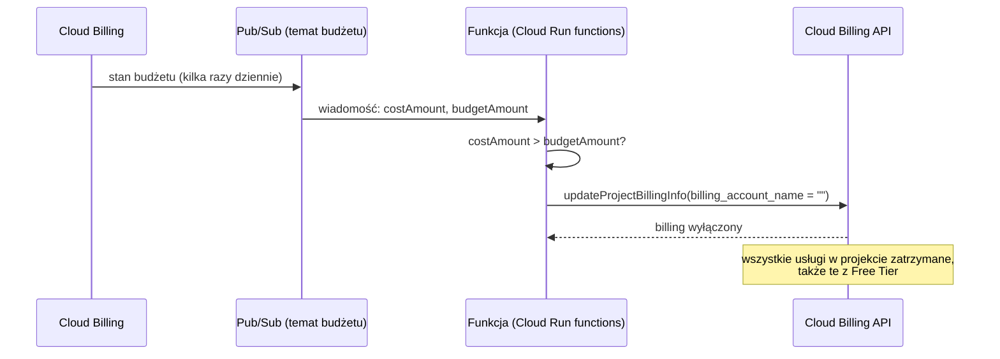

# 00.03 — Bezpieczeństwo kosztowe od pierwszego dnia

> **Czas:** ~90 min · **Wymaga:** [Lekcja 00.02](02-konto-i-projekt-gcp.md) · **Ostatnia weryfikacja:** 2026-11-07

**W tej lekcji:**

- zrozumiesz, dlaczego budżet w Google Cloud **nie jest limitem** i skąd bierze się opóźnienie danych o kosztach;
- poznasz cztery warstwy ochrony: prewencję (limity, `maximum_bytes_billed`), detekcję (budżety i alerty), reakcję (powiadomienia programowe, „bezpiecznik”) i sprzątanie (etykiety, Terraform, usuwanie projektu);
- dowiesz się, jak BigQuery szacuje koszt zapytania przed jego wykonaniem i dlaczego `LIMIT 10` nie zmniejsza rachunku;
- skonfigurujesz w Terraform budżet z alertami e-mail i Pub/Sub oraz dzienny limit zapytań BigQuery;
- poznasz listę zasobów, które najczęściej generują niespodziewane rachunki, i sposoby ich pilnowania.

---

## 1. Problem

Piątek, 16:40. Stażysta w NovaCart tworzy w BigQuery *scheduled query* (zapytanie uruchamiane cyklicznie), które co godzinę odświeża tabelę dla dashboardu marketingu:

```sql
SELECT * FROM `novacart-prod-data.raw.clickstream` WHERE DATE(event_ts) >= '2025-01-01'
```

Tabela `clickstream` ma w produkcji kilkanaście TiB i jest partycjonowana po dacie **przyjęcia** zdarzenia (`received_at`), a nie po `event_ts`. Filtr nie trafia w partycje, więc każde uruchomienie czyta całą tabelę, około 1,5 TiB w potrzebnych kolumnach (a `SELECT *` czyta wszystkie). Przy cenie on-demand rzędu 6,25 USD za TiB jedno uruchomienie kosztuje około 9–10 USD, czyli ~225 USD na dobę. W poniedziałek rano rachunek za weekend przekracza 600 USD.

Zespół **miał** budżet z alertem na 500 USD miesięcznie. E-mail o przekroczeniu 50% przyszedł w sobotę wieczorem, o 100% w niedzielę po południu. Nikt nie czytał skrzynki w weekend, a nawet gdyby czytał, alert nic by nie zatrzymał. Budżet tylko informuje.

Ten scenariusz da się w pełni zablokować trzema ustawieniami, z których każde zajmuje kilka minut: dziennym limitem zapytań na projekt, `maximum_bytes_billed` w zapytaniach cyklicznych i wymaganym filtrem partycji na dużej tabeli. W tej lekcji poznasz pierwsze dwa (trzecie to moduł 15) i resztę bezpieczników, które warto mieć, zanim uruchomisz cokolwiek innego.

## 2. Intuicja

> [!TIP]
> **Intuicja.** Budżet w chmurze działa jak **SMS z banku** o transakcji: informuje, że pieniądze już wydano, i to z opóźnieniem. Nie blokuje karty. **Limit (*quota*)** działa jak **dzienny limit karty**: transakcja ponad limit zostaje odrzucona. **`maximum_bytes_billed`** to **zlecenie z limitem ceny** na giełdzie: „kup, ale najwyżej za X”. Jeśli cena jest wyższa, zlecenie nie zostanie wykonane i nic nie płacisz.

Analogia pokazuje najważniejsze: **detekcja** (SMS, budżet) i **prewencja** (limit karty, quota) to różne mechanizmy i potrzebujesz obu. Ma też granice. Bank zna kwotę transakcji natychmiast, a chmura liczy koszty z opóźnieniem sięgającym godzin. Limit karty obejmuje każdą transakcję, a limity w chmurze dotyczą tylko wybranych operacji. Limit zapytań BigQuery nie zatrzyma zapomnianego klastra Dataproc, który nalicza opłaty za każdą sekundę działania, choć nie wykonuje żadnych „operacji”.

## 3. Koncepcja

### 3.1. Pojęcia

| Pojęcie | Znaczenie |
|---|---|
| Budżet (*budget*) | Obiekt na koncie rozliczeniowym: kwota na okres (miesiąc, kwartał, rok) i progi, po których przychodzą alerty. **Nie ogranicza wydatków.** |
| Próg (*threshold rule*) | Procent budżetu, po którego przekroczeniu wysyłany jest alert. Liczony od wydatków faktycznych (*actual*) albo prognozowanych (*forecasted*). |
| Powiadomienia programowe | Wiadomości Pub/Sub ze stanem budżetu, wysyłane kilka razy dziennie. Podstawa automatyzacji reakcji. |
| *Spend cap budget* | Nowy typ budżetu, który **wstrzymuje** wybrane usługi po przekroczeniu kwoty. Obejmuje tylko niektóre usługi (sekcja 4.3). |
| *Quota* (limit) | Ograniczenie ilości użycia usługi. *Custom quota* to limit ustawiony przez Ciebie poniżej domyślnego. |
| `maximum_bytes_billed` | Parametr zapytania BigQuery: jeśli szacowana liczba bajtów przekracza limit, zapytanie kończy się błędem przed wykonaniem i nic nie kosztuje. |
| *Dry run* | Tryb „na sucho”: BigQuery waliduje zapytanie i szacuje liczbę przetworzonych bajtów bez jego wykonania. Bezpłatny. |
| Etykieta (*label*) | Para klucz–wartość na zasobie (np. `module=00`). Trafia do danych billingowych, więc pozwala grupować koszty i znajdować zasoby do usunięcia. |
| Kredyt (*credit*) | Pomniejszenie kosztu: kredyt triala, Free Tier, promocje, rabaty. W raportach kosztów widoczny jako osobna, ujemna pozycja. |
| *Billing export* | Eksport szczegółowych danych o kosztach do BigQuery. Podstawa analiz FinOps (moduł 39). |

### 3.2. Cztery warstwy obrony

```mermaid
flowchart LR
    subgraph P["1. Prewencja<br/>(zanim wydasz)"]
        P1["Custom quotas<br/>BigQuery TiB/dzień"]
        P2["maximum_bytes_billed<br/>+ dry run"]
        P3["Org policies,<br/>limity zasobów"]
    end
    subgraph D["2. Detekcja<br/>(po fakcie, z opóźnieniem)"]
        D1["Budżet: progi<br/>faktyczne + prognoza"]
        D2["Billing reports,<br/>billing export"]
    end
    subgraph R["3. Reakcja"]
        R1["Pub/Sub → Slack / e-mail"]
        R2["Pub/Sub → wyłączenie<br/>billingu (sandbox)"]
        R3["Spend cap<br/>(wybrane usługi)"]
    end
    subgraph C["4. Sprzątanie"]
        C1["terraform destroy"]
        C2["Etykiety + skrypt"]
        C3["Usunięcie projektu"]
    end
    P --> D --> R --> C
```



*Rysunek 3.1. Każda warstwa łapie to, co przepuściła poprzednia. Prewencja jest najtańsza, ale wąska. Detekcja obejmuje wszystko, ale działa z opóźnieniem. Sprzątanie usuwa przyczynę.*

Żadna warstwa nie wystarcza sama:

- **Prewencja** działa natychmiast, ale tylko tam, gdzie istnieje odpowiedni limit. Limit zapytań BigQuery nie chroni przed maszyną wirtualną.
- **Detekcja** obejmuje wszystkie usługi, ale z opóźnieniem liczonym w godzinach i bez blokowania czegokolwiek.
- **Reakcja** automatyzuje to, co zrobiłby człowiek po alercie. Odziedziczy jednak opóźnienie detekcji, a najbardziej radykalna reakcja (wyłączenie billingu) niszczy środowisko.
- **Sprzątanie** usuwa przyczynę kosztów, ale tylko wtedy, gdy wiesz, co sprzątać. Stąd etykiety i infrastruktura jako kod.

## 4. 🔍 Pod maską

### 4.1. Jak powstaje rachunek i skąd opóźnienie

Między użyciem zasobu a informacją o koszcie jest kilka etapów, każdy z własnym opóźnieniem:

```text
  użycie zasobu           pomiar (metering)         wycena (rating)          dane billingowe        budżet
┌──────────────┐       ┌───────────────────┐     ┌────────────────────┐    ┌─────────────────┐   ┌──────────────┐
│ zapytanie BQ │──────►│ usługa raportuje  │────►│ cennik × ilość,    │───►│ koszty w        │──►│ porównanie z │──► e-mail /
│ maszyna VM   │       │ zużycie: bajty,   │     │ kredyty (trial,    │    │ Cloud Billing   │   │ progami      │    Pub/Sub
│ bajty w GCS  │       │ vCPU-s, GB-mies.  │     │ Free Tier, rabaty) │    │ (reports,export)│   │              │
└──────────────┘       └───────────────────┘     └────────────────────┘    └─────────────────┘   └──────────────┘
      t = 0                 minuty–godziny             godziny                  godziny–doba         kilka razy/dobę
```

Dokumentacja Cloud Billing mówi wprost, że istnieje opóźnienie między użyciem zasobów a pojawieniem się kosztów w rozliczeniach, a pierwszy e-mail lub wiadomość Pub/Sub może przyjść po kilku godzinach. Różne usługi raportują zużycie z różną częstotliwością. Część zasobów (np. storage) rozlicza się w okresach miesięcznych, więc koszt „dopisuje się” stopniowo.

Drugi ważny mechanizm to **kredyty**. Koszt w raporcie to koszt katalogowy minus kredyty: kredyt triala, Free Tier, rabaty za zobowiązania (*committed use discounts*), promocje. Budżet może je uwzględniać albo nie:

| Ustawienie `credit_types_treatment` | Co widzi budżet na *free trial* | Kiedy dostaniesz alert |
|---|---|---|
| `INCLUDE_ALL_CREDITS` (domyślne) | koszt − kredyty ≈ 0 USD, dopóki kredyt się nie skończy | prawie nigdy w trakcie triala |
| `EXCLUDE_ALL_CREDITS` | pełny koszt katalogowy | gdy rzeczywiste zużycie zbliża się do progu |

> [!IMPORTANT]
> **Co z tego wynika w praktyce:** budżet to **mechanizm detekcji z opóźnieniem liczonym w godzinach**. Nie zastąpi prewencji. Ustaw progi nisko (np. 25% i 50% małej kwoty), dodaj próg dla prognozy, a na *free trial* wyłącz kredyty z budżetu (`EXCLUDE_ALL_CREDITS`). Inaczej alert przyjdzie dopiero wtedy, gdy kredyt już się skończył.

### 4.2. Budżety i alerty od środka

Budżet należy do **konta rozliczeniowego**, a nie do projektu (lekcja 00.02). Ma cztery części:

1. **Zakres** (`budget_filter`): które koszty liczyć. Wszystkie z konta albo wybrane projekty (podawane **numerem**), usługi, etykiety, foldery. Do tego okres: miesiąc, kwartał, rok albo okres własny.
2. **Kwota** (`amount`): stała (`specified_amount`) albo równa wydatkom z poprzedniego okresu (`last_period_amount`). Waluta musi być zgodna z walutą konta rozliczeniowego.
3. **Progi** (`threshold_rules`): domyślnie 50%, 90% i 100% faktycznych wydatków. Każdy próg może dotyczyć wydatków faktycznych (`CURRENT_SPEND`) albo prognozy na koniec okresu (`FORECASTED_SPEND`).
4. **Odbiorcy**: domyślnie e-mail trafia do administratorów i użytkowników konta rozliczeniowego. Dodatkowo do 5 kanałów Cloud Monitoring (e-mail, SMS, aplikacja mobilna…), właściciele projektu (gdy budżet obejmuje dokładnie jeden projekt) i temat Pub/Sub.

E-mail przychodzi **raz, przy przekroczeniu progu**. Pub/Sub działa inaczej: dostaje **stan budżetu kilka razy dziennie**, także wtedy, gdy żaden próg nie został przekroczony. Wiadomość ma pola m.in.:

```json
{
  "budgetDisplayName": "ade-ade-jkowalski-2611-monthly",
  "costAmount": 12.37,
  "costIntervalStart": "2026-11-01T07:00:00Z",
  "budgetAmount": 20.0,
  "budgetAmountType": "SPECIFIED_AMOUNT",
  "alertThresholdExceeded": 0.5,
  "currencyCode": "PLN"
}
```

`alertThresholdExceeded` to najwyższy przekroczony próg faktycznych wydatków (0,5 = 50%). Gdy żaden nie został przekroczony, pola nie ma. Pub/Sub gwarantuje dostarczenie **co najmniej raz** (*at-least-once*), więc ta sama wiadomość może przyjść dwa razy albo w innej kolejności. Kod reagujący na alert musi to tolerować, czyli być **idempotentny**: ponowne przetworzenie tej samej wiadomości nie może zmienić wyniku. Ten wzorzec omawia szczegółowo moduł 02.

> [!NOTE]
> **Pod maską — dla dociekliwych.** Próg prognozy (`FORECASTED_SPEND`) jest szczególnie cenny na początku miesiąca. 10. dnia faktyczne wydatki mogą wynosić 30% budżetu, czyli nie przekraczają żadnego progu, ale tempo wskazuje na 95% na koniec miesiąca. Prognoza wykrywa **zmianę tempa** wcześniej niż próg faktyczny. Google nie publikuje szczegółów modelu prognozy. Traktuj go jako przybliżenie, które w pierwszych dniach okresu może być niestabilne.

> [!IMPORTANT]
> **Co z tego wynika w praktyce:** ustaw kilka progów faktycznych (np. 25/50/90/100%) **i** próg prognozy na 100%. Dodaj kanał e-mail, który naprawdę czytasz, oraz temat Pub/Sub. Nawet jeśli dziś nic z nim nie robisz, to gotowe miejsce na automatyzację.

### 4.3. Spend cap — budżet, który zatrzymuje (ale nie wszystko)

Google Cloud wprowadził **budżety z limitem wydatków** (*spend cap budgets*). Po przekroczeniu kwoty **wstrzymują** wskazaną usługę w projekcie do końca okresu. Brzmi jak rozwiązanie problemu z sekcji 1, ale ograniczenia są poważne (stan na dzień weryfikacji):

- **Tylko wybrane usługi.** Lista obejmowała m.in. Gemini API, Gemini Enterprise Agent Platform (dawniej Vertex AI), Cloud Run i Cloud Run functions. **Nie obejmowała BigQuery ani Compute Engine.**
- **Jeden projekt i jedna usługa na limit.** Nie da się ustawić limitu na całe konto rozliczeniowe, folder czy etykietę.
- **Opóźnienie.** Limit działa na szacowanym koszcie katalogowym (bez kredytów i rabatów), który jest szybszy niż dane billingowe, ale nie natychmiastowy. Dokumentacja zaleca ustawienie kwoty nieco poniżej faktycznej granicy, bo za przekroczenia w czasie opóźnienia płacisz Ty.
- **Zasoby trwałe dalej kosztują.** Wstrzymywane są nowe żądania. Koszty stałe (np. przechowywane dane) naliczają się dalej.
- **Okres miesięczny.** Limit zdejmuje się ręcznie albo automatycznie na początku kolejnego miesiąca.

> [!IMPORTANT]
> **Co z tego wynika w praktyce:** *spend cap* to dobry bezpiecznik dla usług rozliczanych za żądanie (np. API modeli generatywnych w module 42), ale **nie chroni** przed kosztami BigQuery ani maszyn. Dla BigQuery masz *custom quotas* (sekcja 4.6). Sprawdź aktualną listę obsługiwanych usług i status funkcji przed użyciem.

### 4.4. „Bezpiecznik”: automatyczne wyłączenie billingu

Skoro budżet wysyła stan na Pub/Sub, można podpiąć funkcję, która po przekroczeniu kwoty **odepnie konto rozliczeniowe od projektu**. Dokumentacja Google opisuje ten wzorzec i podaje przykładowy kod (Node.js i Python):



*Rysunek 3.2. Automatyczne odpięcie billingu to najmocniejsza i najbardziej niszcząca reakcja na przekroczenie budżetu.*

Wady tego rozwiązania są poważne i warto je znać, zanim się na nie zdecydujesz:

| Wada | Szczegóły |
|---|---|
| Niszczy środowisko | Wyłączenie billingu zatrzymuje **wszystkie** usługi w projekcie, także darmowe. Dokumentacja ostrzega, że zasoby mogą zostać **trwale usunięte**, a ponowne włączenie billingu nie gwarantuje odtworzenia usług. |
| Nie gwarantuje limitu | Działa na danych budżetu, więc dziedziczy opóźnienie z sekcji 4.1. Wydatki z ostatnich godzin i tak zostaną naliczone. |
| Wymaga silnych uprawnień | Konto serwisowe funkcji potrzebuje uprawnień do zmiany billingu projektu. Przykład w dokumentacji nadaje mu rolę Billing Account Administrator. To cenny cel ataku. |
| Duplikaty wiadomości | Pub/Sub dostarcza *at-least-once*. Funkcja musi sprawdzić, czy billing nie jest już wyłączony. |
| Nie dotyczy zobowiązań | Billingu nie da się wyłączyć w projekcie z aktywnymi rabatami za zobowiązania (CUD). |

Przykład z dokumentacji ma flagę symulacji (`SIMULATE_DEACTIVATION = True`), która tylko loguje akcję. Dokumentacja zaleca wyłączenie symulacji dopiero po przetestowaniu na budżecie testowym.

> [!IMPORTANT]
> **Co z tego wynika w praktyce:** automatyczne wyłączenie billingu ma sens **wyłącznie dla projektów eksperymentalnych**, w których utrata zasobów jest akceptowalna, np. w Twoim projekcie kursowym, jeśli wolisz stracić dane niż pieniądze. Dla środowisk zespołowych i produkcyjnych lepszą reakcją jest powiadomienie na Slacku lub PagerDuty plus prewencja (limity). W tym module konfigurujesz temat Pub/Sub, a samą funkcję możesz dodać jako rozszerzenie zadania.

### 4.5. Jak BigQuery szacuje koszt zapytania

W modelu **on-demand** BigQuery rozlicza zapytanie według liczby **przetworzonych bajtów**, a nie czasu ani liczby wierszy wyniku. Bajty przetworzone to suma rozmiarów **kolumn**, które zapytanie odczytuje, w **partycjach**, których nie dało się pominąć. Wynika to z kolumnowego formatu przechowywania (moduły 04 i 15):

```text
Tabela clickstream (uproszczenie)          Zapytanie: SELECT session_id, event_type
                                                      FROM clickstream
┌──────────┬──────────┬────────────┬─────────────┬──────────────┐
│ event_id │ event_ts │ session_id │ event_type  │ user_agent   │ … 25 kolumn
├──────────┼──────────┼────────────┼─────────────┼──────────────┤
│  1,2 GB  │  0,4 GB  │   1,1 GB   │   0,2 GB    │   6,8 GB     │
└──────────┴──────────┴────────────┴─────────────┴──────────────┘
                         ▲▲▲▲▲▲▲▲▲▲   ▲▲▲▲▲▲▲▲▲▲▲
                         czytane tylko te kolumny → 1,3 GB, a nie ~15 GB
```

Ponieważ rozmiar każdej kolumny w każdej partycji jest zapisany w **metadanych** tabeli, BigQuery potrafi oszacować koszt **przed** wykonaniem zapytania, bez czytania danych. To robi *dry run*: parsuje zapytanie, ustala, które kolumny i partycje będą potrzebne, i sumuje ich rozmiary z metadanych. Stąd kilka ważnych właściwości:

- **`LIMIT` nie zmniejsza kosztu** (dla tabel bez *clusteringu*). Ogranicza liczbę wierszy wyniku, a nie liczbę odczytanych bajtów kolumn. `SELECT * … LIMIT 10` kosztuje tyle samo co `SELECT *`.
- **`SELECT COUNT(*)` bez filtra kosztuje 0 bajtów.** Liczba wierszy jest w metadanych.
- **Szacunek to górna granica.** Dla tabel z *clusteringiem* faktycznie przetworzonych bajtów może być mniej, bo część bloków zostanie pominięta dopiero w trakcie wykonania.
- **Minimalna opłata to 10 MiB** na zapytanie i 10 MiB na każdą tabelę, do której się odwołujesz. Tysiąc „malutkich” zapytań kosztuje co najmniej 1000 × 10 MiB ≈ 9,8 GiB.
- **Podgląd danych jest darmowy.** Zakładka *Preview* w konsoli, `bq head` i `tabledata.list` nie zużywają limitów ani nie kosztują.

**`maximum_bytes_billed`** wykorzystuje ten sam szacunek. Jeśli szacowana liczba bajtów przekracza limit, zapytanie **kończy się błędem przed wykonaniem i nic nie kosztuje**. Ponieważ szacunek jest górną granicą, zapytanie na tabeli z *clusteringiem* może zostać odrzucone, choć w rzeczywistości zmieściłoby się w limicie.

> [!IMPORTANT]
> **Co z tego wynika w praktyce:** (1) przed każdym nowym zapytaniem na dużej tabeli wykonaj *dry run* albo spójrz na szacunek w edytorze konsoli; (2) **każde zapytanie uruchamiane automatycznie** (scheduled query, dbt, Airflow, aplikacja) powinno mieć `maximum_bytes_billed`; (3) do oglądania danych używaj *Preview* / `bq head`, nie `SELECT * LIMIT`. Domyślny limit dla poleceń `bq` możesz ustawić w `~/.bigqueryrc`:
>
> ```ini
> [query]
> --maximum_bytes_billed=10000000000
> ```

### 4.6. Custom quotas BigQuery — jedyny twardy limit na zapytania

BigQuery ma dwa limity, które możesz obniżyć:

| Quota ID | Zakres | Domyślnie | Co ogranicza |
|---|---|---|---|
| `QueryUsagePerDay` | cały projekt (suma wszystkich użytkowników i kont serwisowych) | 200 TiB/dzień | dane przetworzone przez zapytania on-demand |
| `QueryUsagePerUserPerDay` | każdy użytkownik i konto serwisowe osobno (ta sama wartość dla wszystkich) | bez limitu | j.w., per tożsamość |

Obie mają metrykę `bigquery.googleapis.com/quota/query/usage`. Jak działają:

- **Dotyczą tylko modelu on-demand.** Zapytania w zarezerwowanej mocy (edycje i sloty, moduł 16) ich nie zużywają.
- **Zerują się o północy czasu pacyficznego (PT).** W Polsce to zwykle 9:00 rano przez cały rok (PST = UTC−8 zimą, PDT = UTC−7 latem, a w Polsce analogicznie UTC+1 i UTC+2). Wyjątkiem są tygodnie, w których USA i Europa zmieniają czas w różnych terminach; wtedy reset wypada o 8:00.
- **Są przybliżone.** Dokumentacja nazywa je zabezpieczeniem, a nie ścisłym limitem. Pojedyncze zapytanie może przekroczyć próg. Zużycie jest normalizowane do zwykłej stawki on-demand, więc może się różnić od `total_bytes_billed` w `INFORMATION_SCHEMA.JOBS`.
- **Po przekroczeniu** BigQuery zwraca błąd `quotaExceeded` z komunikatem typu *„Custom quota exceeded: Your usage exceeded the custom quota for QueryUsagePerDay”*. Przekroczenie limitu projektu zatrzymuje zapytania **wszystkich** w projekcie do resetu.
- **Obniżenie działa szybko** (w ciągu kilku minut). Podwyższenie może wymagać zatwierdzenia.
- **Wymagane uprawnienia:** rola Quota Administrator (`roles/servicemanagement.quotaAdmin`) albo inna z `serviceusage.quotas.update`.

Sytuacja z sekcji 1 przy limicie 1 TiB/dzień: pierwsze uruchomienie (1,5 TiB) albo zostałoby od razu zatrzymane, albo przeszłoby jako „przybliżone” przekroczenie, a kolejne kończyłyby się błędem do 9:00 następnego dnia. Strata wyniosłaby ~10 USD zamiast ~600 USD.

```text
dzień (PT)       00:00 ─────────────────────────────────────────────── 24:00
zużycie          ▁▁▂▂▃▃▄▄▅▅▆▆▇▇██████████████████████████████████████████
limit 1 TiB      ─────────────────┬──────────────────────────────────────
                                  └─► od tej chwili: quotaExceeded dla każdego zapytania on-demand
                                      w projekcie, do północy PT (≈ 9:00 w Polsce)
```

> [!IMPORTANT]
> **Co z tego wynika w praktyce:** w projekcie kursowym ustaw `QueryUsagePerDay` na 1 TiB (darmowy limit całego miesiąca!) i `QueryUsagePerUserPerDay` na mniej, np. 0,5 TiB. To jedyny mechanizm, który **zatrzymuje** wydatki na zapytania BigQuery bez Twojej reakcji. W firmie limit na użytkownika chroni zespół przed jednym niefortunnym zapytaniem, a limit projektu przed błędem w automatyzacji.

### 4.7. Etykiety: skąd wiadomo, co kosztuje i co posprzątać

**Etykiety** (*labels*) to pary klucz–wartość na zasobach, np. `course=ade`, `module=00`, `owner=jkowalski`. Mają dwie funkcje:

1. **Trafiają do danych billingowych.** W *Billing → Reports* możesz filtrować i grupować koszty według etykiet, a w eksporcie billingu do BigQuery są kolumną `labels`. Dzięki temu odpowiesz na pytanie „ile kosztował moduł 20?”.
2. **Pozwalają znaleźć zasoby.** `gcloud storage buckets list --filter="labels.module=00"` zwraca buckety z danego modułu. Na tym opiera się skrypt sprzątający.

Etykieta na zasobie trafia do kosztów **tego zasobu**. Zapytania BigQuery mają osobne **etykiety zadań** (*job labels*), które widać w `INFORMATION_SCHEMA.JOBS` i w billingu. Przykład `03_dry_run.py` ustawia je na każdym zapytaniu. Nie wszystkie zasoby obsługują etykiety, a etykieta dodana dziś nie zmienia kosztów sprzed jej dodania.

Reguły zapisu: klucze i wartości małymi literami, cyfry, `_` i `-`, klucz zaczyna się literą, do 63 znaków. Na jednym zasobie może być do 64 etykiet.

> [!NOTE]
> **Pod maską — dla dociekliwych.** Google Cloud ma też **tagi** (*Resource Manager tags*). Choć nazwa brzmi podobnie, to inny mechanizm: tagi są zasobami z własnymi uprawnieniami, dziedziczą się w hierarchii i można ich używać w warunkach IAM oraz politykach organizacji (np. „tylko zasoby z tagiem `env=prod` mogą…”). Etykiety służą do organizacji i rozliczeń, tagi do kontroli dostępu. Szczegóły w module 09.

> [!IMPORTANT]
> **Co z tego wynika w praktyce:** każdy zasób kursu ma etykiety `course=ade` i `module=NN` (w Terraform najprościej przez `default_labels` providera). Zapytania uruchamiane z kodu mają etykiety zadań. Bez etykiet koszty modułów zleją się w jedną kwotę, a sprzątanie będzie wymagało ręcznego przeglądania konsoli.

### 4.8. Sprzątanie: trzy poziomy i ich pułapki

| Poziom | Jak | Co usuwa | Pułapki |
|---|---|---|---|
| Terraform | `terraform destroy` | wszystko, co jest w *stanie* (*state*) Terraform | nie usunie zasobów utworzonych ręcznie lub przez inne narzędzia; stan musi być dostępny |
| Etykiety | `examples/99_cleanup.sh labels NN` | zasoby z etykietą `course=ade`, `module=NN` | tylko obsługiwane typy; zasoby bez etykiet zostaną |
| Projekt | `gcloud projects delete` | **wszystko** w projekcie, naliczanie opłat się zatrzymuje | ~30 dni na przywrócenie; project ID przepada na zawsze |

Zasada kursu: **„wszystko przez Terraform, wszystko da się zniszczyć jednym poleceniem”**. Terraform zna listę zasobów, które utworzył, więc wie, co usunąć. Skrypt po etykietach to siatka bezpieczeństwa dla zasobów utworzonych ręcznie. Usunięcie projektu to opcja ostateczna, ale najpewniejsza.

Dwie mniej oczywiste pułapki przy usuwaniu danych:

- **Cloud Storage *soft delete*.** Buckety mają domyślnie włączone przechowywanie usuniętych obiektów przez określony czas (domyślnie 7 dni), za które się płaci. Dla danych kursu, które zawsze można wygenerować ponownie, warto ustawić retencję na 0.
- **BigQuery *time travel* i *fail-safe*.** Usunięte lub zmienione dane tabeli są przez pewien czas dostępne do odtworzenia. W modelu rozliczania storage fizycznego (*physical storage billing*) za te bajty się płaci.

Te mechanizmy chronią przed przypadkowym usunięciem danych, ale opóźniają moment, w którym koszt storage spada do zera. Omawiamy je w modułach 13 i 15.

> [!IMPORTANT]
> **Co z tego wynika w praktyce:** twórz zasoby przez Terraform z `force_destroy = true` dla bucketów kursu i `delete_contents_on_destroy = true` dla zbiorów BigQuery. Po każdej sesji uruchom `terraform destroy` albo przynajmniej `99_cleanup.sh labels NN` w trybie *dry run*, żeby zobaczyć, co zostało.

### 4.9. Najdroższe pułapki w data engineeringu

Większość niespodziewanych rachunków w projektach danych ma jedną z kilku przyczyn:

| Pułapka | Mechanizm kosztu | Bezpiecznik |
|---|---|---|
| `SELECT *` / brak filtra partycji na dużej tabeli, zwłaszcza w zapytaniu cyklicznym albo w dashboardzie | bajty przetworzone × liczba uruchomień | `maximum_bytes_billed`, custom quotas, `require_partition_filter` (moduł 15) |
| Zapomniany klaster Dataproc | każda sekunda działania maszyn + dyski | `--max-idle`, `--max-age`, Dataproc Serverless (moduł 20) |
| Środowisko Cloud Composer | działa 24/7, nawet bez DAG-ów; rząd wielkości: setki USD miesięcznie | tworzyć tylko na czas zadania; lokalny Airflow do nauki (moduł 27) |
| Job Dataflow w trybie *streaming* | workery działają bez przerwy | `drain`/`cancel` po zadaniu; etykiety + skrypt (moduł 23) |
| Instancje Cloud SQL, Spanner, Bigtable, Memorystore | opłata za godzinę, także w bezczynności | zatrzymywanie / usuwanie po sesji; emulatory lokalne (lekcja 00.05) |
| Ruch wychodzący (*egress*) | transfer do internetu i między regionami | dane i obliczenia w tym samym regionie (moduł 10) |
| Cloud NAT | opłata za godzinę bramki i za przetworzone GB | NAT tylko tam, gdzie potrzebny; Private Google Access (moduł 10) |
| Logi | ingest do Cloud Logging ponad darmowy limit, np. przez *debug logging* w pipeline'ie | filtry wykluczające, poziom logowania (moduł 38) |
| Osierocone zasoby | dyski po usuniętych maszynach, nieużywane statyczne IP, snapshoty | etykiety + regularny przegląd |

> [!IMPORTANT]
> **Co z tego wynika w praktyce:** zasoby rozliczane **za czas istnienia** (klastry, środowiska, instancje, joby streamingowe) są groźniejsze niż te rozliczane **za użycie** (zapytania, operacje), bo kosztują, gdy nikt na nie nie patrzy. Dla każdego zasobu „czasowego” zaplanuj z góry, kto i kiedy go usunie.

## 5. 💻 W praktyce

### 5.1. Pierwsze zapytanie z *dry run*

Skrypt `03_first_query_dry_run.sh` szacuje koszt kilku zapytań do publicznej tabeli `bigquery-public-data.samples.wikipedia` (ponad 300 mln wierszy), a potem uruchamia „niebezpieczne” zapytanie z bezpiecznikiem:

```bash
# examples/03_first_query_dry_run.sh (fragment)
bq_q() { bq --project_id="$PROJECT_ID" query --use_legacy_sql=false --nouse_cache "$@"; }

# Zwraca liczbę bajtów, które przetworzyłoby zapytanie (dry run).
estimate_bytes() {
  bq_q --dry_run "$1" 2>&1 | grep -oE '[0-9]+ bytes' | grep -oE '[0-9]+'
}

report "SELECT * (cała tabela)" \
  'SELECT * FROM `bigquery-public-data.samples.wikipedia`'
report "SELECT * ... LIMIT 10" \
  'SELECT * FROM `bigquery-public-data.samples.wikipedia` LIMIT 10'
report "SELECT COUNT(*) (tylko metadane)" \
  'SELECT COUNT(*) FROM `bigquery-public-data.samples.wikipedia`'

# Oczekiwany wynik: błąd „Query exceeded limit for bytes billed”, zapytanie nie rusza i nic nie kosztuje.
if bq_q --maximum_bytes_billed="$LIMIT_BYTES" \
     'SELECT * FROM `bigquery-public-data.samples.wikipedia` LIMIT 10' >/dev/null 2>err.log; then
  echo "Zapytanie wykonane (nieoczekiwane: sprawdź LIMIT_BYTES)"
else
  echo "Zatrzymane przed wykonaniem:"; sed 's/^/  /' err.log
fi
```

```bash
cd modules/00-wprowadzenie/examples
PROJECT_ID=ade-jkowalski-2611 ./03_first_query_dry_run.sh
```

**Przykładowy wynik** (skrócony; liczby zależą od aktualnej wersji tabel publicznych):

```text
== Szacunki (dry run, koszt 0) ==
SELECT * (cała tabela)                      38324173849 B      35.69 GiB  ~0.2179 USD
SELECT * ... LIMIT 10                       38324173849 B      35.69 GiB  ~0.2179 USD
SELECT title (jedna kolumna)                 (kilkukrotnie mniej niż SELECT *)
SELECT COUNT(*) (tylko metadane)                      0 B       0.00 GiB  ~0.0000 USD
Mała tabela: shakespeare                       (kilka MB; rozliczone jako minimum 10 MiB)

== Zapytanie z bezpiecznikiem: SELECT * LIMIT 10, limit 1000000000 B ==
Zatrzymane przed wykonaniem:
  Error in query string: Query exceeded limit for bytes billed: 1000000000. 38324173849 or higher required.
```

Zwróć uwagę na trzy rzeczy:

1. `SELECT *` i `SELECT * … LIMIT 10` mają **identyczny** szacunek (sekcja 4.5).
2. `COUNT(*)` bez filtra kosztuje 0 B, bo odpowiedź jest w metadanych.
3. Zapytanie z limitem 1 GB zostało odrzucone **przed** wykonaniem. W historii zadań zobaczysz je jako nieudane, z 0 bajtów rozliczonych.

Te same 35 GiB to ok. 3,5% darmowego miesięcznego 1 TiB. Wystarczy jednak około 30 takich zapytań, żeby wyczerpać cały darmowy limit miesiąca.

### 5.2. To samo z Pythona

```python
# examples/03_dry_run.py (fragment)
def estimate(client: bigquery.Client, sql: str) -> int:
    """Zwraca górne oszacowanie liczby przetworzonych bajtów. Dry run jest bezpłatny."""
    config = bigquery.QueryJobConfig(dry_run=True, use_query_cache=False)
    job = client.query(sql, job_config=config)
    # Przy dry run zadanie nie jest uruchamiane: statystyki są dostępne od razu.
    return job.total_bytes_processed or 0


def run_guarded(client: bigquery.Client, sql: str, limit_bytes: int) -> None:
    """Uruchamia zapytanie z bezpiecznikiem maximum_bytes_billed."""
    config = bigquery.QueryJobConfig(
        maximum_bytes_billed=limit_bytes,
        use_query_cache=False,
        labels={"course": "ade", "module": "00"},  # etykiety trafiają do INFORMATION_SCHEMA.JOBS i billingu
    )
    try:
        rows = client.query(sql, job_config=config).result()
    except GoogleAPICallError as exc:
        # Szacunek przekroczył limit: BigQuery odrzuca zadanie przed startem, opłata = 0.
        print(f"Zatrzymane przed wykonaniem: {exc.message}")
        return
```

```bash
cd modules/00-wprowadzenie/examples
uv sync
GOOGLE_CLOUD_PROJECT=ade-jkowalski-2611 uv run python 03_dry_run.py --run
```

**Przykładowy wynik:**

```text
Projekt rozliczany:  ade-jkowalski-2611
Szacowane bajty:     38,324,173,849 B (35.69 GiB)
Szacowany koszt:     ~0.2179 USD (on-demand, bez darmowego 1 TiB/mies.)
Limit bezpiecznika:  1,000,000,000 B -> ZA DUŻO
Zatrzymane przed wykonaniem: Query exceeded limit for bytes billed: 1000000000. 38324173849 or higher required.
```

Ten wzorzec (szacunek → decyzja → wykonanie z limitem) zobaczysz ponownie w modułach 16 i 39: w testach CI, które odrzucają zapytania przekraczające budżet bajtów, i w narzędziach typu „cost guard” dla analityków.

### 5.3. Budżet i limity w Terraform

Katalog `examples/terraform/budget/` tworzy cztery rzeczy: kanał e-mail w Cloud Monitoring, temat Pub/Sub na powiadomienia, budżet miesięczny i dwa dzienne limity BigQuery.

Najpierw konfiguracja providera. Billing Budgets API wymaga wskazania projektu, który „płaci” za wywołania API. Przy uwierzytelnieniu kontem użytkownika bez tych dwóch ustawień zwraca 403:

```hcl
# examples/terraform/budget/versions.tf (fragment)
provider "google" {
  project               = var.project_id
  region                = var.region
  billing_project       = var.project_id
  user_project_override = true
  default_labels        = local.labels
}
```

Budżet. Zwróć uwagę na numer projektu w filtrze, wyłączenie kredytów i próg prognozy:

```hcl
# examples/terraform/budget/main.tf (fragment)
resource "google_billing_budget" "monthly" {
  billing_account = var.billing_account_id
  display_name    = "ade-${var.project_id}-monthly"

  budget_filter {
    # Projekt wskazujemy NUMEREM, nie identyfikatorem.
    projects = ["projects/${data.google_project.this.number}"]

    # Kredyty (free trial, Free Tier, promocje) NIE pomniejszają wydatków budżetu.
    # Bez tego w okresie próbnym „wydatki” wynoszą 0 i alert nigdy nie przychodzi,
    # dopóki kredyty się nie skończą.
    credit_types_treatment = "EXCLUDE_ALL_CREDITS"
    calendar_period        = "MONTH"
  }

  amount {
    specified_amount {
      currency_code = var.currency_code
      units         = tostring(var.monthly_budget)
    }
  }

  dynamic "threshold_rules" {
    for_each = var.alert_thresholds
    content {
      threshold_percent = threshold_rules.value
      spend_basis       = "CURRENT_SPEND"
    }
  }

  # Prognoza: alert, gdy przy obecnym tempie wydatków miesiąc skończy się powyżej budżetu.
  threshold_rules {
    threshold_percent = 1.0
    spend_basis       = "FORECASTED_SPEND"
  }

  all_updates_rule {
    monitoring_notification_channels = [google_monitoring_notification_channel.budget_email.id]
    pubsub_topic                     = google_pubsub_topic.budget.id
    schema_version                   = "1.0"
    # Domyślni odbiorcy (administratorzy i użytkownicy konta rozliczeniowego) też dostaną e-mail.
    disable_default_iam_recipients = false
  }
}
```

Limity BigQuery. Nadpisanie limitu jest dostępne tylko w providerze `google-beta`. Metryka i limit są podawane w postaci zakodowanej w URL (`urlencode`):

```hcl
# examples/terraform/budget/main.tf (fragment)
resource "google_service_usage_consumer_quota_override" "bq_query_per_day" {
  provider       = google-beta
  project        = var.project_id
  service        = "bigquery.googleapis.com"
  metric         = urlencode("bigquery.googleapis.com/quota/query/usage")
  limit          = urlencode("/d/project")
  override_value = tostring(floor(var.bq_query_tib_per_day * local.mib_per_tib))
  # Obniżenie limitu o więcej niż 10% wymaga potwierdzenia (force).
  force = true
}
```

> [!WARNING]
> **Pułapka: jednostki.** Dokumentacja BigQuery i konsola podają limit w **TiB**, ale wartość nadpisania przez API Service Usage w przykładzie jest w **MiB** (1 TiB = 1 048 576 MiB). Pomyłka o czynnik 2²⁰ daje albo limit nie do przekroczenia, albo limit blokujący każde zapytanie. Po `apply` **zawsze sprawdź** wartość w konsoli: *IAM & Admin → Quotas & System Limits*, filtr „Query usage per day”.

Uruchomienie:

```bash
cd modules/00-wprowadzenie/examples/terraform/budget
cp terraform.tfvars.example terraform.tfvars   # uzupełnij project_id, billing_account_id, alert_email
terraform init
terraform plan
terraform apply
```

**Przykładowy wynik `terraform apply`** (skrócony):

```text
Plan: 5 to add, 0 to change, 0 to destroy.
...
google_billing_budget.monthly: Creation complete after 2s [id=billingAccounts/0X0X0X-.../budgets/1f2e...]
google_service_usage_consumer_quota_override.bq_query_per_day: Creation complete after 9s

Outputs:
bq_query_limit_mib_per_day = "1048576"
budget_name  = "billingAccounts/0X0X0X-0X0X0X-0X0X0X/budgets/1f2e3d4c-..."
budget_topic = "projects/ade-jkowalski-2611/topics/billing-budget-notifications"
```

Do utworzenia budżetu potrzebujesz uprawnień **na koncie rozliczeniowym** (np. Billing Account Administrator albo Billing Account Costs Manager). Do limitów potrzebujesz roli Quota Administrator na projekcie. Na prywatnym koncie, jako właściciel wszystkiego, masz oba zestawy uprawnień.

### 5.4. Sprawdzenie, że limit działa

Najprościej ustawić tymczasowo bardzo niski limit użytkownika (np. `bq_query_tib_per_user_per_day = 0.0001`, czyli ~100 MiB), wykonać `terraform apply`, odczekać kilka minut i uruchomić zapytanie powyżej limitu, np. `SELECT title FROM bigquery-public-data.samples.wikipedia`. **Przykładowy wynik:**

```text
BigQuery error in query operation: Custom quota exceeded: Your usage exceeded the custom quota for
QueryUsagePerUserPerDay, which is set by your administrator. For more information, see
https://cloud.google.com/bigquery/cost-controls
```

Pamiętaj, że limity są przybliżone. Pierwsze zapytanie może jeszcze przejść, kolejne zostaną zablokowane. Po teście przywróć wartość 0,5 TiB.

### 5.5. Sprzątanie po etykietach

```bash
# examples/99_cleanup.sh (fragment)
  # Cloud Storage: buckety razem z zawartością.
  for b in $(gcloud storage buckets list --project="$PROJECT_ID" \
               --filter="$filter" --format='value(name)'); do
    run gcloud storage rm --recursive "gs://${b}"
  done

  # BigQuery: zbiory danych razem z tabelami (bq używa innej składni filtra).
  for d in $(bq ls --project_id="$PROJECT_ID" --filter="$bq_filter" --format=json \
               | python3 -c 'import json,sys; [print(x["datasetReference"]["datasetId"]) for x in json.load(sys.stdin) or []]'); do
    run bq rm -r -f -d "${PROJECT_ID}:${d}"
  done
```

Skrypt domyślnie działa **na sucho** i tylko wypisuje, co by usunął. Usuwanie wymaga `DRY_RUN=0` i wpisania ID projektu:

```bash
PROJECT_ID=ade-jkowalski-2611 ./99_cleanup.sh labels 00            # podgląd
PROJECT_ID=ade-jkowalski-2611 DRY_RUN=0 ./99_cleanup.sh labels 00  # usunięcie
PROJECT_ID=ade-jkowalski-2611 ./99_cleanup.sh project              # podgląd usunięcia całego projektu
```

**Przykładowy wynik** (podgląd):

```text
Projekt: ade-jkowalski-2611   filtr: labels.course=ade AND labels.module=00   DRY_RUN=1
[dry-run] gcloud storage rm --recursive gs://ade-jkowalski-2611-novacart-raw
[dry-run] bq rm -r -f -d ade-jkowalski-2611:novacart_raw
[dry-run] gcloud pubsub topics delete projects/ade-jkowalski-2611/topics/billing-budget-notifications --project=ade-jkowalski-2611 --quiet
Gotowe. Sprawdź jeszcze: Billing → Reports (filtr: projekt, etykieta course=ade).
```

Zauważ, że skrypt znalazłby też temat Pub/Sub budżetu, bo ma etykietę `module=00`. Zasoby zarządzane przez Terraform usuwaj przez `terraform destroy`. Gdyby skrypt usunął je „spod spodu”, stan Terraform rozjechałby się z rzeczywistością (moduł 12). Budżet zostaw do końca kursu.

## 6. ⚖️ Porównanie platform

| Aspekt | GCP | AWS | Azure | Snowflake | Databricks | On-prem / OSS |
|---|---|---|---|---|---|---|
| Budżet z alertami | Cloud Billing budgets (konto rozliczeniowe, filtr projekty/etykiety) | AWS Budgets | Cost Management budgets (subskrypcja, grupa zasobów, grupa zarządzania) | Resource monitors (kredyty) + budżety | Budgets w konsoli konta (alerty) | Brak; koszt jest stały (sprzęt) |
| Czy budżet **zatrzymuje** wydatki | Nie. Wyjątek: *spend cap* dla wybranych usług | Nie sam z siebie; **Budget Actions** mogą zastosować politykę IAM/SCP albo zatrzymać instancje EC2/RDS | Nie; alert może uruchomić *action group* (np. automatyzację), która coś zatrzyma | **Tak**: resource monitor może zawiesić warehouse (`SUSPEND` po zakończeniu bieżących zapytań, `SUSPEND_IMMEDIATE` natychmiast) | Nie dla budżetów; ograniczenia dają *cluster policies* (np. autoterminacja, maks. rozmiar) | Nie dotyczy; ograniczeniem jest pojemność klastra |
| Twardy limit zapytań | Custom quotas BigQuery (TiB/dzień, projekt i użytkownik) + `maximum_bytes_billed` | Athena: limity skanu per zapytanie i per grupa robocza (*workgroup*) | Synapse serverless SQL: limity przetworzonych danych dziennie/tygodniowo/miesięcznie | Resource monitor + timeouty i rozmiar warehouse'u | Limity w politykach SQL warehouse/klastrów, timeouty | Kolejki i limity zasobów (YARN, resource groups) |
| Opóźnienie danych o kosztach | godziny | godziny (budżety odświeżane kilka razy dziennie) | godziny, do doby | kredyty widoczne niemal na bieżąco; monitor działa w trakcie | godziny (system tables z danymi o zużyciu) | brak (koszt z góry) |
| Atrybucja kosztów | etykiety (*labels*), etykiety zadań BQ, billing export | tagi alokacji kosztów (*cost allocation tags*) | tagi, Cost Management | rozliczenie per warehouse, *query tags*, `ACCOUNT_USAGE` | tagi klastrów, *budget policies* dla serverless, system tables | ręczny *chargeback* |

**Wnioski:** różnica fundamentalna dotyczy tego, **czy platforma rozlicza moc obliczeniową, którą sama przydziela**. Snowflake rozlicza czas pracy warehouse'u, który sam uruchamia i zatrzymuje, więc może go zawiesić po przekroczeniu kredytów. Resource monitor jest więc naturalnym, twardym limitem. Hiperskalery (GCP, AWS, Azure) rozliczają setki rodzajów zasobów o różnej naturze (dyski, sieć, maszyny, zapytania). Ogólne „zatrzymanie wszystkiego” oznacza w praktyce zniszczenie środowiska, dlatego budżety tylko informują, a twarde limity istnieją punktowo dla wybranych usług (custom quotas BigQuery, limity Athena, *spend cap* dla API). Różnice w nazwach („budgets”, „resource monitors”, „cost alerts”) są kosmetyczne. Liczy się to, które zasoby dany mechanizm naprawdę zatrzymuje.

## 7. ⚠️ Antywzorce i pułapki

| Antywzorzec | Objaw | Dlaczego tak się dzieje | Jak naprawić |
|---|---|---|---|
| „Mam budżet, więc jestem bezpieczny” | Rachunek wielokrotnie wyższy niż budżet | Budżet tylko informuje, z opóźnieniem | Prewencja: custom quotas, `maximum_bytes_billed`, polityki |
| Budżet z kredytami na *free trial* | Brak alertów przez cały trial, potem nagły rachunek | `INCLUDE_ALL_CREDITS` zeruje koszty netto | `EXCLUDE_ALL_CREDITS` |
| Alerty na skrzynkę, której nikt nie czyta | Alert przyszedł, reakcji brak | Domyślni odbiorcy to administratorzy billingu | Kanał, który czytasz (e-mail, aplikacja, Slack przez Pub/Sub) |
| `SELECT * … LIMIT 10` „żeby zobaczyć dane” | Koszt całej tabeli | Format kolumnowy; LIMIT nie ogranicza skanu | *Preview*, `bq head`, wybór kolumn |
| Zapytania cykliczne bez limitu bajtów | Koszt × liczba uruchomień | Brak bezpiecznika w automatyzacji | `maximum_bytes_billed` w każdym zadaniu automatycznym |
| Automatyczne wyłączanie billingu w projekcie zespołowym | Awaria środowiska, utrata danych | Odpięcie billingu zatrzymuje wszystko | Powiadomienie + prewencja; bezpiecznik tylko w sandboxie |
| Zasoby tworzone ręcznie „na chwilę” | Osierocone zasoby po tygodniach | Brak listy tego, co utworzono | Terraform + etykiety + `99_cleanup.sh` |
| Usuwanie zasobów Terraform poza Terraform | Błędy przy kolejnym `plan`/`apply` | Stan nie zgadza się z rzeczywistością | `terraform destroy`; skrypt tylko jako siatka bezpieczeństwa |

> [!WARNING]
> **Pułapka.** Najczęstszy błąd to przeświadczenie, że budżet „ustawia limit”. Konsola nazywa go *Budget*, a nie *Alert*, co sugeruje kontrolę. W Google Cloud (poza *spend cap* dla kilku usług) budżet **nigdy** niczego nie zatrzymuje. Jeśli z tej lekcji zapamiętasz jedno zdanie, niech to będzie właśnie to.

## 8. 💰 Koszty

Same bezpieczniki są praktycznie darmowe:

| Element | Koszt |
|---|---|
| Budżet, progi, kanał e-mail | 0 |
| Temat Pub/Sub z kilkoma wiadomościami dziennie | pomijalny (Free Tier Pub/Sub: 10 GiB miesięcznie) |
| Custom quotas | 0 |
| *Dry run*, *Preview*, `bq head` | 0 |
| Retencja wiadomości w temacie (7 dni) | pomijalna przy kilku wiadomościach dziennie |

Przykładowe wyliczenie, dlaczego warto. Zapytanie przetwarza 1,5 TiB i jest uruchamiane co godzinę:

```text
bez limitu:        1,5 TiB × 24 uruchomienia × 6,25 USD/TiB ≈ 225 USD/dobę ≈ 6 750 USD/miesiąc
limit 1 TiB/dzień: najwyżej ~1–1,5 TiB/dobę                  ≈ 6–10 USD/dobę, a zespół widzi błędy quotaExceeded
                   + pierwszy 1 TiB w miesiącu darmowy
z maximum_bytes_billed = 100 GB w zapytaniu cyklicznym:
                   każde uruchomienie odrzucone przed startem ≈ 0 USD
```

> [!CAUTION]
> **Koszt!** Usunięcie projektu i wyłączenie billingu to operacje, które zatrzymują **wszystkie** usługi. Wyłączenie billingu może usunąć zasoby bezpowrotnie, a usunięty project ID przepada na zawsze. Przed każdym z tych kroków upewnij się, że nie ma tam niczego, czego nie da się odtworzyć z kodu i generatora.

## 9. Podsumowanie

- Budżet w Google Cloud **informuje, ale nie zatrzymuje** wydatków. Dane o kosztach spływają z opóźnieniem liczonym w godzinach. *Spend cap* zatrzymuje tylko wybrane usługi (nie BigQuery ani Compute Engine).
- Ochrona kosztowa ma cztery warstwy: prewencję (custom quotas, `maximum_bytes_billed`), detekcję (budżety z progami faktycznymi i prognozą), reakcję (Pub/Sub, ewentualnie wyłączenie billingu w sandboxie) i sprzątanie (Terraform, etykiety, usunięcie projektu).
- BigQuery on-demand rozlicza bajty kolumn odczytanych w niepominiętych partycjach. *Dry run* szacuje je z metadanych za darmo, a `maximum_bytes_billed` odrzuca zapytanie przed wykonaniem. `LIMIT` nie zmniejsza kosztu.
- `QueryUsagePerDay` i `QueryUsagePerUserPerDay` to jedyne twarde limity zapytań on-demand. Są przybliżone i zerują się o północy PT (zwykle 9:00 w Polsce).
- Na *free trial* budżet musi wykluczać kredyty, inaczej nie zobaczysz kosztów do końca triala.
- Etykiety `course=ade` i `module=NN` pozwalają policzyć koszt modułu i posprzątać po nim. Zasoby rozliczane za czas istnienia (klastry, środowiska, instancje, streaming) są najgroźniejsze.

## 🧠 Sprawdź się

<details>
<summary><b>Budżet 50 USD z alertem na 100% przyszedł o 14:00. O 18:00 rachunek wynosi 140 USD. Jak to możliwe?</b></summary>

Budżet nie zatrzymuje wydatków, tylko wysyła alert. Do tego dane o kosztach spływają z opóźnieniem liczonym w godzinach, więc w chwili wysłania alertu faktyczne zużycie było już wyższe niż 50 USD. Zasób, który generował koszt (np. klaster albo cykliczne zapytanie), działał dalej. Ochroną przed tym jest prewencja (limity, `maximum_bytes_billed`) albo automatyczna reakcja na wiadomość Pub/Sub, która jednak też dziedziczy opóźnienie.

</details>

<details>
<summary><b>Dlaczego <code>SELECT * FROM t LIMIT 10</code> kosztuje w BigQuery tyle samo co <code>SELECT * FROM t</code>, a <code>SELECT COUNT(*) FROM t</code> nic?</b></summary>

BigQuery on-demand rozlicza bajty kolumn odczytanych z niepominiętych partycji. `LIMIT` ogranicza wynik, a nie skan, więc dla tabeli bez *clusteringu* trzeba odczytać wszystkie kolumny ze wszystkich partycji. `COUNT(*)` bez filtra nie potrzebuje danych z kolumn, bo liczba wierszy jest w metadanych tabeli. Ten sam mechanizm metadanych (rozmiary kolumn per partycja) pozwala *dry runowi* oszacować koszt przed wykonaniem.

</details>

<details>
<summary><b>Ustawiasz <code>maximum_bytes_billed = 1 GB</code>. Zapytanie na tabeli z <i>clusteringiem</i> zostaje odrzucone, choć po wykonaniu bez limitu rozliczono 300 MB. Dlaczego?</b></summary>

`maximum_bytes_billed` porównuje limit z **szacunkiem**, a dla tabel z *clusteringiem* szacunek jest górną granicą. Pomijanie bloków na podstawie *clusteringu* następuje dopiero w trakcie wykonania. Szacunek mógł wynosić np. 2 GB, choć faktycznie przeczytano 300 MB. Możesz podnieść limit dla tego zapytania albo dodać filtr partycji, który zmniejszy szacunek.

</details>

<details>
<summary><b>Jest piątek, 17:00 w Warszawie. Projekt wyczerpał <code>QueryUsagePerDay</code>. Kiedy zapytania znowu zadziałają i czy to dotyczy wszystkich?</b></summary>

Limit zeruje się o północy czasu pacyficznego, czyli zwykle o 9:00 czasu polskiego. Zapytania on-demand ruszą więc w sobotę około 9:00 (o 8:00, jeśli wypada to w tygodniu, gdy USA i Europa zmieniają czas w różnych terminach). Limit projektu dotyczy **wszystkich** użytkowników i kont serwisowych w projekcie. Nie dotyczy zapytań wykonywanych na zarezerwowanych slotach (edycje), bo custom quotas obejmują tylko model on-demand.

</details>

<details>
<summary><b>Kolega proponuje funkcję, która wyłącza billing w projekcie produkcyjnym po przekroczeniu budżetu. Jakie trzy argumenty przeciw podasz?</b></summary>

(1) Wyłączenie billingu zatrzymuje **wszystkie** usługi, także darmowe, a część zasobów może zostać usunięta bez możliwości odzyskania. To awaria produkcji wywołana przez mechanizm ochronny. (2) Nie gwarantuje limitu: działa na danych budżetu z kilkugodzinnym opóźnieniem. (3) Wymaga nadania kontu serwisowemu silnych uprawnień do billingu, co poszerza powierzchnię ataku. Lepiej: powiadomienia (Slack/PagerDuty), custom quotas, `maximum_bytes_billed`, polityki ograniczające kosztowne zasoby, a bezpiecznik zostawić dla projektów eksperymentalnych.

</details>

<details>
<summary><b>Jesteś na <i>free trial</i>. Budżet 100 USD ma domyślne ustawienia. Przez 60 dni zużywasz zasoby o wartości katalogowej 250 USD. Ile alertów dostaniesz?</b></summary>

Prawdopodobnie żadnego. Domyślnie budżet uwzględnia kredyty (`INCLUDE_ALL_CREDITS`), a koszt netto przy kredycie triala wynosi ~0 USD, dopóki 300 USD kredytu się nie wyczerpie. Alerty zaczęłyby przychodzić dopiero po wyczerpaniu kredytu, gdy koszty netto zaczną rosnąć. Na trialu ustaw `EXCLUDE_ALL_CREDITS`, żeby budżet liczył pełny koszt katalogowy.

</details>

<details>
<summary><b>Które zasoby z listy są najgroźniejsze kosztowo i dlaczego: zapytanie BigQuery, bucket z 150 MB danych, klaster Dataproc, środowisko Cloud Composer, temat Pub/Sub?</b></summary>

Klaster Dataproc i środowisko Composer są rozliczane **za czas istnienia**: kosztują każdą godzinę, także wtedy, gdy nic nie robią i nikt na nie nie patrzy. Zapytanie BigQuery jest rozliczane za użycie (jednorazowo, przy uruchomieniu) i można je ograniczyć limitami. Bucket ze 150 MB i temat Pub/Sub z kilkoma wiadomościami kosztują ułamki centa. Dla zasobów czasowych potrzebujesz planu usunięcia (TTL, `--max-idle`, `terraform destroy`) jeszcze przed ich utworzeniem.

</details>

## 📚 Źródła

1. Google Cloud, [Create, edit, or delete budgets and budget alerts](https://docs.cloud.google.com/billing/docs/how-to/budgets) — dostęp 2026-11-07.
2. Google Cloud, [Manage spend cap budgets](https://docs.cloud.google.com/billing/docs/how-to/budgets-spend-caps) — dostęp 2026-11-07.
3. Google Cloud, [Set up programmatic notifications](https://docs.cloud.google.com/billing/docs/how-to/notify) — dostęp 2026-11-07.
4. Google Cloud, [Disable billing usage with notifications](https://docs.cloud.google.com/billing/docs/how-to/disable-billing-with-notifications) — dostęp 2026-11-07.
5. Google Cloud, [Create custom query quotas](https://docs.cloud.google.com/bigquery/docs/custom-quotas) — dostęp 2026-11-07.
6. Google Cloud, [BigQuery quotas and limits](https://docs.cloud.google.com/bigquery/quotas) — dostęp 2026-11-07.
7. Google Cloud, [Estimate and control costs (BigQuery best practices)](https://docs.cloud.google.com/bigquery/docs/best-practices-costs) — dostęp 2026-11-07.
8. HashiCorp, dokumentacja providera Terraform: [`google_billing_budget`](https://registry.terraform.io/providers/hashicorp/google/latest/docs/resources/billing_budget) i [`google_service_usage_consumer_quota_override`](https://registry.terraform.io/providers/hashicorp/google-beta/latest/docs/resources/service_usage_consumer_quota_override) — dostęp 2026-11-07 (źródła w repozytorium providera).
9. Google Cloud, [BigQuery pricing](https://cloud.google.com/bigquery/pricing) — cena on-demand ~6,25 USD/TiB i darmowy 1 TiB miesięcznie; **sprawdź aktualny cennik**, strona nie została w pełni zweryfikowana przy tej aktualizacji.
10. Snowflake, [Working with resource monitors](https://docs.snowflake.com/en/user-guide/resource-monitors); AWS, [Configuring budget actions](https://docs.aws.amazon.com/cost-management/latest/userguide/budgets-controls.html); Microsoft, [Tutorial: Create and manage budgets](https://learn.microsoft.com/azure/cost-management-billing/costs/tutorial-acm-create-budgets); Databricks, [Compute policy reference](https://docs.databricks.com/aws/en/admin/clusters/policy-definition) — opisy mechanizmów w tabeli porównawczej.

---

<sub>← [Konto i projekt GCP](02-konto-i-projekt-gcp.md) · [Moduł 00](README.md) · [Narzędzia lokalne](04-narzedzia-lokalne.md) →</sub>
