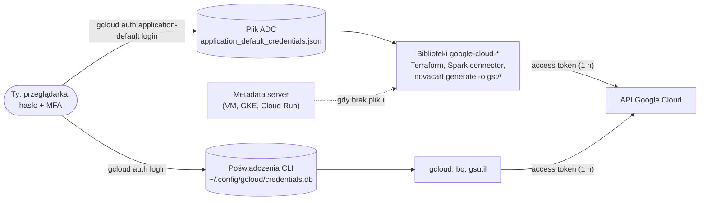
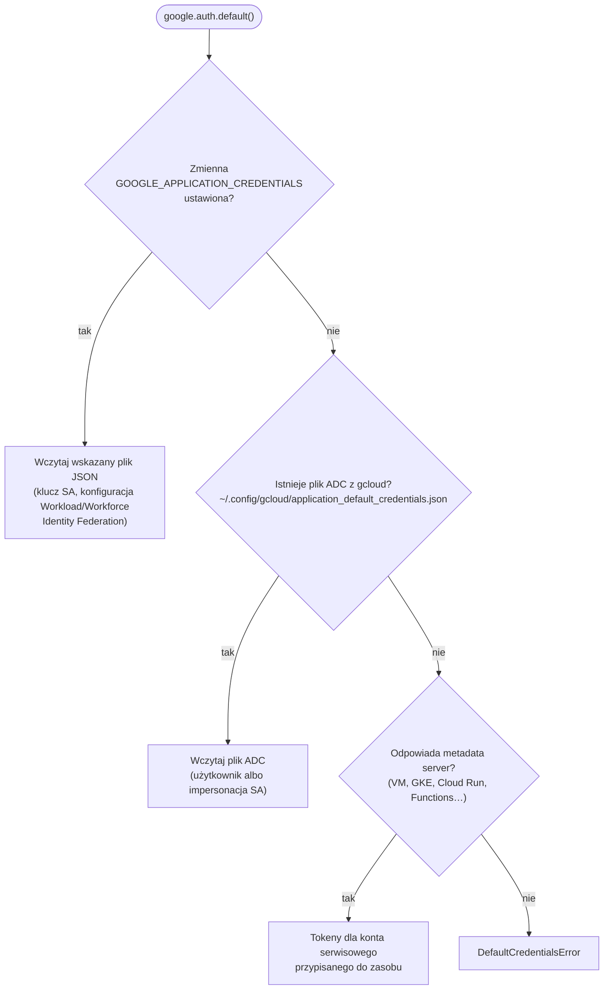
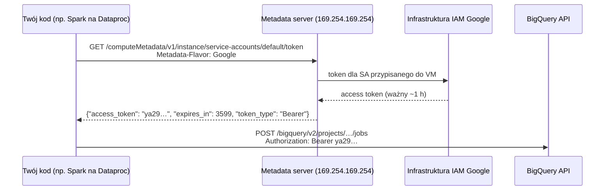
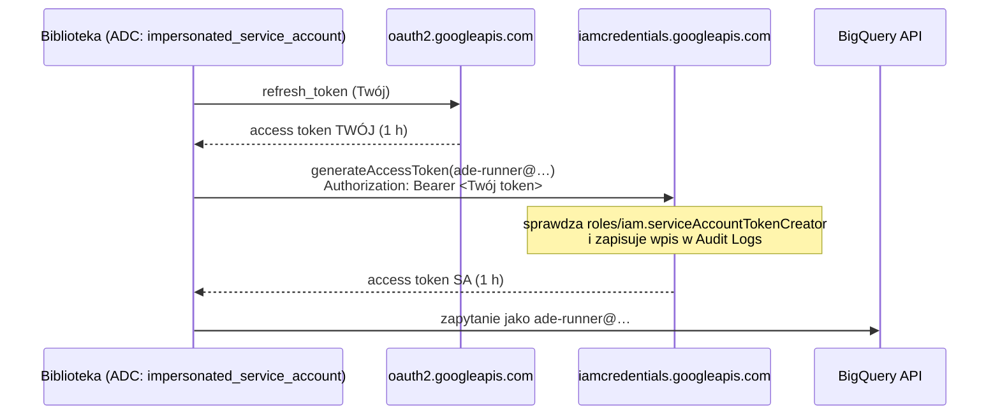

# 00.04 — Narzędzia lokalne

> **Czas:** ~75 min · **Wymaga:** [Lekcja 00.02](02-konto-i-projekt-gcp.md), [Lekcja 00.03](03-bezpieczenstwo-kosztowe.md) · **Ostatnia weryfikacja:** 2026-11-07

**W tej lekcji:**

- zainstalujesz i sprawdzisz zestaw narzędzi kursu: `gcloud`, `bq`, Terraform/OpenTofu, `uv`, Docker, DuckDB i VS Code;
- zrozumiesz, dlaczego `gcloud` ma **dwa niezależne zestawy poświadczeń** i który z nich widzi Twój kod;
- prześledzisz krok po kroku, jak *Application Default Credentials* (ADC) znajdują poświadczenia, czym jest *access token*, *refresh token* i *ID token* oraz jak działa *metadata server*;
- dowiesz się, dlaczego w kursie **nie używamy kluczy kont serwisowych** i czym je zastępujemy (impersonacja);
- porównasz ten model z AWS, Azure, Snowflake, Databricks i Kerberosem z klastrów on-premise.

---

## 1. Problem

Pierwszy dzień w zespole danych NovaCart. Dostajesz dostęp do projektu `novacart-dev`, instalujesz `gcloud`, logujesz się przez `gcloud auth login` i wszystko działa: `gcloud storage ls` pokazuje buckety, `bq ls` pokazuje datasety. Uruchamiasz pierwszy skrypt w Pythonie, który ma odczytać tabelę z BigQuery, i dostajesz:

```text
google.auth.exceptions.DefaultCredentialsError: Your default credentials were not found.
```

Kolega radzi: „wygeneruj klucz JSON dla konta serwisowego i ustaw `GOOGLE_APPLICATION_CREDENTIALS`”. Skrypt działa. Trzy miesiące później ten sam plik JSON trafia przypadkiem do publicznego repozytorium razem z notatnikiem Jupytera. Klucz nie ma daty wygaśnięcia, a konto serwisowe miało rolę `roles/editor` w projekcie produkcyjnym. W ciągu kilku godzin ktoś uruchamia w projekcie maszyny do kopania kryptowalut.

To nie jest wymyślony scenariusz. Wyciekające klucze kont serwisowych są jedną z najczęstszych przyczyn incydentów w GCP i właśnie dlatego Google od maja 2024 r. **domyślnie blokuje tworzenie kluczy** w nowych organizacjach. Źródłem problemu nie był jednak sam klucz, tylko brak zrozumienia, jak działa uwierzytelnianie narzędzi: dlaczego `gcloud` działał, a Python nie, i jakie są bezpieczne alternatywy.

Ta lekcja to porządkuje. Zanim napiszesz pierwszą linijkę kodu w kursie, Twoje środowisko powinno być skonfigurowane tak, jak w dobrze prowadzonym zespole: osobna konfiguracja dla kursu, ADC bez kluczy, przewidywalne wersje narzędzi.

## 2. Intuicja

> [!TIP]
> **Intuicja.** Pomyśl o hotelu. Na recepcji pokazujesz dowód osobisty (logowanie w przeglądarce, z hasłem i MFA). W zamian dostajesz **kartę-klucz do pokoju**, ważną tylko przez czas pobytu (*access token*, ważny godzinę). Karta nie zawiera Twojego dowodu i nie da się z niej odtworzyć hasła. Gdy wygaśnie, recepcja wyda nową bez ponownego pokazywania dowodu, bo pamięta Twoją rezerwację (*refresh token*). **Klucz konta serwisowego** to natomiast **metalowy klucz-wytrych bez daty ważności**: kto go znajdzie, ten wejdzie, a hotel nie wie, kto go trzyma.

Analogia dobrze oddaje różnicę między długotrwałym sekretem a krótkotrwałym tokenem. Ma jednak granicę: w hotelu jest jedna recepcja, a na Twoim laptopie są **dwie niezależne „recepcje”**. Jedna wydaje karty dla poleceń `gcloud`, druga dla bibliotek i Terraform. Dlatego zalogowanie się do jednej nie wpuszcza Cię do drugiej. Z tego wynikał problem z sekcji 1.

## 3. Koncepcja

### 3.1. Pojęcia

| Pojęcie | Znaczenie |
|---|---|
| *gcloud configuration* (konfiguracja gcloud) | Nazwany zestaw ustawień CLI: konto, projekt, region, opcjonalnie impersonacja. Przełączasz się między nimi jednym poleceniem. |
| Poświadczenia CLI | Tokeny uzyskane przez `gcloud auth login`, przechowywane w wewnętrznej bazie `gcloud`. Używają ich `gcloud`, `bq` i `gsutil`. |
| *Application Default Credentials* (ADC) | Algorytm (i plik), dzięki któremu biblioteki klienckie Google i Terraform same znajdują poświadczenia, bez podawania ich w kodzie. |
| *Access token* (token dostępu) | Krótkotrwały (domyślnie 1 h) token *bearer* dołączany do każdego wywołania API w nagłówku `Authorization`. W Google ma postać nieprzezroczystego napisu `ya29.…`. |
| *Refresh token* | Długotrwały sekret, który pozwala uzyskać nowy access token bez ponownego logowania. Jest w pliku ADC dla poświadczeń użytkownika. |
| *ID token* | Podpisany token JWT, który mówi **kim jesteś** (nie co możesz). Służy do wywoływania usług, które same weryfikują tożsamość, np. Cloud Run czy IAP. |
| *Service account* (konto serwisowe, SA) | Tożsamość dla programów, a nie ludzi. Ma adres `nazwa@projekt.iam.gserviceaccount.com`. |
| *Service account key* (klucz SA) | Para kluczy RSA. Prywatna część trafia do pliku JSON. Domyślnie **nigdy nie wygasa**. |
| *Impersonation* (impersonacja) | Działanie „jako” konto serwisowe na podstawie własnej tożsamości i uprawnienia `roles/iam.serviceAccountTokenCreator`, bez klucza. |
| *Quota project* | Projekt, któremu przypisuje się zużycie limitów (*quota*) i rozliczenie wywołań API wykonanych poświadczeniami użytkownika. |
| *Metadata server* | Lokalny endpoint HTTP dostępny z wnętrza maszyn i kontenerów GCP, który wydaje tokeny dla przypisanego konta serwisowego. |

### 3.2. Jak to działa — widok z lotu ptaka



*Rysunek 4.1. Dwa niezależne zestawy poświadczeń na jednej maszynie. Zauważ, że `gcloud` i Twój kod nie współdzielą tokenów: logowanie w jednym miejscu nie loguje w drugim.*

Po lewej stronie jest jedno logowanie interaktywne (przeglądarka, MFA), ale wykonane **dwa razy**, z dwoma różnymi poleceniami i do dwóch różnych miejsc. Polecenia CLI korzystają z bazy `gcloud`. Biblioteki (Python, Java, Go), Terraform i wszystko, co z nich korzysta, szukają poświadczeń algorytmem ADC. Na maszynie w chmurze pliku zwykle nie ma, więc ADC sięga do *metadata server*. W obu przypadkach do API trafia ten sam rodzaj artefaktu: krótkotrwały access token.

## 4. 🔍 Pod maską

### 4.1. Dwa zestawy poświadczeń i konfiguracje `gcloud`

`gcloud` przechowuje stan w katalogu konfiguracyjnym (`~/.config/gcloud` na Linuksie i macOS, `%APPDATA%\gcloud` na Windows; można go zmienić zmienną `CLOUDSDK_CONFIG`):

```text
~/.config/gcloud/
├── active_config                         # nazwa aktywnej konfiguracji, np. "ade"
├── configurations/
│   ├── config_default                    # plik INI: [core] account, project; [compute] region
│   └── config_ade
├── credentials.db                        # SQLite: refresh tokeny kont zalogowanych przez `gcloud auth login`
├── access_tokens.db                      # SQLite: cache krótkotrwałych access tokenów
└── application_default_credentials.json  # plik ADC: tylko z `gcloud auth application-default login`
```

Konfiguracja (`configurations/config_ade`) to zwykły plik INI. Nie zawiera sekretów, tylko wskazanie, **którego** konta i projektu używać. Sekrety są w `credentials.db`, wspólnym dla wszystkich konfiguracji. Dlatego możesz mieć konfigurację `praca` i `ade`, każdą z innym kontem i projektem, i przełączać się bez ponownego logowania:

```text
gcloud config configurations activate ade      # globalnie (zapisuje active_config)
CLOUDSDK_ACTIVE_CONFIG_NAME=ade gcloud ...     # tylko dla jednego polecenia / jednej powłoki
```

Plik ADC to zupełnie inna historia. Jest **jeden** na katalog konfiguracyjny i nie zależy od aktywnej konfiguracji. `gcloud config configurations activate praca` nie zmienia tożsamości, której używa Twój kod w Pythonie. To najczęstsze źródło pomyłek typu „zapytanie poszło do złego projektu”.

> [!IMPORTANT]
> **Co z tego wynika w praktyce:** (1) Załóż osobną konfigurację `gcloud` dla kursu, żeby nie mieszać projektów kursowych z projektami z pracy. (2) Pamiętaj, że ADC jest wspólne dla wszystkich konfiguracji: po przełączeniu konfiguracji sprawdź, czy ADC wskazuje właściwe konto, albo ustaw projekt jawnie w kodzie. (3) Jeśli pracujesz równolegle w dwóch organizacjach, rozważ osobne `CLOUDSDK_CONFIG` (osobny katalog), bo wtedy rozdzielasz także plik ADC.

### 4.2. Algorytm ADC krok po kroku

Gdy biblioteka potrzebuje poświadczeń (`google.auth.default()` w Pythonie, analogiczne funkcje w innych językach, provider `google` w Terraform), sprawdza **po kolei** trzy miejsca i bierze pierwsze, które znajdzie:



*Rysunek 4.2. Kolejność wyszukiwania w ADC. Zmienna środowiskowa wygrywa ze wszystkim, nawet gdy wskazuje stary plik.*

Dokumentacja Google podkreśla, że ta kolejność **nie oznacza rekomendacji**. Pierwsze miejsce zajmuje zmienna środowiskowa, ale zalecanym sposobem na produkcji jest konto serwisowe przypisane do zasobu (krok 3), a na laptopie plik z `gcloud auth application-default login` (krok 2).

Plik ADC może zawierać kilka typów poświadczeń. Pole `type` mówi, z którym masz do czynienia:

| `type` | Skąd się bierze | Co zawiera | Sekret długotrwały? |
|---|---|---|---|
| `authorized_user` | `gcloud auth application-default login` | `client_id`, `client_secret`, `refresh_token`, opcjonalnie `quota_project_id` | tak: refresh token (do odwołania) |
| `impersonated_service_account` | `… login --impersonate-service-account=SA` | poświadczenia źródłowe (Twój refresh token) + URL impersonacji SA | tak, ale **Twój**, a nie konta serwisowego |
| `service_account` | ręcznie pobrany klucz SA | `private_key` RSA, `client_email` | tak: klucz bez daty ważności |
| `external_account` | Workload/Workforce Identity Federation | opis, jak wymienić token z innego systemu (GitHub, AWS, Azure, OIDC) na token Google | nie: tylko konfiguracja |

Wykonanie jest leniwe. `google.auth.default()` tylko **wczytuje** opis poświadczeń. Token powstaje dopiero przy pierwszym wywołaniu API: biblioteka wysyła refresh token do `https://oauth2.googleapis.com/token` i dostaje access token ważny 3 600 sekund. Kolejne wywołania używają tego samego tokenu, a kilka minut przed wygaśnięciem biblioteka sama go odświeża.

> [!IMPORTANT]
> **Co z tego wynika w praktyce:** Gdy kod „używa nie tego konta”, sprawdzaj w kolejności algorytmu: najpierw `echo $GOOGLE_APPLICATION_CREDENTIALS` (zapomniana zmienna z `.bashrc` lub `.env` to klasyk), potem typ w pliku ADC, a na końcu konto przypisane do maszyny. Skrypt [`examples/check_env.sh`](examples/check_env.sh) robi to za Ciebie.

### 4.3. Access token, refresh token, ID token

Te trzy tokeny często się myli, a każdy ma inną rolę:

```text
ACCESS TOKEN (OAuth 2.0, Google)            ID TOKEN (OpenID Connect, JWT)
ya29.a0AfB_byC...  (nieprzezroczysty)       eyJhbGciOiJSUzI1NiIs... . eyJpc3MiOi... . SflKxwRJ...
                                            └──── nagłówek ────┘   └─ treść ─┘   └ podpis ┘
"co możesz zrobić"                          "kim jesteś"
- nośnik uprawnień (scopes)                 - iss: https://accounts.google.com
- weryfikuje go serwer Google               - aud: dla kogo token wydano (np. URL usługi Cloud Run)
- ważny domyślnie 1 h                       - email, sub, exp (ważny ~1 h)
- wysyłany do API Google Cloud              - weryfikuje go ODBIORCA (podpis kluczem publicznym Google)
                                            - wysyłany do Twoich usług (Cloud Run, IAP, Functions)

REFRESH TOKEN
1//0gLx...  (nieprzezroczysty, długotrwały)
- nigdy nie trafia do API usług; tylko do https://oauth2.googleapis.com/token
- pozwala bez logowania uzyskać nowy access token
- ważny do odwołania (wylogowanie, zmiana hasła, polityka sesji w organizacji)
```

Access token Google jest **nieprzezroczysty**: nie da się go odczytać lokalnie. Żeby sprawdzić, do kogo należy, trzeba zapytać serwer (`https://oauth2.googleapis.com/tokeninfo`). ID token to JWT: trzy fragmenty base64url rozdzielone kropkami, z czego środkowy można zdekodować i przeczytać. Prawdziwość potwierdza dopiero podpis.

Do wywoływania API Google Cloud (BigQuery, Storage) potrzebujesz access tokenu. ID tokenu potrzebujesz, gdy wywołujesz **własną** usługę za uwierzytelnieniem, np. prywatny serwis Cloud Run (moduł 36): `gcloud auth print-identity-token`.

> [!IMPORTANT]
> **Co z tego wynika w praktyce:** Tokeny to sekrety typu *bearer*: kto je ma, ten ich używa, bez dodatkowego dowodu tożsamości. Nie wklejaj ich do czatu, issue ani logów. Jeśli musisz coś sprawdzić, patrz na **metadane** tokenu (właściciel, czas ważności, zakresy), a nie na sam token. Tak robi skrypt z sekcji 5.2.

### 4.4. Metadata server: skąd maszyna w chmurze ma tożsamość

Na maszynie wirtualnej, w kontenerze GKE czy w Cloud Run nie ma pliku ADC. Biblioteka pyta wtedy lokalny serwer metadanych pod adresem `http://metadata.google.internal` (`169.254.169.254`). Adres jest *link-local*: osiągalny tylko z wnętrza danej maszyny, a nie przez internet.



*Rysunek 4.3. Na maszynie w chmurze nie ma żadnego sekretu na dysku. Token jest wydawany na żądanie i ważny około godziny.*

Nagłówek `Metadata-Flavor: Google` jest obowiązkowy i ma konkretne zadanie: utrudnia ataki *SSRF* (*server-side request forgery*, zmuszenie aplikacji do wykonania żądania pod wskazany przez atakującego adres). Typowa podatność SSRF pozwala kontrolować URL, ale nie nagłówki, więc nie wystarczy do wyciągnięcia tokenu.

> [!NOTE]
> **Pod maską — dla dociekliwych.** Wszystkie trzy duże chmury stosują ten sam wzorzec i ten sam adres `169.254.169.254`. Różnią się zabezpieczeniem przed SSRF. GCP wymaga nagłówka `Metadata-Flavor: Google`, a Azure nagłówka `Metadata: true`. AWS w IMDSv2 wymaga najpierw uzyskania tokenu sesji żądaniem `PUT` (podatności SSRF rzadko pozwalają na `PUT`). Wycieki poświadczeń przez SSRF do metadata service w IMDSv1 były przyczyną kilku głośnych incydentów i to one skłoniły AWS do wprowadzenia IMDSv2.

> [!IMPORTANT]
> **Co z tego wynika w praktyce:** Kod, który na laptopie korzysta z ADC, działa **bez zmian** na VM, w Dataproc, GKE czy Cloud Run. Zmienia się tylko źródło poświadczeń. Dlatego nigdy nie wpisuj ścieżki do pliku z poświadczeniami w kodzie i nie przekazuj kluczy do kontenerów. Przypisz zasobowi konto serwisowe z minimalnymi uprawnieniami (moduł 09).

### 4.5. Dlaczego klucze kont serwisowych są złe i co zamiast nich

Klucz SA to plik JSON z prywatnym kluczem RSA. Biblioteka podpisuje nim krótkie oświadczenie JWT („jestem `sa@…`, chcę token do `cloud-platform`, ważne 1 h”) i wymienia je w `oauth2.googleapis.com/token` na access token. Ten mechanizm jest kryptograficznie poprawny. Problemem jest **cykl życia sekretu**:

| Właściwość | Klucz SA | Impersonacja / ADC użytkownika | Metadata server |
|---|---|---|---|
| Gdzie jest sekret | plik na dysku, kopiowany dowolnie | refresh token Twojego konta (Twoje MFA, polityki sesji) | brak sekretu na maszynie |
| Ważność | domyślnie **bez daty wygaśnięcia** | token SA ważny domyślnie 1 h | ~1 h, odnawiany automatycznie |
| Kto użył (audyt) | widać tylko SA, nie wiadomo, kto trzymał plik | Cloud Audit Logs pokazują **Ciebie** jako inicjatora impersonacji | SA + zasób |
| Odwołanie | trzeba znaleźć i usunąć klucz | odebranie roli `serviceAccountTokenCreator` | zmiana SA na zasobie |
| Skutek wycieku | pełny dostęp SA do czasu wykrycia | wymaga przejęcia Twojej sesji | wymaga przejęcia maszyny |

Dlatego od 3 maja 2024 r. w organizacjach utworzonych od tej daty ograniczenia `iam.disableServiceAccountKeyCreation` i `iam.disableServiceAccountKeyUpload` są **włączone domyślnie**. Jeśli zakładasz nową organizację na potrzeby kursu, w ogóle nie wygenerujesz klucza bez zmiany polityki.

Impersonacja działa tak: Twoje poświadczenia (z MFA) wywołują IAM Credentials API (`iamcredentials.googleapis.com`, metoda `generateAccessToken`) i dostają krótkotrwały token **konta serwisowego**. Wymaga to roli `roles/iam.serviceAccountTokenCreator` na tym koncie. Token SA jest domyślnie ważny godzinę. Biblioteki odświeżają go same, korzystając z Twojego refresh tokenu.



*Rysunek 4.4. Impersonacja to dwa kroki wymiany tokenów. Na dysku nie pojawia się żaden sekret konta serwisowego.*

Po co w ogóle działać jako konto serwisowe na laptopie, skoro możesz działać jako Ty? Z dwóch powodów. Po pierwsze, testujesz **dokładnie te uprawnienia**, które będzie miał pipeline na produkcji, więc błąd „403 Permission denied” zobaczysz lokalnie, a nie po wdrożeniu. Po drugie, Twoje konto może mieć szerokie uprawnienia (np. `Owner` w projekcie kursowym), a codzienna praca na koncie o węższych uprawnieniach ogranicza skutki pomyłki.

> [!IMPORTANT]
> **Co z tego wynika w praktyce:** W kursie obowiązuje zasada **zero kluczy SA**. Na laptopie używasz `gcloud auth application-default login` (opcjonalnie z `--impersonate-service-account`), w chmurze kont przypisanych do zasobów, a w CI/CD (moduł 37) Workload Identity Federation. Jeśli jakaś instrukcja w internecie zaczyna się od „pobierz klucz JSON”, szukaj alternatywy.

### 4.6. *Quota project*: kto płaci za wywołanie API

Przy poświadczeniach **konta serwisowego** sprawa jest prosta: każde konto należy do projektu, więc wiadomo, czyje limity zużywa wywołanie. Konto **użytkownika** nie należy do żadnego projektu. Wiele API (np. Cloud Billing Budget API, Service Usage, Resource Manager) musi jednak wiedzieć, w którym projekcie naliczyć limity i sprawdzić, czy API jest włączone. Biblioteka dołącza wtedy nagłówek `x-goog-user-project: <quota project>`.

Gdy *quota project* nie jest ustawiony, biblioteka `google-auth` w Pythonie ostrzega przy każdym starcie:

```text
UserWarning: Your application has authenticated using end user credentials from Google Cloud SDK
without a quota project. You might receive a "quota exceeded" or "API not enabled" error.
```

Rozwiązanie to `gcloud auth application-default set-quota-project <projekt>`. Polecenie dopisuje `quota_project_id` do pliku ADC. Wymaga uprawnienia `serviceusage.services.use` w tym projekcie, więc w projekcie kursowym (gdzie jesteś właścicielem) działa od razu.

> [!IMPORTANT]
> **Co z tego wynika w praktyce:** Komunikat „API not enabled” w projekcie, w którym API **jest** włączone, zwykle oznacza, że wywołanie zostało przypisane do innego projektu (domyślnego projektu OAuth klienta `gcloud` albo innego quota project). Ustaw quota project jawnie, a przy impersonacji problem znika sam, bo konto serwisowe ma swój projekt.

### 4.7. Pozostałe narzędzia: co robią pod spodem

**Terraform i OpenTofu.** Terraform czyta pliki `.tf`, buduje graf zależności zasobów, porównuje go z plikiem stanu (*state*) i z rzeczywistością (przez API dostawcy) i wylicza plan zmian. Logika chmury nie jest w samym Terraform, tylko w *providerach*: osobnych procesach (pluginach) komunikujących się z rdzeniem przez gRPC. Provider `google` korzysta z ADC, więc bez kroku z sekcji 4.2 Terraform nie zadziała. Szczegóły w module 12.

W sierpniu 2023 r. HashiCorp zmienił licencję Terraform (od wersji 1.6) z otwartej MPL 2.0 na *Business Source License* 1.1 (BSL). BSL pozwala na normalne używanie, ale ogranicza budowanie konkurencyjnych produktów komercyjnych. W odpowiedzi społeczność utworzyła fork **OpenTofu** na licencji MPL 2.0, pod opieką Linux Foundation. W kwietniu 2025 r. OpenTofu został przyjęty do CNCF jako projekt *Sandbox*. W 2025 r. HashiCorp stał się częścią IBM.

| | Terraform | OpenTofu |
|---|---|---|
| Licencja | BSL 1.1 (od 1.6) | MPL 2.0 (open source) |
| Polecenie | `terraform` | `tofu` |
| Rejestr providerów | `registry.terraform.io` | `registry.opentofu.org` (te same providery, np. `hashicorp/google`) |
| Funkcje różnicujące | HCP Terraform, Terraform Stacks | szyfrowanie pliku stanu po stronie klienta, `.tofu` jako rozszerzenie nadpisujące |
| Kompatybilność | — | język HCL i format stanu zgodne z Terraform 1.5/1.6; potem drogi się rozchodzą |

Przykłady w kursie są pisane tak, żeby działały na obu (Terraform 1.9+ lub OpenTofu 1.8+). Wybierz to, czego używa Twoja firma. Jeśli nie masz preferencji, wybierz Terraform, bo większość dokumentacji GCP pokazuje polecenie `terraform`.

**`uv`.** Menedżer pakietów i projektów Pythona napisany w Ruście (Astral). Zastępuje `pip`, `pip-tools`, `virtualenv`, `pyenv` i `pipx`. Kluczowe dla kursu cechy:

- `uv.lock` to **wieloplatformowy lockfile**: dokładne wersje wszystkich zależności (także tranzytywnych) z sumami kontrolnymi. U wszystkich uczestników kursu biblioteki są więc takie same.
- `uv sync` tworzy `.venv` obok `pyproject.toml` i instaluje dokładnie to, co jest w lockfile. Pakiety trafiają do globalnego cache i są *linkowane* do środowisk (na macOS przez klonowanie plików APFS). Dziesiąte środowisko z tymi samymi bibliotekami powstaje więc w ułamku sekundy i prawie nie zajmuje miejsca.
- `uv run` przed uruchomieniem sprawdza, czy środowisko jest zgodne z lockfile, więc nie zapomnisz o `pip install`.
- `uv python install 3.12` instaluje interpreter, jeśli systemowy jest za stary.

> [!WARNING]
> **Pułapka.** Jeśli masz aktywny inny virtualenv (np. z `pyenv` lub `conda`), `uv` ostrzega: ``VIRTUAL_ENV=… does not match the project environment path `.venv` and will be ignored``. To tylko ostrzeżenie, bo `uv` i tak użyje `.venv` projektu. Żeby go nie widzieć, dezaktywuj środowisko (`deactivate`) albo uruchamiaj `env -u VIRTUAL_ENV uv run …`, tak jak robią to skrypty kursu.

**Docker i Colima.** Na macOS i Windows kontenery Linuksa nie działają natywnie, tylko w lekkiej maszynie wirtualnej. Docker Desktop i Colima (otwartoźródłowa alternatywa dla macOS i Linuksa, oparta na Lima) różnią się sposobem zarządzania tą maszyną i licencją, a nie samymi kontenerami. Docker Desktop jest bezpłatny do użytku osobistego, edukacyjnego i w małych firmach. Większe organizacje potrzebują płatnej subskrypcji, więc w pracy sprawdź, co jest dozwolone. Konsekwencje VM dla kursu:

- kontenery mają tyle pamięci, ile przydzielisz VM (Kafka + emulator Pub/Sub + PostgreSQL to ok. 2–3 GB, a lokalny Spark kolejne kilka);
- na Apple Silicon obrazy `linux/amd64` działają w emulacji (Rosetta/QEMU) i są wolniejsze. Wszystkie obrazy z [`examples/compose/docker-compose.yml`](examples/compose/docker-compose.yml) mają warianty `arm64`;
- bind-mounty dużych katalogów (np. `data/m`) są wolniejsze niż wolumeny Dockera, bo pliki przechodzą przez warstwę współdzielenia z VM.

**DuckDB.** Kolumnowa, wektoryzowana baza analityczna działająca **wewnątrz Twojego procesu** (jak SQLite, ale dla analityki). Czyta Parquet, CSV i JSON bezpośrednio z dysku, bez ładowania. W kursie pełni rolę lokalnej „hurtowni”: sprawdzasz na niej zapytania i dane, zanim zapłacisz za skan w BigQuery. Wystarczy pakiet Pythona `duckdb` (jest w `pyproject.toml` przykładów). Interaktywne CLI `duckdb` jest wygodne, ale opcjonalne. Mechanizmy wykonania (wektoryzacja, *morsels*) rozbieramy w module 06, a DuckDB jako zamiennik hurtowni w lekcji [00.05](05-emulatory-i-praca-offline.md).

**`bq`.** Klient CLI BigQuery dołączony do Google Cloud SDK. Korzysta z poświadczeń CLI (nie z ADC). Ma plik ustawień domyślnych `~/.bigqueryrc`, w którym możesz ustawić m.in. GoogleSQL jako domyślny dialekt i limit bajtów dla zapytań. Szczegóły w [lekcji 00.03](03-bezpieczenstwo-kosztowe.md).

> [!IMPORTANT]
> **Co z tego wynika w praktyce:** Przypinaj wersje wszystkiego, co wpływa na wynik: Pythona i bibliotek (`uv.lock`), providerów Terraform (`required_providers` + `.terraform.lock.hcl`) i obrazów Dockera (tag z numerem wersji zamiast `latest`). Wtedy przykład z kursu zadziała tak samo za rok, a Twój pipeline tak samo na laptopie i w CI.

## 5. 💻 W praktyce

### 5.1. Instalacja

Wymagane minimum i polecenia instalacji dla macOS (Homebrew) i Linuksa. Na Windows zalecamy WSL2 i polecenia linuksowe.

| Narzędzie | Wersja w kursie | macOS | Linux (Debian/Ubuntu) |
|---|---|---|---|
| Google Cloud CLI (`gcloud`, `bq`) | aktualna | `brew install --cask google-cloud-sdk` | [repozytorium apt Google](https://cloud.google.com/sdk/docs/install) |
| Terraform **lub** OpenTofu | 1.9+ / 1.8+ | `brew install hashicorp/tap/terraform` / `brew install opentofu` | [repozytorium HashiCorp](https://developer.hashicorp.com/terraform/install) / [instalator OpenTofu](https://opentofu.org/docs/intro/install/) |
| `uv` | 0.8+ | `brew install uv` | `curl -LsSf https://astral.sh/uv/install.sh \| sh` |
| Python | 3.12+ | `uv python install 3.12` | `uv python install 3.12` |
| Docker | 24+ | Docker Desktop albo `brew install colima docker docker-compose` | `docker.io` + `docker-compose-v2` z dystrybucji |
| Git | 2.40+ | `brew install git` | `apt install git` |
| DuckDB CLI (opcjonalnie) | 1.3+ | `brew install duckdb` | [instalator DuckDB](https://duckdb.org/docs/installation/) |
| Java (opcjonalnie, lokalny Spark) | 17 lub 21 | `brew install openjdk@21` | `apt install openjdk-21-jdk` |

Rozszerzenia VS Code, które przydadzą się w kursie:

| Rozszerzenie | Identyfikator | Po co |
|---|---|---|
| Python | `ms-python.python` | interpreter z `.venv`, debugowanie |
| Ruff | `charliermarsh.ruff` | lint i formatowanie zgodne z konwencją kursu |
| HashiCorp Terraform | `hashicorp.terraform` | składnia HCL, podpowiedzi atrybutów providera |
| YAML | `redhat.vscode-yaml` | Docker Compose, Cloud Build, Kubernetes |
| Markdown Preview Mermaid Support | `bierner.markdown-mermaid` | podgląd diagramów z lekcji |
| Rainbow CSV | `mechatroner.rainbow-csv` | podgląd plików partnerów NovaCart |
| Docker | `ms-azuretools.vscode-docker` | kontenery i Compose |
| Cloud Code (opcjonalnie) | `googlecloudtools.cloudcode` | integracja z GCP, Cloud Run, GKE |

### 5.2. Sprawdzenie środowiska

Skrypt [`examples/check_env.sh`](examples/check_env.sh) niczego nie instaluje i niczego nie zmienia. Sprawdza wersje, działanie Docker daemona i źródło ADC:

```bash
# examples/check_env.sh (fragment)
# gcloud: aktywne konto, projekt i ADC. Pokazujemy tylko metadane, nigdy tokeny.
if command -v gcloud >/dev/null 2>&1; then
  account="$(gcloud config get-value account 2>/dev/null)"
  project="$(gcloud config get-value project 2>/dev/null)"
  config="$(gcloud config configurations list --filter=is_active=true --format='value(name)' 2>/dev/null)"
  echo "  ℹ️  gcloud: konfiguracja='${config:-?}', konto='${account:-(brak)}', projekt='${project:-(brak)}'"
  adc="${CLOUDSDK_CONFIG:-$HOME/.config/gcloud}/application_default_credentials.json"
  if [[ -n "${GOOGLE_APPLICATION_CREDENTIALS:-}" && "${GOOGLE_APPLICATION_CREDENTIALS}" != "$adc" ]]; then
    echo "  ⚠️  GOOGLE_APPLICATION_CREDENTIALS=${GOOGLE_APPLICATION_CREDENTIALS} ma pierwszeństwo przed plikiem ADC z gcloud"
  elif [[ -f "$adc" ]]; then
    adc_type="$(python3 -c 'import json,sys; print(json.load(open(sys.argv[1])).get("type","?"))' "$adc" 2>/dev/null)"
    echo "  ✅ ADC: $adc (type=$adc_type)"
  else
    echo "  ⚠️  ADC nie skonfigurowane: gcloud auth application-default login (lekcja 00.04)"
  fi
fi
```

**Wynik** (macOS, Apple Silicon; konto i projekt zanonimizowane):

```text
$ bash examples/check_env.sh
== Narzędzia wymagane ==
  ✅ gcloud     Google Cloud SDK 541.0.0
  ✅ bq         This is BigQuery CLI 2.1.24
  ✅ terraform  Terraform v1.16.0
  ✅ uv         uv 0.10.0 (Homebrew 2026-02-05)
  ✅ python3    Python 3.13.7
  ✅ git        git version 2.54.0 (Apple Git-157)
  ✅ docker     Docker version 28.4.0, build d8eb465
== Narzędzia opcjonalne ==
  ⚪ tofu       brak (opcjonalne)
  ⚪ duckdb     brak (opcjonalne)
  ✅ java       openjdk version "25.0.2" 2026-01-20
  ✅ kubectl    Client Version: v1.34.1
  ✅ jq         jq-1.7.1-apple
  ⚪ colima     brak (opcjonalne)
== Szczegóły ==
  ✅ Python 3.13 (>= 3.12)
  ✅ Terraform 1.16.0 (>= 1.9)
  ⚠️  Docker daemon nie działa: uruchom Docker Desktop albo 'colima start'
  ✅ DuckDB (pakiet Pythona) 2.0.0
  ℹ️  gcloud: konfiguracja='default', konto='jan.kowalski@example.com', projekt='novacart-dev-4821'
  ✅ ADC: /Users/jan/.config/gcloud/application_default_credentials.json (type=authorized_user)

Wynik: wszystkie wymagane narzędzia są zainstalowane.
```

Zwróć uwagę na trzy rzeczy. Po pierwsze, sam klient `docker` to za mało: bez działającego daemona (Docker Desktop albo `colima start`) emulatory z następnej lekcji nie wystartują. Po drugie, brak CLI `duckdb` nie przeszkadza, bo przykłady używają pakietu Pythona. Po trzecie, aktywna jest konfiguracja `default`, a nie osobna konfiguracja kursowa. To naprawimy w kolejnym kroku.

> [!NOTE]
> Java 25 z wyniku powyżej jest nowsza niż wersje wspierane przez Apache Spark 4.x (Java 17 i 21). Jeśli planujesz lokalny Spark (moduł 19), zainstaluj obok JDK 21 i ustaw `JAVA_HOME` w projekcie Sparka.

### 5.3. Konfiguracja `gcloud` i ADC dla kursu

Skrypt [`examples/02_adc_setup.sh`](examples/02_adc_setup.sh) wykonuje wszystkie kroki z sekcji 4. Zmienia konfigurację `gcloud` na Twojej maszynie, więc przeczytaj go przed uruchomieniem. Najważniejsze fragmenty:

```bash
# examples/02_adc_setup.sh (fragment 1: osobna konfiguracja)
if ! gcloud config configurations describe "$CONFIG_NAME" >/dev/null 2>&1; then
  gcloud config configurations create "$CONFIG_NAME" --no-activate
fi
gcloud config configurations activate "$CONFIG_NAME"
gcloud config set project "$PROJECT_ID"
gcloud config set compute/region "$REGION"
gcloud config set compute/zone "${REGION}-a"
```

```bash
# examples/02_adc_setup.sh (fragment 2: ADC z impersonacją albo z quota project)
if $IMPERSONATE; then
  # Twój użytkownik musi mieć roles/iam.serviceAccountTokenCreator na koncie serwisowym.
  # Plik ADC zawiera wtedy Twój refresh token + adres SA; biblioteki same wymieniają go
  # na krótkotrwały token konta serwisowego (domyślnie ważny 1 h).
  gcloud auth application-default login --impersonate-service-account="$SA_EMAIL"
else
  gcloud auth application-default login
  # Projekt, który płaci za limity (quota) i do którego trafiają wywołania API
  # „bez projektu” (np. niektóre wywołania Service Usage). Tylko dla poświadczeń użytkownika.
  gcloud auth application-default set-quota-project "$PROJECT_ID"
fi
```

```bash
# examples/02_adc_setup.sh (fragment 3: metadane tokenu, bez tokenu)
TOKEN="$(gcloud auth application-default print-access-token)"
curl -s --fail https://oauth2.googleapis.com/tokeninfo \
  --data-urlencode "access_token=${TOKEN}" \
  | python3 -c 'import json,sys; d=json.load(sys.stdin); print({k: d.get(k) for k in ("email","expires_in","scope")})'
unset TOKEN
```

Uruchomienie:

```text
PROJECT_ID=novacart-dev-4821 bash examples/02_adc_setup.sh                 # ADC jako Ty
PROJECT_ID=novacart-dev-4821 bash examples/02_adc_setup.sh --impersonate   # ADC jako ade-runner@…
```

Wariant z impersonacją zakłada, że konto serwisowe `ade-runner` istnieje i masz na nim rolę `roles/iam.serviceAccountTokenCreator`. Konto i rolę utworzysz w zadaniu końcowym modułu (Terraform). Do tego czasu wystarczy wariant podstawowy.

**Oczekiwany wynik** kroków 4–5 dla wariantu podstawowego (wartości przykładowe):

```text
== 4. Typ poświadczeń w pliku ADC ==
{
  "type": "authorized_user",
  "quota_project_id": "novacart-dev-4821"
}

== 4b. google.auth.default() z perspektywy Pythona ==
klasa poświadczeń: google.oauth2.credentials.Credentials
projekt z ADC:     novacart-dev-4821
quota project:     novacart-dev-4821

== 5. Metadane tokenu dostępu z ADC ==
{'email': 'jan.kowalski@example.com', 'expires_in': '3599', 'scope': 'openid https://www.googleapis.com/auth/userinfo.email https://www.googleapis.com/auth/cloud-platform ...'}
```

`expires_in: 3599` potwierdza, że access token żyje godzinę. Zakres `cloud-platform` oznacza „wszystkie API Google Cloud”: o tym, **co** wolno, decyduje IAM, a nie zakres tokenu (moduł 09). Krok 4b pokazuje dokładnie to, co zobaczy każda biblioteka `google-cloud-*` i Terraform. Bez kroku `set-quota-project` w tym miejscu pojawiłoby się ostrzeżenie z sekcji 4.6.

## 6. ⚖️ Porównanie platform

| Aspekt | GCP | AWS | Azure | Snowflake | Databricks | On-prem / OSS (Hadoop) |
|---|---|---|---|---|---|---|
| Główne CLI | `gcloud`, `bq` | `aws` | `az` | `snow` (Snowflake CLI), wcześniej SnowSQL | `databricks` | `hdfs`, `yarn`, `beeline`, `kinit` |
| Profile / konfiguracje | `gcloud config configurations`, `CLOUDSDK_ACTIVE_CONFIG_NAME` | profile w `~/.aws/config`, `AWS_PROFILE` | `az account set`, osobne `AZURE_CONFIG_DIR` | połączenia w `~/.snowflake/connections.toml` (`-c nazwa`) | profile w `~/.databrickscfg` (`--profile`) | pliki `*-site.xml`, `krb5.conf` |
| Logowanie człowieka | `gcloud auth login` (przeglądarka, MFA) | `aws sso login` (IAM Identity Center) | `az login` (Entra ID) | przeglądarka (SSO), hasło + MFA | `databricks auth login` (OAuth U2M) | `kinit` → bilet TGT |
| Łańcuch domyślnych poświadczeń dla kodu | ADC: zmienna → plik gcloud → metadata server | *default credential provider chain*: zmienne → pliki `~/.aws` → kontener → IMDS | `DefaultAzureCredential`: zmienne → workload identity → managed identity → `az` CLI → … | brak; połączenie konfigurowane jawnie | *unified client auth*: zmienne `DATABRICKS_*` → profil → … | brak; bilet Kerberos z cache |
| Tożsamość zasobu w chmurze | konto serwisowe + metadata server (`Metadata-Flavor: Google`) | IAM role + IMDSv2 (token sesji przez `PUT`) | *managed identity* + IMDS (`Metadata: true`) | brak zasobów klienta; usługi wewnętrzne | *service principal*, poświadczenia instancji chmury | *keytab* usługi |
| „Długi sekret” do unikania | klucz SA (JSON) | access key `AKIA…` użytkownika IAM | sekret *service principal* | hasło bez MFA | *personal access token* (PAT) | *keytab* skopiowany poza serwer |
| Zalecana alternatywa | impersonacja, Workload Identity Federation | role + SSO, IAM Roles Anywhere, OIDC | managed identity, federacja OIDC | uwierzytelnianie parą kluczy (JWT), OAuth, *workload identity federation* | OAuth M2M (service principal), federacja | krótkie bilety, *delegation tokens* |
| Krótkotrwały token | access token, ~1 h | STS, 15 min – 12 h | access token Entra, ~1 h | token sesji | token OAuth, ~1 h | bilet TGT, typowo 10–24 h |

**Wnioski:** Architektura jest wszędzie ta sama: człowiek loguje się interaktywnie z MFA i dostaje krótkotrwały token, a programy w chmurze dostają tożsamość od platformy przez lokalny endpoint metadanych, bez sekretu na dysku. Różnice są głównie w nazwach i w szczegółach ochrony endpointu metadanych (nagłówek w GCP i Azure, token sesji w AWS). Wyróżnia się Snowflake: nie ma własnych maszyn klienta, więc nie ma metadata server, a aplikacje używają pary kluczy RSA, OAuth albo federacji z tożsamością chmury. Kerberos z klastrów Hadoop jest „dziadkiem” tego modelu. Bilet TGT pełni rolę refresh tokenu, bilet usługi rolę access tokenu, a *keytab* ma te same wady co klucz SA.

## 7. ⚠️ Antywzorce i pułapki

| Antywzorzec | Objaw | Dlaczego tak się dzieje | Jak naprawić |
|---|---|---|---|
| Klucz SA w repozytorium lub w obrazie Dockera | Alert od Google o wycieku klucza, nieznane zasoby w projekcie | Klucz nie wygasa i działa z każdego miejsca na świecie | Usuń klucz, sprawdź Audit Logs, przejdź na ADC + impersonację lub WIF |
| Zapomniane `GOOGLE_APPLICATION_CREDENTIALS` w `.bashrc` | Kod działa jako „stare” konto, mimo nowego `application-default login` | Zmienna ma najwyższy priorytet w algorytmie ADC | `unset GOOGLE_APPLICATION_CREDENTIALS`, usuń ją z plików startowych |
| `gcloud auth login` zamiast `application-default login` | `DefaultCredentialsError` w Pythonie i Terraform, mimo że `gcloud` działa | Dwa niezależne zestawy poświadczeń | `gcloud auth application-default login` |
| Brak quota project | Ostrzeżenie przy starcie, „API not enabled” w projekcie, w którym API działa | Wywołania z poświadczeniami użytkownika są przypisane do innego projektu | `gcloud auth application-default set-quota-project` |
| Jedna konfiguracja `gcloud` do pracy i kursu | Zasoby kursu utworzone w projekcie firmowym | Domyślny projekt z konfiguracji `default` | Osobna konfiguracja `ade` (sekcja 5.3), projekt zawsze jawnie w Terraform |
| Obrazy i providery bez przypiętej wersji | „U mnie działało” po aktualizacji `latest` | Nowa wersja zmienia zachowanie lub API | Tagi wersji, `uv.lock`, `.terraform.lock.hcl` w repozytorium |

> [!WARNING]
> **Pułapka.** Plik ADC typu `authorized_user` też zawiera długotrwały sekret: Twój refresh token. Jest bezpieczniejszy od klucza SA, bo podlega politykom sesji organizacji i wylogowanie go unieważnia (`gcloud auth application-default revoke`). Nadal jednak **nie kopiuj go** na serwery, do kontenerów ani do CI. Tam używaj tożsamości zasobu albo Workload Identity Federation.

## 8. 💰 Koszty

Narzędzia z tej lekcji są bezpłatne i działają lokalnie, z dwoma zastrzeżeniami:

- **Docker Desktop** wymaga płatnej subskrypcji w większych organizacjach (zgodnie z warunkami licencji Dockera). Colima i natywny Docker Engine na Linuksie są bezpłatne.
- Same polecenia `gcloud`, `bq` i Terraform nic nie kosztują, ale **zasoby i zapytania**, które uruchamiają, już tak. Każde `bq query` bez limitu bajtów to potencjalny koszt. Zabezpieczenia omawia [lekcja 00.03](03-bezpieczenstwo-kosztowe.md).

Wywołania IAM Credentials API (impersonacja) i wydawanie tokenów są bezpłatne.

## 9. Podsumowanie

- `gcloud auth login` loguje **CLI**, a `gcloud auth application-default login` loguje **Twój kod i Terraform**. To dwa niezależne zestawy poświadczeń.
- ADC szuka poświadczeń w kolejności: zmienna `GOOGLE_APPLICATION_CREDENTIALS` → plik ADC z `gcloud` → metadata server. Pierwsze trafienie wygrywa.
- Do API trafia zawsze krótkotrwały access token (1 h). Refresh token i klucz SA to długotrwałe sekrety, które służą tylko do jego uzyskania.
- W kursie nie używamy kluczy SA: na laptopie ADC (opcjonalnie z impersonacją), w chmurze konto przypisane do zasobu, w CI federacja tożsamości.
- Osobna konfiguracja `gcloud`, ustawiony quota project i przypięte wersje narzędzi eliminują większość problemów typu „działa u mnie, nie działa u Ciebie”.

## 🧠 Sprawdź się

<details>
<summary><b>`gcloud storage ls` działa, a `storage.Client().list_buckets()` w Pythonie zgłasza `DefaultCredentialsError`. Dlaczego?</b></summary>

`gcloud` korzysta z poświadczeń CLI (z `gcloud auth login`), a biblioteka Pythona z ADC. Plik ADC powstaje tylko po `gcloud auth application-default login`. Jeśli go nie ma, nie ma zmiennej `GOOGLE_APPLICATION_CREDENTIALS` i nie działasz na maszynie GCP, ADC nie ma skąd wziąć poświadczeń.

</details>

<details>
<summary><b>Przełączasz konfigurację `gcloud` na `praca` i uruchamiasz skrypt w Pythonie. Jako kto działa skrypt?</b></summary>

Jako tożsamość z pliku ADC, niezależnie od aktywnej konfiguracji `gcloud`. Plik ADC jest jeden na katalog konfiguracyjny. Projekt domyślny biblioteka może jednak wziąć z aktywnej konfiguracji (albo ze zmiennej `GOOGLE_CLOUD_PROJECT`), więc łatwo o mieszankę „konto z kursu, projekt z pracy”. Dlatego projekt podawaj jawnie.

</details>

<details>
<summary><b>Czym różni się wyciek pliku ADC z impersonacją od wycieku klucza konta serwisowego?</b></summary>

Plik ADC z impersonacją zawiera **Twój** refresh token i adres SA, a nie klucz SA. Atakujący działa więc jako Ty. Podlega politykom sesji Twojej organizacji, każda impersonacja zostawia wpis w Audit Logs z Twoją tożsamością, a odwołanie sesji (`revoke`, zmiana hasła) albo odebranie roli `serviceAccountTokenCreator` natychmiast blokuje dostęp. Klucz SA działa bez daty ważności, z dowolnego miejsca, a w logach widać tylko konto serwisowe.

</details>

<details>
<summary><b>Dlaczego metadata server wymaga nagłówka `Metadata-Flavor: Google`, skoro i tak jest dostępny tylko z wnętrza maszyny?</b></summary>

„Tylko z wnętrza maszyny” obejmuje też Twoją aplikację, a ta może mieć podatność SSRF: atakujący z zewnątrz każe jej pobrać dowolny URL, np. adres tokenu. Typowe SSRF pozwala kontrolować URL, ale nie nagłówki, więc wymagany nagłówek blokuje ten wektor. AWS osiąga to samo w IMDSv2 przez token sesji uzyskiwany żądaniem `PUT`.

</details>

<details>
<summary><b>Twój zespół rozważa przejście z Terraform na OpenTofu. Co sprawdzić przed decyzją?</b></summary>

Licencję (BSL ogranicza budowanie konkurencyjnych produktów, ale nie zwykłe użycie), zgodność wersji (wspólna baza to Terraform 1.5/1.6, a nowsze funkcje się różnią), dostępność używanych providerów i modułów w rejestrze OpenTofu, integracje (HCP Terraform, CI, skanery polityk) oraz funkcje, których potrzebujecie, np. szyfrowanie stanu w OpenTofu. Kod HCL z kursu działa na obu.

</details>

## 📚 Źródła

1. Google Cloud, [How Application Default Credentials works](https://docs.cloud.google.com/docs/authentication/application-default-credentials) — dostęp 2026-11-07
2. Google Cloud, [Service account credentials](https://docs.cloud.google.com/iam/docs/service-account-creds) (ważność kluczy, domyślne ograniczenia od 3.05.2024, czas życia tokenów) — dostęp 2026-11-07
3. Google Cloud, [Troubleshoot ADC with user credentials](https://cloud.google.com/docs/authentication/adc-troubleshooting/user-creds) (quota project)
4. Google Cloud, [About VM metadata](https://cloud.google.com/compute/docs/metadata/overview) (nagłówek `Metadata-Flavor`)
5. Google Cloud, [Service account impersonation](https://cloud.google.com/iam/docs/service-account-impersonation)
6. Google Cloud, [Managing gcloud CLI configurations](https://cloud.google.com/sdk/docs/configurations)
7. Biblioteka `google-auth` dla Pythona, moduł `google/auth/_default.py` (algorytm ADC i ostrzeżenie o quota project) — wersja zainstalowana w `examples/.venv`, 2026-11-07
8. HashiCorp, [HashiCorp adopts Business Source License](https://www.hashicorp.com/blog/hashicorp-adopts-business-source-license) (2023)
9. CNCF, [OpenTofu — projekt CNCF](https://www.cncf.io/projects/opentofu/) (Sandbox od 23.04.2025)
10. Astral, [uv — dokumentacja](https://docs.astral.sh/uv/)
11. AWS, [Use IMDSv2](https://docs.aws.amazon.com/AWSEC2/latest/UserGuide/configuring-instance-metadata-service.html); Microsoft, [DefaultAzureCredential](https://learn.microsoft.com/azure/developer/python/sdk/authentication/credential-chains); Snowflake, [Key-pair authentication](https://docs.snowflake.com/en/user-guide/key-pair-auth); Databricks, [Authentication for the Databricks CLI](https://docs.databricks.com/en/dev-tools/cli/authentication.html)

---

<sub>← [00.03 — Bezpieczeństwo kosztowe od pierwszego dnia](03-bezpieczenstwo-kosztowe.md) · [Moduł 00](README.md) · [00.05 — Emulatory i praca offline](05-emulatory-i-praca-offline.md) →</sub>
