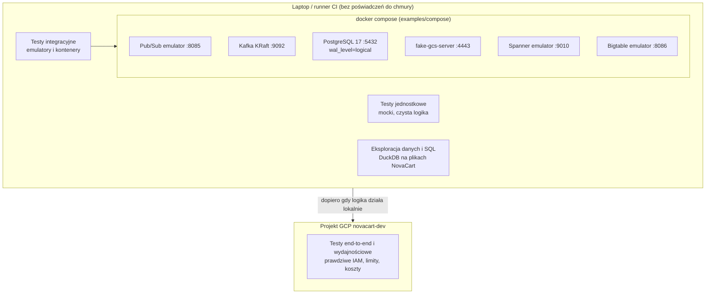
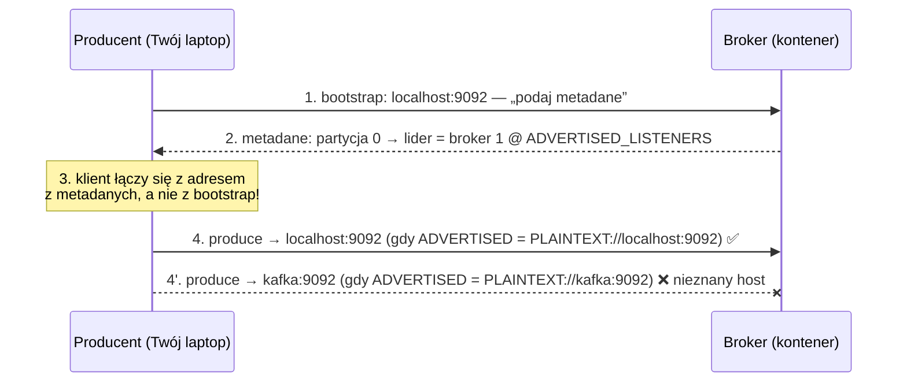

# 00.05 — Emulatory i praca offline

> **Czas:** ~70 min · **Wymaga:** [Lekcja 00.04](04-narzedzia-lokalne.md) · **Ostatnia weryfikacja:** 2026-11-07

**W tej lekcji:**

- poznasz lokalne zamienniki usług chmurowych: oficjalne emulatory Google (Pub/Sub, Bigtable, Spanner, Firestore/Datastore), lokalną Kafkę, PostgreSQL, atrapę Cloud Storage i DuckDB jako „hurtownię na laptopie”;
- zrozumiesz, **jak** biblioteka kliencka przełącza się na emulator i dlaczego jedna zmienna środowiskowa może skierować Twój kod do prawdziwej chmury albo na `localhost`;
- nauczysz się odróżniać, co emulator odwzorowuje (kontrakt API), a czego nie (IAM, limity, wydajność, awarie);
- uruchomisz Pub/Sub w emulatorze z danymi NovaCart i zmierzysz, jak DuckDB dzięki partycjom i projekcji kolumn czyta tylko potrzebne dane;
- porównasz podejście GCP z LocalStack (AWS), Azurite (Azure) oraz z sytuacją w Snowflake i Databricks, gdzie emulatorów praktycznie nie ma.

---

## 1. Problem

Zespół NovaCart pisze konsumenta zdarzeń clickstream: subskrypcja Pub/Sub, deduplikacja po `event_id`, zapis do BigQuery. Każda zmiana w kodzie wymaga dziś tego samego cyklu: wdrożenia w projekcie `novacart-dev`, wysłania testowych zdarzeń i sprawdzenia wyników w konsoli. Jedna iteracja trwa 4–6 minut. Do tego dwóch programistów testuje jednocześnie na tej samej subskrypcji i „kradnie” sobie wiadomości. Test w CI w ogóle nie dotyka Pub/Sub, bo pipeline CI nie ma poświadczeń do chmury.

Druga sytuacja: analityk pisze zapytanie lejka konwersji na tabeli `clickstream`. Każda poprawka literówki w `WHERE` to nowy skan w BigQuery. Na skali M, przy kilkudziesięciu iteracjach dziennie, to kilkaset GB skanowania tylko na „sprawdzenie, czy SQL się parsuje”.

Obie sytuacje mają wspólny mianownik: **pętla informacji zwrotnej przechodzi przez chmurę**, choć nie musi. Większość błędów to błędy logiki (zły filtr, zła deserializacja, brak obsługi duplikatu), a nie błędy integracji z prawdziwą usługą. Takie błędy można znaleźć lokalnie w kilka sekund, za darmo i bez konfliktów z innymi.

Emulatory mają jednak drugą stronę. Kod, który działa idealnie na emulatorze, potrafi się wyłożyć w chmurze na brakującym uprawnieniu IAM, limicie przepustowości albo na tym, że prawdziwy Pub/Sub dostarcza wiadomości **co najmniej raz**, a emulator w testach akurat dostarczał każdą dokładnie raz. Ta lekcja uczy, kiedy emulator wystarczy, a kiedy nie.

## 2. Intuicja

> [!TIP]
> **Intuicja.** Emulator jest jak **symulator lotów**. Pilot ćwiczy w nim procedury: checklisty, przyciski, komunikację. Robi to tanio, bezpiecznie i może powtarzać tę samą awarię silnika dwadzieścia razy. Symulator nie nauczy go jednak, jak zachowuje się konkretny samolot w prawdziwej turbulencji, ani nie sprawdzi, czy lotnisko ma wolny pas. Licencję i tak zdobywa się w prawdziwym samolocie.

Emulator odwzorowuje **kontrakt** usługi: te same wywołania API, te same komunikaty, ten sam format zasobów. Twój kod „naciska te same przyciski”. Nie odwzorowuje natomiast **otoczenia**: uprawnień (IAM), limitów (*quota*), opóźnień sieci, zachowania pod obciążeniem ani rzadkich awarii. Analogia ma też granicę w drugą stronę. Symulator lotów jest certyfikowany i bardzo wierny, a emulatory usług danych są zwykle **uproszczonymi implementacjami** (jednowęzłowe, w pamięci), które w szczegółach potrafią zachowywać się inaczej niż oryginał. Dokumentacja Google wprost ostrzega, że np. komunikaty błędów emulatora Spannera mogą się różnić od produkcyjnych.

## 3. Koncepcja

### 3.1. Pojęcia

| Pojęcie | Znaczenie |
|---|---|
| *Emulator* | Lokalna implementacja API usługi, zwykle oficjalna (np. emulator Pub/Sub od Google). Twój kod rozmawia z nim tym samym protokołem co z chmurą. |
| *Fake* (atrapa) | Uproszczona implementacja API, często społecznościowa (np. `fake-gcs-server`). Działa „wystarczająco podobnie” dla typowych przypadków. |
| *Mock / stub* | Obiekt w kodzie testu, który udaje klienta biblioteki i zwraca przygotowane odpowiedzi. Nie ma sieci ani serwera. |
| Substytut | Inne narzędzie o podobnym modelu, użyte zamiast usługi: DuckDB zamiast BigQuery, lokalny Spark zamiast Dataproc. Inny kod pod spodem, inny dialekt. |
| *Testcontainers* | Biblioteka (Java, Python, Go…) uruchamiająca kontenery z zależnościami na czas testów i sprzątająca je po teście. |
| *KRaft* | Tryb pracy Kafki, w którym metadane klastra utrzymuje wbudowany kworum Raft, bez ZooKeepera. Od Kafki 4.0 jest jedynym trybem. |
| Kontrakt API | Zestaw operacji, ich parametrów, odpowiedzi i błędów. To właśnie odwzorowuje emulator. |
| Semantyka usługi | Gwarancje i zachowanie „pomiędzy” wywołaniami: kolejność, ponowne dostarczenia, spójność, opóźnienia, limity. Tego emulator zwykle nie odwzorowuje wiernie. |

### 3.2. Jak to działa — widok z lotu ptaka



*Rysunek 5.1. Warstwy testowania. Zauważ, że lokalnie da się sprawdzić prawie całą logikę, ale IAM, limity, wydajność i koszty sprawdzisz tylko w chmurze.*

Lokalne środowisko kursu ma trzy warstwy. Na dole są testy jednostkowe z mockami: najszybsze, ale testują tylko Twój kod, a nie integrację. W środku są testy integracyjne na emulatorach i kontenerach, uruchamianych jednym poleceniem `docker compose`. Obok jest DuckDB do pracy z danymi i SQL. Do chmury trafia kod, który przeszedł te warstwy. Tam sprawdzasz to, czego lokalnie sprawdzić się nie da.

| Usługa w chmurze | Lokalny zamiennik w kursie | Rodzaj | Gdzie w kursie |
|---|---|---|---|
| Pub/Sub | emulator Pub/Sub | oficjalny emulator | moduły 21–24 |
| Bigtable | emulator Bigtable | oficjalny emulator | moduł 25 |
| Spanner | emulator Spannera | oficjalny emulator | moduł 25 |
| Firestore / Datastore | emulatory Firestore / Datastore | oficjalne emulatory | moduł 25 (wzmianka) |
| Cloud Storage | `fake-gcs-server` | atrapa społecznościowa | moduł 13 (testy kodu) |
| Managed Kafka / Confluent | Apache Kafka w kontenerze | ta sama technologia | moduł 22 |
| Cloud SQL / AlloyDB (PostgreSQL) | PostgreSQL 17 w kontenerze | ta sama technologia | moduły 25–26 |
| Dataproc / Spark | `pyspark` w trybie `local[*]` | ta sama technologia, jeden proces | moduł 19 |
| BigQuery | DuckDB | substytut (inny silnik i dialekt) | moduły 03–07, eksploracja |

## 4. 🔍 Pod maską

### 4.1. Jak biblioteka przełącza się na emulator

Nie ma tu żadnej magii. Biblioteki klienckie Google przy tworzeniu klienta sprawdzają **zmienną środowiskową** z adresem emulatora. Jeśli jest ustawiona, zmieniają trzy rzeczy naraz. Fragment z biblioteki `google-cloud-pubsub` (wersja z `examples/.venv`, plik `google/pubsub_v1/services/publisher/client.py`):

```python
# google/pubsub_v1/services/publisher/client.py (biblioteka google-cloud-pubsub, fragment)
emulator_host = os.environ.get("PUBSUB_EMULATOR_HOST")
if emulator_host:
    if issubclass(transport_init, type(self)._transport_registry["grpc"]):
        channel = grpc.insecure_channel(target=emulator_host)
    else:
        channel = grpc.aio.insecure_channel(target=emulator_host)
```

W warstwie wyżej (`google/cloud/pubsub_v1/publisher/client.py`) ten sam warunek podmienia endpoint i poświadczenia:

```python
# google/cloud/pubsub_v1/publisher/client.py (biblioteka google-cloud-pubsub, fragment)
if os.environ.get("PUBSUB_EMULATOR_HOST"):
    kwargs["client_options"] = {"api_endpoint": os.environ.get("PUBSUB_EMULATOR_HOST")}
    if "transport" not in kwargs:
        kwargs["credentials"] = AnonymousCredentials()
```

Czyli po ustawieniu zmiennej:

1. **Endpoint**: zamiast `pubsub.googleapis.com:443` klient łączy się z `localhost:8085`.
2. **Kanał**: `grpc.insecure_channel` to połączenie **bez TLS**, czyste HTTP/2.
3. **Poświadczenia**: `AnonymousCredentials()`. Nie ma tokenu ani ADC, więc nie jest też potrzebne `gcloud auth`.

Każdy emulator ma swoją zmienną, a biblioteki stosują ten sam wzorzec:

| Zmienna | Usługa | Domyślny port emulatora |
|---|---|---|
| `PUBSUB_EMULATOR_HOST` | Pub/Sub | 8085 |
| `BIGTABLE_EMULATOR_HOST` | Bigtable | 8086 |
| `SPANNER_EMULATOR_HOST` | Spanner (gRPC) | 9010 (REST: 9020) |
| `DATASTORE_EMULATOR_HOST` | Datastore | 8081 |
| `FIRESTORE_EMULATOR_HOST` | Firestore | 8080 |
| `STORAGE_EMULATOR_HOST` | Cloud Storage (dla atrap typu `fake-gcs-server`) | 4443 w naszym Compose |
| `BIGQUERY_EMULATOR_HOST` | BigQuery (biblioteka ją odczytuje; oficjalnego emulatora nie ma) | — |

> [!IMPORTANT]
> **Co z tego wynika w praktyce:** O tym, czy kod idzie do chmury, czy do emulatora, decyduje **zmienna środowiskowa, a nie kod**. To wygodne, bo ten sam kod działa w obu miejscach, ale też niebezpieczne. Jeśli w teście zapomnisz ustawić zmienną, a na maszynie jest ADC, test utworzy prawdziwe tematy w prawdziwym projekcie. Dlatego [`examples/05_pubsub_emulator_demo.py`](examples/05_pubsub_emulator_demo.py) **odmawia działania** bez `PUBSUB_EMULATOR_HOST`. Zastosuj ten wzorzec w swoich testach integracyjnych (np. jako *fixture* w `pytest`). Odwrotny błąd też się zdarza: zmienna „przecieka” do konfiguracji produkcyjnej i aplikacja próbuje łączyć się z `localhost`.

### 4.2. Co emulator odwzorowuje, a czego nie

Dokumentacja każdego emulatora ma sekcję ograniczeń. Warto ją przeczytać **przed** napisaniem testów, bo wyznacza granicę tego, co test na emulatorze w ogóle może udowodnić.

| Emulator | Odwzorowuje | Nie odwzorowuje (wg dokumentacji) |
|---|---|---|
| **Pub/Sub** | tematy, subskrypcje pull i push, publikację, ack, *ordering keys*, filtry subskrypcji | `UpdateTopic` i `UpdateSnapshot`, IAM, konfigurowalną retencję (wiadomości są trzymane bez końca), wygasanie subskrypcji; subskrypcje BigQuery da się utworzyć, ale nie wysyłają danych; *seek* do znacznika czasu na subskrypcjach uporządkowanych; transformacje SMT są ignorowane |
| **Spanner** | schemat, zapytania SQL, transakcje, mutacje | IAM, TLS i uwierzytelnianie; transakcja read-write i zmiana schematu **blokują całą bazę**; plany zapytań są puste; `ANALYZE` jest ignorowane; inna wydajność; komunikaty błędów mogą się różnić; dane tylko w pamięci |
| **Bigtable** | tabele, wiersze, mutacje, filtry (poza jednym) | API administracyjne instancji i klastrów, bezpieczne połączenia, dostęp z HBase shell; dane tylko w pamięci |
| **Wszystkie** | kontrakt API | limity i *quota*, opóźnienia sieci, autoskalowanie, awarie stref, rozliczenia, Cloud Audit Logs |

Przyjrzyj się dwóm pozycjom, bo pokazują, jak ograniczenia emulatora przekładają się na fałszywe wnioski z testów.

**Spanner blokuje całą bazę na czas transakcji read-write.** Prawdziwy Spanner blokuje na poziomie wierszy (a dokładniej komórek) i pozwala na wiele równoległych transakcji. Test współbieżności na emulatorze **nigdy nie pokaże** konfliktu blokad ani przerwania transakcji, które w produkcji mogą się zdarzać często. Mechanizmy transakcji w Spannerze rozbieramy w modułach 02 i 25.

**Pub/Sub w emulatorze nie ma IAM ani limitów.** Test „konsument odbiera wiadomości” przejdzie, nawet jeśli konto serwisowe konsumenta nie ma roli `roles/pubsub.subscriber`. Pierwszy raz zobaczysz błąd 403 dopiero po wdrożeniu.

> [!NOTE]
> **Pod maską — dla dociekliwych.** Prawdziwy Pub/Sub to rozproszony system, w którym wiadomość jest replikowana między strefami, a dostarczanie jest **co najmniej raz** (*at-least-once*). Ponowne dostarczenia zdarzają się przy przekroczeniu terminu potwierdzenia, przy rebalansowaniu i przy awariach. Emulator to jeden proces Javy trzymający wszystko w pamięci. W typowym teście dostarcza każdą wiadomość raz, więc kod bez deduplikacji „działa”. Dlatego w module 22 testujemy idempotencję konsumenta celowo: wstrzykujemy duplikaty (generator NovaCart robi to sam, `--duplicate-rate`) albo nie potwierdzamy wiadomości, żeby wymusić ponowne dostarczenie.

> [!IMPORTANT]
> **Co z tego wynika w praktyce:** Emulator dowodzi, że **logika i integracja z API** są poprawne. Nie dowodzi poprawnych uprawnień, wydajności, zachowania pod obciążeniem ani odporności na awarie. Przy każdym teście na emulatorze zapytaj: czy ta własność w ogóle istnieje w emulatorze? Jeśli nie, test musi mieć swój odpowiednik w środowisku chmurowym (moduł 37).

### 4.3. Kafka w KRaft i pułapka *advertised listeners*

Kafka w trybie KRaft (od wersji 4.0 jedynym) nie potrzebuje ZooKeepera. Metadane klastra (tematy, partycje, liderzy) przechowuje wewnętrzny log replikowany algorytmem Raft (moduł 02). Lokalnie uruchamiamy jeden proces w trybie *combined*, który jest jednocześnie brokerem i kontrolerem: `KAFKA_PROCESS_ROLES: broker,controller`.

Najczęstszy problem z lokalną Kafką nie dotyczy jednak KRaft, tylko sposobu, w jaki klient łączy się z klastrem:



*Rysunek 5.2. Adres z `bootstrap.servers` służy tylko do pierwszego kontaktu. Potem klient łączy się pod adresy, które broker sam o sobie ogłasza.*

Bootstrap to tylko „pierwszy kontakt”. Broker odsyła listę brokerów **z ich ogłaszanymi adresami** (`advertised.listeners`), a klient łączy się bezpośrednio z liderem każdej partycji pod tym adresem. Jeśli broker w kontenerze ogłasza się jako `kafka:9092` (nazwa w sieci Dockera), producent na laptopie dostanie metadane, ale nie zdoła wysłać ani jednej wiadomości. Objawem są zwykle timeouty, a nie czytelny błąd. W naszym pliku Compose broker ogłasza `PLAINTEXT://localhost:9092`, bo klienci (generator NovaCart, Twoje skrypty) działają na hoście. Gdyby klienci działali w innych kontenerach, potrzebny byłby drugi listener z wewnętrznym adresem.

> [!IMPORTANT]
> **Co z tego wynika w praktyce:** Problem z połączeniem do Kafki prawie zawsze dotyczy `advertised.listeners`, a nie portów. Ta sama mechanika wraca w chmurze (moduł 22): klient w innej sieci VPC niż broker, broker za NAT-em, Managed Service for Apache Kafka z adresami prywatnymi. Klient musi umieć połączyć się z **każdym** ogłaszanym adresem.

### 4.4. DuckDB jako lokalna „hurtownia”

DuckDB nie emuluje BigQuery. To inny silnik o podobnej filozofii: kolumnowy, wektoryzowany, czytający Parquet bezpośrednio. Dzięki temu dobrze nadaje się do nauki **zasad**, które decydują o koszcie w BigQuery:

- **Projekcja kolumn.** Format kolumnowy przechowuje każdą kolumnę osobno, więc zapytanie czytające 1 kolumnę z 25 czyta mniej więcej tylko jej bajty. W BigQuery on-demand płacisz właśnie za bajty przeczytanych kolumn.
- **Partition pruning** (odcinanie partycji). Filtr na kolumnie partycjonującej (`dt`) pozwala pominąć całe pliki, zanim cokolwiek zostanie przeczytane.

Różnice, o których trzeba pamiętać:

| | DuckDB | BigQuery |
|---|---|---|
| Wykonanie | jeden proces, wątki na rdzeniach laptopa | tysiące *slotów* w rozproszonym klastrze, *shuffle* przez sieć |
| Dane | lokalne pliki (lub `gs://`, `s3://` przez rozszerzenia) | zarządzany storage Capacitor/Colossus |
| Koszt | zero (Twój sprzęt) | bajty przeczytane (on-demand) albo sloty (capacity) |
| Dialekt | DuckDB SQL (bliski PostgreSQL) | GoogleSQL |
| Przykładowe różnice | `TRY_CAST`, `strftime`, `list`, `struct_pack`, `date_trunc('day', ts)` | `SAFE_CAST`, `FORMAT_TIMESTAMP`, `ARRAY`, `STRUCT`, `TIMESTAMP_TRUNC(ts, DAY)` |

> [!IMPORTANT]
> **Co z tego wynika w praktyce:** Zapytanie, które w DuckDB czyta 1 plik z 61 i 1 kolumnę z 25, w BigQuery też będzie tanie, bo zasady są te same. Przenosząc SQL, sprawdź jednak dialekt i zawsze zrób w BigQuery `--dry_run` ([lekcja 00.03](03-bezpieczenstwo-kosztowe.md)). Czasy wykonania z DuckDB nie mówią nic o czasie w BigQuery: inna architektura i inna skala.

### 4.5. Lokalny Spark i atrapa Cloud Storage

**Spark w trybie `local[*]`** uruchamia driver i executory jako wątki **jednego procesu JVM**. API (DataFrame, SQL) jest identyczne jak na Dataproc, a *shuffle* (przesyłanie danych między etapami) odbywa się przez lokalny dysk zamiast przez sieć. To świetne miejsce do testowania logiki transformacji, ale złe miejsce do nauki wydajności: nie zobaczysz *stragglerów*, kosztu sieci ani skutków skośności na wielu maszynach. Do tego wrócimy w module 19. Spark 4.x wymaga Javy 17 lub 21, a instalacja `pip install pyspark` (lub `uv add pyspark`) wystarczy do trybu lokalnego.

**`fake-gcs-server`** implementuje podzbiór JSON API Cloud Storage. Przydaje się do testowania kodu, który listuje, zapisuje i czyta obiekty. Nie odwzorowuje natomiast cech, które w module 13 będą najważniejsze: klas storage, cyklu życia obiektów, wersjonowania z kosztami, limitów zapisu do jednego obiektu ani spójności i wydajności przy dużym zrównolegleniu. W kursie generator NovaCart zapisuje lokalnie do katalogu `data/`, a do GCS bezpośrednio w chmurze (`-o gs://…`). Atrapa GCS jest opcjonalnym profilem Compose.

> [!IMPORTANT]
> **Co z tego wynika w praktyce:** Używaj lokalnego Sparka i atrapy GCS do sprawdzania **poprawności** transformacji i kodu I/O. Do pytań o **wydajność i koszt** (liczba partycji, skośność, małe pliki) potrzebujesz klastra i prawdziwego storage, czyli modułów 13, 19 i 20.

## 5. 💻 W praktyce

### 5.1. Uruchomienie lokalnych usług

Plik [`examples/compose/docker-compose.yml`](examples/compose/docker-compose.yml) definiuje wszystkie zamienniki. Domyślnie startują dwie najczęściej używane usługi, a pozostałe są w profilach:

```yaml
# examples/compose/docker-compose.yml (fragment)
services:
  pubsub:
    # Obraz gcloud CLI z wbudowanymi emulatorami (Pub/Sub, Bigtable, Datastore, Firestore, Spanner).
    image: gcr.io/google.com/cloudsdktool/google-cloud-cli:emulators
    command: >
      gcloud beta emulators pubsub start
      --project=novacart-local
      --host-port=0.0.0.0:8085
    ports:
      - "127.0.0.1:8085:8085"

  kafka:
    # Jeden węzeł Kafki w trybie KRaft (bez ZooKeepera): ten sam proces jest brokerem i kontrolerem.
    image: apache/kafka:4.1.0
    ports:
      - "127.0.0.1:9092:9092"
    environment:
      KAFKA_NODE_ID: 1
      KAFKA_PROCESS_ROLES: broker,controller
      KAFKA_LISTENERS: PLAINTEXT://:9092,CONTROLLER://:9093
      KAFKA_ADVERTISED_LISTENERS: PLAINTEXT://localhost:9092
      # ...
  postgres:
    # Baza transakcyjna NovaCart dla `novacart replay-oltp` i CDC (Debezium / Datastream).
    profiles: ["oltp", "all"]
    image: postgres:17
    command:
      - postgres
      - -c
      - wal_level=logical
      # ...
```

Zwróć uwagę na `127.0.0.1:` przed każdym portem. Emulatory nie mają uwierzytelniania, więc nie powinny być widoczne w sieci Wi-Fi kawiarni ani biura. Domyślne `"8085:8085"` wystawiłoby port na wszystkich interfejsach.

```text
$ cd examples/compose
$ docker compose up -d                       # pubsub + kafka
$ docker compose --profile oltp up -d        # + postgres
$ docker compose ps
$ export PUBSUB_EMULATOR_HOST=localhost:8085
```

Bez Dockera emulator Pub/Sub uruchomisz też przez `gcloud` (wymaga Javy 11+). Polecenie zainstaluje brakujący komponent:

```text
$ gcloud components install pubsub-emulator      # przy instalacji z Homebrew/apt: patrz uwaga niżej
$ gcloud beta emulators pubsub start --project=novacart-local --host-port=localhost:8085
$ $(gcloud beta emulators pubsub env-init)       # w drugim terminalu: ustawia PUBSUB_EMULATOR_HOST
```

> [!NOTE]
> Jeśli `gcloud` jest zainstalowany przez menedżer pakietów (apt, część instalacji Homebrew), `gcloud components install` może być zablokowane. Wtedy zainstaluj pakiet systemowy (np. `google-cloud-cli-pubsub-emulator` w apt) albo użyj Dockera.

### 5.2. Pub/Sub w emulatorze z danymi NovaCart

Skrypt [`examples/05_pubsub_emulator_demo.py`](examples/05_pubsub_emulator_demo.py) tworzy temat i dwie subskrypcje: wszystkie zdarzenia oraz tylko zakupy (filtr na atrybucie). Następnie publikuje 2 000 zdarzeń z ostatniego dnia skali XS, odbiera je i liczy. Najważniejsze fragmenty:

```python
# examples/05_pubsub_emulator_demo.py (fragment: bezpiecznik)
host = os.environ.get("PUBSUB_EMULATOR_HOST")
if not host:
    print("Brak PUBSUB_EMULATOR_HOST. Ten przykład działa wyłącznie z emulatorem:", file=sys.stderr)
    print("  export PUBSUB_EMULATOR_HOST=localhost:8085", file=sys.stderr)
    return 2
```

```python
# examples/05_pubsub_emulator_demo.py (fragment: publikacja)
futures.append(
    publisher.publish(
        topic_path,
        payload,
        # klucz kolejności: zdarzenia jednej sesji trafią do subskrybenta w kolejności publikacji
        ordering_key=e["session_id"] or "",
        # atrybuty są widoczne bez parsowania treści, m.in. dla filtrów subskrypcji
        event_type=str(e["event_type"]),
        platform=str(e["platform"]),
    )
)
```

```python
# examples/05_pubsub_emulator_demo.py (fragment: subskrypcja z filtrem)
ensure_subscription(subscriber, sub_purchase, topic_path, 'attributes.event_type = "purchase"')
```

**Wynik** (emulator Pub/Sub 0.8.37, Apple Silicon, dane `data/xs`):

```text
$ cd examples && export PUBSUB_EMULATOR_HOST=localhost:8085
$ uv run python 05_pubsub_emulator_demo.py --events 2000
emulator: localhost:8085 (kanał gRPC bez TLS i bez uwierzytelniania)

utworzono temat         projects/novacart-local/topics/clickstream
utworzono subskrypcję   projects/novacart-local/subscriptions/clickstream-all
utworzono subskrypcję   projects/novacart-local/subscriptions/clickstream-purchases  (filtr: attributes.event_type = "purchase")

opublikowano 2000 zdarzeń w 0.13 s (15,065 msg/s)

[clickstream-all] odebrano 2000 wiadomości, unikalnych event_id: 1984
  event_id występujące więcej niż raz: 16 (duplikaty z generatora, nie z Pub/Sub)
  page_view             704
  product_view          614
  search                215
  add_to_cart           159
  view_cart             146
  add_to_wishlist        69
  remove_from_cart       42
  purchase               26
  begin_checkout         25

[clickstream-purchases] odebrano 26 wiadomości: {'purchase': 26}

usunięto temat i subskrypcje (użyj --keep, żeby je zostawić)
```

Wniosków jest kilka:

- **Duplikaty pochodzą z danych, a nie z transportu.** 16 zdarzeń ma powtórzone `event_id`, bo generator symuluje ponowne wysyłki z aplikacji mobilnej (`--duplicate-rate 0.01`). W prawdziwym Pub/Sub do tego dochodzą ponowne dostarczenia przez samą usługę. Konsument musi deduplikować w obu przypadkach.
- **Filtr działa po stronie usługi.** Subskrypcja `clickstream-purchases` dostała tylko 26 zakupów. Filtrowanie na atrybutach (a nie na treści JSON) pozwala nie płacić za dostarczanie i przetwarzanie niepotrzebnych wiadomości. Szczegóły w module 22.
- **15 000 wiadomości/s nic nie mówi o Pub/Sub.** To przepustowość jednego procesu Javy na laptopie, bez replikacji i bez sieci. Wydajność mierzymy wyłącznie w chmurze.

### 5.3. Strumień „na żywo” z generatora do emulatora

Generator NovaCart ma tryb strumieniowy ([lekcja 00.07](07-generator-danych-novacart.md)). Ponieważ korzysta z tej samej biblioteki `google-cloud-pubsub`, ustawienie `PUBSUB_EMULATOR_HOST` wystarczy, żeby zamiast do chmury pisał do emulatora. Temat musi istnieć, dlatego najpierw uruchamiamy demo z `--keep`:

```text
$ uv run python 05_pubsub_emulator_demo.py --events 10 --keep     # tworzy temat i subskrypcje
$ cd ../../../datasets
$ uv run --extra pubsub novacart stream --scale xs --sink pubsub \
    --project novacart-local --topic clickstream --speed 0 --max-events 5000
Wysłano 5,000 zdarzeń
```

Na laptopie z Apple Silicon wysłanie 5 000 zdarzeń trwało 2,4 s (łącznie ze startem generatora). Wiadomości mają atrybuty `event_type` i `platform`, a w treści pole `sent_at` zamiast `received_at`, bo czas przyjęcia ustala odbiorca. To dokładnie ten sam przepływ, który w module 23 skierujesz do prawdziwego Pub/Sub i Dataflow, zmieniając tylko zmienną środowiskową i nazwę projektu.

### 5.4. DuckDB: analityka na plikach NovaCart

Skrypt [`examples/06_duckdb_local_warehouse.py`](examples/06_duckdb_local_warehouse.py) tworzy widoki na plikach Parquet (bez ładowania danych) i wykonuje cztery zapytania analityczne oraz pomiar odczytu:

```python
# examples/06_duckdb_local_warehouse.py (fragment: widoki na plikach)
con = duckdb.connect()  # baza w pamięci; nic nie zapisujemy na dysk
for table in ("orders", "order_items", "clickstream", "products", "categories"):
    pattern = "*/*.parquet" if table in {"orders", "order_items", "clickstream"} else "*.parquet"
    con.sql(
        f"CREATE VIEW {table} AS SELECT * FROM read_parquet("
        f"'{(DATA / table / pattern).as_posix()}', hive_partitioning = true)"
    )
```

```python
# examples/06_duckdb_local_warehouse.py (fragment: lejek konwersji liczony na sesjach)
WITH s AS (
    SELECT session_id,
           bool_or(event_type = 'product_view')   AS viewed,
           bool_or(event_type = 'add_to_cart')    AS carted,
           bool_or(event_type = 'begin_checkout') AS checkout,
           bool_or(event_type = 'purchase')       AS purchased
    FROM clickstream
    WHERE dt >= DATE '2025-12-01' AND session_id IS NOT NULL
    GROUP BY session_id
)
SELECT count(*) AS sesje,
       count(*) FILTER (viewed)    AS z_ogladaniem_produktu,
       ...
```

**Wynik** (skala S, seed 42, DuckDB 2.0.0, Apple Silicon):

```text
$ uv run python 06_duckdb_local_warehouse.py

### 1. Przychód (zamówienia nieanulowane) per kraj wysyłki i waluta  (15 ms)
kraj  waluta  zamowienia  przychod     sredni_koszyk
PL    PLN     10448       12240912.33  1171.6
DE    EUR     5857        1647576.25   281.3
CZ    CZK     2828        19484157.00  6889.73
NL    EUR     1756        468337.48    266.71
SK    EUR     1467        418863.78    285.52
LT    EUR     1087        324962.17    298.95

### 2. Lejek konwersji (sesje) w grudniu 2025  (17 ms)
sesje   z_ogladaniem_produktu  z_koszykiem  z_checkoutem  z_zakupem  konwersja_proc
256542  146525                 60787        12817         12814      4.99

### 3. Duplikaty event_id per dzień przyjęcia (5 najgorszych dni)  (31 ms)
dt          zdarzenia  nadmiarowe_kopie  proc
2025-11-28  82757      840               1.02
2025-12-28  34000      835               2.46
2025-12-01  60873      620               1.02
2025-11-29  47108      475               1.01
2025-12-19  41093      410               1.0

### 4. Udział top N produktów w sprzedanych sztukach  (13 ms)
top_n  udzial_proc
10     44.9
100    69.6
400    82.9

### 5. Partition pruning i projekcja kolumn (EXPLAIN ANALYZE)
  pełny skan, 1 kolumna  Total Time: 0.0227s | Data Read:  42.1 MB
  1 dzień, 1 kolumna     Total Time: 0.0080s | Data Read: 361.6 kB | Scanning Files: 1/61
  1 dzień, *             Total Time: 0.0081s | Data Read: 949.2 kB | Scanning Files: 1/61
```

Każdy wynik coś pokazuje:

- **(1)** Kwoty są w walucie lokalnej. Suma „przychodu” po wszystkich krajach byłaby bez sensu, bo dodawałaby złote do euro i koron. To klasyczny błąd w raportach i temat modelowania w module 07.
- **(2)** Konwersja 4,99% to wartość z parametru generatora (`--conversion-rate 0.05`). Liczymy **sesje**, a nie zdarzenia, więc duplikaty nie zawyżają wyniku.
- **(3)** Zwykle ok. 1% zdarzeń to nadmiarowe kopie, ale 28 grudnia jest 2,46%. To anomalia `clickstream_retry_storm` z `_manifest.json`. Wykryłeś ją jednym zapytaniem, bez chmury. Wrócimy do tego w module 29.
- **(4)** 10 produktów z 4 000 to 45% sprzedanych sztuk. To skośność z rozkładu Zipfa, która w joinach rozproszonych (moduły 06 i 19) tworzy „gorące klucze”.
- **(5)** Pełny skan jednej kolumny czyta 42,1 MB z 111 MB katalogu `clickstream`. Filtr na `dt` ogranicza odczyt do 1 pliku z 61 (361,6 kB). `SELECT *` z tego samego dnia czyta prawie 3 razy więcej (949,2 kB, w praktyce cały plik o rozmiarze 925 kB). Te same proporcje zobaczysz w BigQuery jako *bytes processed*, a tam przekładają się wprost na rachunek.

### 5.5. Sprzątanie

```text
$ cd examples/compose
$ docker compose --profile all down -v      # zatrzymuje kontenery i usuwa wolumen pgdata
$ unset PUBSUB_EMULATOR_HOST                 # żeby kolejne skrypty nie szły do emulatora
```

Emulatory Pub/Sub, Spanner i Bigtable trzymają dane w pamięci, więc znikają po zatrzymaniu kontenera. PostgreSQL zapisuje do wolumenu `pgdata` i bez `-v` dane przetrwają restart. Czasem to przydatne, ale łatwo o tym zapomnieć.

## 6. ⚖️ Porównanie platform

| Aspekt | GCP | AWS | Azure | Snowflake | Databricks | On-prem / OSS |
|---|---|---|---|---|---|---|
| Oficjalne emulatory | Pub/Sub, Bigtable, Spanner, Datastore, Firestore (+ Firebase Local Emulator Suite) | DynamoDB Local, Step Functions Local, SAM CLI (lokalne Lambdy) | Azurite (Storage), emulator Cosmos DB, emulatory Event Hubs i Service Bus (kontenery) | brak | brak (lokalny Spark + Delta Lake OSS) | nie dotyczy: oprogramowanie jest to samo lokalnie i na serwerze |
| Hurtownia lokalnie | brak emulatora BigQuery (społecznościowe próby, np. `bigquery-emulator`); w praktyce DuckDB | brak emulatora Redshift; PostgreSQL lub DuckDB | brak emulatora Synapse/Fabric | brak; społecznościowe `fakesnow` (Snowflake na DuckDB, dla testów) | lokalny Spark SQL | PostgreSQL, ClickHouse, Trino w kontenerach |
| Kompleksowa „chmura w kontenerze” | brak oficjalnej | LocalStack (szeroki zakres usług; część funkcji tylko w płatnej wersji) | brak oficjalnej | brak | brak | Docker Compose z Hadoop, Hive, Kafka, MinIO |
| Przełączanie klienta | zmienna `*_EMULATOR_HOST` | `endpoint_url` / `AWS_ENDPOINT_URL` (SDK) | connection string (`UseDevelopmentStorage=true`) | parametry połączenia | Databricks Connect kieruje kod do zdalnego klastra (nie działa offline!) | adres serwera w konfiguracji |
| Taniość testów w chmurze | projekt `dev`, sandbox BigQuery | konta w AWS Organizations | subskrypcje i grupy zasobów | osobna baza + *zero-copy clone*, mały warehouse z auto-suspend | Free Edition, małe klastry z auto-terminacją | — |

**Wnioski:** Różnice wynikają z architektury usług. Komponenty o prostym, dobrze zdefiniowanym API (kolejki, key-value, object storage) da się sensownie emulować, więc każda chmura takie emulatory ma. Hurtowni i lakehouse'ów nikt nie emuluje, bo ich wartość leży w rozproszonym silniku, optymalizatorze i zarządzanym storage. Zamiast tego stosuje się substytuty (DuckDB, lokalny Spark) do logiki i tanie środowiska chmurowe do reszty. Snowflake i Databricks są usługami „tylko w chmurze”. Snowflake rekompensuje to tanim klonowaniem baz (*zero-copy clone*, moduł 31), a Databricks zgodnością z otwartym Sparkiem i Delta Lake. Świat on-premise jest tu paradoksalnie w najlepszej sytuacji: ten sam Kafka, PostgreSQL czy Spark działa na laptopie i na serwerze.

## 7. ⚠️ Antywzorce i pułapki

| Antywzorzec | Objaw | Dlaczego tak się dzieje | Jak naprawić |
|---|---|---|---|
| Testy wydajności na emulatorze | „Na emulatorze 15 000 msg/s, w chmurze konsument nie nadąża” | Emulator to jeden proces bez replikacji, sieci i limitów | Wydajność mierz wyłącznie w chmurze, na docelowej skali |
| Test bez bezpiecznika na zmienną `*_EMULATOR_HOST` | Testy tworzą zasoby w prawdziwym projekcie | Bez zmiennej klient idzie do chmury z ADC | Fixture, który przerywa test, gdy zmienna nie jest ustawiona |
| Zaufanie do braku IAM w emulatorze | 403 po pierwszym wdrożeniu | Emulator nie sprawdza uprawnień | Test „dymny” w chmurze z docelowym kontem serwisowym |
| Porty emulatorów na `0.0.0.0` | Każdy w sieci może czytać i pisać wiadomości | Emulatory nie mają uwierzytelniania | Mapowanie `127.0.0.1:PORT:PORT` |
| `advertised.listeners` z nazwą kontenera | Producent na hoście dostaje timeout | Klient łączy się z adresem z metadanych | Listener z adresem osiągalnym dla klienta |
| SQL z DuckDB 1:1 w BigQuery | Błędy składni albo inna semantyka (np. dzielenie liczb całkowitych, strefy czasowe) | Różne dialekty | Dry run w BigQuery, testy SQL na obu silnikach |
| Obrazy z tagiem `latest` | Testy w CI nagle przestają przechodzić | Nowa wersja emulatora zmienia zachowanie | Przypięte wersje, aktualizacja świadomie |

> [!WARNING]
> **Pułapka.** Najgroźniejsze są testy, które **przechodzą na emulatorze z niewłaściwego powodu**. Konsument bez deduplikacji, test współbieżności na Spannerze, test uprawnień na Pub/Sub: wszystkie będą „zielone”, bo emulator nie ma ponownych dostarczeń, nie ma współbieżnych transakcji i nie ma IAM. Zielony test buduje fałszywe poczucie bezpieczeństwa. Dla każdej krytycznej własności (idempotencja, transakcje, uprawnienia) zapisz, w którym środowisku jest naprawdę sprawdzana.

## 8. 💰 Koszty

Emulatory i kontenery nie generują kosztów w chmurze. Płacisz zasobami laptopa (zestaw domyślny Compose to ok. 1–2 GB RAM, z PostgreSQL i Spannerem więcej) i minutami CI, jeśli uruchamiasz je w pipeline'ie.

Dla porównania: darmowy limit Pub/Sub to 10 GiB wiadomości miesięcznie na konto rozliczeniowe, a typowy test integracyjny zużywa ułamek megabajta. Prawdziwą oszczędnością nie są więc bajty, tylko **czas pętli** (sekundy zamiast minut) i brak konfliktów na wspólnych zasobach. Drugą oszczędnością jest DuckDB: każde zapytanie sprawdzone lokalnie to jeden skan BigQuery mniej. Przy skali M (kilka GB) to niewiele, przy skali L i większej (dziesiątki GB na zapytanie) różnica staje się zauważalna.

> [!CAUTION]
> **Koszt!** Emulator nie chroni przed kosztami, jeśli kod **przez pomyłkę** trafi do chmury (brak zmiennej, patrz sekcja 4.1). Generator strumienia z `--speed 0` potrafi wysłać miliony wiadomości w kilka minut. Pierwsze uruchomienie każdego nowego skryptu strumieniowego rób zawsze z `--max-events`.

## 9. Podsumowanie

- Biblioteki Google przełączają się na emulator po ustawieniu zmiennej `*_EMULATOR_HOST`. Używają wtedy kanału gRPC bez TLS i anonimowych poświadczeń. To zmienna, a nie kod, decyduje, dokąd trafiają wywołania.
- Emulator odwzorowuje kontrakt API, ale nie IAM, limitów, wydajności, ponownych dostarczeń ani współbieżności. Testy na emulatorze dowodzą poprawności logiki, a nie zachowania w produkcji.
- Lokalna Kafka w KRaft to jeden proces broker + kontroler. Większość problemów z połączeniem wynika z `advertised.listeners`.
- DuckDB to substytut, a nie emulator BigQuery: inny silnik i dialekt, ale te same zasady kosztu (projekcja kolumn, partition pruning). Pozwala zweryfikować zapytania za darmo, zanim zapłacisz za skan.
- Snowflake i Databricks nie mają emulatorów. Testuje się je przez tanie środowiska w chmurze (klony, małe warehouse'y, Free Edition) i zgodne silniki open source.

## 🧠 Sprawdź się

<details>
<summary><b>Ustawiłeś `PUBSUB_EMULATOR_HOST`, ale nie uruchomiłeś emulatora. Co się stanie przy publikacji?</b></summary>

Klient spróbuje połączyć się z `localhost:8085` i dostanie błąd połączenia (gRPC `UNAVAILABLE`), po czym będzie ponawiał próby zgodnie z polityką retry. Nie poleci do chmury, bo zmienna zmienia endpoint niezależnie od tego, czy emulator działa. Odwrotna sytuacja (emulator działa, zmienna nieustawiona) jest groźniejsza: kod z ADC pójdzie do prawdziwego projektu.

</details>

<details>
<summary><b>Test współbieżnych rezerwacji produktu na emulatorze Spannera zawsze przechodzi. Czy możesz uznać, że kod jest odporny na konflikty transakcji?</b></summary>

Nie. Emulator Spannera blokuje całą bazę na czas każdej transakcji read-write, więc transakcje wykonują się w praktyce szeregowo i konflikty (przerwania, ponowienia) nie występują. Odporność na konflikty trzeba przetestować na prawdziwej instancji (np. najmniejszej konfiguracji w module 25) z rzeczywistą równoległością.

</details>

<details>
<summary><b>Producent na laptopie łączy się z Kafką w kontenerze, `bootstrap.servers=localhost:9092`, i dostaje timeouty przy wysyłce, choć `kafka-topics --list` działa. Co sprawdzić?</b></summary>

`advertised.listeners`. Listowanie tematów wymaga tylko połączenia bootstrap, a wysyłka wymaga połączenia z liderem partycji pod adresem z metadanych. Jeśli broker ogłasza się jako `kafka:9092`, laptop nie rozwiąże tej nazwy. Rozwiązanie: listener z adresem `localhost:9092` dla klientów na hoście (i ewentualnie drugi dla klientów w sieci Dockera).

</details>

<details>
<summary><b>Zapytanie w DuckDB na skali S trwa 20 ms. Czy na tej podstawie oszacujesz czas i koszt w BigQuery na skali L?</b></summary>

Czasu nie: to inny silnik i inna architektura (proces lokalny vs rozproszone sloty, kolejkowanie, shuffle przez sieć). Koszt częściowo tak: proporcje bajtów odczytanych dzięki projekcji kolumn i odcinaniu partycji przenoszą się, bo wynikają z formatu kolumnowego i układu partycji. Dokładną liczbę bajtów da jednak dopiero `--dry_run` w BigQuery, bo BigQuery liczy bajty według własnego modelu (logiczne rozmiary typów, a nie skompresowane pliki).

</details>

<details>
<summary><b>Dlaczego dla Snowflake nie ma emulatora, a dla Pub/Sub jest?</b></summary>

Pub/Sub ma wąskie, dobrze zdefiniowane API (temat, subskrypcja, publish, pull, ack), które da się sensownie zaimplementować w jednym procesie. Wartość Snowflake to rozproszony silnik zapytań, optymalizator, mikropartycje i zarządzany storage. Emulator SQL musiałby odtworzyć cały dialekt i semantykę, a i tak nie pokazałby wydajności ani kosztów. Dlatego w Snowflake testuje się na tanich obiektach w chmurze (osobne bazy, *zero-copy clone*, najmniejszy warehouse z auto-suspend), a do prostych testów jednostkowych istnieją biblioteki społecznościowe tłumaczące SQL na DuckDB.

</details>

## 📚 Źródła

1. Google Cloud, [Testing apps locally with the Pub/Sub emulator](https://docs.cloud.google.com/pubsub/docs/emulator) (port, zmienne, ograniczenia) — dostęp 2026-11-07
2. Google Cloud, [Use the Spanner emulator](https://docs.cloud.google.com/spanner/docs/emulator) (ograniczenia, porty 9010/9020, obraz Dockera) — dostęp 2026-11-07
3. Google Cloud, [Test using the Bigtable emulator](https://docs.cloud.google.com/bigtable/docs/emulator) (port 8086, ograniczenia) — dostęp 2026-11-07
4. Google Cloud, [Free Tier — limity usług](https://docs.cloud.google.com/free/docs/free-cloud-features) (Pub/Sub: 10 GiB miesięcznie) — dostęp 2026-11-07
5. Biblioteka `google-cloud-pubsub` dla Pythona, `google/cloud/pubsub_v1/publisher/client.py` i `google/pubsub_v1/services/publisher/client.py` — wersja z `examples/.venv`, 2026-11-07
6. Google Cloud, [Firestore emulator](https://cloud.google.com/firestore/docs/emulator), [Datastore emulator](https://cloud.google.com/datastore/docs/tools/datastore-emulator)
7. Apache Kafka, [KRaft — documentation](https://kafka.apache.org/documentation/#kraft); obraz [apache/kafka](https://hub.docker.com/r/apache/kafka)
8. DuckDB, [Parquet files](https://duckdb.org/docs/data/parquet/overview), [Hive partitioning](https://duckdb.org/docs/data/partitioning/hive_partitioning)
9. [fake-gcs-server](https://github.com/fsouza/fake-gcs-server); [LocalStack](https://www.localstack.cloud/); Microsoft, [Azurite](https://learn.microsoft.com/azure/storage/common/storage-use-azurite); [fakesnow](https://github.com/tekumara/fakesnow); Databricks, [Databricks Connect](https://docs.databricks.com/en/dev-tools/databricks-connect/index.html)

---

<sub>← [00.04 — Narzędzia lokalne](04-narzedzia-lokalne.md) · [Moduł 00](README.md) · [00.06 — Konta próbne innych platform](06-konta-innych-platform.md) →</sub>
