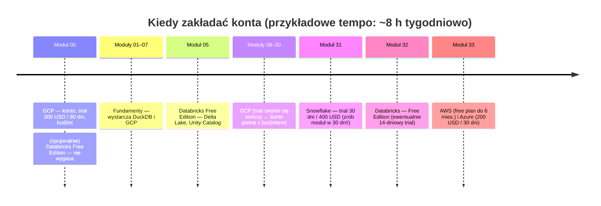
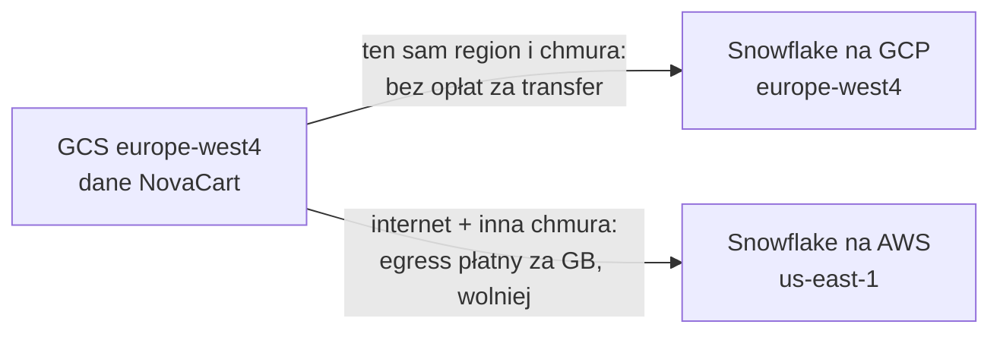

# 00.06 — Konta próbne innych platform

> **Czas:** ~45 min · **Wymaga:** [Lekcja 00.02](02-konto-i-projekt-gcp.md), [Lekcja 00.03](03-bezpieczenstwo-kosztowe.md) · **Ostatnia weryfikacja:** 2026-11-07

**W tej lekcji:**

- poznasz programy darmowe i próbne Snowflake, Databricks, AWS i Azure: ile dają, na jak długo i co się dzieje po ich zakończeniu;
- ułożysz **kalendarz zakładania kont** tak, żeby trial nie wygasł, zanim dojdziesz do odpowiedniego modułu;
- zrozumiesz, jak pod spodem działają modele rozliczeń: kredyty Snowflake, DBU Databricks, rozliczanie za bajty i za sekundy zasobów;
- dowiesz się, dlaczego **wybór chmury i regionu** przy zakładaniu konta Snowflake czy Databricks wpływa na koszty ćwiczeń;
- przygotujesz listę zabezpieczeń kosztowych, które ustawisz w pierwszych 15 minutach po założeniu każdego konta.

---

## 1. Problem

Uczestnik poprzedniej edycji kursu był bardzo zmotywowany. W pierwszym tygodniu założył wszystkie konta naraz: GCP, Snowflake, Databricks, AWS i Azure. Gdy cztery miesiące później doszedł do modułu 31 (Snowflake), trial był od dawna wygasły, a e-mail był już „zużyty”. Zadanie porównawcze robił w pośpiechu, na koncie znajomego. Z AWS było odwrotnie: przez pomyłkę wybrał przy rejestracji plan płatny zamiast darmowego, zostawił włączoną instancję bazy danych z ćwiczeń i po dwóch miesiącach dostał fakturę na kilkadziesiąt dolarów.

Platformy mają bardzo różne programy próbne. GCP daje kredyty na 90 dni, Snowflake na 30 dni, Azure również na 30, AWS do 6 miesięcy, a Databricks Free Edition w ogóle nie wygasa, tylko ma dzienne limity. Różne są też skutki ich zakończenia: od zawieszenia konta, przez jego zamknięcie z usunięciem danych, po automatyczne przejście na płatne rozliczanie. Kurs trwa 300–350 godzin, czyli przy kilku godzinach tygodniowo **wiele miesięcy**. Konta trzeba więc zakładać we właściwym momencie i od razu zabezpieczać.

## 2. Intuicja

> [!TIP]
> **Intuicja.** Programy próbne są jak **karnety na siłownię w promocji**. Jeden to karnet na 30 dni od aktywacji: kupiony za wcześnie, przepadnie, zanim zaczniesz trenować. Drugi to karnet na 10 wejść ważny pół roku. Trzeci daje dostęp bez końca, ale tylko do części sprzętu i w określonych godzinach. Czasem też karnet po okresie próbnym sam zamienia się w płatny abonament, jeśli o tym nie pamiętasz. Planujesz więc aktywację pod swój grafik i od razu sprawdzasz, co się stanie po zakończeniu promocji.

Analogia działa dla terminów i limitów, ale nie oddaje jednej rzeczy: w chmurze **sposób liczenia zużycia** różni się między platformami bardziej niż na siłowni. W jednej płacisz za przeczytane bajty, w innej za każdą sekundę pracy maszyny (z minimum 60 sekund przy każdym starcie), w jeszcze innej osobno platformie i osobno dostawcy chmury za maszyny. Ten sam „trening” kosztuje więc inaczej w zależności od tego, jak go zaplanujesz. Rozbieramy to w sekcji 4.

## 3. Koncepcja

### 3.1. Pojęcia

| Pojęcie | Znaczenie |
|---|---|
| *Free trial* (okres próbny) | Ograniczone w czasie kredyty (np. 300 USD na 90 dni). Po wyczerpaniu kredytów lub upływie czasu konto jest zawieszane albo zamykane, chyba że przejdziesz na płatne rozliczanie. |
| *Free tier* (darmowy poziom) | Stałe miesięczne limity bezpłatnego użycia wybranych usług, niezależne od triala (np. BigQuery: 1 TiB zapytań miesięcznie). |
| *Free Edition* (Databricks) | Bezterminowe, niekomercyjne konto z dziennymi limitami zasobów, bez karty płatniczej. |
| *Credit* (kredyt Snowflake) | Jednostka zużycia mocy obliczeniowej w Snowflake. Warehouse XS zużywa 1 kredyt na godzinę pracy, a każdy kolejny rozmiar dwa razy więcej. Cena kredytu zależy od edycji, chmury i regionu. |
| *DBU* (Databricks Unit) | Jednostka zużycia w Databricks, naliczana za czas pracy zasobów. Cena DBU zależy od typu obciążenia (jobs, SQL, all-purpose, serverless). |
| *Resource monitor* | Obiekt Snowflake, który liczy zużyte kredyty i po przekroczeniu progu powiadamia albo zawiesza warehouse'y. |
| *Auto-suspend / auto-termination* | Automatyczne zatrzymanie warehouse'u lub klastra po okresie bezczynności. Najważniejsze zabezpieczenie kosztowe na platformach rozliczanych za czas. |
| *Egress* | Ruch wychodzący z chmury lub regionu, płatny za GB. Dotyczy np. kopiowania danych NovaCart z GCS do Snowflake działającego w innej chmurze. |

### 3.2. Jak to działa — widok z lotu ptaka



*Rysunek 6.1. Kalendarz zakładania kont. Zauważ, że konta z krótkim terminem (Snowflake, Azure) zakładasz dopiero w dniu rozpoczęcia odpowiedniego modułu.*

Zasada jest prosta: **konto z terminem zakładasz w dniu, w którym zaczynasz moduł, który go potrzebuje**. Databricks Free Edition można założyć wcześniej, bo nie wygasa. GCP zakładasz od razu, bo na nim opiera się cały kurs. Trial GCP (90 dni) zwykle skończy się w okolicach modułów BigQuery i trzeba będzie przejść na płatne konto z budżetem ([lekcja 00.03](03-bezpieczenstwo-kosztowe.md)).

## 4. 🔍 Pod maską

### 4.1. Jak technicznie działa trial

Z perspektywy systemu rozliczeń trial to zwykłe konto rozliczeniowe z dwiema dodatkami: **pulą kredytów promocyjnych** i **flagami ograniczeń**.

```text
Zużycie (naliczane co godzinę / co sekundę)
        │
        ▼
┌───────────────────────────┐
│ 1. Free tier (stałe limity│  ← np. BigQuery 1 TiB/mies., Pub/Sub 10 GiB/mies.
│    miesięczne)            │     pomniejsza zużycie, zanim cokolwiek zostanie naliczone
├───────────────────────────┤
│ 2. Kredyty promocyjne     │  ← trial: 300 USD (GCP), 400 USD (Snowflake), 200 USD (Azure), do 200 USD (AWS)
│    (z datą ważności)      │     „zjadane” przez resztę zużycia
├───────────────────────────┤
│ 3. Faktura                │  ← tylko konto płatne; w trialu: 0, a po wyczerpaniu kredytów
│                           │     konto zostaje zawieszone / zamknięte
└───────────────────────────┘
Flagi trialu: brak GPU, brak zwiększania limitów (quota), brak Marketplace, …
```

Flagi ograniczeń nie są złośliwością dostawcy, tylko obroną przed nadużyciami. Darmowe kredyty to łakomy kąsek dla kopalni kryptowalut i botnetów, stąd zakaz GPU i zwiększania limitów w trialu GCP. W kursie nie są Ci potrzebne. Jeśli któryś moduł wymaga zasobu niedostępnego w trialu, zaznaczamy to w treści zadania.

Najważniejsza różnica między platformami dotyczy tego, **co się dzieje na końcu**:

| Platforma | Koniec okresu próbnego | Co z danymi | Czy może pojawić się faktura bez Twojej decyzji |
|---|---|---|---|
| GCP | konto rozliczeniowe trialu jest zamykane po 90 dniach lub po wyczerpaniu 300 USD, zasoby są zatrzymywane | 30 dni na przejście na konto płatne, potem zasoby są trwale usuwane | nie; potrzebny jest świadomy *upgrade* |
| Snowflake | konto jest zawieszane po 30 dniach lub po wyczerpaniu 400 USD | dane są usuwane po pewnym czasie (sprawdź aktualne warunki) | nie, jeśli nie podałeś karty |
| Databricks Free Edition | nie kończy się; po przekroczeniu dziennego limitu compute jest wyłączany do następnego dnia (w skrajnych przypadkach do końca miesiąca) | dane i ustawienia zostają; nieaktywne konta mogą zostać usunięte | nie; konto jest niekomercyjne |
| AWS (konta od 15.07.2025, plan Free) | plan kończy się po 6 miesiącach lub po wyczerpaniu kredytów | konto jest zamykane, a dane przechowywane przez 90 dni | nie w planie Free; w planie Paid tak, od pierwszej sekundy po kredytach |
| Azure (konto free) | po 30 dniach lub wyczerpaniu 200 USD usługi są wyłączane, chyba że przejdziesz na *pay-as-you-go* | po przejściu na pay-as-you-go darmowe usługi 12-miesięczne działają dalej, a potem są płatne | nie bez przejścia na pay-as-you-go |

> [!IMPORTANT]
> **Co z tego wynika w praktyce:** W żadnej z tych platform trial **sam z siebie** nie zamienia się w fakturę. Ryzyko pojawia się w momencie świadomego przejścia na konto płatne (albo wyboru planu Paid w AWS). Po tym kroku zasoby zostawione z ćwiczeń zaczynają kosztować. Dlatego przejście na płatne konto zawsze idzie w parze z ustawieniem budżetu i z regularnym sprzątaniem.

### 4.2. Modele rozliczeń: za co właściwie płacisz

Te same ćwiczenie (np. dzienne zapytanie agregujące zamówienia NovaCart) jest rozliczane na każdej platformie inaczej:

| Platforma | Jednostka | Co ją napędza | Typowa pułapka |
|---|---|---|---|
| BigQuery (on-demand) | bajty przeczytane przez zapytanie | rozmiar kolumn i partycji, które czyta zapytanie | `SELECT *` na dużej tabeli |
| Snowflake | kredyty × czas pracy warehouse'u | rozmiar warehouse'u i czas, w którym jest **włączony** (nie tylko czas zapytań) | warehouse, który „budzi się” co kilka minut |
| Databricks (klasyczny compute) | DBU **plus** maszyny u dostawcy chmury | rozmiar i czas pracy klastra | dwa rachunki: Databricks i dostawca chmury |
| Databricks (serverless) | DBU (maszyny wliczone) | czas i rozmiar zasobów serverless | wygoda kusi, żeby nie wyłączać |
| AWS / Azure (np. Redshift, Synapse, maszyny) | sekundy lub godziny pracy zasobu, czasem bajty (Athena, serverless SQL) | czas istnienia zasobu, nawet bezczynnego | zapomniany klaster lub baza |

**Snowflake od środka.** Warehouse to klaster maszyn wirtualnych przydzielany z puli Snowflake. Rozmiary rosną dwukrotnie: XS = 1 kredyt/h, S = 2, M = 4, L = 8 i tak dalej. Rozliczenie jest sekundowe, ale **z minimum 60 sekund przy każdym uruchomieniu lub wznowieniu**. Warstwa *cloud services* (kompilacja zapytań, metadane) jest doliczana tylko w części przekraczającej 10% dziennego zużycia warehouse'ów. Cena kredytu zależy od edycji i regionu. W AWS US East wynosi 2 USD w Standard, 3 USD w Enterprise i 4 USD w Business Critical (on-demand, stan na 2026 r.). Przy 3 USD za kredyt trial o wartości 400 USD to około 133 godzin pracy warehouse'u XS. To dużo, jeśli warehouse się wyłącza, i bardzo mało, jeśli nie.

Minimum 60 sekund ma ciekawą konsekwencję. Wyobraź sobie dashboard, który co 5 minut wykonuje 5-sekundowe zapytanie, przy `AUTO_SUSPEND = 60`:

```text
Każde odświeżenie: wznowienie → 5 s pracy → 60 s bezczynności → zawieszenie
Naliczane:          max(60 s, 5 s + 60 s) = 65 s  (×12 odświeżeń/h) = 13 min/h
Faktyczna praca:    5 s × 12 = 1 min/h

Ten sam dashboard przy AUTO_SUSPEND = 600 (10 min, wartość domyślna w CREATE WAREHOUSE):
warehouse nigdy się nie zawiesza  →  60 min/h naliczane,  1 min/h pracy
```

Ustawienie `AUTO_SUSPEND` zmienia koszt tego samego obciążenia prawie pięciokrotnie. Snowflake od środka (mikropartycje, warstwa usług, *result cache*, który w ogóle nie uruchamia warehouse'u) to temat modułu 31.

**Databricks od środka.** W klasycznym modelu Databricks zarządza klastrem Sparka, ale maszyny wirtualne działają **na Twoim koncie chmurowym** (AWS, Azure lub GCP). Dostajesz więc dwa rachunki: od Databricks za DBU i od dostawcy chmury za maszyny, dyski i sieć. W modelu serverless maszyny należą do Databricks, a ich koszt jest wliczony w cenę DBU. Databricks Free Edition korzysta wyłącznie z serverless i ma twarde limity: jeden SQL warehouse w rozmiarze 2X-Small, maksymalnie 5 równoległych zadań, jeden aktywny pipeline danego typu i ograniczony dostęp do internetu. Przekroczenie dziennego limitu wyłącza compute do następnego dnia. To w praktyce **twardy limit kosztów**, czyli coś, czego budżety w GCP nie dają.

> [!IMPORTANT]
> **Co z tego wynika w praktyce:** Na platformach rozliczanych za czas (Snowflake, Databricks, klastry w AWS i Azure) najważniejszym ustawieniem kosztowym jest **automatyczne wyłączanie po bezczynności**, a nie rozmiar zasobu. Na platformach rozliczanych za bajty (BigQuery on-demand, Athena) najważniejszy jest **kształt zapytania** (kolumny, partycje). Porównując koszty platform w module 33, porównuj więc wzorzec obciążenia, a nie cennik.

### 4.3. Dlaczego chmura i region konta mają znaczenie

Przy zakładaniu konta Snowflake wybierasz **dostawcę chmury** (AWS, Azure albo GCP) i **region**. Przy klasycznym Databricks wybierasz dostawcę i region, w którym będą działać klastry. To nie jest kosmetyka. Dane NovaCart z kursu leżą w GCS, w regionie, który wybrałeś w module 00 (np. `europe-west4`).



*Rysunek 6.2. To samo `COPY INTO` z GCS kosztuje różnie w zależności od tego, gdzie działa konto Snowflake.*

Ładowanie kilkudziesięciu GB danych NovaCart (skala L) z GCS do Snowflake w innej chmurze oznacza płatny *egress* z GCP i wolniejszy transfer. Dla kursu wybierz konto Snowflake na **GCP, w tym samym regionie co Twój bucket** (np. `europe-west4`, Holandia), o ile jest dostępny w formularzu rejestracji. Podobnie w module 33 ładuj dane do S3 i Azure Storage w regionach europejskich, a duże skale generuj bezpośrednio w docelowej chmurze, zamiast kopiować je przez internet.

> [!IMPORTANT]
> **Co z tego wynika w praktyce:** Przy zakładaniu konta na platformie wielochmurowej najpierw zdecyduj, **gdzie leżą dane**, a potem dobierz chmurę i region konta. Tę samą regułę stosuje się w firmach: Snowflake i Databricks wdraża się zwykle w tej chmurze i regionie, w których jest już jezioro danych, a koszty transferu między chmurami są stałym punktem dyskusji architektonicznych (moduły 34 i 41).

## 5. 💻 W praktyce

W tej lekcji nie ma kodu. Konta zakłada się w przeglądarce, a zabezpieczenia w postaci kodu (resource monitory Snowflake, budżety AWS i Azure w Terraform) znajdziesz w przykładach modułów 31–33. Tutaj dostajesz plan i listy kontrolne.

### 5.1. Plan zakładania kont

| Platforma | Kiedy założyć | Co dostajesz (stan na 2026-11-07) | Wymagania przy rejestracji | Do czego w kursie |
|---|---|---|---|---|
| **GCP** | moduł 00 (teraz) | 300 USD na 90 dni + Free Tier bez końca | karta płatnicza (tymczasowa blokada, nie obciążenie) | cały kurs |
| **Databricks Free Edition** | moduł 05 lub wcześniej | bezterminowo, serverless, dzienne limity | e-mail, bez karty | moduły 05 i 32, porównania w 41–42 |
| **Snowflake** | **pierwszy dzień modułu 31** | 30 dni, 400 USD kredytów | e-mail, bez karty | moduł 31, porównania w 33 i 41 |
| **AWS** | pierwszy dzień modułu 33 | plan Free: 100 USD + do 100 USD za wykonanie zadań startowych, do 6 miesięcy | karta, telefon | moduł 33 |
| **Azure** | pierwszy dzień modułu 33 (część Azure) | 200 USD na 30 dni + wybrane usługi bezpłatnie przez 12 miesięcy | karta (tymczasowa blokada ok. 1 USD), telefon, konto Microsoft lub GitHub | moduł 33 |

Kilka uwag praktycznych:

- **Jedno konto próbne na osobę.** Snowflake, AWS, Azure i GCP pilnują, żeby trial był jednorazowy (e-mail, karta, telefon). Nie „spal” go na szybkie klikanie bez planu.
- **Studenci** mają osobne programy (np. Azure for Students z kredytem bez karty, GitHub Student Developer Pack). Jeśli się kwalifikujesz, sprawdź je przed zwykłym trialem.
- **Konto firmowe.** Jeśli Twoja firma ma sandboksy w którejś z platform, zapytaj o nie: to często najprostsza droga i bez ryzyka dla Twojej karty. Zasady sprzątania obowiązują tak samo.
- **Snowflake na 30 dni.** Moduł 31 zajmuje ok. 8 godzin, a porównania w module 33 kolejne kilka. Zaplanuj oba moduły tak, żeby zmieściły się w 30 dniach od rejestracji. Jeśli nie zdążysz, część Snowflake w module 33 możesz wykonać na podstawie wyników z modułu 31.
- **AWS: wybierz plan Free.** Przy rejestracji konta AWS (od 15 lipca 2025 r.) wybierasz plan Free albo Paid. Plan Free nie wystawi faktury, ale nie obejmuje usług, które od razu zużyłyby całe kredyty. Moduł 33 jest napisany tak, żeby się w nim zmieścić.

### 5.2. Pierwsze 15 minut po założeniu konta: lista kontrolna

**Snowflake**

- [ ] Włącz MFA dla swojego użytkownika (konto z rolą `ACCOUNTADMIN`).
- [ ] Do ćwiczeń używaj roli `SYSADMIN` lub własnej roli, a nie `ACCOUNTADMIN`.
- [ ] Utwórz warehouse `XSMALL` z `AUTO_SUSPEND = 60` i `AUTO_RESUME = TRUE`. Nie używaj większego rozmiaru bez potrzeby.
- [ ] Utwórz *resource monitor* z limitem kredytów (np. 100 na miesiąc), z powiadomieniem przy 75% i akcją `SUSPEND` przy 100%, i przypisz go do konta lub warehouse'u.
- [ ] Ustaw `STATEMENT_TIMEOUT_IN_SECONDS` (np. 1 800) na warehouse'ie, żeby zawieszone zapytanie nie pracowało godzinami.
- [ ] Sprawdź w Snowsight (Admin → Cost Management), ile kredytów zostało.

**Databricks Free Edition**

- [ ] Sprawdź w dokumentacji aktualne limity (zmieniają się). Przekroczenie oznacza przerwę w pracy, a nie fakturę.
- [ ] Nie przechowuj tam danych, których utrata byłaby problemem: konto jest niekomercyjne i bez SLA.
- [ ] Jeśli zamiast Free Edition używasz triala na własnym koncie chmurowym: ustaw *auto-termination* klastrów (np. 15–20 min) i budżet u dostawcy chmury, bo maszyny są na Twoim rachunku.

**AWS**

- [ ] Włącz MFA na koncie *root* i przestań go używać. Do pracy utwórz użytkownika w IAM Identity Center.
- [ ] Sprawdź, czy konto jest w planie Free (Billing and Cost Management).
- [ ] Utwórz budżet w AWS Budgets z alertem e-mail (np. 10 USD), nawet w planie Free. Przyda się po ewentualnym przejściu na Paid.
- [ ] Wybierz jeden region do ćwiczeń (np. `eu-central-1`, Frankfurt) i trzymaj się go, żeby łatwo znaleźć zasoby do usunięcia.

**Azure**

- [ ] Włącz MFA.
- [ ] Zostaw włączony *spending limit* na subskrypcji free (jest włączony domyślnie dla subskrypcji opartych na kredytach).
- [ ] Twórz zasoby z ćwiczeń w jednej, dedykowanej *resource group* (np. `rg-ade-m33`). Usunięcie grupy usuwa wszystko, co w niej jest.
- [ ] Ustaw budżet z alertem w Cost Management.

**Wszystkie platformy**

- [ ] Zapisz w kalendarzu datę końca triala i datę „przeglądu zasobów” tydzień wcześniej.
- [ ] Oznaczaj zasoby etykietami (`course=ade`, `module=NN`), tak jak w GCP. Odpowiednikiem są *tags* w AWS i Azure, a w Snowflake *object tags* lub komentarze.

### 5.3. Gdzie sprawdzić zużycie

| Platforma | Gdzie | Opóźnienie danych |
|---|---|---|
| GCP | Billing → Reports; eksport billingu do BigQuery (moduł 39) | kilka godzin |
| Snowflake | Snowsight → Admin → Cost Management; widok `SNOWFLAKE.ACCOUNT_USAGE.WAREHOUSE_METERING_HISTORY` | do kilku godzin dla widoków `ACCOUNT_USAGE` |
| Databricks | strona konta / *usage*; tabela systemowa `system.billing.usage` (w planach z Unity Catalog) | kilka godzin |
| AWS | Billing and Cost Management → Free Tier, Cost Explorer | do 24 h |
| Azure | Cost Management + Billing, kredyty na stronie subskrypcji | do 24 h |

> [!WARNING]
> **Pułapka.** We wszystkich platformach dane o kosztach spływają z opóźnieniem od kilku do kilkudziesięciu godzin. Jeśli sprawdzasz zużycie zaraz po ćwiczeniu i widzisz zero, to nie znaczy, że nic nie kosztowało. Dlatego zabezpieczenia muszą działać **z wyprzedzeniem** (auto-suspend, resource monitor, limity), a nie reagować na raport.

## 6. ⚖️ Porównanie platform

| Aspekt | GCP | AWS | Azure | Snowflake | Databricks |
|---|---|---|---|---|---|
| Program próbny | 300 USD / 90 dni | plan Free: 100 + do 100 USD, do 6 mies. (konta od 15.07.2025) | 200 USD / 30 dni | 400 USD / 30 dni | Free Edition bez terminu; osobno trial 14-dniowy na koncie chmurowym |
| Stały darmowy poziom | Free Tier (np. BigQuery 1 TiB/mies., GCS 5 GB w regionach USA) | *always free* wybranych usług | usługi *always free* + 12 mies. wybranych usług | brak | Free Edition |
| Karta przy rejestracji | tak | tak | tak | nie | nie (Free Edition) |
| Jednostka rozliczeń | zasób × czas, bajty (BigQuery), operacje | zasób × czas, żądania, bajty | zasób × czas, żądania | kredyty (czas warehouse'u) + storage + transfer | DBU (+ maszyny w klasycznym compute) |
| Twardy limit kosztów | brak ogólnego (budżety tylko alarmują; *spend cap* tylko dla wybranych usług, Preview) | plan Free (do zakończenia) | *spending limit* w subskrypcjach kredytowych | resource monitor z akcją `SUSPEND` | limity Free Edition |
| Najważniejsze ustawienie oszczędzające | limit bajtów zapytań, sprzątanie | wyłączanie zasobów, budżety | usuwanie grup zasobów, budżety | `AUTO_SUSPEND = 60` | auto-termination, serverless |

**Wnioski:** Hiperskalerzy (GCP, AWS, Azure) dają kredyty na całą paletę usług i rozliczają głównie czas istnienia zasobów. Dlatego największym ryzykiem jest zapomniany zasób. Snowflake i Databricks rozliczają czas pracy mocy obliczeniowej, więc kluczowe jest automatyczne wyłączanie. Tylko one mają za to wbudowane mechanizmy, które naprawdę **zatrzymują** zużycie (resource monitor, limity Free Edition). Natywne budżety GCP, AWS i Azure domyślnie tylko powiadamiają. Ta różnica wynika z modelu biznesowego: hiperskaler nie może „wyłączyć” Twojej produkcyjnej bazy z powodu budżetu, a warehouse analityczny można bezpiecznie zawiesić.

## 7. ⚠️ Antywzorce i pułapki

| Antywzorzec | Objaw | Dlaczego tak się dzieje | Jak naprawić |
|---|---|---|---|
| Wszystkie konta założone pierwszego dnia | Trial Snowflake i Azure wygasa przed modułem 31/33 | Krótkie terminy liczone od rejestracji | Kalendarz z sekcji 5.1 |
| Wybór planu Paid w AWS „na wszelki wypadek” | Faktura za zapomniany zasób | Plan Paid nalicza opłaty po wyczerpaniu kredytów | Plan Free; przejście na Paid świadomie, z budżetem |
| Warehouse Snowflake z `AUTO_SUSPEND = 600` lub wyłączonym | Kredyty znikają szybciej niż wynika z liczby zapytań | Rozliczenie za czas włączenia, minimum 60 s przy wznowieniu | `AUTO_SUSPEND = 60`, resource monitor |
| Konto Snowflake/Databricks w innej chmurze lub regionie niż dane | Wolne ładowanie, opłaty za egress w GCP | Transfer między chmurami/regionami jest płatny | Chmura i region konta zgodne z bucketem danych |
| Praca na `root` (AWS) / `ACCOUNTADMIN` (Snowflake) | Ryzyko pomyłki o dużym zasięgu, brak śladu w audycie | Konta o pełnych uprawnieniach | Osobne konto robocze z węższą rolą, MFA na koncie głównym |
| Ocena kosztu na podstawie raportu z ostatniej godziny | „Nic nie kosztowało”, a następnego dnia rachunek | Opóźnienie danych billingowych | Zabezpieczenia prewencyjne, przegląd po 24 h |

> [!CAUTION]
> **Koszt!** Najdroższe pomyłki w kursie zdarzają się **po** przejściu z triala na konto płatne. W trialu zapomniany klaster jest zatrzymywany razem z kontem, a na koncie płatnym działa do końca miesiąca. W dniu przejścia na płatne konto przejrzyj wszystkie zasoby i ustaw budżety. Zasada „wszystko przez Terraform, wszystko da się zniszczyć jednym poleceniem” z [lekcji 00.03](03-bezpieczenstwo-kosztowe.md) obowiązuje też w AWS i Azure.

## 8. 💰 Koszty

Szacunkowo, przy założeniu, że wykonujesz ćwiczenia zgodnie z instrukcjami i sprzątasz po nich:

| Platforma | Moduły | Szacowane zużycie | Mieści się w programie darmowym? |
|---|---|---|---|
| Snowflake | 31, 33 | 15–40 kredytów (głównie XS, przez chwilę S/M w testach skalowania) | tak, 400 USD to ok. 133 kredyty po 3 USD |
| Databricks | 05, 32 | w granicach dziennych limitów | tak (Free Edition) |
| AWS | 33 | kilka–kilkanaście USD (S3, Athena, Glue, krótko Redshift Serverless) | tak, w kredytach planu Free |
| Azure | 33 | kilka–kilkanaście USD (Storage, Synapse serverless / Fabric trial) | tak, w 200 USD |

Szczegółowe kosztorysy i polecenia sprzątające są w treści zadań poszczególnych modułów.

## 9. Podsumowanie

- Programy próbne mają różne terminy (30 dni, 90 dni, 6 miesięcy, bezterminowo) i różne skutki zakończenia. Konto z krótkim terminem zakładasz w dniu rozpoczęcia modułu, który go potrzebuje.
- Żaden trial sam nie zamienia się w fakturę. Ryzyko zaczyna się po świadomym przejściu na konto płatne, więc wtedy ustawiasz budżety i przeglądasz zasoby.
- Snowflake rozlicza czas włączenia warehouse'u (minimum 60 s przy każdym wznowieniu), Databricks DBU (w modelu klasycznym plus maszyny u dostawcy chmury), a BigQuery bajty. Najważniejsze dźwignie kosztowe są przez to różne.
- Chmurę i region konta Snowflake czy Databricks dobierasz do miejsca, w którym leżą dane, żeby uniknąć opłat za transfer.
- W pierwszych 15 minutach po założeniu konta włączasz MFA, ustawiasz automatyczne wyłączanie i limity, a do pracy używasz roli o węższych uprawnieniach.

## 🧠 Sprawdź się

<details>
<summary><b>Masz 400 USD kredytów w Snowflake Enterprise (3 USD za kredyt). Ile godzin pracy warehouse'u M to daje i dlaczego to może wystarczyć na dużo mniej?</b></summary>

400 / 3 ≈ 133 kredyty. Warehouse M zużywa 4 kredyty na godzinę, więc to ok. 33 godziny **włączenia**. Może wystarczyć na mniej, jeśli warehouse nie zawiesza się szybko (`AUTO_SUSPEND` liczone w minutach, a nie sekundach), gdy jest często wznawiany (każde wznowienie to minimum 60 s) albo gdy działają usługi serverless (np. automatyczny clustering) rozliczane osobno.

</details>

<details>
<summary><b>Dlaczego na Databricks Free Edition nie musisz się obawiać faktury, a na 14-dniowym trialu na własnym koncie AWS już tak?</b></summary>

Free Edition działa wyłącznie na serverless compute należącym do Databricks i ma dzienne limity. Po ich przekroczeniu compute jest wyłączany, a konto jest niekomercyjne. W trialu na koncie chmurowym darmowe są DBU, ale klastry klasycznego compute uruchamiają maszyny wirtualne **na Twoim koncie AWS**, a za nie płacisz dostawcy chmury normalnie.

</details>

<details>
<summary><b>Dane NovaCart w skali L (ok. 45 GB) leżą w GCS w `europe-west4`. Zakładasz konto Snowflake. Którą chmurę i region wybierzesz i dlaczego?</b></summary>

GCP, region `europe-west4` (lub najbliższy dostępny na GCP). Wtedy `COPY INTO` czyta dane w obrębie tej samej chmury i regionu, bez opłat za egress z GCP i z najwyższą przepustowością. Konto na AWS czy Azure oznaczałoby płatny transfer 45 GB przez internet przy każdym ładowaniu i wolniejsze ćwiczenia.

</details>

<details>
<summary><b>Czym różni się budżet w GCP od resource monitora w Snowflake?</b></summary>

Budżet w GCP (w trybie alertów) tylko powiadamia (e-mail, Pub/Sub) i nie zatrzymuje zużycia. Zatrzymanie trzeba zautomatyzować samemu, np. funkcją odłączającą billing ([lekcja 00.03](03-bezpieczenstwo-kosztowe.md)). Resource monitor w Snowflake po przekroczeniu progu może sam zawiesić warehouse'y (`SUSPEND` po zakończeniu bieżących zapytań albo `SUSPEND_IMMEDIATE`). Snowflake może sobie na to pozwolić, bo zawieszenie warehouse'u analitycznego nie usuwa danych ani nie wyłącza aplikacji produkcyjnych klienta.

</details>

## 📚 Źródła

1. Google Cloud, [Free cloud features and trial offer](https://docs.cloud.google.com/free/docs/free-cloud-features) (300 USD / 90 dni, ograniczenia triala, Free Tier) — dostęp 2026-11-07
2. Google Cloud, [Create, edit, or delete budgets and budget alerts](https://docs.cloud.google.com/billing/docs/how-to/budgets) i [Manage spend cap budgets](https://docs.cloud.google.com/billing/docs/how-to/budgets-spend-caps) — dostęp 2026-11-07
3. AWS, [AWS Free Tier now offers $200 in credits and 6-month free plan](https://aws.amazon.com/about-aws/whats-new/2025/07/aws-free-tier-credits-month-free-plan/) (lipiec 2025) oraz [AWS Free Tier FAQs](https://aws.amazon.com/free/faqs/) — dostęp 2026-11-07
4. Microsoft, [Azure free account](https://azure.microsoft.com/free/) i [Azure free account FAQ](https://azure.microsoft.com/free/free-account-faq) — dostęp 2026-11-07
5. Snowflake, [Start your 30-day free trial](https://signup.snowflake.com) i [Snowflake pricing guide](https://www.snowflake.com/pricing/pricing-guide/) (ceny kredytu w AWS US East) — dostęp 2026-11-07
6. Snowflake, [Overview of warehouses](https://docs.snowflake.com/en/user-guide/warehouses-overview) (rozmiary, rozliczanie sekundowe, minimum 60 s) i [Working with resource monitors](https://docs.snowflake.com/en/user-guide/resource-monitors)
7. Databricks, [Databricks Free Edition limitations](https://docs.databricks.com/gcp/en/getting-started/free-edition-limitations) — dostęp 2026-11-07
8. Databricks, [Databricks pricing — DBU](https://www.databricks.com/product/pricing)

---

<sub>← [00.05 — Emulatory i praca offline](05-emulatory-i-praca-offline.md) · [Moduł 00](README.md) · [00.07 — Generator danych NovaCart](07-generator-danych-novacart.md) →</sub>
