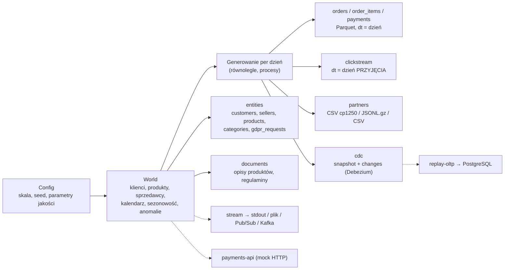
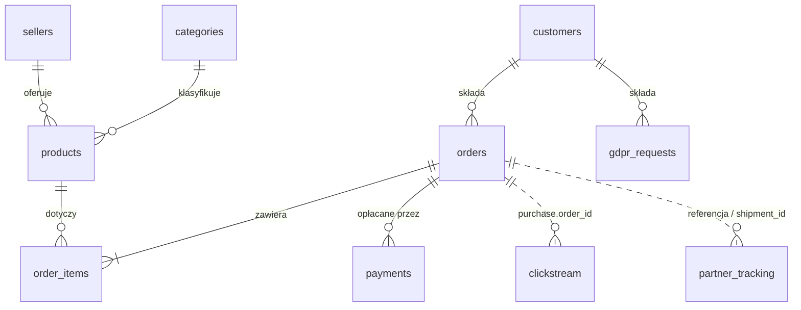

# 00.07 — Generator danych NovaCart

> **Czas:** ~60 min · **Wymaga:** [Lekcja 00.04](04-narzedzia-lokalne.md) · **Ostatnia weryfikacja:** 2026-11-07

**W tej lekcji:**

- uruchomisz generator danych NovaCart, poznasz jego skale, komponenty i strukturę wyniku;
- poznasz model danych i reguły biznesowe NovaCart oraz **celowo wprowadzone problemy z danymi**, na których będziesz ćwiczyć przez cały kurs;
- zrozumiesz, jak generator zapewnia **determinizm** (ten sam seed daje identyczne bajty niezależnie od liczby procesów), spójność czasową i skośność rozkładów;
- zobaczysz, dlaczego clickstream jest partycjonowany po czasie **przyjęcia**, a nie zdarzenia, i co z tego wynika;
- porównasz NovaCart z danymi przykładowymi platform: TPC-H/TPC-DS, `SNOWFLAKE_SAMPLE_DATA`, katalogiem `samples` w Databricks i publicznymi zbiorami BigQuery.

---

## 1. Problem

Do nauki data engineeringu potrzebne są dane, a wszystkie oczywiste źródła mają wady:

- **Dane produkcyjne z pracy** są niedostępne albo nie wolno ich używać (RODO, tajemnica firmy). Nawet gdyby było wolno, nie da się ich udostępnić innym uczestnikom kursu.
- **Benchmarki (TPC-H, TPC-DS)** są duże i dobrze zdefiniowane, ale **zbyt czyste**: brak duplikatów, brak spóźnionych zdarzeń, brak zmian schematu i plików w dziwnym kodowaniu. Pipeline deduplikacji przetestowany na TPC-H zawsze „działa”, bo nie ma czego deduplikować.
- **Publiczne zbiory** (np. przykładowy e-commerce w BigQuery) są świetne do analityki, ale to pojedyncze, gotowe tabele. Nie ma w nich strumienia zmian bazy, plików od partnerów ani API, czyli tego, z czym data engineer walczy na co dzień.
- **Ręcznie robione CSV** są za małe, żeby zobaczyć efekt partycjonowania, skośności czy problemu małych plików.

Dlatego kurs ma własny generator. NovaCart to fikcyjny marketplace z sześciu krajów. Jego dane są **spójne między źródłami** (zamówienie ma sesję w clickstreamie, płatności, zdarzenia przewoźnika i historię zmian w CDC), **brudne w kontrolowany sposób** i **deterministyczne**. Ten ostatni punkt oznacza, że rozwiązanie zadania może podać konkretną liczbę („dla skali M i seed 42 tabela ma 650 432 wiersze”) i każdy uczestnik może ją sprawdzić u siebie.

## 2. Intuicja

> [!TIP]
> **Intuicja.** Generator działa jak gra z **proceduralnie generowanym światem**. Wpisujesz *seed*, a gra buduje świat kawałek po kawałku, dopiero gdy do niego dojdziesz. Ten sam seed daje u każdego gracza identyczny świat. Każdy kawałek da się wygenerować niezależnie od innych i w dowolnej kolejności, bo zależy tylko od seeda i swojego położenia, a nie od tego, co gracz robił wcześniej.

W NovaCart „kawałkiem świata” jest jeden dzień działalności sklepu. Zamówienia, sesje i zdarzenia przewoźnika z dnia 137 zależą tylko od seeda, numeru dnia i stałego „świata” (klientów, produktów, kalendarza). Dlatego 12 procesów może równolegle generować różne dni i wynik będzie bajt w bajt taki sam jak w jednym procesie.

Analogia ma granicę: w grze kawałki świata są od siebie niezależne, a w sklepie nie. Zamówienie złożone w poniedziałek ma płatność, wysyłkę i zwrot w kolejnych dniach, a zdarzenie z telefonu w trybie offline dociera z opóźnieniem. Sekcja 4 pokazuje, jak generator godzi niezależne generowanie dni z tymi zależnościami.

## 3. Koncepcja

### 3.1. Pojęcia

| Pojęcie | Znaczenie |
|---|---|
| *Seed* (ziarno losowości) | Liczba (domyślnie 42), od której zależą wszystkie losowania. Ten sam seed i parametry dają identyczne pliki. |
| Skala | Preset rozmiaru świata: `xs`, `s`, `m`, `l`, `xl` (liczba dni, klientów, produktów, sprzedawców i zamówień dziennie). |
| Komponent | Grupa wyników do wygenerowania: `entities`, `orders`, `clickstream`, `partners`, `cdc`, `documents`. |
| Partycja `dt=` | Katalog w stylu Hive (`orders/dt=2025-11-01/`) z danymi z jednego dnia. Każda partycja to dokładnie jeden plik. |
| `_manifest.json` | Plik z konfiguracją, licznościami tabel i listą wstrzykniętych anomalii („klucz odpowiedzi”). |
| `_SUCCESS` | Pusty plik znacznikowy zapisywany na końcu. Jego obecność oznacza, że generowanie zakończyło się w całości (konwencja z Hadoop/Spark). |
| Anomalia | Celowo wprowadzony, jednorazowy incydent w danych (np. spadek zdarzeń z Androida przez jeden dzień), do wykrycia w module 29. |
| *Event time* / *processing time* | Czas zajścia zdarzenia (`event_ts`) vs czas jego przyjęcia przez system (`received_at`). Mogą się różnić o godziny. |

### 3.2. Jak to działa — widok z lotu ptaka



*Rysunek 7.1. Jeden „świat” i wiele widoków na niego. Zauważ, że tryby strumieniowy, API i replay (linie przerywane) korzystają z tego samego świata co pliki, więc ich dane są spójne z danymi wsadowymi.*

Generator składa się z czterech poleceń wsadowych i trzech „żywych” trybów:

| Polecenie | Co robi | Moduły |
|---|---|---|
| `novacart info` | pokazuje skale i szacowane wolumeny | 00 |
| `novacart generate` | generuje pliki (lokalnie albo do `gs://`) | prawie wszystkie |
| `novacart schemas` | eksportuje schematy z opisami kolumn: BigQuery JSON, Avro, Arrow, DDL PostgreSQL | 13–17, 25 |
| `novacart stream` | odtwarza clickstream „na żywo” do stdout, pliku, Pub/Sub lub Kafki | 21–24 |
| `novacart payments-api` | uruchamia mock API płatności (paginacja, rate limiting, błędy 5xx) | 26, 36 |
| `novacart replay-oltp` | odtwarza strumień zmian na PostgreSQL jako źródło CDC | 25–26 |

**Skale** (koniec okresu zawsze 31.12.2025, więc każda skala obejmuje Black Friday i święta):

| Skala | Dni | Klienci | Produkty | Zamówienia | Zdarzenia clickstream | Rozmiar (Parquet) | Do czego |
|---|---|---|---|---|---|---|---|
| `xs` | 21 | 2 tys. | 500 | ~2 tys. | ~0,16 mln | ~13 MB | testy, CI |
| `s` | 61 | 20 tys. | 4 tys. | ~25 tys. | ~1,9 mln | ~120–140 MB | nauka lokalna, DuckDB |
| `m` | 365 | 200 tys. | 30 tys. | ~650 tys. | ~50 mln | ~3 GB | większość zadań w chmurze |
| `l` | 730 | 2 mln | 200 tys. | ~10 mln | ~0,8 mld | ~45 GB | wydajność: BigQuery, Spark, Dataflow |
| `xl` | 1 095 | 10 mln | 1 mln | ~110 mln | ~8 mld | ~500 GB | benchmarki; generuj bezpośrednio do GCS |

**Model danych.** Tabele odpowiadają bazie transakcyjnej sklepu i źródłom zewnętrznym:



*Rysunek 7.2. Uproszczony model danych. Linie przerywane to powiązania „miękkie”, bez klucza obcego w bazie, tak jak w prawdziwych systemach.*

Pełne schematy z opisem każdej kolumny i flagą `pii` (dane osobowe) znajdziesz w [`datasets/README.md`](../../datasets/README.md#model-danych) i w eksporcie `novacart schemas`.

**Reguły biznesowe** obowiązujące w danych (wybrane; są też opisane w dokumentach `documents/policies/`, więc da się je sprawdzać testami jakości):

| Obszar | Reguła |
|---|---|
| Cykl życia zamówienia | `created → paid → shipped → delivered → (returned)` albo `→ cancelled`; za pobraniem: `created → shipped → delivered` |
| Kwoty | `total = subtotal − discount + shipping`; `line_amount = quantity × unit_price − discount_amount` |
| Waluta | wynika z kraju: PL → PLN, CZ → CZK, pozostałe → EUR |
| Darmowa dostawa | od 399 PLN / 99 EUR / 2 499 CZK |
| Metody płatności | BLIK tylko w PL, iDEAL tylko w NL |
| RODO | po anonimizacji klient nie składa nowych zamówień, ale jego adres w starych zamówieniach **zostaje** (zadanie w module 11) |
| Sezonowość | tydzień, miesiąc, Black Friday (×2,8), święta, wzrost 35% r/r, szczyt wieczorem |
| Skośność | popularność produktów według rozkładu Zipfa (`--skew 1.1`), aktywność klientów log-normalna |

**Problemy z danymi.** Część jest parametryzowana, część jest stałą cechą „prawdziwego świata”:

| Problem | Parametr / cecha | Domyślnie |
|---|---|---|
| Duplikaty zdarzeń (to samo `event_id`, późniejsze `received_at`) | `--duplicate-rate` | 1% |
| Spóźnione sesje mobilne (tryb offline) | `--late-rate`, `--max-lateness-hours` | 3%, do 72 h |
| Rozjechane zegary urządzeń, także w przyszłość | `--clock-skew-rate` | 0,5% sesji |
| Uszkodzone rekordy (literówki w `event_type`, `session_id = NULL`, ujemna cena) | `--invalid-rate` | 0,2% |
| Pliki SpeedPost w Windows-1250, przecinek dziesiętny, czas lokalny bez strefy | stała cecha | — |
| Kwoty w API płatności w groszach (`int`), w tabelach `DECIMAL(12,2)` | stała cecha | — |
| Wszystkie problemy i anomalie wyłączone (dane „podręcznikowe”) | `--clean` | — |

Do tego dochodzi pięć **anomalii** (dla okresów od 14 dni): spadek zdarzeń z Androida, burza duplikatów, ceny jednego sprzedawcy w groszach, brakujący plik przewoźnika i nieogłoszona zmiana schematu w plikach QuickShip. Opis z datami trafia do `_manifest.json`.

## 4. 🔍 Pod maską

### 4.1. Determinizm: niezależne strumienie losowości

Najprostszy generator ma jeden globalny generator liczb losowych i losuje kolejno: klient, produkt, kwota, następny wiersz… Wynik zależy wtedy od **kolejności** wywołań. Wystarczy zmienić liczbę procesów, dodać jedną kolumnę albo wygenerować dni w innej kolejności, a wszystkie kolejne wartości się przesuwają.

NovaCart robi to inaczej. Każdy fragment danych ma **własny** generator zainicjowany kluczem:

```text
rng_for(seed, Stream.ORDERS, day)       →  np.random.default_rng([42, 10, 137])
rng_for(seed, Stream.CLICKSTREAM, day)  →  np.random.default_rng([42, 11, 137])
rng_for(seed, Stream.CUSTOMERS)         →  np.random.default_rng([42, 1])

          seed ─┐
     strumień ──┼──► SeedSequence (mieszanie entropii) ──► niezależny generator PCG64
  klucz (dzień)─┘
```

`numpy` przepuszcza listę `[seed, strumień, dzień]` przez `SeedSequence`, która miesza ją w stan generatora tak, że generatory dla sąsiednich kluczy są statystycznie niezależne. Zamówienia z dnia 137 zależą więc wyłącznie od trójki `(42, ORDERS, 137)` i od stałego świata. Nie zależą od tego, czy dzień 136 został już wygenerowany, ani od tego, w którym procesie to się dzieje.

Skutki widać w praktyce:

- **Równoległość bez koordynacji.** Proces nr 3 generuje dni 40–59, proces nr 7 dni 120–139 i nie muszą się komunikować.
- **Identyczne bajty.** Parquet z kompresją zstd jest zapisywany deterministycznie, więc skrót SHA-256 wszystkich plików `orders` jest taki sam u każdego (sekcja 5.3).
- **Lokalne zmiany.** Dodanie nowego strumienia (np. nowego typu zdarzeń) nie zmienia danych w istniejących strumieniach.

> [!IMPORTANT]
> **Co z tego wynika w praktyce:** Ten sam wzorzec (deterministyczna funkcja klucza zamiast współdzielonego stanu) poznasz w przetwarzaniu rozproszonym: partycjonowanie przez hash klucza, idempotentne zadania, które przy ponownym uruchomieniu dają ten sam wynik (moduły 02, 19, 27). Dla Ciebie jako uczestnika kursu najważniejsze jest to, że **wyniki zadań da się porównywać**. Jeśli Twoja liczba wierszy różni się od tej w rozwiązaniu, sprawdź najpierw seed i parametry w `_manifest.json`, a dopiero potem swój kod.

### 4.2. „Świat” z liczb, napisy na żądanie

Obiekt `World` przechowuje **wyłącznie tablice liczbowe**: daty utworzenia klientów i produktów, indeksy miast i kategorii, ceny w centach, wagi popularności. Klient to w nim wiersz kilku tablic `numpy`, a nie obiekt z imieniem i adresem. Napisy (imiona, ulice, e-maile, SKU) powstają dopiero przy zapisie, **wektorowo**, operacjami `pyarrow.compute` na całych kolumnach.

```text
Podejście „obiektowe” (wolne):           Podejście kolumnowe (NovaCart):
for i in range(n):                        first = take(FIRST_POOL, first_idx)       # 1 operacja na n wierszy
    c = Customer(...)                     last  = take(LAST_POOL, last_idx)
    c.email = f"{c.first}.{c.last}@..."   email = join(lower(first), ".", lower(last), "@", domain)
    rows.append(c)                        → kolumna Arrow → Parquet
```

Pętla po wierszach w Pythonie kosztuje rząd mikrosekund na wiersz i operację. Przy 50 mln zdarzeń w skali M to minuty, a przy 8 mld w skali XL godziny. Operacje wektorowe wykonują tę samą pracę w skompilowanym kodzie, na ciągłych blokach pamięci. Dzięki temu skala M (ok. 52 mln zdarzeń) powstaje w ok. 20 s na 12 rdzeniach. Kwoty `DECIMAL(12,2)` są budowane bezpośrednio z buforów 128-bitowych, a UUID-y z wektorów losowych bajtów, bez tworzenia obiektów Pythona.

> [!IMPORTANT]
> **Co z tego wynika w praktyce:** To ta sama zasada, na której stoją silniki analityczne: DuckDB, BigQuery, Photon w Databricks i Velox przetwarzają dane **kolumnami i wektorami**, a nie wiersz po wierszu (moduł 06). W swoim kodzie w Pythonie (pandas, Polars, PyArrow, PySpark) unikaj pętli po wierszach i UDF-ów, gdy istnieje operacja wektorowa.

### 4.3. Spójność czasowa i skośność: próbkowanie prefiksowe z wagami Zipfa

Zamówienie złożone 3 listopada nie może dotyczyć klienta zarejestrowanego 20 listopada ani produktu dodanego w grudniu. Generator rozwiązuje to bez sprawdzania warunków wiersz po wierszu:

1. Klienci i produkty są **posortowani po dacie utworzenia**.
2. Dla każdego zamówienia `searchsorted` na tablicy dat zwraca `k`, czyli liczbę encji istniejących w chwili zamówienia.
3. Losowanie odbywa się z wagami, ale tylko spośród pierwszych `k` elementów. Wystarczy do tego skumulowana suma wag (`cumw`): losujemy `u ∈ [0, cumw[k−1])` i znowu stosujemy `searchsorted`.

```text
produkty (posortowane po created_at):  P0   P1   P2   P3   P4   P5   ...
wagi popularności (Zipf):               0.3  1.0  0.1  0.5  0.2  0.05
cumw:                                   0.3  1.3  1.4  1.9  2.1  2.15
                                                       ▲
zamówienie z chwili t: k = 4 produkty istnieją ───────┘  → losuj u z [0, cumw[3]=1.9)
u = 1.35  → searchsorted(cumw, 1.35) = 2 → P2
```

Wagi popularności produktów mają rozkład Zipfa: waga produktu o randze `r` to `r^(−skew)`. Rangi są przypisywane **losowo** (permutacja), więc popularność nie zależy od daty dodania produktu. Bestseller może być produktem starym albo nowym. Przy domyślnym `skew = 1.1` i 4 000 produktów w skali S **10 najpopularniejszych produktów to 44,9% sprzedanych sztuk**, a 100 najpopularniejszych to 69,6% (pomiar w [lekcji 00.05](05-emulatory-i-praca-offline.md#54-duckdb-analityka-na-plikach-novacart)).

> [!IMPORTANT]
> **Co z tego wynika w praktyce:** Skośność nie jest wadą danych, tylko cechą prawie każdego realnego zbioru (bestsellery, duzi sprzedawcy, Black Friday). W systemach rozproszonych tworzy **gorące klucze**: jeden worker dostaje 45% danych joinu i wszyscy na niego czekają. Parametr `--skew` pozwala to wzmocnić (np. `--skew 1.3` w module 19) i zobaczyć problem w kontrolowanych warunkach.

### 4.4. Pełny cykl życia, różne widoki

Każde zamówienie ma w pamięci **komplet** znaczników czasu: `created_at`, `paid_at`, `shipped_at`, `delivered_at`, `returned_at` lub `cancelled_at`. Część z nich może przypadać już **po** końcu okresu, np. dostawa 2 stycznia zamówienia złożonego 30 grudnia. Z tej jednej „prawdy” powstają różne widoki:

```text
                        created     paid      shipped    delivered     │ koniec okresu
zamówienie 1011679:  ──────●─────────●───────────●───────────────●─────┼─────────────►
                                                                      │
tabela orders (migawka) │ status = delivered, wszystkie czasy ≤ koniec okresu
cdc/changes             │ 4 zdarzenia: c (insert), u→paid, u→shipped, u→delivered
partners (przewoźnik)   │ LABEL_CREATED, PICKED_UP, IN_TRANSIT, OUT_FOR_DELIVERY, DELIVERED
clickstream             │ sesja zakończona zdarzeniem purchase z order_id = 1011679
payments                │ charge (succeeded), ewentualnie wcześniej charge (failed)
```

Ponieważ wszystkie widoki powstają z tych samych znaczników czasu, **spójność wynika z konstrukcji**, a nie z dopasowywania. Test automatyczny generatora sprawdza najmocniejszą wersję tej właściwości: migawka CDC + wszystkie zmiany, odtworzone po kolei, dają dokładnie tabele z komponentu `entities`/`orders` na koniec okresu.

> [!IMPORTANT]
> **Co z tego wynika w praktyce:** Możesz łączyć źródła (clickstream z zamówieniami, zamówienia z plikami przewoźników, CDC z migawką) i oczekiwać, że **brak dopasowania jest sygnałem**: błędem w Twoim kodzie albo jedną z udokumentowanych anomalii. To pozwala w module 29 pisać testy uzgadniające (*reconciliation*) między systemami, tak jak w prawdziwej firmie.

### 4.5. Partycjonowanie po właściwym czasie i „jeden plik na partycję”

Z czasem w danych jest pewien kłopot. Zdarzenie z telefonu w trybie offline zaszło 30 listopada o 23:50 (`event_ts`), ale dotarło 1 grudnia o 9:15 (`received_at`). Do której partycji trafia?

NovaCart robi to, co prawdziwe systemy zbierające zdarzenia: **clickstream jest partycjonowany po dniu przyjęcia** (`received_at`). System zapisujący dane wie, kiedy zdarzenie dotarło, ale nie może czekać w nieskończoność na wszystkie zdarzenia z danego dnia. Partycja `dt=2025-12-01` zawiera więc zdarzenia „z 1 grudnia” i spóźnione z poprzednich dni (do 72 h). Zamówienia są partycjonowane po dniu złożenia, a płatności po dniu transakcji. Zwrot środków po trzech tygodniach trafia więc do partycji z tamtego dnia, a nie dnia zamówienia.

Zapis wymaga przez to buforowania. Dzień źródłowy *d* produkuje wiersze do partycji *d*, *d+1*, …, *d+40* (płatności). Gdyby każdy dzień zapisywał swoje fragmenty od razu, powstałyby setki małych plików na partycję. Generator stosuje więc bufor `_Pending`:

```text
proces przetwarza blok dni [40..59]:
  rozgrzewka: dni 0..39 (tylko po to, żeby zebrać ich spóźnione fragmenty do dni 40+)
  dzień 40 → fragmenty dla partycji 40, 41, 43, 61 …   ┐
  dzień 41 → fragmenty dla partycji 41, 42, 55 …        ├─► bufor: {partycja → [fragmenty]}
  …                                                     ┘
  partycja p jest kompletna, gdy przetworzono wszystkie dni, które mogą do niej pisać
  → sortuj, złącz, zapisz JEDEN plik dt=p/part-00000.parquet, usuń z bufora
  + 1 dzień „wyprzedzenia”: sesje zamówień tuż po północy zaczynają się poprzedniego dnia
```

> [!IMPORTANT]
> **Co z tego wynika w praktyce:** Wybór kolumny partycjonującej to decyzja biznesowa, a nie techniczna. Partycja po `received_at` jest stabilna (raz zapisana się nie zmienia), ale raport „sprzedaż według dnia zdarzenia” musi czytać kilka partycji. Partycja po `event_ts` jest wygodna dla analityka, ale spóźnione zdarzenia wymagają dopisywania do „zamkniętych” dni. Do tego kompromisu wrócimy w modułach 15 (partycjonowanie BigQuery) i 21 (event time vs processing time, watermarki). Jeden plik na partycję w danych źródłowych jest decyzją dydaktyczną: problem małych plików poznasz celowo w modułach 03–05, a nie przypadkiem.

### 4.6. Anomalie i manifest

Anomalie są planowane razem ze światem (strumień `ANOMALIES`), więc też są deterministyczne. Dla danego seeda wypadają zawsze w tych samych dniach. `_manifest.json` zapisuje ich typ, datę i parametry:

```json
{"kind": "clickstream_retry_storm", "date": "2025-12-28",
 "description": "Awaria kolektora zdarzeń: klienci ponawiali wysyłkę, liczba duplikatów wzrosła ~15x.",
 "start_hour_utc": 10, "duration_hours": 2, "duplicate_multiplier": 15}
```

Manifest jest „kluczem odpowiedzi”. W zadaniach o jakości danych najpierw próbujesz wykryć anomalie samodzielnie (np. zapytaniem o odsetek duplikatów per dzień), a dopiero potem porównujesz wynik z manifestem.

> [!IMPORTANT]
> **Co z tego wynika w praktyce:** Nie „naprawiaj” danych generatora, gdy trafisz na anomalię. To nie jest błąd generatora, tylko ćwiczenie. Jeśli potrzebujesz czystych danych (np. do benchmarku wydajności), użyj `--no-anomalies` (bez anomalii) albo `--clean` (bez anomalii i bez wszystkich parametryzowanych problemów).

## 5. 💻 W praktyce

### 5.1. Instalacja

Generator to pakiet Pythona w katalogu [`datasets/`](../../datasets/README.md). Wymaga Pythona 3.12+ i `uv`:

```text
$ cd datasets
$ uv sync                    # numpy + pyarrow; opcjonalnie: --extra pubsub / kafka / postgres / avro
$ uv run novacart --help
```

### 5.2. Wygenerowanie i przegląd danych

Skrypt [`examples/07_generate_and_inspect.sh`](examples/07_generate_and_inspect.sh) generuje dane i pokazuje, co powstało:

```bash
# examples/07_generate_and_inspect.sh (fragment)
cd "${REPO_ROOT}/datasets"
uv sync --quiet

echo "== 1. Skale dostępne w generatorze =="
uv run novacart info

echo
echo "== 2. Generowanie: skala=${SCALE}, seed=${SEED} -> ${OUT_ABS} =="
time uv run novacart generate --scale "$SCALE" --seed "$SEED" \
  --components "$COMPONENTS" -o "$OUT_ABS" --overwrite
```

**Wynik** (skala S, seed 42, Apple Silicon, 8 procesów; fragmenty):

```text
$ bash examples/07_generate_and_inspect.sh
== 1. Skale dostępne w generatorze ==
skala   dni     klienci   produkty   zamówienia     zdarzenia~  opis
xs       21       2,000        500        2,085        160,336  Testy jednostkowe i CI. Generuje się w kilka sekund.
s        61      20,000      4,000       24,506      1,884,511  Nauka i eksperymenty lokalne (DuckDB, laptop). Okres listopad–grudzień.
m       365     200,000     30,000      650,432     50,018,220  Większość zadań w chmurze. Cały rok sprzedaży.
l       730   2,000,000    200,000   10,184,972    783,224,346  Zadania wydajnościowe (BigQuery, Spark, Dataflow). Dwa lata.
xl     1095  10,000,000  1,000,000  108,728,147  8,361,194,504  Benchmarki i testy skali. Setki GB, generuj bezpośrednio do GCS.

== 2. Generowanie: skala=s, seed=42 -> …/data/s ==
NovaCart datagen 0.1.0: skala=s, okres 2025-11-01..2025-12-31 (61 dni), seed=42, komponenty=entities,orders,clickstream,partners, format=parquet, procesy=8
  świat gotowy: 20,000 klientów, 4,000 produktów, 250 sprzedawców, ~24,506 zamówień
  …
Gotowe w 2.3 s → …/data/s

== 3. Manifest: konfiguracja i liczności ==
wersja generatora 0.1.0, czas 2.3 s
okres 2025-11-01 .. 2025-12-31 (61 dni), seed 42
  categories                            48
  clickstream                    1,946,266
  customers                         20,000
  gdpr_requests                         78
  order_items                       44,683
  orders                            24,506
  partner_files                        182
  payments                          26,751
  products                           4,000
  sellers                              250

== 4. Anomalie wstrzyknięte w dane (ściąga do modułu 29) ==
  2025-11-27  clickstream_android_drop             Błąd w wydaniu aplikacji Android: ok. 85% zdarzeń z Androida nie dotarło.
  2025-12-28  clickstream_retry_storm              Awaria kolektora zdarzeń: klienci ponawiali wysyłkę, liczba duplikatów wzrosła ~15x.
  2025-11-30  order_items_price_in_minor_units     Błąd integracji sprzedawcy: unit_price w groszach zamiast w złotych (x100).
  2025-12-13  partner_file_missing                 Plik SpeedPost za ten dzień nie dotarł; jego zawartość dołączono do pliku z dnia następnego.
  2025-12-07  partner_schema_change                QuickShip bez zapowiedzi zmienił schemat pliku (zmiana nazwy kolumny, jednostki wagi, nowa kolumna).

== 5. Rozmiar na dysku per tabela ==
4.0K	categories/
8.0K	gdpr_requests/
 12K	sellers/
200K	products/
856K	order_items/
1.1M	customers/
1.6M	payments/
2.6M	orders/
7.6M	partners/
111M	clickstream/

== 6. Partycje: jedna partycja dzienna = jeden plik ==
orders/dt=2025-11-01/part-00000.parquet
orders/dt=2025-11-02/part-00000.parquet
orders/dt=2025-11-03/part-00000.parquet
... razem 61 plików w orders/
```

Zwróć uwagę na proporcje: clickstream to ok. 90% objętości, choć z perspektywy biznesu „najważniejsze” są zamówienia (2,6 MB). To typowe dla e-commerce: dane behawioralne są o 1–3 rzędy wielkości większe niż transakcyjne, więc to one dyktują koszty storage i zapytań. Druga obserwacja: `payments` (26 751) ma więcej wierszy niż `orders` (24 506), bo zapisuje także nieudane próby i zwroty środków.

### 5.3. Determinizm w praktyce: odcisk palca danych

Ostatni krok skryptu liczy skrót SHA-256 ze wszystkich plików `orders`:

```bash
# examples/07_generate_and_inspect.sh (fragment)
# Ten sam seed i parametry => identyczne bajty, więc identyczny skrót SHA-256.
(cd "$OUT_ABS" && find orders -name '*.parquet' | sort | xargs cat | shasum -a 256 | cut -c1-16)
```

**Wynik** (skala S): dwa niezależne uruchomienia z seed 42, w różnych katalogach i z różnymi zestawami komponentów, dały ten sam odcisk `75ad2b93d02b6299`. Testy generatora sprawdzają dodatkowo, że wynik nie zależy od liczby procesów (`--workers`). Dla skali XS seed 42 daje `60c40919f2eb893a`, a seed 7 daje `847348fceb3c087d`. Jeśli Twój odcisk dla skali S i seed 42 jest inny, masz inną wersję generatora albo inne parametry. Porównaj sekcję `config` w `_manifest.json`.

### 5.4. Źródła „surowe”: jak wyglądają pliki partnerów

Pliki przewoźników są zapisywane w formatach natywnych, takich jak w prawdziwych integracjach. Fragmenty z partycji z 1 grudnia (skala S):

```text
SpeedPost — partners/speedpost/2025/12/01/SP_TRACKING_20251201.csv (Windows-1250, tu po konwersji do UTF-8)
numer_przesylki;referencja_zamowienia;status;data_zdarzenia;miejscowosc;kraj;waga_kg;odbiorca;kod_pocztowy
SP5677467119PL;1008345;W_TRANSPORCIE;30.11.2025 12:00:02;Warszawa;PL;79,69;Tomáš Procházka;165 15

QuickShip — partners/quickship/quickship_20251201.csv
tracking_id,order_ref,status,event_time,city,country_code,weight_grams
QSQPRYK4TV0G,1008212,delivered,2025-12-01T01:05:20+01:00,Dortmund,DE,6363

QuickShip po 7 grudnia (anomalia partner_schema_change) — nagłówek:
tracking_number,order_ref,status,event_time,city,country_code,weight_kg,service_level

EuroParcel — partners/europarcel/dt=2025-12-01/europarcel_events_2025-12-01.jsonl.gz
{"parcel": {"id": "43110541733811", "reference": "NC-1007639"}, "event": {"code": "OUT_FOR_DELIVERY",
 "timestamp": "2025-12-01T01:05:38Z", "location": {"city": "Lublin", "country": "PL"}},
 "weight": {"value": 5.24, "unit": "kg"}, "sent_at": "2025-12-02T02:00:00Z"}
```

Trzy pliki o tym samym zdarzeniu biznesowym (zmiana statusu przesyłki) różnią się kodowaniem, separatorem, formatem liczb (`79,69` vs `5.24`), reprezentacją czasu (lokalny bez strefy, z przesunięciem, UTC), jednostkami (kg vs gramy), nazwami statusów i formatem referencji zamówienia (`1008345` vs `NC-1007639`). Ujednolicenie ich to klasyczne zadanie warstwy *staging* (moduły 04, 13, 17, 28). Zauważ też, że w katalogu `speedpost/2025/12/` brakuje dnia `13`. To anomalia `partner_file_missing`.

### 5.5. Szybkie sprawdzenie danych w DuckDB

Skrypt z poprzedniej lekcji, [`examples/06_duckdb_local_warehouse.py`](examples/06_duckdb_local_warehouse.py), jest jednocześnie testem „dymnym” wygenerowanych danych. Liczy przychód per kraj, lejek konwersji (4,99% przy `--conversion-rate 0.05`), duplikaty per dzień (z wyraźnym skokiem 28 grudnia) i skośność produktów. Jeśli te liczby się zgadzają, dane są gotowe do pracy.

### 5.6. Do chmury: GCS i BigQuery

Ładowanie danych do GCS i odpytywanie ich w BigQuery to treść [zadania końcowego](exercise/README.md) tego modułu, więc tutaj tylko kierunek. Generator potrafi pisać bezpośrednio do bucketu (przez ADC z [lekcji 00.04](04-narzedzia-lokalne.md)) i eksportuje schematy BigQuery z opisami kolumn:

```text
$ uv run novacart schemas --format bigquery -o ./schemas      # orders.json, clickstream.json, …
$ uv run novacart generate --scale s -o gs://MOJ-BUCKET/novacart/s
```

Fragment wygenerowanego schematu `orders.json`:

```json
[
  {"name": "order_id", "type": "INTEGER", "mode": "REQUIRED", "description": "Identyfikator zamówienia."},
  {"name": "customer_id", "type": "INTEGER", "mode": "REQUIRED", "description": "Klient."},
  {"name": "status", "type": "STRING", "mode": "REQUIRED", "description": "created, paid, shipped, delivered, returned, cancelled."}
]
```

> [!CAUTION]
> **Koszt!** Skale `l` i `xl` (dziesiątki i setki GB) generuj na maszynie wirtualnej w **tym samym regionie co bucket**, a nie z laptopa. Wysyłanie setek GB przez domowe łącze jest wolne, a generowanie z innego regionu oznacza opłaty za transfer. Po zakończeniu modułu usuń dane albo ustaw regułę cyklu życia bucketu ([lekcja 00.03](03-bezpieczenstwo-kosztowe.md)).

## 6. ⚖️ Porównanie platform

| Aspekt | GCP | AWS | Azure | Snowflake | Databricks | On-prem / OSS |
|---|---|---|---|---|---|---|
| Wbudowane dane przykładowe | `bigquery-public-data` (setki zbiorów, m.in. syntetyczny e-commerce `thelook_ecommerce`, próbka GA4) | Registry of Open Data on AWS (pliki w S3) | Azure Open Datasets | współdzielona baza `SNOWFLAKE_SAMPLE_DATA` (m.in. TPC-H w kilku skalach) | katalog `samples` (m.in. `nyctaxi`, `tpch`), `/databricks-datasets` | generatory TPC (`dbgen`, `dsdgen`), Faker, SDV |
| Koszt użycia | płacisz za zapytania (bajty), storage jest po stronie Google | transfer i zapytania (np. Athena) | zależnie od usługi | tylko compute (warehouse) | tylko compute | własny sprzęt |
| Realizm „brudu” | niski–średni (zbiory publiczne są zwykle oczyszczone) | zależny od zbioru | zależny od zbioru | niski (TPC-H: rozkłady jednostajne, brak duplikatów) | niski–średni | TPC-H niski, TPC-DS ma skośność; Faker/SDV konfigurowalne |
| Spójne wiele źródeł (CDC, pliki, strumień, API) | nie | nie | nie | nie | nie | nie (trzeba złożyć samemu) |
| Kontrola skali | stała (zbiór taki, jaki jest) | stała | stała | kilka stałych skal TPC | stała | dowolna (*scale factor*) |

**Wnioski:** Dane przykładowe platform służą głównie do **analityki i benchmarków**. Są gotowymi tabelami w jednym miejscu, zwykle czystymi, o stałej skali. Generatory TPC dają kontrolę skali i powtarzalność (dlatego są standardem benchmarków), ale celowo nie mają problemów jakości ani wielu źródeł. NovaCart łączy cechy obu podejść: kontrolowaną skalę i determinizm jak TPC oraz realistyczne źródła i problemy jak w firmie. Dzięki temu ten sam zbiór da się załadować do każdej platformy z kursu i porównać wyniki. Do benchmarków porównawczych w module 33 i 35 użyjemy jednak także TPC-H, bo jego wyniki są publikowane i łatwo je zestawić z literaturą.

## 7. ⚠️ Antywzorce i pułapki

| Antywzorzec | Objaw | Dlaczego tak się dzieje | Jak naprawić |
|---|---|---|---|
| Porównywanie wyników z rozwiązaniem przy innym seedzie lub skali | „Moja liczba wierszy się nie zgadza” | Inny świat danych | Sprawdź `config` w `_manifest.json`; zadania podają `--seed 42` |
| Założenie, że `event_id` jest unikalny | Zawyżone liczniki zdarzeń i przychodu z clickstreamu | Duplikaty z ponownych wysyłek (1%, w burzy ~15×) | Deduplikacja po `event_id` |
| Traktowanie `dt` clickstreamu jako dnia zdarzenia | Raport dzienny „przesunięty” na skraju dnia | Partycja = dzień przyjęcia; spóźnienia do 72 h | Filtr po `event_ts` + odczyt kilku partycji |
| Sumowanie `total_amount` bez waluty | Absurdalny „przychód” (PLN + EUR + CZK) | Kwoty w walucie lokalnej | Grupowanie po walucie albo przeliczenie kursem (moduł 07) |
| Czytanie plików SpeedPost jako UTF-8 | Krzaki zamiast polskich znaków, błąd dekodowania | Plik w Windows-1250 | Jawne kodowanie przy odczycie |
| Wrzucenie `data/` do repozytorium Git | Repozytorium puchnie o setki MB | Dane generowane | `data/` jest w `.gitignore`; dane zawsze regenerujesz |
| Generowanie skali L/XL z laptopa do GCS | Godziny wysyłania, opłaty za transfer | Ograniczona przepustowość, egress | VM w regionie bucketu (sekcja 5.6) |
| Użycie `--clean` w zadaniach o jakości danych | „Nie ma czego wykrywać” | Wyłączone problemy i anomalie | Domyślne parametry; `--clean` tylko do benchmarków |

> [!WARNING]
> **Pułapka.** Najczęstszy błąd w pierwszych modułach to liczenie zdarzeń clickstreamu wprost: `COUNT(*)` zamiast `COUNT(DISTINCT event_id)`. Przy domyślnych parametrach różnica to ok. 1%, więc łatwo jej nie zauważyć, ale 28 grudnia (burza duplikatów) skacze do 2,5%. Każda metryka na clickstreamie powinna od początku uwzględniać duplikaty.

## 8. 💰 Koszty

Generowanie lokalne jest bezpłatne: skala S zajmuje ok. 140 MB i kilka sekund, skala M ok. 3 GB i kilkanaście–kilkadziesiąt sekund. Koszty pojawiają się dopiero w chmurze:

| Działanie | Od czego zależy koszt | Rząd wielkości dla kursu |
|---|---|---|
| Przechowywanie w GCS (klasa Standard) | GB × miesiąc | skala M: centy miesięcznie; skala L (~45 GB): ok. 1 USD miesięcznie |
| Ładowanie do BigQuery (`bq load`, wspólna pula slotów) | bezpłatne | 0 USD |
| Storage BigQuery | GB × miesiąc, 10 GiB miesięcznie w Free Tier | skala S i M mieszczą się albo prawie mieszczą |
| Zapytania BigQuery on-demand | przeczytane bajty, 1 TiB miesięcznie w Free Tier | zależy od Ciebie: projekcja kolumn i partycje |
| Transfer z laptopa do GCS | ruch przychodzący do GCP jest bezpłatny | 0 USD, ale czas |

Ceny przechowywania podajemy jako rząd wielkości. Aktualne stawki sprawdzisz w cenniku Cloud Storage i BigQuery, a ich analizę zrobisz w zadaniu końcowym tego modułu.

## 9. Podsumowanie

- Generator NovaCart tworzy spójny świat sklepu: tabele transakcyjne, clickstream, pliki przewoźników, strumień CDC, dokumenty, a także strumień na żywo, mock API i źródło CDC na PostgreSQL.
- Dane są brudne w kontrolowany sposób: duplikaty, spóźnienia, rozjechane zegary, uszkodzone rekordy, natywne formaty partnerów i pięć anomalii opisanych w `_manifest.json`.
- Determinizm wynika z niezależnych strumieni losowości kluczowanych `(seed, strumień, dzień)`. Ten sam seed daje te same bajty niezależnie od liczby procesów, więc wyniki zadań da się porównywać.
- Spójność czasową zapewnia próbkowanie prefiksowe po encjach posortowanych według daty utworzenia, a skośność rozkład Zipfa z losowymi rangami.
- Clickstream jest partycjonowany po czasie przyjęcia, a każda partycja to jeden plik. Wybór czasu partycjonowania to kompromis, do którego wrócisz w modułach o BigQuery i streamingu.

## 🧠 Sprawdź się

<details>
<summary><b>Dlaczego generator używa osobnego generatora liczb losowych dla każdego dnia, zamiast jednego globalnego?</b></summary>

Przy jednym globalnym generatorze wynik zależy od kolejności losowań: zmiana liczby procesów, kolejności dni albo dodanie kolumny przesuwa wszystkie kolejne wartości. Generator kluczowany `(seed, strumień, dzień)` daje dla danego dnia zawsze te same liczby, niezależnie od tego, gdzie i kiedy dzień jest liczony. Dzięki temu można generować równolegle bez koordynacji i dostać identyczne bajty.

</details>

<details>
<summary><b>W partycji `clickstream/dt=2025-12-01` znajdujesz zdarzenia z `event_ts` 29 i 30 listopada. Czy to błąd?</b></summary>

Nie. Clickstream jest partycjonowany po dniu przyjęcia (`received_at`). Sesje mobilne w trybie offline docierają z opóźnieniem (do 72 h przy domyślnych parametrach), a sesje zamówień złożonych tuż po północy zaczynają się poprzedniego dnia. Raport według dnia zdarzenia musi więc czytać kilka partycji i filtrować po `event_ts`.

</details>

<details>
<summary><b>Kolega ma dla skali M inną liczbę zamówień niż Ty. Jak w dwie minuty ustalić dlaczego?</b></summary>

Porównać pliki `_manifest.json`: wersję generatora i sekcję `config` (seed, daty, liczby klientów i produktów, `orders_per_day`, parametry jakości). Ta sama wersja i konfiguracja muszą dać identyczne dane, co potwierdza odcisk SHA-256 plików `orders`. Jeśli konfiguracje są takie same, a liczby różne, któryś z Was ma niepełny wynik (np. przerwane generowanie bez pliku `_SUCCESS`).

</details>

<details>
<summary><b>Dlaczego 10 produktów z 4 000 odpowiada za prawie połowę sprzedanych sztuk i dlaczego to ważne dla data engineera?</b></summary>

Popularność produktów ma rozkład Zipfa z wykładnikiem 1,1: waga produktu o randze *r* to *r*^−1,1, więc kilka pierwszych rang dominuje. W przetwarzaniu rozproszonym oznacza to gorące klucze: przy joinie albo agregacji po `product_id` partycja z bestsellerami jest wielokrotnie większa od pozostałych, a jeden worker staje się wąskim gardłem. To podstawa tematów o skew w modułach 02, 06 i 19.

</details>

## 📚 Źródła

1. Generator NovaCart, [`datasets/README.md`](../../datasets/README.md) oraz kod w `datasets/src/novacart_datagen/` (`arrays.py`: `rng_for`, `sample_prefix`; `world.py`: wagi Zipfa; `generate.py`: `_Pending`) — wersja 0.1.0, 2026-11-07
2. NumPy, [Random sampling: SeedSequence and parallel generation](https://numpy.org/doc/stable/reference/random/parallel.html)
3. TPC, [TPC-H](https://www.tpc.org/tpch/) i [TPC-DS](https://www.tpc.org/tpcds/) — specyfikacje i generatory danych
4. Google Cloud, [BigQuery public datasets](https://cloud.google.com/bigquery/public-data); zbiór `bigquery-public-data.thelook_ecommerce`
5. Snowflake, [Sample data sets](https://docs.snowflake.com/en/user-guide/sample-data)
6. Databricks, [Sample datasets](https://docs.databricks.com/en/discover/databricks-datasets.html)
7. AWS, [Registry of Open Data on AWS](https://registry.opendata.aws/); Microsoft, [Azure Open Datasets](https://learn.microsoft.com/azure/open-datasets/)

---

<sub>← [00.06 — Konta próbne innych platform](06-konta-innych-platform.md) · [Moduł 00](README.md) · [🧪 Zadanie końcowe](exercise/README.md) →</sub>
