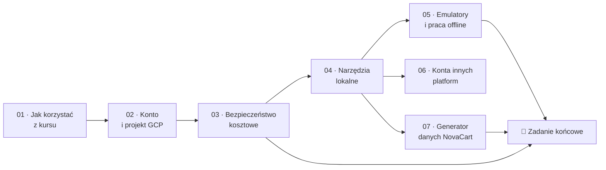

# Moduł 00 — Wprowadzenie, środowisko i bezpieczne korzystanie z chmury

> Zanim uruchomisz pierwsze zapytanie, zbudujesz środowisko, w którym błąd kosztuje grosze, a nie tysiące złotych. Ten moduł przygotowuje konto GCP, zabezpieczenia kosztowe, narzędzia lokalne i dane NovaCart, na których opiera się cały kurs.

| | |
|---|---|
| **Część** | Część 0 — Start |
| **Szacowany czas** | ~9 h (lekcje z przykładami ~7,5 h, zadanie ~1,5–2 h) |
| **Poziom** | ★☆☆☆ |
| **Wymaga** | — |
| **Koszt zadań** | < 0,10 USD przy skali S; mieści się w Free Tier i kredytach próbnych |
| **Ostatnia weryfikacja** | 2026-11-07 |

---

## 🎯 Cele modułu

Po ukończeniu modułu będziesz umieć:

1. **Wyjaśnić** zależność między organizacją, *billing account* (kontem rozliczeniowym) i projektem GCP oraz wskazać, na którym poziomie działa każde zabezpieczenie kosztowe.
2. **Skonfigurować** projekt GCP z budżetem, alertami i limitem bajtów przetwarzanych przez BigQuery, w całości przez Terraform i z możliwością usunięcia jednym poleceniem.
3. **Rozróżnić** mechanizmy, które tylko *ostrzegają* o kosztach (budżety), od tych, które je faktycznie *blokują* (`maximum_bytes_billed`, *custom quotas*, *spend caps*), i opisać ograniczenia każdego z nich.
4. **Uwierzytelnić** narzędzia lokalne przez Application Default Credentials (ADC) bez używania kluczy kont serwisowych.
5. **Uruchomić** lokalne zamienniki usług chmurowych (emulator Pub/Sub, Kafka, DuckDB) i wskazać, czego emulatory nie odwzorowują.
6. **Zaplanować** zakładanie kont próbnych Snowflake, Databricks, AWS i Azure tak, żeby nie wygasły przed modułami, w których będą potrzebne.
7. **Wygenerować** dane NovaCart w wybranej skali i opisać ich model, reguły biznesowe oraz świadomie wprowadzone problemy.

## 📋 Zanim zaczniesz

- **Wiedza:** podstawy pracy w terminalu, Git, SQL i Python (zobacz [wymagania wstępne kursu](../../README.md#dla-kogo-jest-ten-kurs)).
- **Środowisko:** komputer z macOS, Linuksem albo Windows z WSL2; konto Google; karta płatnicza do weryfikacji konta próbnego (BigQuery Sandbox działa bez karty, ale ma ograniczenia opisane w [lekcji 02](02-konto-i-projekt-gcp.md)).
- **Dane:** dane wygenerujesz w [lekcji 07](07-generator-danych-novacart.md). Jeśli chcesz zacząć od razu:

  ```bash
  cd datasets
  uv sync
  uv run novacart generate --scale s -o ../data/s
  ```

## 🧭 Dlaczego ten moduł

Zespół danych NovaCart dostał zgodę na migrację do GCP. Pierwszego dnia stażysta uruchomił w konsoli zapytanie `SELECT *` na tabeli clickstreamu, żeby „zobaczyć, co tam jest”. Tabela miała 40 TiB, a zapytanie było w pętli odświeżania dashboardu co 15 minut. Budżet z alertem istniał, ale e-mail przyszedł kilka godzin później i trafił na skrzynkę, której nikt nie czytał. Kilka takich historii opisanych publicznie zaczyna się dokładnie tak samo.

Ten moduł jest krótki, ale jest najważniejszy z punktu widzenia Twojego portfela. Uczy, że w chmurze **koszt jest właściwością architektury**, a nie pozycją na fakturze, i że każde zabezpieczenie ma swoją granicę: budżet tylko ostrzega i to z opóźnieniem, `maximum_bytes_billed` chroni pojedyncze zapytanie, *custom quota* chroni dzień, a usunięcie projektu chroni wszystko. Wszystko, co zbudujesz w kolejnych modułach, będzie stało na tym fundamencie.

Drugi cel to wspólny punkt startu. W całym kursie zakładamy te same narzędzia, ten sam sposób uwierzytelniania i te same dane NovaCart z ustalonym `--seed`. Dzięki temu liczby w lekcjach i rozwiązaniach zadań zgadzają się z tym, co zobaczysz u siebie.

## 🗺️ Mapa modułu



*Rysunek 00.1. Lekcje 01–04 trzeba przejść po kolei. Lekcje 05–07 są od siebie niezależne. Lekcję 06 możesz odłożyć do modułów 31–33.*

| # | Lekcja | Czas | Najważniejsze pojęcia |
|---|---|---|---|
| 01 | [Jak korzystać z kursu](01-jak-korzystac-z-kursu.md) | 40 min | drabina głębokości, ścieżki nauki, oznaczenia, praca z zadaniami |
| 02 | [Konto i projekt GCP](02-konto-i-projekt-gcp.md) | 60 min | organizacja, *billing account*, projekt, Free Trial, Free Tier, BigQuery Sandbox |
| 03 | [Bezpieczeństwo kosztowe od pierwszego dnia](03-bezpieczenstwo-kosztowe.md) | 90 min | budżety, *spend caps*, `maximum_bytes_billed`, *custom quotas*, etykiety, sprzątanie |
| 04 | [Narzędzia lokalne](04-narzedzia-lokalne.md) | 75 min | `gcloud`, ADC, impersonacja, Terraform/OpenTofu, `uv`, Docker, DuckDB |
| 05 | [Emulatory i praca offline](05-emulatory-i-praca-offline.md) | 70 min | emulatory GCP, Kafka w Docker Compose, DuckDB jako lokalna hurtownia |
| 06 | [Konta próbne innych platform](06-konta-innych-platform.md) | 45 min | Snowflake trial, Databricks Free Edition, AWS Free Tier, Azure free account |
| 07 | [Generator danych NovaCart](07-generator-danych-novacart.md) | 60 min | skale, komponenty, model danych, anomalie, determinizm |
| — | [Przykłady kodu](examples/README.md) | 30 min | |
| — | [🧪 Zadanie końcowe](exercise/README.md) | 1,5–2 h | |

## ⚖️ Porównanie platform — podsumowanie modułu

| Aspekt | GCP | AWS | Azure | Snowflake | Databricks | On-prem / OSS |
|---|---|---|---|---|---|---|
| Jednostka izolacji zasobów i kosztów | Projekt (w folderach i organizacji) | Konto (w AWS Organizations) | Subskrypcja i *resource group* | Konto (w organizacji Snowflake) | *Workspace* (w koncie Databricks) | Klaster, serwer, centrum kosztów w księgowości |
| Program na start | Free Trial 300 USD na 90 dni, Free Tier, BigQuery Sandbox bez karty | Do 200 USD kredytów; plan Free do 6 miesięcy (konta od 15.07.2025) | 200 USD na 30 dni i 12 miesięcy wybranych usług | Trial 30 dni z kredytami o wartości 400 USD, bez karty | Free Edition (bezterminowo, z dziennymi limitami) | Brak: koszt sprzętu i licencji ponosisz z góry |
| Budżet z alertem | Cloud Billing budgets: tylko ostrzega, z opóźnieniem | AWS Budgets; *Budget Actions* mogą zastosować politykę IAM lub zatrzymać instancje | Cost Management budgets; *action groups* do automatyzacji | *Resource monitors* faktycznie zawieszają *warehouse* | Budżety na poziomie konta; limity przez *compute policies* | Limit wynika z pojemności sprzętu |
| Twarda blokada kosztu | `maximum_bytes_billed` (zapytanie), *custom quotas* BigQuery (dzień), *spend caps* (wybrane usługi: m.in. Gemini API, Cloud Run) | Brak ogólnej; plan Free blokuje usługi drogie | Brak ogólnej poza limitem kredytu w ofercie próbnej | *Resource monitor* z akcją `SUSPEND` / `SUSPEND_IMMEDIATE` | Limity Free Edition; *auto-termination* klastrów | Fizyczna pojemność klastra |
| Uwierzytelnianie lokalne | ADC (`gcloud auth application-default login`), impersonacja SA | Profile CLI, IAM Identity Center (SSO) | `az login`, `DefaultAzureCredential` | Hasło + MFA, para kluczy, OAuth | OAuth U2M / M2M, tokeny PAT | Kerberos, LDAP, certyfikaty |
| Lokalny zamiennik | Emulatory Pub/Sub, Bigtable, Spanner, Firestore; brak emulatora BigQuery | LocalStack (zewnętrzny projekt) | Azurite (Storage), emulator Cosmos DB | Brak oficjalnego emulatora | Lokalny Spark, Databricks Connect | Ten sam stos lokalnie w Dockerze |

**Wnioski:** różnice w nazewnictwie (projekt, konto, subskrypcja, *workspace*) są kosmetyczne, bo każda platforma ma jednostkę izolacji, do której przypina się koszty i uprawnienia. Fundamentalna różnica dotyczy **zatrzymywania wydatków**. Platformy z płatnością za moc obliczeniową w czasie (Snowflake, Databricks) mogą wyłączyć *warehouse* lub klaster i zrobić to szybko. Platformy z setkami usług rozliczanych na różne sposoby (GCP, AWS, Azure) oferują głównie alerty, a twarde limity tylko dla wybranych mechanizmów. Dlatego w GCP zabezpieczenia buduje się warstwowo, co jest tematem [lekcji 03](03-bezpieczenstwo-kosztowe.md). On-premise nie ma tego problemu, bo koszt jest stały, ale płaci się za to brakiem elastyczności, o czym będzie [moduł 01](../01-ewolucja-architektur-danych/README.md).

## 📌 Najważniejsze wnioski

1. Budżet w Cloud Billing **nie zatrzymuje wydatków**. Wysyła powiadomienia na progach (domyślnie 50%, 90% i 100%), a dane o kosztach docierają z opóźnieniem liczonym w godzinach.
2. Realną ochronę przed drogim zapytaniem dają mechanizmy BigQuery: `maximum_bytes_billed` na poziomie zapytania i *custom quota* `QueryUsagePerDay` lub `QueryUsagePerUserPerDay` na poziomie dnia. Kwoty są przybliżone i resetują się o północy czasu pacyficznego.
3. Najskuteczniejsze sprzątanie to **usunięcie całego projektu**. Projekt przeznaczony na jeden moduł lub zadanie, z etykietami `course=ade` i `module=NN`, sprawia, że nic nie zostaje zapomniane.
4. Klucze kont serwisowych w plikach JSON to jedno z najczęstszych źródeł wycieków. Lokalnie używaj ADC z własnym kontem albo impersonacji konta serwisowego.
5. Emulatory przyspieszają pracę i nic nie kosztują, ale nie odwzorowują IAM, kwot, opóźnień ani części semantyki usług. Test na emulatorze nie zastąpi testu w chmurze.
6. Konta próbne innych platform mają krótkie okna (Snowflake i Azure 30 dni). Zakładaj je dopiero tuż przed modułem, w którym są potrzebne.
7. Dane NovaCart są deterministyczne: ten sam `--seed` i ta sama skala dają identyczne pliki, więc wyniki w zadaniach można porównywać z rozwiązaniem co do wiersza.

## 🧠 Pytania kontrolne

<details>
<summary><b>1. Ustawiłeś budżet 50 USD z alertem na 100%. Czy to gwarantuje, że miesięczny rachunek nie przekroczy 50 USD?</b> ★☆☆</summary>

Nie. Budżet w Cloud Billing to mechanizm powiadomień, a nie limit. Nie wyłącza żadnej usługi. Dodatkowo dane o kosztach trafiają do Cloud Billing z opóźnieniem, więc w chwili otrzymania e-maila wydatek może już być znacznie wyższy. Żeby zatrzymać wydatki, potrzebujesz mechanizmów blokujących: `maximum_bytes_billed`, *custom quotas* BigQuery, *spend caps* dla obsługiwanych usług albo automatu, który po powiadomieniu Pub/Sub odłącza billing od projektu (szczegóły i wady tego rozwiązania w [lekcji 03](03-bezpieczenstwo-kosztowe.md)).

</details>

<details>
<summary><b>2. Czym różni się <code>gcloud auth login</code> od <code>gcloud auth application-default login</code>?</b> ★☆☆</summary>

Pierwsze polecenie zapisuje poświadczenia używane przez samo narzędzie `gcloud` (i `bq`, `gsutil`). Drugie tworzy plik ADC (`~/.config/gcloud/application_default_credentials.json`), z którego korzystają biblioteki klienckie, np. `google-cloud-bigquery` w Pythonie i provider Terraform. Bez drugiego polecenia skrypt w Pythonie nie znajdzie poświadczeń, mimo że `gcloud` działa. Zobacz [lekcję 04](04-narzedzia-lokalne.md).

</details>

<details>
<summary><b>3. Dlaczego <code>LIMIT 10</code> nie zmniejsza kosztu zapytania BigQuery w modelu on-demand, a jaki mechanizm pozwala to sprawdzić przed uruchomieniem?</b> ★★☆</summary>

W modelu on-demand płacisz za bajty odczytane z kolumn wskazanych w zapytaniu, a nie za liczbę zwróconych wierszy. `LIMIT` ogranicza wynik, ale w typowym przypadku silnik i tak czyta całe kolumny. Koszt sprawdzisz przez *dry run* (`bq query --dry_run` albo `QueryJobConfig(dry_run=True)`), który zwraca szacowaną liczbę bajtów bez wykonywania zapytania i bez opłat. Dlaczego tak jest, wyjaśnia budowa kolumnowego storage BigQuery w modułach 14–15.

</details>

<details>
<summary><b>4. Zespół NovaCart chce, żeby żaden analityk nie mógł przetworzyć w BigQuery więcej niż 2 TiB dziennie, a cały projekt nie więcej niż 10 TiB. Jak to skonfigurować i jakie są ograniczenia?</b> ★★☆</summary>

Dwie *custom quotas* na API BigQuery: `QueryUsagePerUserPerDay` = 2 TiB i `QueryUsagePerDay` = 10 TiB, najlepiej przez Terraform. Ograniczenia: limit użytkownika jest jednakowy dla wszystkich (nie da się ustawić innej wartości dla jednej osoby), kwoty są przybliżone (pojedyncze zapytanie może je przekroczyć), resetują się o północy czasu pacyficznego, dotyczą tylko modelu on-demand, a po wyczerpaniu limitu projektowego BigQuery przestaje działać dla wszystkich w projekcie, również dla produkcyjnych pipeline'ów. Dlatego produkcja i analityka ad hoc powinny być w osobnych projektach.

</details>

<details>
<summary><b>5. Test integracyjny Twojego konsumenta Pub/Sub przechodzi na emulatorze, ale na produkcji konsument dostaje błąd 403. Co jest najbardziej prawdopodobną przyczyną i dlaczego emulator jej nie wykrył?</b> ★★☆</summary>

Brak uprawnień IAM konta serwisowego, np. roli `roles/pubsub.subscriber` na subskrypcji. Emulator nie implementuje IAM ani uwierzytelniania: biblioteka kliencka po wykryciu `PUBSUB_EMULATOR_HOST` łączy się kanałem bez TLS i bez poświadczeń. Testy na emulatorze sprawdzają logikę przetwarzania, a uprawnienia, kwoty i zachowanie pod obciążeniem trzeba sprawdzić w prawdziwym projekcie testowym. Zobacz [lekcję 05](05-emulatory-i-praca-offline.md).

</details>

<details>
<summary><b>6. Dlaczego w kursie każdy moduł z zasobami chmurowymi zaleca osobny projekt GCP, zamiast jednego projektu na cały kurs?</b> ★★☆</summary>

Projekt jest jednostką izolacji uprawnień, kwot, kosztów i cyklu życia. Osobny projekt pozwala: (1) usunąć wszystko jednym poleceniem `gcloud projects delete` bez ryzyka, że coś zostanie; (2) widzieć koszt modułu bez filtrowania po etykietach; (3) ustawić kwoty i budżet dopasowane do zadania; (4) uniknąć sytuacji, w której zadanie z jednego modułu wyczerpuje kwotę potrzebną w innym. Etykiety `course=ade` i `module=NN` uzupełniają ten podział tam, gdzie zasoby muszą współdzielić projekt.

</details>

<details>
<summary><b>7. Uruchomiłeś generator dwa razy z tym samym <code>--seed</code>, raz z <code>--workers 1</code>, raz z <code>--workers 8</code>. Czy pliki będą identyczne? Co musiało być spełnione w implementacji, żeby tak było?</b> ★★★</summary>

Tak, pliki są identyczne bajt w bajt. Każdy fragment danych ma własny strumień liczb losowych wyprowadzony z ziarna i klucza (np. numeru dnia), a nie jeden globalny generator, z którego procesy pobierałyby liczby w nieprzewidywalnej kolejności. Dodatkowo podział pracy między procesy nie wpływa na zawartość ani na granice plików (jedna partycja dzienna = jeden plik), a zapis jest uporządkowany. Ta sama zasada jest podstawą powtarzalnych *backfilli* w pipeline'ach produkcyjnych, do której wrócimy w modułach 23 i 27. Szczegóły w [lekcji 07](07-generator-danych-novacart.md).

</details>

<details>
<summary><b>8. Masz trzy tygodnie do modułu 31 (Snowflake) i dwa miesiące do modułu 33 (AWS i Azure). Kiedy założysz które konto próbne i dlaczego?</b> ★☆☆</summary>

Snowflake: tuż przed modułem 31, bo trial trwa 30 dni (z kredytami o wartości 400 USD). Azure: tuż przed modułem 33, bo 200 USD kredytu jest ważne tylko 30 dni. AWS (konta od 15.07.2025): plan Free trwa do 6 miesięcy albo do wyczerpania kredytów, więc jest mniej wrażliwy na moment założenia, ale też warto go założyć blisko modułu 33. Databricks Free Edition nie wygasa, więc możesz go założyć wcześniej, np. przed modułem 05. Zobacz [lekcję 06](06-konta-innych-platform.md).

</details>

## 🧪 Zadanie końcowe

**[Bezpieczny projekt i pierwsze dane NovaCart w chmurze](exercise/README.md)**: skonfiguruj w Terraform projekt z budżetem, alertem e-mail i dzienną kwotą BigQuery, załaduj dane NovaCart w skali S do Cloud Storage, odpytaj je przez tabelę zewnętrzną i rozlicz koszt każdej operacji.

## 📚 Dalsza lektura

**Dokumentacja**
- [Cloud Billing: budżety i alerty](https://docs.cloud.google.com/billing/docs/how-to/budgets): progi, typy kosztów, powiadomienia Pub/Sub.
- [Cloud Billing: spend cap budgets](https://docs.cloud.google.com/billing/docs/how-to/budgets-spend-caps): które usługi można twardo ograniczyć i z jakimi zastrzeżeniami.
- [BigQuery: custom quotas](https://docs.cloud.google.com/bigquery/docs/custom-quotas): `QueryUsagePerDay` i `QueryUsagePerUserPerDay`.
- [BigQuery Sandbox](https://docs.cloud.google.com/bigquery/docs/sandbox): limity i niedostępne funkcje.
- [Application Default Credentials](https://docs.cloud.google.com/docs/authentication/application-default-credentials): kolejność wyszukiwania poświadczeń.
- [Free Trial i Free Tier](https://docs.cloud.google.com/free/docs/free-cloud-features): aktualne warunki programów darmowych.

**Książki i wystąpienia**
- J. R. Storment, M. Fuller, *Cloud FinOps*, O'Reilly, wyd. 2 (2023): kultura i praktyka zarządzania kosztami chmury; rozwijamy ten temat w [module 39](../../README.md#moduł-39--finops-inżynieria-kosztów).
- Dokumentacja [`uv`](https://docs.astral.sh/uv/) i [Terraform](https://developer.hashicorp.com/terraform/docs): narzędzia używane w całym kursie.

---

<sub>Następny moduł: [01 — Ewolucja architektur danych](../01-ewolucja-architektur-danych/README.md) · [Spis treści kursu](../../README.md)</sub>
