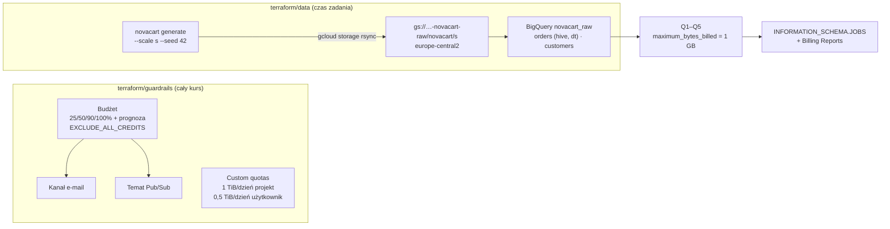

# Rozwiązanie — Bezpieczny projekt i pierwsze dane NovaCart w chmurze

> [!WARNING]
> Zajrzyj tutaj dopiero po samodzielnej próbie. Największa wartość zadania to samodzielne zmierzenie się z problemem, także z błędnymi podejściami.

## Podejście w skrócie

Rozwiązanie dzieli infrastrukturę na **dwa stany Terraform o różnym cyklu życia**. `guardrails` (budżet, kanał e-mail, temat Pub/Sub, limity BigQuery) powstaje raz i chroni projekt przez cały kurs. `data` (bucket, zbiór, tabele zewnętrzne) powstaje na czas zadania i jest usuwany jednym poleceniem. Ponieważ tabela zewnętrzna na plikach Parquet odczytuje schemat z plików przy tworzeniu, dane trafiają do bucketu **między** dwoma uruchomieniami `terraform apply`. Steruje tym zmienna `create_tables`. Zapytania czytają pojedyncze partycje i kolumny, a każde ma limit bajtów i etykiety, więc ich koszt da się policzyć w `INFORMATION_SCHEMA.JOBS`.



## Kluczowe decyzje

| Decyzja | Wybór | Odrzucone alternatywy | Uzasadnienie |
|---|---|---|---|
| Podział Terraform | Dwa katalogi i dwa stany: `guardrails`, `data` | Jeden stan; `terraform destroy -target=…` | Różny cykl życia zasobów. `destroy` danych nie może usuwać budżetu. `-target` to narzędzie awaryjne, a nie element procesu. |
| Kolejność tworzenia | Zmienna `create_tables` i drugi `apply` po wgraniu danych | Schemat podany jawnie (`schema = file(…)`); wgrywanie danych przez Terraform (`google_storage_bucket_object`) | `autodetect` wymaga plików w chwili tworzenia tabeli. Jawny schemat to dobre rozszerzenie (kontrakt danych), ale zwiększa zakres zadania. Wgrywanie ~430 plików przez Terraform puchnie stan i jest wolne. |
| Region | `europe-central2` dla bucketu i zbioru | `EU` (multi-region); `us-central1` (Free Tier Cloud Storage) | Dane klientów z UE (RODO). Ta sama lokalizacja dla bucketu i zbioru eliminuje problemy z kolokacją tabel zewnętrznych. Koszt ~124 MB poza Free Tier jest pomijalny. |
| Tabela zewnętrzna vs natywna | Zewnętrzna (Parquet na GCS) | `bq load` do tabeli natywnej | Zadanie ma pokazać dostęp „bez kopiowania”. Tabela natywna dałaby lepszą wydajność i metadane (moduły 15, 17), ale podwoiłaby storage. |
| Partycjonowanie hive | `mode = "AUTO"`, `require_partition_filter = true` | `CUSTOM` z jawnymi typami (`{dt:DATE}`); `STRINGS` | AUTO poprawnie wykrywa `dt` jako `DATE` dla formatu `RRRR-MM-DD`. Wymagany filtr to bezpiecznik kosztowy na poziomie tabeli. |
| Budżet | 20 jednostek waluty, progi 25/50/90/100% + prognoza 100%, `EXCLUDE_ALL_CREDITS` | Domyślne progi 50/90/100%; uwzględnianie kredytów | Niskie progi dają wcześniejszy sygnał. Na *free trial* kredyty zerowałyby wydatki do końca triala. |
| Limity BigQuery | 1 TiB/dzień projekt, 0,5 TiB/dzień użytkownik | Tylko limit projektu; brak limitów | Limit użytkownika chroni przed pojedynczym błędem, a limit projektu przed automatyzacją. 1 TiB to cały darmowy miesiąc, więc dzienny błąd kosztuje najwyżej ~6 USD. |
| Bucket | `force_destroy`, `soft_delete_policy` = 0, reguła usuwania po 30 dniach, `public_access_prevention = "enforced"` | Ustawienia domyślne | Dane da się zawsze wygenerować ponownie, więc *soft delete* to tylko koszt. Reguła 30 dni to siatka bezpieczeństwa, gdy zapomnisz o sprzątaniu. |
| API przy `destroy` | `disable_on_destroy = false` | `true` (domyślne) | Wyłączenie API usunęłoby lub zablokowało zasoby zarządzane w innych stanach i modułach. |

## Krok po kroku

### 1. Bezpieczniki

Najważniejsze fragmenty to filtr po **numerze** projektu, wykluczenie kredytów i próg prognozy:

```hcl
# exercise/solution/terraform/guardrails/main.tf (fragment)
resource "google_billing_budget" "monthly" {
  billing_account = var.billing_account_id
  display_name    = "ade-${var.project_id}-monthly"

  budget_filter {
    projects               = ["projects/${data.google_project.this.number}"]
    credit_types_treatment = "EXCLUDE_ALL_CREDITS"
    calendar_period        = "MONTH"
  }
  # ...
  dynamic "threshold_rules" {
    for_each = [0.25, 0.5, 0.9, 1.0]
    content {
      threshold_percent = threshold_rules.value
      spend_basis       = "CURRENT_SPEND"
    }
  }

  threshold_rules {
    threshold_percent = 1.0
    spend_basis       = "FORECASTED_SPEND"
  }
  # ...
}
```

Limity w MiB (1 TiB = 1 048 576 MiB):

```hcl
# exercise/solution/terraform/guardrails/main.tf (fragment)
resource "google_service_usage_consumer_quota_override" "bq_query_per_user_per_day" {
  provider       = google-beta
  project        = var.project_id
  service        = "bigquery.googleapis.com"
  metric         = urlencode("bigquery.googleapis.com/quota/query/usage")
  limit          = urlencode("/d/project/user")
  override_value = tostring(floor(var.bq_query_tib_per_user_per_day * local.mib_per_tib))
  force          = true
  depends_on     = [google_project_service.apis]
}
```

```bash
cd modules/00-wprowadzenie/exercise/solution
cp terraform/guardrails/terraform.tfvars.example terraform/guardrails/terraform.tfvars   # uzupełnij
terraform -chdir=terraform/guardrails init && terraform -chdir=terraform/guardrails apply
```

Po `apply` sprawdź w konsoli (*IAM & Admin → Quotas & System Limits*, filtr „Query usage per day”), czy widzisz 1 TiB i 0,5 TiB, a nie np. 1 MiB.

### 2. Bucket i zbiór, potem dane, potem tabele

```hcl
# exercise/solution/terraform/data/main.tf (fragment)
resource "google_storage_bucket" "raw" {
  name                        = local.bucket_name
  location                    = upper(var.region)
  storage_class               = "STANDARD"
  uniform_bucket_level_access = true
  public_access_prevention    = "enforced"
  force_destroy               = true # dane kursu można zawsze wygenerować ponownie

  # Usunięte obiekty nie są przechowywane (domyślnie byłyby trzymane 7 dni, płatnie).
  soft_delete_policy {
    retention_duration_seconds = 0
  }
  # ...
}

resource "google_bigquery_table" "orders" {
  count               = var.create_tables ? 1 : 0
  dataset_id          = google_bigquery_dataset.raw.dataset_id
  table_id            = "orders"
  deletion_protection = false

  external_data_configuration {
    autodetect    = true
    source_format = "PARQUET"
    source_uris   = ["${local.data_uri}/orders/*"]

    hive_partitioning_options {
      mode                     = "AUTO"
      source_uri_prefix        = "${local.data_uri}/orders/"
      require_partition_filter = true
    }
  }
}
```

```bash
cp terraform/data/terraform.tfvars.example terraform/data/terraform.tfvars                # uzupełnij
terraform -chdir=terraform/data init && terraform -chdir=terraform/data apply             # create_tables = false
DATA_URI="$(terraform -chdir=terraform/data output -raw data_uri)" ../starter/scripts/upload_data.sh
terraform -chdir=terraform/data apply -var create_tables=true
```

`source_uri_prefix` musi kończyć się na katalogu **nad** `dt=…`. BigQuery wycina z dalszej części ścieżki pary `klucz=wartość` i zamienia je w kolumny.

### 3. Zapytania kontrolne

```sql
-- exercise/solution/sql/control_queries.sql (fragment)
-- Q1. Liczba zamówień, liczba partycji i zakres dat.
-- Filtr na dt jest wymagany (require_partition_filter = true) i pozwala pominąć zbędne pliki.
SELECT
  COUNT(*)           AS orders,
  COUNT(DISTINCT dt) AS partitions,
  MIN(dt)            AS first_day,
  MAX(dt)            AS last_day
FROM novacart_raw.orders
WHERE dt BETWEEN DATE '2025-11-01' AND DATE '2025-12-31';

-- Q4. Black Friday (28.11.2025): jedna partycja, więc zapytanie czyta jeden plik.
SELECT currency, COUNT(*) AS orders, SUM(total_amount) AS revenue
FROM novacart_raw.orders
WHERE dt = DATE '2025-11-28'
GROUP BY currency
ORDER BY currency;
```

```bash
bq query --project_id="$PROJECT_ID" --use_legacy_sql=false \
  --maximum_bytes_billed=1000000000 --label=course:ade --label=module:00 < sql/control_queries.sql
```

### 4. Raport kosztów

```sql
-- exercise/solution/sql/cost_report.sql (fragment)
SELECT
  job_type,
  statement_type,
  COUNT(*)                                              AS jobs,
  SUM(total_bytes_processed)                            AS bytes_processed,
  SUM(total_bytes_billed)                               AS bytes_billed,
  ROUND(SUM(total_bytes_billed) / POW(2, 40), 6)        AS tib_billed,
  -- Koszt wg ceny katalogowej on-demand (sprawdź aktualny cennik); Free Tier pomniejsza go do 0.
  ROUND(SUM(total_bytes_billed) / POW(2, 40) * 6.25, 4) AS list_price_usd
FROM `region-europe-central2`.INFORMATION_SCHEMA.JOBS_BY_PROJECT
WHERE creation_time >= TIMESTAMP_SUB(CURRENT_TIMESTAMP(), INTERVAL 7 DAY)
  AND EXISTS (SELECT 1 FROM UNNEST(labels) AS l WHERE l.key = 'module' AND l.value = '00')
GROUP BY job_type, statement_type
ORDER BY bytes_billed DESC;
```

Uzupełnij go danymi z *Billing → Reports*: filtr na projekt i etykietę `module=00`, grupowanie po SKU. Zobaczysz tam osobno storage Cloud Storage, operacje klasy A (zapisy) i B (odczyty) oraz analizę BigQuery. Dane spływają z opóźnieniem do ~24 h.

## Weryfikacja

Dla skali S i seed 42 (generator v0.1.0):

| Kryterium | Oczekiwana wartość | Jak sprawdzić |
|---|---|---|
| Liczba zamówień | 24 506 | Q1 |
| Partycje i zakres | 61; 2025-11-01 … 2025-12-31 | Q1 |
| Statusy | delivered 20 865 · returned 1 241 · cancelled 1 063 · shipped 988 · paid 288 · created 61 | Q2 |
| Przychód | PLN 12 681 259,98 (10 890 zam.) · EUR 2 984 871,97 (10 653) · CZK 20 245 410,80 (2 963) | Q3 |
| Black Friday | 1 046: CZK 128 (792 321,25) · EUR 430 (116 676,35) · PLN 488 (496 395,92) | Q4 |
| Klienci | 20 000, z czego 78 zanonimizowanych | Q5 |
| Zapytanie bez filtra `dt` | błąd: tabela wymaga filtra partycji | `bq query --dry_run 'SELECT COUNT(*) FROM novacart_raw.orders'` |
| Bezpieczniki i pozostałe kryteria | wszystkie ✔ | `../starter/scripts/check.sh` |
| Idempotencja | `No changes` | `terraform -chdir=terraform/<katalog> plan` |

Liczby w tabeli policzono lokalnie w DuckDB na tych samych plikach Parquet. BigQuery musi zwrócić identyczne wartości.

## Wyniki i koszty

| Wariant | Bajty rozliczone (Q1–Q5 + check.sh) | Pliki czytane przez Q4 | Koszt |
|---|---|---|---|
| Punkt wyjścia: `SELECT *` bez filtra, bez limitu (gdyby tabela nie wymagała filtra) | cała tabela `orders` (~2,5 MB) przy każdym zapytaniu | 61 | ułamek centa, ale przy tabeli produkcyjnej rzędu TiB — dziesiątki USD na zapytanie |
| Rozwiązanie | rząd kilkudziesięciu–kilkuset MiB, głównie minimalne opłaty 10 MiB za każde zapytanie i każdą tabelę | 1 | 0 USD po Free Tier; według cen katalogowych < 0,01 USD |
| Storage GCS (~124 MB przez kilka dni) i ~430 operacji zapisu | — | — | < 0,01 USD według cen katalogowych |

Zwróć uwagę, że przy tak małych danych **dominuje minimalna opłata 10 MiB** za zapytanie i za każdą tabelę. Q1 na 2,5 MB danych zostanie rozliczone jako 10 MiB. To dobry moment, żeby w raporcie wyjaśnić, dlaczego tysiąc małych zapytań (np. z dashboardu odświeżanego co minutę) może kosztować więcej niż kilka dużych.

Koszt rozwiązania wzorcowego **nie został jeszcze zmierzony na żywym projekcie**. Wartości w tabeli to szacunek z cen katalogowych i rozmiarów plików. Po wykonaniu zadania wpisz w swoim raporcie liczby z `INFORMATION_SCHEMA.JOBS` i *Billing → Reports* wraz z datą pomiaru.

## Typowe błędy

1. **Projekt w filtrze budżetu podany jako ID** (`projects/ade-jkowalski-2611`). API oczekuje numeru. Terraform zwróci błąd albo budżet obejmie nie to, co trzeba. Użyj `data.google_project.this.number`.
2. **Brak `billing_project` i `user_project_override` w providerze.** Przy ADC z kontem użytkownika Billing Budgets API zwraca 403. Komunikat sugeruje problem z uprawnieniami, choć brakuje wskazania projektu do rozliczania wywołań.
3. **Limit w złych jednostkach** (`override_value = "1"`, czyli 1 MiB). Każde zapytanie zostaje odrzucone z `quotaExceeded`. Wartość podajesz w MiB: 1 TiB = 1 048 576.
4. **Tabela tworzona przed wgraniem danych.** `terraform apply` kończy się błędem, bo BigQuery nie ma z czego odczytać schematu. Rozwiązanie: `create_tables` i drugi `apply`.
5. **Zła wartość `source_uri_prefix`** (np. bez końcowego `/orders/` albo z `dt=` w środku). BigQuery nie wykrywa kolumny `dt` albo zgłasza niezgodność układu ścieżek.
6. **Bucket i zbiór w różnych lokalizacjach** (np. bucket `EU`, zbiór `europe-central2` albo odwrotnie). Zapytania na tabeli zewnętrznej kończą się błędem lokalizacji. Najprościej trzymać oba w tym samym regionie.
7. **Sumowanie `total_amount` bez grupowania po walucie.** Wynik „36 miliony” nic nie znaczy, bo dodaje złotówki do euro i koron.
8. **`terraform destroy` w jednym, wspólnym stanie.** Razem z danymi znika budżet, a kolejne moduły startują bez bezpieczników.
9. **Raport kosztów zaraz po zadaniu.** *Billing → Reports* pokazuje jeszcze zero, bo dane spływają z opóźnieniem. Wróć następnego dnia.

## Co dalej

- **Moduł 12 (Terraform):** stan w zdalnym backendzie (bucket GCS z blokadą), moduły wielokrotnego użytku: `guardrails` to naturalny kandydat na moduł używany przez każdy projekt w firmie.
- **Moduł 13 (Cloud Storage):** klasy storage, *soft delete*, *object versioning*, reguły cyklu życia i ich koszty.
- **Moduł 15 (BigQuery storage):** tabele natywne vs zewnętrzne vs BigLake, partycjonowanie i *clustering* tabel natywnych, porównanie bajtów rozliczonych.
- **Moduł 17 (ingestion):** `bq load`, Storage Write API, schematy jako kontrakt (`novacart schemas`).
- **Moduł 39 (FinOps):** eksport billingu do BigQuery, alokacja kosztów po etykietach, automatyczne reakcje na wiadomości z tematu budżetu.
