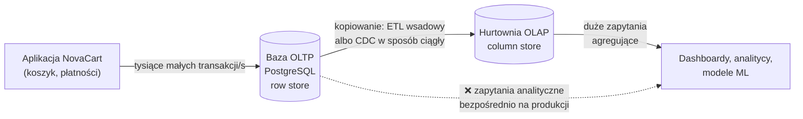
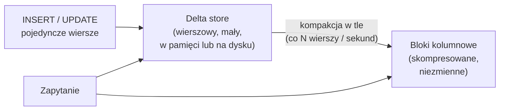

# 01.01 — OLTP vs OLAP: dwa światy obciążeń

> **Czas:** ~75 min · **Wymaga:** [Moduł 00](../00-wprowadzenie/README.md) · **Ostatnia weryfikacja:** 2026-11-07

**W tej lekcji:**

- zobaczysz, czym różnią się obciążenia transakcyjne (OLTP) i analityczne (OLAP) i dlaczego te różnice są fundamentalne, a nie „ilościowe”,
- zajrzysz do środka bazy wierszowej (strony, B-drzewo) i kolumnowej (kodowanie, kompresja, wektoryzacja),
- zmierzysz na danych NovaCart, że ta sama tabela w SQLite i w DuckDB daje odwrotne wyniki dla tych dwóch obciążeń,
- zrozumiesz, dlaczego „jedna baza do wszystkiego” nie działa i jak systemy HTAP próbują to zmienić (i za jaką cenę).

---

## 1. Problem

Jest piątek, 28 listopada 2025, Black Friday. Sklep NovaCart obsługuje w szczycie ponad 200 zamówień na minutę. Baza transakcyjna PostgreSQL odpowiada w 40 ms na 99. percentylu i wszystko działa.

O 14:05 analityk z działu sprzedaży, który potrzebuje „na szybko” przychodu per kraj i godzina, uruchamia zapytanie bezpośrednio na produkcyjnej bazie. Zapytanie łączy `orders` z `order_items`, grupuje kilkadziesiąt milionów wierszy i trwa 11 minut. W tym czasie p99 czasu odpowiedzi koszyka rośnie do 2,1 s, a część płatności kończy się *timeoutem* (przekroczeniem limitu czasu). Nikt niczego nie zablokował, bo PostgreSQL dzięki MVCC nie blokuje zapisów przy odczycie. Po prostu zapytanie analityczne zajęło dyski, wyrzuciło z pamięci podręcznej (*buffer cache*) gorące strony tabel używanych przez koszyk, a dodatkowo wstrzymało sprzątanie starych wersji wierszy (*vacuum*), więc tabele zaczęły puchnąć.

Pierwszy odruch to „dajmy mocniejszy serwer”. Nie pomoże. Ta sama baza nie może być jednocześnie dobra w obsłudze tysięcy małych, krótkich operacji na pojedynczych wierszach i w przeglądaniu milionów wierszy w poszukiwaniu sum. To nie jest kwestia mocy, tylko **sposobu ułożenia danych na dysku i sposobu ich przetwarzania**. Ta lekcja wyjaśnia dlaczego, a cała historia architektur danych, którą omawiamy w tym module, zaczyna się właśnie od tego rozdźwięku.

## 2. Intuicja

> [!TIP]
> **Intuicja.** Wyobraź sobie przychodnię. Każdy pacjent ma **teczkę** z całą swoją historią: dane osobowe, wizyty, wyniki badań. Gdy pacjent przychodzi, rejestratorka wyciąga jedną teczkę i ma wszystko w ręku. To jest **baza wierszowa** (*row store*): wszystko o jednym obiekcie leży razem.
>
> Teraz Ministerstwo Zdrowia pyta: „jaki jest średni poziom cholesterolu pacjentów w wieku 40–50 lat?”. Rejestratorka musi przejrzeć **wszystkie** teczki, z każdej wyjąć jedną liczbę i odłożyć teczkę z powrotem. Gdyby zamiast teczek przychodnia prowadziła osobne zeszyty — jeden z datami urodzenia, drugi z wynikami cholesterolu, oba w tej samej kolejności pacjentów — wystarczyłoby przeczytać dwa zeszyty. To jest **baza kolumnowa** (*column store*).

Analogia dobrze tłumaczy, skąd bierze się różnica w ilości czytanych danych. Pokazuje też koszt drugiej strony: gdy nowy pacjent się rejestruje, w przychodni z teczkami zakładasz jedną teczkę, a w przychodni z zeszytami musisz dopisać po jednej linijce w **każdym** zeszycie.

Analogia przestaje działać w dwóch miejscach. Po pierwsze, w bazie kolumnowej „zeszyty” są jeszcze **skompresowane**. Zeszyt z krajem pacjenta, w którym występuje sześć różnych wartości, da się zapisać kilkadziesiąt razy krócej niż teczki. Po drugie, różnica nie dotyczy tylko dysku, ale też procesora: przetwarzanie długiej kolumny liczb tego samego typu jest dla CPU nieporównanie wydajniejsze niż przeskakiwanie po różnych polach w kolejnych wierszach. Oba efekty omawiamy w sekcji „Pod maską”.

## 3. Koncepcja

### 3.1. Pojęcia

| Pojęcie | Znaczenie |
|---|---|
| *OLTP* (*Online Transaction Processing*, przetwarzanie transakcyjne) | Obciążenie złożone z wielu krótkich operacji (odczyt, wstawienie, aktualizacja) na pojedynczych wierszach, wykonywanych współbieżnie przez aplikację. Przykład: złożenie zamówienia. |
| *OLAP* (*Online Analytical Processing*, przetwarzanie analityczne) | Obciążenie złożone z mniejszej liczby dużych zapytań, które czytają miliony wierszy, ale zwykle tylko kilka kolumn, i liczą agregaty. Przykład: przychód per kraj i miesiąc. Termin wprowadził E. F. Codd w 1993 roku. |
| *Row store* (baza wierszowa) | Silnik, który przechowuje wszystkie kolumny jednego wiersza obok siebie na dysku. PostgreSQL, MySQL/InnoDB, Oracle, SQL Server (domyślnie), SQLite. |
| *Column store* (baza kolumnowa) | Silnik, który przechowuje wartości jednej kolumny obok siebie. BigQuery, Snowflake, Redshift, ClickHouse, DuckDB, Vertica; formaty plików Parquet i ORC. |
| Strona (*page*) | Najmniejsza jednostka wymiany danych między dyskiem a pamięcią w bazie wierszowej: 8 KB w PostgreSQL, 16 KB w InnoDB, domyślnie 4 KB w SQLite. |
| *B-drzewo* (*B-tree*, ściślej B+-drzewo) | Zrównoważone drzewo wyszukiwania o dużym rozgałęzieniu. Pozwala znaleźć wiersz po kluczu w kilku odczytach stron. Podstawowa struktura indeksu w bazach OLTP. |
| *ACID* | Atomowość, spójność, izolacja, trwałość: gwarancje transakcji, bez których nie da się bezpiecznie obsługiwać płatności. Szczegółowo w module 02. |
| Wektoryzacja (*vectorized execution*) | Przetwarzanie danych porcjami (wektorami) po ~1000–2000 wartości jednej kolumny zamiast wiersz po wierszu. |
| *HTAP* (*Hybrid Transactional/Analytical Processing*) | System, który obsługuje oba typy obciążeń na tych samych, świeżych danych. Termin spopularyzował Gartner w 2014 roku. |

Najważniejsze różnice zebrane w jednym miejscu:

| Cecha | OLTP | OLAP |
|---|---|---|
| Typowa operacja | `SELECT … WHERE order_id = ?`, `INSERT`, `UPDATE` jednego wiersza | `SELECT kraj, SUM(kwota) … GROUP BY` po milionach wierszy |
| Wierszy na zapytanie | 1–100 | 10⁶–10¹¹ |
| Kolumn na zapytanie | wszystkie (cały obiekt) | kilka z dziesiątek lub setek |
| Oczekiwany czas odpowiedzi | milisekundy | sekundy do minut |
| Współbieżność | tysiące transakcji na sekundę | dziesiątki do setek zapytań naraz |
| Zapisy | ciągłe, pojedyncze wiersze, aktualizacje w miejscu | wsadowe dopisywanie (*append*), rzadkie aktualizacje |
| Model danych | znormalizowany (3NF), unika duplikacji | zdenormalizowany (gwiazda, szerokie tabele), optymalizuje odczyt |
| Historia | stan bieżący | pełna historia, często wiele lat |
| Rozmiar | GB do kilku TB | TB do PB |
| Wąskie gardło | opóźnienie losowych odczytów i zapisów, blokady, log transakcyjny | przepustowość skanowania (bajty/s) i CPU |
| Użytkownik | aplikacja | analityk, dashboard, model ML |

### 3.2. Jak to działa — widok z lotu ptaka



*Rysunek 1.1. Klasyczny podział: dane powstają w bazie OLTP, a analizy wykonuje się na kopii w systemie OLAP. Przerywana strzałka to sytuacja z sekcji „Problem”.*

Dane powstają tam, gdzie działa biznes, czyli w bazie transakcyjnej. Analizy wykonujemy na kopii w osobnym systemie, który jest zbudowany inaczej. Między nimi płyną dane: kiedyś raz na dobę (ETL, lekcja [01.02](02-era-hurtowni-danych.md)), dziś często w sposób ciągły (CDC, moduł 26). Ten podział ma swoją cenę: dane w hurtowni są **opóźnione** względem produkcji, a utrzymanie kopii kosztuje. Próbą jego zniesienia jest HTAP (sekcja 4.6).

## 4. 🔍 Pod maską

### 4.1. Jak baza wierszowa układa dane na dysku

Baza wierszowa dzieli plik tabeli na strony o stałym rozmiarze. W PostgreSQL strona ma 8 KB i wygląda tak:

```text
 Strona sterty (heap page) PostgreSQL — 8192 bajty
┌────────────────────────────────────────────────────────────────┐
│ nagłówek strony (24 B): LSN, sumy kontrolne, wskaźniki wolnego │
├────────────────────────────────────────────────────────────────┤
│ wskaźniki wierszy (line pointers), po 4 B: [1] [2] [3] ... →   │
├────────────────────────────────────────────────────────────────┤
│                                                                │
│                       wolne miejsce                            │
│                                                                │
├────────────────────────────────────────────────────────────────┤
│ ← ... [wiersz 3] [wiersz 2] [wiersz 1]                         │
│  każdy wiersz: nagłówek (23 B: xmin, xmax, ...) + WSZYSTKIE    │
│  kolumny: order_id | customer_id | status | currency | ... |   │
│  total_amount | shipping_city | ... | updated_at               │
└────────────────────────────────────────────────────────────────┘
```

*Rysunek 1.2. Wiersze rosną od końca strony, wskaźniki od początku. Zauważ, że jeden wiersz zawiera wszystkie kolumny zamówienia.*

Zamówienie NovaCart ma 25 kolumn i zajmuje w wierszowej bazie około 200–250 bajtów, więc na stronę mieści się około 30 zamówień. Konsekwencje:

- **Odczyt jednego zamówienia to odczyt jednej strony.** Wszystkie jego kolumny przychodzą „gratis”, bo leżą obok siebie.
- **Zsumowanie jednej kolumny wymaga odczytu wszystkich stron.** Baza nie umie przeczytać „samego `total_amount`”, bo jest on rozrzucony po wszystkich stronach, przemieszany z 24 innymi kolumnami. Dla tabeli 10 mln zamówień to ok. 2,4 GB danych, z których potrzebujesz ~80 MB.
- **Aktualizacja jest lokalna.** Zmiana statusu zamówienia dotyka jednej strony (w PostgreSQL powstaje nowa wersja wiersza, zwykle na tej samej stronie) plus wpis w logu transakcyjnym (*WAL*, *write-ahead log*).

> [!IMPORTANT]
> **Co z tego wynika w praktyce:** w bazie wierszowej koszt zapytania jest proporcjonalny do **liczby stron, które trzeba przeczytać**, a każda strona niesie wszystkie kolumny. Dlatego zapytanie analityczne na bazie OLTP czyta 10–50× więcej danych, niż potrzebuje, i przy okazji wypycha z pamięci strony potrzebne aplikacji.

### 4.2. B-drzewo: jak znaleźć jeden wiersz wśród miliardów w trzech krokach

Jak baza wierszowa znajduje zamówienie `1 011 679` bez czytania wszystkich stron? Dzięki indeksowi w postaci B+-drzewa.

```text
                         ┌───────────────────────────────┐
  poziom 0 (korzeń)      │ <500 000 │ <1 000 000 │ ...  │       1 strona
                         └────┬──────────┬───────────────┘
                 ┌────────────┘          └────────────┐
  poziom 1   ┌─────────────────────┐        ┌─────────────────────┐
             │ <1 005 000 │ <1 010 000 │ <1 015 000 │ ...  │    ~setki stron
             └──────────────────┬────────────────────┘
  poziom 2 (liście)     ┌──────────────────────────────────────┐
                        │ 1 011 677 → strona 8812, wiersz 3     │  ~setki tysięcy stron
                        │ 1 011 678 → strona 8812, wiersz 4     │
                        │ 1 011 679 → strona 8813, wiersz 1  ◄──┼── szukany klucz
                        └──────────────────────────────────────┘
                                         │
                                         ▼
                              strona sterty 8813 (cały wiersz)
```

*Rysunek 1.3. Każdy węzeł B-drzewa to jedna strona z setkami kluczy. Wyszukanie to zejście od korzenia do liścia i odczyt jednej strony z danymi.*

Kluczowa właściwość B-drzewa to **ogromne rozgałęzienie** (*fan-out*). Strona 8 KB mieści kilkaset kluczy typu `BIGINT` ze wskaźnikami. Przy rozgałęzieniu 400:

| Głębokość drzewa | Liczba adresowalnych wierszy |
|---|---|
| 2 | 160 000 |
| 3 | 64 mln |
| 4 | 25,6 mld |

Znalezienie jednego zamówienia wśród miliardów to więc 3–4 odczyty stron indeksu i jeden odczyt strony danych. Górne poziomy drzewa są używane przy każdym wyszukiwaniu, więc prawie zawsze leżą w pamięci. W praktyce z dysku czytasz najwyżej jedną lub dwie strony. To dlatego baza OLTP odpowiada w milisekundach niezależnie od tego, czy tabela ma milion, czy miliard wierszy.

W SQLite, którego użyjemy w przykładzie, tabela z kluczem `INTEGER PRIMARY KEY` **sama jest B-drzewem** uporządkowanym po tym kluczu, a wiersze leżą w jego liściach. Taki układ (w InnoDB i SQL Server nazywany *clustered index*) oszczędza jeden skok do osobnej strony danych.

> [!IMPORTANT]
> **Co z tego wynika w praktyce:** B-drzewo daje stały, mały koszt dostępu po kluczu (O(log n) z bardzo dużą podstawą logarytmu), ale **nic nie daje** zapytaniu, które musi przeczytać większość tabeli. Dodawanie indeksów pod zapytania analityczne na bazie OLTP spowalnia każdy zapis (każdy indeks trzeba aktualizować) i rzadko rozwiązuje problem.

### 4.3. Baza kolumnowa: osobne kolumny, kodowanie i kompresja

Baza kolumnowa przechowuje każdą kolumnę osobno. Dzieli tabelę na duże grupy wierszy (w Parquet *row group*, w Snowflake *micro-partition*, w DuckDB *row group* po ~122 tys. wierszy), a w każdej grupie zapisuje kolumny jedna po drugiej:

```text
 Grupa wierszy 1 (np. 122 880 zamówień)
┌──────────────┬──────────────┬──────────────┬─────┬──────────────┐
│ order_id     │ status       │ shipping_    │ ... │ total_amount │
│ (delta +     │ (słownik +   │ country      │     │ (bit-packing)│
│  bit-packing)│  RLE)        │ (słownik)    │     │              │
│ min=1000000  │ 6 wartości   │ 6 wartości   │     │ min=4.99     │
│ max=1122879  │              │              │     │ max=8412.00  │
└──────────────┴──────────────┴──────────────┴─────┴──────────────┘
 Grupa wierszy 2 ...
```

*Rysunek 1.4. W bazie kolumnowej każda kolumna każdej grupy wierszy jest osobnym, niezależnie zakodowanym blokiem z metadanymi (min, max). Zapytanie czyta tylko bloki potrzebnych kolumn.*

Ponieważ w jednym bloku leżą wartości **tego samego typu i o podobnym rozkładzie**, można je bardzo skutecznie zakodować. Najważniejsze techniki, na przykładzie kolumn zamówień NovaCart:

| Technika | Jak działa | Przykład NovaCart |
|---|---|---|
| Słownik (*dictionary encoding*) | Każdą wartość zastępujesz numerem z małego słownika. | `shipping_country` ma 6 wartości. Zamiast 2 bajtów tekstu plus długości zapisujesz 3 bity. |
| *RLE* (*run-length encoding*) | Serię identycznych wartości zapisujesz jako (wartość, długość serii). | Po posortowaniu po `status` milion wierszy `delivered` to jedna para `(delivered, 1 000 000)`. |
| Kodowanie różnicowe (*delta*) | Zapisujesz różnice między kolejnymi wartościami zamiast samych wartości. | `order_id` rośnie o 1, a `created_at` o kilka sekund, więc różnice mieszczą się w kilku bitach. |
| *Bit-packing* | Liczby zapisujesz na minimalnej liczbie bitów. | `items_count` (1–8) wymaga 3 bitów zamiast 32. |
| Kompresja ogólna | Na zakodowane bloki nakładasz zstd, LZ4 lub Snappy. | Dodatkowe 2–4× dla tekstu (miasta, ulice). |

Do tego dochodzą **metadane bloków**: minimum i maksimum każdej kolumny w każdej grupie wierszy (*zone maps*). Zapytanie `WHERE created_at >= '2025-12-01'` pomija bloki, których maksimum jest wcześniejsze. To jest zalążek mechanizmu *partition pruning*, który poznasz w modułach 4 i 15.

> [!IMPORTANT]
> **Co z tego wynika w praktyce:** w bazie kolumnowej koszt zapytania zależy od **liczby i rodzaju kolumn**, które czytasz, a nie od szerokości tabeli. `SELECT *` jest najdroższym możliwym zapytaniem. W BigQuery on-demand płacisz dosłownie za bajty przeczytanych kolumn, więc ta zasada przekłada się wprost na rachunek.

### 4.4. Wektoryzacja: dlaczego kolumny lubi także procesor

Mniej bajtów z dysku to połowa historii. Druga połowa dzieje się w CPU.

Klasyczny silnik zapytań (model *Volcano*, Graefe, 1994) przetwarza dane **wiersz po wierszu**. Każdy operator (skan, filtr, agregacja) ma metodę `next()`, która zwraca jeden wiersz. Dla miliarda wierszy i czterech operatorów to cztery miliardy wywołań funkcji wirtualnych, a w każdym wywołaniu interpreter sprawdza typy, rozpakowuje wartości z wiersza i skacze po pamięci. Procesor spędza więcej czasu na tej „biurokracji” niż na dodawaniu liczb.

Silnik wektorowy (MonetDB/X100, Boncz, Zukowski i Nes, CIDR 2005; dziś DuckDB, ClickHouse, Photon w Databricks, Velox, silniki BigQuery i Snowflake) przetwarza **wektory**: tablice po kilka tysięcy wartości jednej kolumny. W DuckDB standardowy rozmiar wektora to 2048 wartości.

```text
 Volcano (wiersz po wierszu)               Wektorowo (2048 wartości naraz)
 for row in input:                          for batch in input:            # 2048 wartości
     if row.status != 'cancelled':              mask = batch.status != 3   # 1 pętla, SIMD
         acc[row.country] += row.total          sum_by_key(batch.country,
                                                           batch.total, mask, acc)
 → narzut interpretacji NA KAŻDY wiersz     → narzut interpretacji NA KAŻDE 2048 wierszy;
 → skoki po różnych polach wiersza           ciasne pętle po ciągłej pamięci, które
                                              kompilator zamienia na instrukcje SIMD
```

*Rysunek 1.5. Ta sama agregacja w modelu wierszowym i wektorowym. W modelu wektorowym narzut interpretacji rozkłada się na tysiące wartości, a dane leżą w pamięci ciągiem, co pozwala użyć SIMD i pamięci podręcznej CPU.*

Wektory jednej kolumny leżą w pamięci obok siebie, więc procesor czyta je sekwencyjnie z pamięci podręcznej L1/L2, a kompilator zamienia pętle na instrukcje SIMD (*Single Instruction, Multiple Data*), które dodają 8 lub 16 liczb w jednym cyklu. Silniki operują często bezpośrednio na danych zakodowanych, np. filtr `status != 'cancelled'` porównuje 3-bitowe kody ze słownika, a nie napisy.

> [!NOTE]
> **Pod maską — dla dociekliwych.** Istnieje też druga szkoła: zamiast interpretować plan wektorowo, można go **skompilować** do kodu maszynowego (HyPer, Neumann, VLDB 2011; Spark od wersji 2.0 przez *whole-stage code generation*). Obie techniki usuwają narzut interpretacji wiersz po wierszu i dają podobne zyski. Szczegóły porównujemy w module 06 („Jak działa silnik zapytań”).

> [!IMPORTANT]
> **Co z tego wynika w praktyce:** różnica między bazą wierszową a kolumnową w zapytaniach analitycznych to iloczyn dwóch efektów: mniej bajtów (10–50×) i szybsze przetwarzanie każdego bajtu (często 5–20×). Dlatego zapytanie, które w PostgreSQL trwa minuty, w hurtowni kolumnowej trwa sekundy na podobnym sprzęcie.

### 4.5. Dlaczego baza kolumnowa nie nadaje się do OLTP

Skoro kolumny są tak dobre, dlaczego sklep nie trzyma zamówień w bazie kolumnowej? Bo zapis pojedynczego wiersza jest w niej drogi:

1. **Jeden wiersz to 25 miejsc na dysku.** Wstawienie zamówienia wymaga dopisania wartości do 25 osobnych bloków kolumn.
2. **Bloki są skompresowane i niezmienne.** Nie da się „wcisnąć” jednej wartości w środek bloku zakodowanego słownikiem i RLE. Trzeba go zdekodować, zmodyfikować i zapisać od nowa albo zapisać zmianę obok.
3. **Odczyt jednego wiersza to też 25 miejsc.** Odtworzenie całego zamówienia (*tuple reconstruction*) wymaga sięgnięcia do każdej kolumny osobno.

Dlatego praktycznie wszystkie bazy kolumnowe stosują **dwuwarstwowy zapis**: świeże zmiany trafiają do małego, wierszowego bufora (*delta store*, *write store*), a proces w tle okresowo przepisuje je do skompresowanych bloków kolumnowych. Tak działał prototyp C-Store (Stonebraker i in., VLDB 2005) z warstwami WS/RS, Vertica (WOS/ROS), indeksy kolumnowe SQL Server (*delta rowgroups*), a także DuckDB i strumieniowe bufory BigQuery. Usunięcia zwykle oznacza się w osobnej mapie bitowej (*delete vector*), zamiast od razu przepisywać blok.



*Rysunek 1.6. Zapis w bazie kolumnowej: małe zmiany są buforowane wierszowo i okresowo zamieniane na bloki kolumnowe. Zapytanie musi połączyć obie warstwy.*

> [!IMPORTANT]
> **Co z tego wynika w praktyce:** hurtownie kolumnowe najlepiej przyjmują dane **wsadowo**, w dużych porcjach. Strumień pojedynczych `INSERT` lub `UPDATE` (np. replikacja wiersz po wierszu z bazy OLTP) jest dla nich drogi i spotyka się z limitami (np. kwotami na operacje DML). Dlatego CDC do hurtowni realizuje się przez bufory i okresowe `MERGE` (moduł 17 i 26).

### 4.6. HTAP: czy da się mieć jedno i drugie?

Kopiowanie danych z OLTP do OLAP ma koszt: opóźnienie, infrastrukturę ETL, dwie kopie danych do zabezpieczenia. Od lat 2010 producenci próbują je wyeliminować. Systemy HTAP nie łamią jednak praw fizyki z sekcji 4.1–4.5. Wszystkie przechowują dane **w dwóch formatach** i różnią się tym, gdzie trzymają drugą kopię i jak ją aktualizują.

| Podejście | Jak działa | Przykłady | Cena |
|---|---|---|---|
| Kolumnowa kopia w pamięci tej samej bazy | Silnik utrzymuje w RAM kolumnową reprezentację wybranych tabel, aktualizowaną przy zapisach; optymalizator sam wybiera format. | Oracle Database In-Memory (2014), indeksy kolumnowe SQL Server, **AlloyDB columnar engine** | Zużywa pamięć serwera OLTP; zapytania analityczne nadal konkurują o CPU z transakcjami. |
| Kolumnowa reprezentacja w silniku rozproszonej bazy | Baza przechowuje obok formatu wierszowego kolumnowy, kompaktowany w tle. | **Spanner columnar engine** (Preview od 2025, w 2026 GA) | Dodatkowy storage; świeże dane jeszcze nieskompaktowane czytane są z formatu wierszowego. |
| Asynchroniczna replika kolumnowa | Osobne węzły przechowują kolumnową kopię, zasilaną z logu replikacji. | **TiDB + TiFlash** (replika jako *learner* w Raft), SingleStore | Osobny sprzęt; replika może być opóźniona o milisekundy do sekund. |
| Osobny compute nad wspólnym storage | Zapytania analityczne wykonuje oddzielna, bezserwerowa pula maszyn czytająca te same pliki. | **Spanner Data Boost**, AlloyDB/BigQuery federacja | Izolacja wydajności, ale nadal format wierszowy, więc skan droższy niż w hurtowni. |
| Tabele hybrydowe w hurtowni | Hurtownia dostaje wierszowy silnik dla szybkich zapisów i odczytów po kluczu. | **Snowflake hybrid tables** (Unistore) | Limity przepustowości i rozmiaru w porównaniu z bazą OLTP; inny model kosztowy. |
| Baza OLTP zintegrowana z lakehouse | Postgres zarządzany przez platformę, z synchronizacją do tabel analitycznych. | **Databricks Lakebase** (GA w 2026), Snowflake Postgres | To nadal dwie kopie danych, tyle że synchronizację utrzymuje platforma. |

> [!NOTE]
> **Pod maską — dla dociekliwych.** TiDB (Huang i in., VLDB 2020) pokazuje elegancki trik: replika kolumnowa TiFlash jest członkiem grupy Raft w roli *learner*, czyli dostaje ten sam log zmian co repliki wierszowe, ale nie głosuje. Dzięki temu odczyt z repliki kolumnowej może być spójny: przed odczytem replika sprawdza u lidera najnowszy indeks logu i czeka, aż go dogoni. Konsensus i Raft poznasz w module 02.

> [!IMPORTANT]
> **Co z tego wynika w praktyce:** HTAP przesuwa granicę, ale jej nie usuwa. Sprawdza się, gdy potrzebujesz analityki na **świeżych** danych jednej aplikacji (np. panel sprzedawcy NovaCart z dzisiejszymi zamówieniami). Nie zastępuje hurtowni, która łączy dane z wielu źródeł, przechowuje wieloletnią historię i obsługuje ciężkie transformacje.

## 5. 💻 W praktyce

Zmierzmy to na danych NovaCart. Skrypt ładuje zamówienia ze skali S do dwóch silników uruchamianych lokalnie, w jednym procesie, bez sieci:

- **SQLite**: klasyczny *row store*, tabela jako B-drzewo po `order_id`,
- **DuckDB**: *column store* z kompresją i wykonaniem wektorowym.

Oba silniki są wbudowane (*embedded*), więc różnice wynikają z ich budowy, a nie z narzutu sieci czy konfiguracji serwera.

### 5.1. Przygotowanie

```bash
# z katalogu datasets/
uv run novacart generate --scale s -o ../data/s

# z katalogu modules/01-ewolucja-architektur-danych/examples/
uv sync
uv run python 01_row_vs_column.py            # 20 kopii skali S ≈ 490 tys. zamówień
uv run python 01_row_vs_column.py --copies 1 # oryginalna skala S
```

Skrypt powiela 24 506 zamówień 20 razy (z nowymi kluczami), żeby uzyskać tabelę, na której różnice są wyraźne. Kwoty zapisuje jako liczby całkowite w groszach, a znaczniki czasu jako tekst, żeby oba silniki przechowywały dokładnie te same wartości. Najważniejszy fragment wygląda tak:

```python
# examples/01_row_vs_column.py (fragment)
ANALYTIC_SQL = """
    SELECT shipping_country,
           strftime('%Y-%m', created_at) AS month,
           count(*)                      AS orders,
           sum(total_amount)             AS revenue
    FROM orders
    WHERE status <> 'cancelled'
    GROUP BY 1, 2
    ORDER BY 1, 2
"""

def lite_lookups() -> None:  # OLTP: 2000 odczytów po kluczu
    for oid in lookup_ids:
        lite.execute("SELECT * FROM orders WHERE order_id = ?", (oid,)).fetchone()

# Row store: skan czyta wszystkie strony tabeli.
bytes_lite = page_count * page_size
# Column store: tylko bloki kolumn użytych w zapytaniu (z metadanych Parquet).
if col.path_in_schema in ANALYTIC_COLUMNS:
    bytes_pq_used += col.total_compressed_size
```

### 5.2. Wyniki

**Wynik** (490 120 zamówień, laptop Apple M4 Max; czasy na Twoim komputerze będą inne, ale proporcje podobne):

```text
Zamówienia: 490,120 wierszy × 25 kolumn (dane: .../data/s, kopie: 20)

Rozmiar danych na dysku
  SQLite (row store, B-drzewo)           118.8 MB  (30,400 stron × 4096 B)
  DuckDB (column store)                   45.8 MB
  Parquet zstd (column store)             12.7 MB
  Czas ładowania: SQLite 1.1 s, DuckDB 0.3 s

Operacja                                           SQLite       DuckDB    Zwycięzca
OLTP: odczyt 1 zamówienia po kluczu              0.005 ms     0.272 ms  SQLite ×57
OLTP: UPDATE 1 wiersza + COMMIT                  0.011 ms     0.298 ms  SQLite ×27
OLAP: przychód per kraj i miesiąc              241.370 ms     4.716 ms  DuckDB ×51

Bajty do przeczytania przez zapytanie analityczne (4 z 25 kolumn)
  Row store (wszystkie strony tabeli)          118.8 MB
  Column store (tylko 4 kolumny, Parquet)        2.1 MB
  Stosunek: ×57 mniej danych w column store
  (wszystkie kolumny w Parquet: 12.7 MB)
```

Ten sam skrypt dla oryginalnej skali S (`--copies 1`, 24 506 zamówień):

```text
OLTP: odczyt 1 zamówienia po kluczu              0.004 ms     0.248 ms  SQLite ×60
OLTP: UPDATE 1 wiersza + COMMIT                  0.011 ms     0.265 ms  SQLite ×24
OLAP: przychód per kraj i miesiąc                8.781 ms     1.179 ms  DuckDB ×7

Bajty do przeczytania przez zapytanie analityczne (4 z 25 kolumn)
  Row store (wszystkie strony tabeli)            5.9 MB
  Column store (tylko 4 kolumny, Parquet)      313.0 KB
  Stosunek: ×19 mniej danych w column store
```

| Operacja | SQLite (row store) | DuckDB (column store) | Zwycięzca |
|---|---|---|---|
| Odczyt zamówienia po kluczu | 0,005 ms | 0,27 ms | SQLite ~60× |
| `UPDATE` jednego wiersza z `COMMIT` | 0,011 ms | 0,30 ms | SQLite ~25× |
| Agregacja po kraju i miesiącu (490 tys. wierszy) | 241 ms | 4,7 ms | DuckDB ~50× |
| Agregacja po kraju i miesiącu (24,5 tys. wierszy) | 8,8 ms | 1,2 ms | DuckDB ~7× |
| Bajty do przeczytania przez agregację (dane unikalne) | 5,9 MB | 0,31 MB | DuckDB ~19× |

### 5.3. Interpretacja

**Każdy silnik wygrywa „swoje” obciążenie o rząd lub dwa rzędy wielkości.** To nie jest kwestia jakości implementacji, tylko konsekwencja sekcji 4:

- **Odczyt po kluczu: SQLite.** Zejście po B-drzewie to 3 strony w pamięci podręcznej, a wiersz leży w całości w liściu. DuckDB ma na każde zapytanie stały narzut ~0,25 ms: parsowanie, optymalizację planu, uruchomienie wektorowego potoku i składanie wiersza z 25 kolumn. Przy 2000 zapytań na sekundę to różnica między 1% a 50% czasu procesora.
- **Agregacja: DuckDB.** Czyta 4 skompresowane kolumny zamiast wszystkich stron, a przetwarza je wektorowo. Zauważ, że przewaga **rośnie z rozmiarem danych** (7× → 51×). Przy małych tabelach dominuje stały narzut zapytania, a przy dużych przepustowość skanowania. Na tabelach hurtowni (miliardy wierszy) różnica jest jeszcze większa.
- **Rozmiar.** Ta sama tabela zajmuje 118,8 MB w SQLite, 45,8 MB w DuckDB i 12,7 MB w Parquet z zstd. Pliki Parquet są zoptymalizowane wyłącznie pod rozmiar i odczyt, a DuckDB utrzymuje dodatkowo struktury do aktualizacji i indeks klucza głównego.

> [!WARNING]
> **Pułapka pomiarowa.** Przy 20 kopiach stosunek bajtów wynosi ×57, a dla danych unikalnych ×19. Powielone dane mają powtarzające się wartości, które kompresja kolumnowa „zjada”. Zawsze sprawdzaj, czy dane testowe nie są sztucznie łatwiejsze do kompresji niż produkcyjne. To częsty błąd w benchmarkach, także tych publikowanych przez dostawców.

## 6. ⚖️ Porównanie platform

| Aspekt | GCP | AWS | Azure | Snowflake | Databricks | On-prem / OSS |
|---|---|---|---|---|---|---|
| Baza OLTP (row store) | Cloud SQL (PostgreSQL, MySQL, SQL Server), AlloyDB, Spanner | RDS, Aurora, DynamoDB | Azure SQL Database, Azure Database for PostgreSQL, Cosmos DB | Hybrid tables, Snowflake Postgres | Lakebase (zarządzany PostgreSQL) | PostgreSQL, MySQL, Oracle, SQL Server |
| Hurtownia OLAP (column store) | BigQuery | Redshift | Fabric Warehouse, Synapse dedicated SQL pool | Snowflake (tabele standardowe) | Databricks SQL na Delta Lake | ClickHouse, Vertica, Greenplum, DuckDB (lokalnie) |
| Mechanizm HTAP | AlloyDB columnar engine, Spanner columnar engine i Data Boost | Aurora zero-ETL integration z Redshift (replikacja, nie wspólny silnik) | Indeksy kolumnowe w SQL Server/Azure SQL, Cosmos DB analytical store, Fabric mirroring | Hybrid tables (Unistore) | Lakebase z synchronizacją do tabel Delta | Oracle In-Memory, SQL Server columnstore, TiDB/TiFlash, SingleStore |
| Jak dane trafiają z OLTP do OLAP | Datastream (CDC) do BigQuery, federacja `EXTERNAL_QUERY` | zero-ETL, DMS | Fabric mirroring, Azure Data Factory | Konektory, Snowpipe Streaming, Openflow | Lakeflow Connect, synchronizacja Lakebase | Debezium + Kafka, narzędzia ETL |
| Model kosztowy OLAP | bajty przeskanowane (on-demand) albo sloty | czas węzłów lub RPU (Serverless) | jednostki pojemności (Fabric CU) lub DWU | kredyty za czas pracy warehouse | DBU za czas pracy warehouse | sprzęt i licencje |

**Wnioski:** wszyscy dostawcy rozwiązują ten sam problem w ten sam fundamentalny sposób: dane OLTP żyją w formacie wierszowym, a analityczne w kolumnowym. Różnice dotyczą tego, **kto i jak utrzymuje drugą kopię**. GCP i Oracle stawiają na kolumnową reprezentację wewnątrz bazy operacyjnej (AlloyDB, Spanner). AWS i Azure wolą zautomatyzowaną replikację do osobnej hurtowni (zero-ETL, mirroring). Snowflake i Databricks idą w odwrotną stronę: dokładają silnik transakcyjny do platformy analitycznej. To kosmetyka na poziomie nazw, ale nie na poziomie kosztów i opóźnień, dlatego wybór porównujemy dokładnie w modułach 25 i 26.

## 7. ⚠️ Antywzorce i pułapki

| Antywzorzec | Objaw | Dlaczego tak się dzieje | Jak naprawić |
|---|---|---|---|
| Raporty analityczne na produkcyjnej bazie OLTP | Spowolnienie aplikacji w trakcie raportu, rosnący *bloat* tabel | Pełne skany wypychają gorące strony z pamięci, długie transakcje wstrzymują vacuum | Osobna kopia analityczna (hurtownia, ewentualnie replika z mechanizmem HTAP) |
| Replika read-only „jako hurtownia” | Raporty działają, ale wolno i coraz wolniej | Replika to nadal row store, ma te same ograniczenia skanowania | Replikacja do bazy kolumnowej (CDC → hurtownia) |
| `SELECT *` w hurtowni kolumnowej | Wysoki rachunek, długie zapytania | Czytane są wszystkie kolumny, cała przewaga formatu znika | Wybieraj tylko potrzebne kolumny; w BigQuery sprawdzaj *dry run* |
| Hurtownia jako backend aplikacji | Opóźnienia setek ms na zapytanie, limity współbieżności | Stały narzut zapytania i optymalizacja pod przepustowość, a nie pod opóźnienie | Serwuj aplikację z bazy OLTP, cache albo bazy *key-value*; z hurtowni eksportuj wyniki |
| Strumień pojedynczych `UPDATE` do hurtowni | Przekroczone limity DML, rosnący koszt, wolne zapytania | Każda zmiana przepisuje bloki kolumnowe lub rozbudowuje *delta store* | Zbieraj zmiany i stosuj okresowy `MERGE` wsadowo (moduły 17, 26) |
| Indeks w OLTP pod każde zapytanie analityczne | Wolniejsze zapisy, rosnący rozmiar bazy | Każdy indeks to dodatkowe B-drzewo aktualizowane przy każdym zapisie | Indeksy tylko pod ścieżki aplikacji; analitykę przenieś |

> [!WARNING]
> **Pułapka.** „Mamy tylko kilka milionów wierszy, PostgreSQL wystarczy do analityki”. Na początku to prawda, a w przykładzie z sekcji 5 różnica dla 24 tys. wierszy wyniosła ledwie 7 ms. Problem pojawia się później i stopniowo: tabela rośnie, raporty się mnożą, a zapytania analityczne zaczynają konkurować z ruchem produkcyjnym w najgorszym momencie, czyli w szczycie sprzedaży. Zaplanuj rozdzielenie obciążeń, **zanim** pierwszy raport spowolni koszyk.

## 8. 💰 Koszty

W chmurze ułożenie danych przekłada się bezpośrednio na pieniądze:

- **Hurtownia w modelu „za bajty”** (BigQuery on-demand): płacisz za skompresowane w formacie logicznym bajty **przeczytanych kolumn**. Tabela `orders` w skali XL (110 mln zamówień, ~25 kolumn) ma kilkadziesiąt GB, ale zapytanie o przychód per kraj czyta tylko 3–4 kolumny, czyli kilka procent tej wielkości. `SELECT *` na tej samej tabeli kosztuje kilkadziesiąt razy więcej. Dokładny model kosztowy BigQuery omawiamy w module 16.
- **Baza OLTP** (Cloud SQL, AlloyDB): płacisz za rozmiar instancji (vCPU, RAM) przez całą dobę. Analityka na niej zmusza do zwiększenia instancji „na szczyt raportów”, czyli płacisz za moc obliczeniową bezczynną przez większość czasu.
- **HTAP**: kolumnowa kopia w pamięci (AlloyDB columnar engine) zużywa RAM instancji, za który płacisz w cenie maszyny. Osobne compute (Spanner Data Boost) rozlicza się za faktyczne użycie, ale skanuje format wierszowy.

> [!CAUTION]
> **Koszt!** Najdroższy błąd z tej lekcji to nie wolne zapytanie, ale **zwiększenie produkcyjnej bazy OLTP** po to, żeby „udźwignęła raporty”. Instancja z dwa razy większą liczbą vCPU kosztuje dwa razy więcej przez 24 godziny na dobę, a raporty i tak będą wolne, bo problemem jest format danych, a nie moc.

## 9. Podsumowanie

- OLTP i OLAP różnią się kształtem obciążenia: wiele małych operacji na całych wierszach kontra mało dużych operacji na kilku kolumnach z milionów wierszy. Z tego wynika różny optymalny układ danych.
- Baza wierszowa trzyma cały wiersz na jednej stronie i znajduje go przez B-drzewo w 3–4 krokach. Jest świetna w odczytach i zapisach po kluczu, a słaba w skanach.
- Baza kolumnowa trzyma kolumny osobno, koduje je i kompresuje, a przetwarza wektorowo. Czyta 10–50× mniej bajtów w zapytaniach analitycznych, ale pojedyncze zapisy są w niej drogie i buforowane w *delta store*.
- Na danych NovaCart SQLite wygrał odczyt po kluczu ~60×, a DuckDB agregację ~50× (przy 490 tys. wierszy). Przewaga bazy kolumnowej rośnie z rozmiarem danych.
- HTAP utrzymuje dwie reprezentacje danych w jednym systemie albo w zautomatyzowanej parze systemów. Sprawdza się w analityce na świeżych danych jednej aplikacji, ale nie zastępuje hurtowni.

## 🧠 Sprawdź się

<details>
<summary><b>1. Dlaczego zapytanie analityczne na produkcyjnym PostgreSQL może spowolnić koszyk, skoro dzięki MVCC odczyty nie blokują zapisów?</b></summary>

Bo konkuruje o wspólne zasoby, a nie o blokady. Pełny skan czyta tysiące stron, zajmując przepustowość dysku, i wypycha z *buffer cache* gorące strony używane przez koszyk, więc kolejne transakcje muszą czytać z dysku. Długa transakcja wstrzymuje też vacuum (stare wersje wierszy nie mogą być usunięte, dopóki ktoś może ich potrzebować), więc tabele i indeksy puchną. Do tego dochodzi zużycie CPU na agregację.

</details>

<details>
<summary><b>2. Tabela `orders` ma 25 kolumn. Zapytanie czyta 4 z nich. Dlaczego w bazie kolumnowej przeczytamy więcej niż 4/25 danych w formacie wierszowym, ale i tak wielokrotnie mniej niż w bazie wierszowej?</b></summary>

Kolumny mają różne rozmiary i różnie się kompresują. `shipping_country` po kodowaniu słownikowym zajmuje 3 bity na wiersz, `created_at` z kodowaniem różnicowym kilka bajtów, a `total_amount` kilka bajtów. Z drugiej strony kolumny tekstowe, jak `shipping_street`, których nie czytamy, są największe. W efekcie stosunek nie wynosi 25:4, tylko zależy od danych (w przykładzie ×19 dla danych unikalnych). Baza wierszowa zawsze czyta wszystkie strony, czyli 100% danych, a do tego bez kompresji kolumnowej.

</details>

<details>
<summary><b>3. Zespół proponuje przesyłanie każdej zmiany zamówienia z PostgreSQL do hurtowni jako osobny `UPDATE`, „żeby dane były na bieżąco”. Co się stanie i co zaproponujesz zamiast tego?</b></summary>

Każdy `UPDATE` w bazie kolumnowej wymaga przepisania bloków lub dopisania do *delta store* i oznaczenia starej wersji w mapie usunięć. Przy tysiącach zmian na minutę hurtownia będzie stale kompaktować dane, zapytania będą łączyć coraz większą warstwę delta, a koszt (i limity DML) szybko staną się problemem. Zamiast tego zbiera się zmiany (CDC) w tabeli przejściowej i co kilka minut stosuje jeden `MERGE`. Alternatywnie, gdy świeżość rzędu sekund jest wymagana dla jednej aplikacji, rozważa się mechanizm HTAP.

</details>

<details>
<summary><b>4. Dlaczego w przykładzie przewaga DuckDB w agregacji wzrosła z 7× do 51×, gdy tabela urosła 20 razy?</b></summary>

Czas zapytania to suma stałego narzutu (parsowanie, planowanie, uruchomienie potoku) i czasu przetwarzania danych. Dla 24 tys. wierszy stały narzut stanowi dużą część czasu w DuckDB, a SQLite i tak czyta mało stron. Dla 490 tys. wierszy dominuje skanowanie: SQLite czyta i interpretuje 30 400 stron wiersz po wierszu, a DuckDB czyta kilka skompresowanych kolumn wektorowo. Im większa tabela, tym bardziej wynik zależy od przepustowości skanowania, a w niej baza kolumnowa ma przewagę.

</details>

<details>
<summary><b>5. Panel sprzedawcy NovaCart ma pokazywać dzisiejszą sprzedaż z opóźnieniem najwyżej kilku sekund. Hurtownia jest ładowana co godzinę. Jakie masz opcje?</b></summary>

(1) Mechanizm HTAP w bazie operacyjnej, np. AlloyDB columnar engine: zapytania panelu idą do bazy OLTP, ale korzystają z kolumnowej reprezentacji w pamięci. Kosztem jest RAM i CPU bazy produkcyjnej, więc zapytania panelu muszą być proste. (2) Strumieniowe zasilanie hurtowni (CDC → Pub/Sub → BigQuery przez Storage Write API) z opóźnieniem rzędu sekund, z agregatami utrzymywanymi przyrostowo. (3) Osobna, strumieniowo liczona tabela agregatów w bazie *key-value*. Wybór zależy od liczby sprzedawców, złożoności zapytań i budżetu. Wzorce te omawiamy w module 24.

</details>

## 📚 Źródła

1. E. F. Codd, S. B. Codd, C. T. Salley, „Providing OLAP to User-Analysts: An IT Mandate”, white paper, 1993.
2. G. Graefe, „Volcano — An Extensible and Parallel Query Evaluation System”, IEEE TKDE 6(1), 1994.
3. P. Boncz, M. Zukowski, N. Nes, „MonetDB/X100: Hyper-Pipelining Query Execution”, CIDR 2005 — [PDF](https://www.cidrdb.org/cidr2005/papers/P19.pdf).
4. M. Stonebraker i in., „C-Store: A Column-oriented DBMS”, VLDB 2005 — [PDF](https://web.stanford.edu/class/cs345d-01/rl/cstore.pdf).
5. D. Abadi, S. Madden, N. Hachem, „Column-Stores vs. Row-Stores: How Different Are They Really?”, SIGMOD 2008.
6. T. Neumann, „Efficiently Compiling Efficient Query Plans for Modern Hardware”, VLDB 2011.
7. D. Huang i in., „TiDB: A Raft-based HTAP Database”, VLDB 2020 — [PDF](https://www.vldb.org/pvldb/vol13/p3072-huang.pdf).
8. Dokumentacja PostgreSQL: [Database Page Layout](https://www.postgresql.org/docs/current/storage-page-layout.html).
9. Dokumentacja SQLite: [Database File Format](https://www.sqlite.org/fileformat2.html).
10. Dokumentacja Spanner: [Columnar engine](https://docs.cloud.google.com/spanner/docs/columnar-engine) i [release notes](https://docs.cloud.google.com/spanner/docs/release-notes) (status GA w 2026).
11. Dokumentacja AlloyDB: [Columnar engine overview](https://cloud.google.com/alloydb/docs/columnar-engine/about).
12. Dokumentacja Snowflake: [Hybrid tables](https://docs.snowflake.com/en/user-guide/tables-hybrid).
13. Dokumentacja Databricks: [Lakebase release notes](https://docs.databricks.com/aws/en/release-notes/lakebase/) (GA w 2026).

---

<sub>← [Moduł 00 — Wprowadzenie](../00-wprowadzenie/README.md) · [Moduł 01](README.md) · [01.02 — Era hurtowni danych](02-era-hurtowni-danych.md) →</sub>
