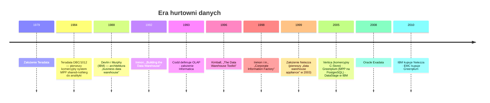
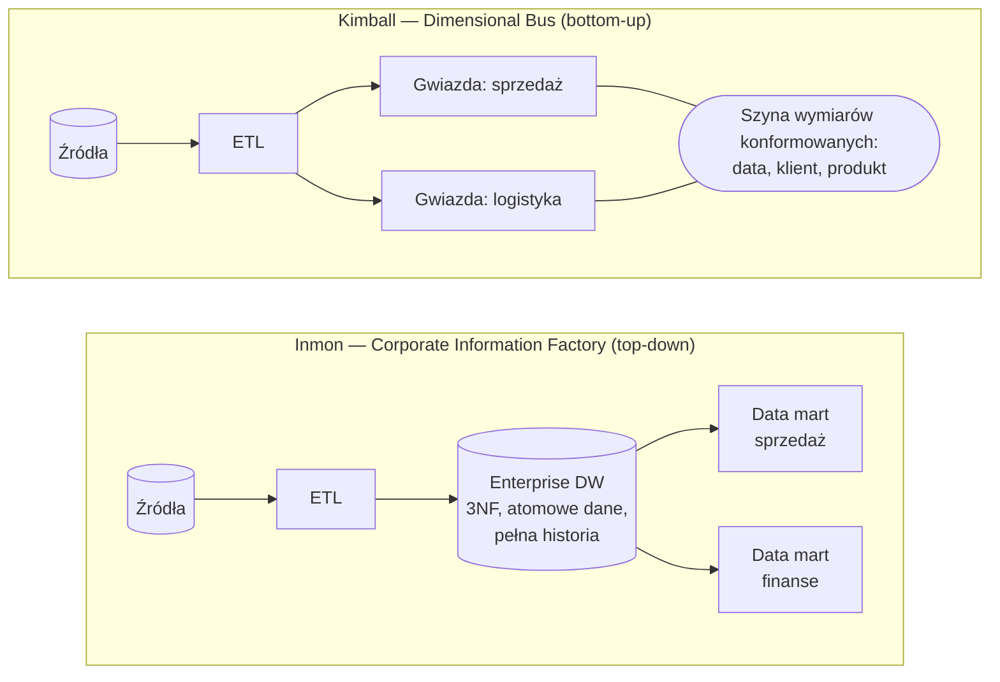
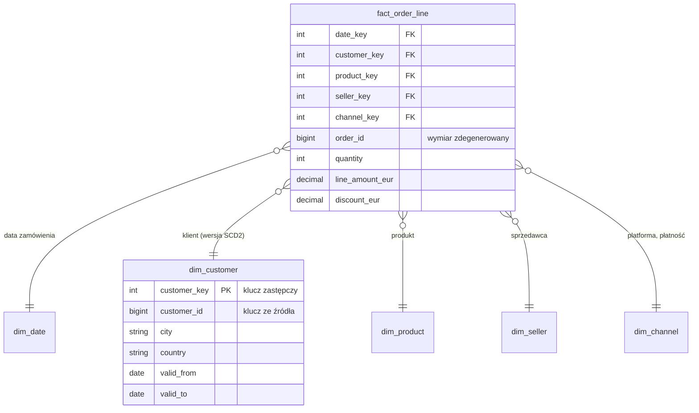
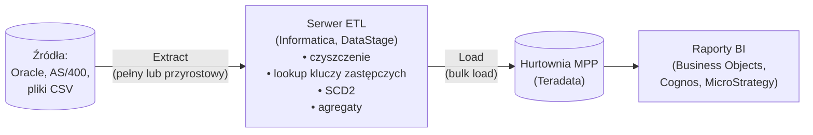

# 01.02 — Era hurtowni danych (lata 90. i 2000.)

> **Czas:** ~80 min · **Wymaga:** [01.01 — OLTP vs OLAP](01-oltp-vs-olap.md) · **Ostatnia weryfikacja:** 2026-11-07

**W tej lekcji:**

- zrozumiesz, jaki problem rozwiązała hurtownia danych i dlaczego jej zasady (zintegrowane, historyczne, tylko do odczytu) obowiązują do dziś,
- porównasz dwie szkoły budowy hurtowni: Inmona (*top-down*, znormalizowane centrum) i Kimballa (*bottom-up*, schemat gwiazdy i szyna wymiarów),
- zobaczysz, jak działały narzędzia ETL i appliance'y MPP: Teradata, Netezza, Exadata,
- zasymulujesz na danych NovaCart dystrybucję wierszy w klastrze *shared-nothing* i zmierzysz, ile danych trzeba przesłać przy JOIN-ie przy różnych kluczach dystrybucji,
- nazwiesz problemy, które ta epoka zostawiła następnej: koszt, skokowe skalowanie i sztywny schemat.

---

## 1. Problem

Cofnijmy się do roku 2004 i wyobraźmy sobie, że NovaCart już wtedy istnieje jako sieć sklepów z wysyłką katalogową. Firma ma pięć systemów: sprzedaż (Oracle), magazyn (aplikacja na AS/400), CRM (Siebel), księgowość (SAP) i call center (SQL Server). Każdy powstał w innym czasie, kupił go inny dział i każdy ma własne pojęcie „klienta” i „przychodu”.

Zarząd dostaje co miesiąc trzy różne liczby przychodu. Sprzedaż liczy zamówienia złożone, księgowość faktury wystawione, a magazyn paczki wysłane. Zwroty są odejmowane w jednym systemie, a w dwóch pozostałych nie. Raport dla zarządu powstaje tak, że analityk w pierwszym tygodniu miesiąca eksportuje dane do Excela, łączy je ręcznie po nazwisku klienta i poprawia formuły. Trwa to cztery dni, a wynik jest nie do odtworzenia.

Do tego systemy operacyjne przechowują tylko stan bieżący. Pytanie „ilu klientów z Wrocławia kupowało u nas dwa lata temu i nadal kupuje?” nie ma odpowiedzi, bo adres klienta został nadpisany po przeprowadzce, a zamówienia starsze niż 18 miesięcy zarchiwizowano na taśmy. Lekcja 01.01 pokazała, że analityka na bazach operacyjnych jest wolna. Tu problem jest głębszy: **dane potrzebne do analizy w ogóle nie istnieją w jednym miejscu, w spójnej postaci i z historią.**

## 2. Intuicja

> [!TIP]
> **Intuicja.** Hurtownia danych to **hurtownia w sensie handlowym**. Producenci (systemy operacyjne) dostarczają towar w różnych opakowaniach i jednostkach. Hurtownia przyjmuje dostawy w nocy, rozpakowuje je, sprawdza, przelicza na wspólne jednostki, nadaje wspólne kody kreskowe i układa na regałach według kategorii. Sklepy detaliczne (działy firmy, raporty) biorą towar już gotowy do sprzedaży i nie muszą wiedzieć, od którego producenta pochodzi.
>
> Dwie szkoły budowy hurtowni to dwa sposoby rozwoju sieci handlowej. **Inmon**: najpierw buduję jeden centralny magazyn dla całej firmy, a dopiero z niego zaopatruję sklepy (*data marty*). **Kimball**: otwieram sklepy po kolei, dział po dziale, ale wszystkie używają **tych samych kodów kreskowych i tych samych kategorii**, więc razem tworzą spójną sieć.

Analogia oddaje najważniejsze: integrację (wspólne jednostki i kody) oraz rozdzielenie „przyjęcia towaru” (ETL) od „sprzedaży” (zapytania). Przestaje działać w jednym ważnym punkcie: towar w hurtowni handlowej znika po sprzedaży, a dane w hurtowni danych **zostają na zawsze**. Hurtownia jest nieulotna (*non-volatile*) i historyczna. Każdy odczyt zostawia dane nietknięte, a nowe dostawy dokładają kolejne warstwy historii zamiast nadpisywać poprzednie.

## 3. Koncepcja

### 3.1. Pojęcia

| Pojęcie | Znaczenie |
|---|---|
| Hurtownia danych (*data warehouse*) | Według definicji Billa Inmona (1992): zbiór danych **zorientowany tematycznie** (klient, produkt, a nie aplikacja), **zintegrowany** (wspólne kody i jednostki), **zmienny w czasie** (z historią) i **nieulotny** (tylko dopisywany), wspierający decyzje biznesowe. |
| *Data mart* (hurtownia tematyczna) | Wycinek danych dla jednego działu lub procesu biznesowego, np. sprzedaż, logistyka. |
| *ETL* (*Extract, Transform, Load*) | Proces, który wyciąga dane ze źródeł, przekształca je na dedykowanym serwerze i ładuje do hurtowni. |
| *Staging area* | Obszar przejściowy, do którego trafiają surowe wyciągi ze źródeł przed transformacją. |
| *ODS* (*Operational Data Store*) | Zintegrowana, ale bieżąca (bez pełnej historii) kopia danych operacyjnych, odświeżana często. |
| Fakt (*fact*) | Mierzalne zdarzenie biznesowe na określonym ziarnie (*grain*), np. „jedna pozycja zamówienia”. Zawiera miary (kwota, ilość) i klucze do wymiarów. |
| Wymiar (*dimension*) | Kontekst faktu: kto, co, gdzie, kiedy. Np. klient, produkt, data, sprzedawca. Zawiera atrybuty opisowe. |
| Schemat gwiazdy (*star schema*) | Tabela faktów otoczona zdenormalizowanymi tabelami wymiarów, połączonymi kluczami zastępczymi. |
| Klucz zastępczy (*surrogate key*) | Sztuczny klucz wymiaru (liczba) niezależny od klucza w systemie źródłowym. Pozwala trzymać wiele wersji tego samego klienta. |
| *SCD* (*Slowly Changing Dimension*) | Sposób obsługi zmian atrybutów wymiaru w czasie. Typ 1 nadpisuje wartość, typ 2 dodaje nową wersję wiersza z datami ważności. |
| Wymiar konformowany (*conformed dimension*) | Wymiar o tej samej definicji i kluczach używany przez wiele data martów. Fundament podejścia Kimballa. |
| *Bus matrix* (macierz szyny) | Tabela: procesy biznesowe × wymiary konformowane. Plan rozwoju hurtowni według Kimballa. |
| *MPP* (*Massively Parallel Processing*) | Architektura, w której zapytanie wykonuje równolegle wiele węzłów, każdy na swojej części danych. |
| *Shared-nothing* | Węzły nie współdzielą ani pamięci, ani dysków. Komunikują się wyłącznie przez sieć. Szerzej w lekcji [01.07](07-architektury-rownoleglego-przetwarzania.md). |
| *Appliance* | Hurtownia sprzedawana jako gotowy zestaw sprzętu i oprogramowania, strojony przez producenta. |

### 3.2. Krótka historia



*Rysunek 2.1. Najważniejsze wydarzenia epoki. Zauważ, że architektura MPP shared-nothing (Teradata, 1984) jest starsza niż samo pojęcie hurtowni danych.*

### 3.3. Dwie szkoły: Inmon i Kimball



*Rysunek 2.2. Inmon buduje najpierw znormalizowane centrum dla całej firmy, a data marty z niego wynikają. Kimball buduje gwiazdy proces po procesie, ale łączy je wspólnymi wymiarami.*

| Aspekt | Inmon (CIF) | Kimball (Dimensional Bus) |
|---|---|---|
| Kierunek | *Top-down*: najpierw model całej firmy | *Bottom-up*: proces biznesowy po procesie |
| Rdzeń | Znormalizowana (3NF) hurtownia korporacyjna | Schematy gwiazdy połączone wymiarami konformowanymi |
| Gdzie są dane atomowe | W centralnej hurtowni 3NF | W tabelach faktów na najniższym ziarnie |
| Czas do pierwszej wartości | Długi (miesiące do lat) | Krótki (tygodnie na pierwszą gwiazdę) |
| Ryzyko | Projekt „wielkiego wybuchu”, który nie kończy się przed zmianą strategii firmy | Silosy, jeśli zespół nie pilnuje konformowanych wymiarów |
| Dla kogo projektowany | Dla integracji danych | Dla użytkownika biznesowego i wydajności zapytań |

W praktyce większość firm skończyła na hybrydzie: warstwa zintegrowana (bliżej Inmona) i warstwa prezentacji w postaci gwiazd (Kimball). Około 2000 roku Dan Linstedt zaproponował trzecie podejście, **Data Vault**, nastawione na audytowalność i łatwe dokładanie źródeł. Wszystkie trzy wracają w module 07, bo w hurtowniach kolumnowych część ich założeń przestała obowiązywać, a część jest aktualna jak nigdy.

### 3.4. Schemat gwiazdy dla NovaCart



*Rysunek 2.3. Gwiazda dla procesu „sprzedaż”: jedna tabela faktów na ziarnie pozycji zamówienia i zdenormalizowane wymiary. Klient przeprowadzający się z Wrocławia do Gdańska ma dwa wiersze w `dim_customer` (SCD typu 2), więc historyczne zamówienia nadal „widzą” Wrocław.*

Zauważ, jak gwiazda odpowiada na problemy z sekcji 1. Przychód jest liczony w jednym miejscu, według jednej definicji, w jednej walucie (`line_amount_eur`). Historia adresu klienta jest zachowana dzięki SCD2. Zapytanie „przychód per miasto klienta i kwartał” to jeden JOIN faktu z dwoma wymiarami, który rozumie także analityk biznesowy.

## 4. 🔍 Pod maską

### 4.1. ETL: nocne okno ładowania

Narzędzia ETL tej epoki (Informatica PowerCenter, IBM DataStage, Ab Initio, Oracle Warehouse Builder, Microsoft SSIS od 2005 roku) miały wspólną architekturę: **osobny serwer transformacji** między źródłami a hurtownią.



*Rysunek 2.4. Klasyczny ETL: transformacja dzieje się na osobnym serwerze, a do hurtowni trafiają dane gotowe.*

Dlaczego transformacja odbywała się **przed** załadowaniem (ETL), a nie w hurtowni (ELT, jak dziś)? Bo moc obliczeniowa hurtowni była najdroższym zasobem w firmie. Płaciło się za nią licencją liczoną od węzła lub terabajta, a była potrzebna analitykom w ciągu dnia. Serwer ETL był tańszy i pracował w nocy.

Typowy przebieg nocnego ładowania wyglądał tak:

1. **22:00–00:00.** Źródła kończą dzień, systemy operacyjne robią eksport (często do plików).
2. **00:00–03:00.** Serwer ETL wczytuje pliki do *staging*, czyści dane, przekodowuje słowniki, szuka kluczy zastępczych w wymiarach (trzymając je w pamięci jako *lookup cache*) i wylicza wersje SCD2.
3. **03:00–05:00.** Szybkie ładowanie hurtowe (*bulk load*, np. Teradata FastLoad/MultiLoad) do tabel faktów, przebudowa agregatów i kostek OLAP.
4. **06:00.** Raporty muszą być gotowe, zanim zarząd przyjdzie do pracy.

To jest **okno ładowania** (*batch window*). Gdy dane rosły szybciej niż wydajność ETL, okno przestawało wystarczać i raporty były gotowe o 10:00 zamiast o 6:00. Walka o zmieszczenie się w oknie była jednym z głównych zajęć zespołów hurtowni.

Ówczesna analityka korzystała też z **kostek OLAP** (*MOLAP*: Essbase, Microsoft Analysis Services). Były to wstępnie przeliczone agregaty dla wszystkich kombinacji wymiarów, zapisane w wielowymiarowych tablicach. Odpowiadały natychmiast, ale tylko na pytania przewidziane w projekcie kostki, a ich przeliczenie zajmowało część nocnego okna.

> [!IMPORTANT]
> **Co z tego wynika w praktyce:** ETL był odpowiedzią na drogie compute hurtowni. Kiedy compute w chmurze stało się elastyczne i tanie w przeliczeniu na zapytanie (lekcja [01.04](04-era-cloud-data-warehouse.md)), opłacało się przenieść transformacje do hurtowni. Stąd ELT, dbt i Dataform (moduł 28). Zasady wypracowane wtedy, czyli staging, idempotentne ładowanie i klucze zastępcze, obowiązują nadal.

### 4.2. Teradata: shared-nothing z dystrybucją hash

Teradata to najbardziej klasyczny przykład hurtowni MPP i warto rozumieć jej architekturę, bo jej idee przetrwały w Redshift, Synapse i Greenplum.

```text
                          ┌──────────────────────┐
     Zapytanie SQL ─────► │ PE (Parsing Engine)  │  parsowanie, optymalizacja,
                          │                      │  podział planu na kroki
                          └──────────┬───────────┘
                                     │
          ═══════════════════════════╪════════════════════════════  BYNET
          (sieć łącząca: rozsyłanie kroków, redystrybucja wierszy, scalanie wyników)
            │              │              │              │
       ┌────┴────┐    ┌────┴────┐    ┌────┴────┐    ┌────┴────┐
       │  AMP 0  │    │  AMP 1  │    │  AMP 2  │    │  AMP 3  │   Access Module Processors:
       │ CPU+RAM │    │ CPU+RAM │    │ CPU+RAM │    │ CPU+RAM │   każdy wykonuje swoją część
       └────┬────┘    └────┬────┘    └────┬────┘    └────┬────┘   każdego kroku
       ┌────┴────┐    ┌────┴────┐    ┌────┴────┐    ┌────┴────┐
       │ vdisk 0 │    │ vdisk 1 │    │ vdisk 2 │    │ vdisk 3 │   każdy AMP ma WYŁĄCZNIE
       │ wiersze │    │ wiersze │    │ wiersze │    │ wiersze │   swoje wiersze
       │ hash→0  │    │ hash→1  │    │ hash→2  │    │ hash→3  │
       └─────────┘    └─────────┘    └─────────┘    └─────────┘
```

*Rysunek 2.5. Architektura Teradata. Każdy AMP jest właścicielem części wierszy każdej tabeli. Jedyna droga do danych innego AMP-a prowadzi przez sieć BYNET.*

Jak wiersz trafia na AMP? Każda tabela ma **Primary Index** (w innych systemach: klucz dystrybucji). Przy zapisie:

1. Funkcja skrótu liczy z wartości klucza 32-bitowy *row hash*.
2. Część bitów skrótu wyznacza **kubełek** (*hash bucket*).
3. **Mapa kubełków** (*hash map*) przypisuje każdy kubełek do jednego AMP-a.
4. Wiersz zapisuje się na dysku tego AMP-a.

Pośrednia mapa kubełków ma ważną zaletę: przy rozbudowie systemu nie trzeba zmieniać funkcji skrótu, tylko przypisanie części kubełków do nowych AMP-ów. Mimo to dane tych kubełków trzeba fizycznie przenieść, o czym w sekcji 4.5.

> [!IMPORTANT]
> **Co z tego wynika w praktyce:** w architekturze shared-nothing **wybór klucza dystrybucji jest najważniejszą decyzją fizycznego projektu**. Decyduje o tym, czy dane rozkładają się równo między węzły i czy JOIN-y można wykonać lokalnie, bez przesyłania danych przez sieć.

### 4.3. JOIN w klastrze shared-nothing: lokalnie, redystrybucja albo broadcast

Załóżmy, że łączysz `orders` z `order_items` po `order_id`. Żeby złączyć dwa wiersze, muszą się one znaleźć **na tym samym węźle**. Optymalizator ma trzy strategie:

```text
 a) CO-LOCATED JOIN — obie tabele rozłożone po order_id
    AMP 0: orders{1,5,9}  items{1,1,5,9,9}     → JOIN lokalny, 0 bajtów przez sieć
    AMP 1: orders{2,6}    items{2,6,6}         → JOIN lokalny

 b) REDYSTRYBUCJA — items rozłożone po seller_id
    AMP 0: items(seller 24){1,2,6,9}  ──hash(order_id)──►  wysyłka na właściwe AMP-y
    AMP 1: items(seller 4){1,5}       ──hash(order_id)──►  (tymczasowy „spool”)
    → przez sieć idzie prawie cała tabela items, potem JOIN lokalny

 c) BROADCAST (duplikacja) — mała tabela kopiowana na każdy AMP
    orders (mała) ──kopia──► AMP 0, AMP 1, AMP 2, AMP 3
    → przez sieć idzie (N-1) × rozmiar małej tabeli, duża tabela zostaje na miejscu
```

*Rysunek 2.6. Trzy strategie JOIN-a w MPP. Optymalizator wybiera tę, która przesyła najmniej danych.*

Do tego dochodzi **agregacja dwufazowa**: każdy węzeł najpierw agreguje lokalnie (np. sumuje przychód per kraj na swoich wierszach), a przez sieć wysyła już tylko częściowe sumy. To ten sam pomysł, który w MapReduce nazywa się *combinerem* (lekcja [01.03](03-era-big-data.md)).

Druga strona medalu to **skew**, czyli nierówny rozkład danych. Zapytanie w MPP kończy się wtedy, gdy skończy **najwolniejszy** węzeł. Jeśli jeden AMP ma 4 razy więcej wierszy niż średnia, cały klaster pracuje z prędkością tego jednego AMP-a, a pozostałe czekają bezczynnie.

> [!IMPORTANT]
> **Co z tego wynika w praktyce:** dobry klucz dystrybucji ma (1) wysoką kardynalność i równy rozkład wartości oraz (2) jest kluczem częstych JOIN-ów między dużymi tabelami. Te kryteria bywają sprzeczne, więc projektant wybiera, które JOIN-y będą lokalne, a resztę akceptuje jako redystrybucję. Zmierzymy to w sekcji 5.

### 4.4. Netezza i Exadata: przesuń obliczenia bliżej dysku

Teradata skalowała się przez dokładanie węzłów. Dwa inne appliance'y zaatakowały inny problem: **dysk czyta dane szybciej, niż procesor nadąża je przetwarzać, a większość danych i tak jest odrzucana przez filtr.**

**Netezza** (założona pod koniec 1999 roku, pierwszy appliance w 2003, przejęta przez IBM w 2010) umieściła w każdym węźle (*S-Blade*) układ **FPGA** między dyskiem a procesorem. Dane płynące z dysku przechodziły przez FPGA, który dekompresował je, odrzucał niepotrzebne kolumny (projekcja) i wiersze niespełniające warunków `WHERE` (restrykcja). Do CPU docierała tylko niewielka część danych. Netezza używała też **zone maps**: dla każdego obszaru dysku zapamiętywała minimum i maksimum kolumn i pomijała obszary, które na pewno nie spełniają filtra. To ten sam pomysł co min/max w Parquet i *pruning* w BigQuery.

**Exadata** (Oracle, 2008) jest ciekawa, bo **nie jest shared-nothing**. Węzły bazy danych (Oracle RAC) współdzielą storage (*shared-disk*), ale storage to inteligentne serwery (*storage cells*). Mechanizm **Smart Scan** wysyła do komórek storage predykaty i listę kolumn, a komórki zwracają tylko pasujące wiersze i kolumny. Komórki utrzymują też **storage indexes** (min/max w pamięci, odpowiednik zone maps), a dane mogą być zapisane w formacie **Hybrid Columnar Compression** — kolumnowo w obrębie większych jednostek, co daje kompresję rzędu 10×.

| System | Główna idea | Gdzie odrzucane są niepotrzebne dane | Echo w dzisiejszych systemach |
|---|---|---|---|
| Teradata | Shared-nothing, dystrybucja hash | Na każdym AMP, po odczycie z dysku | Klucze dystrybucji w Redshift i Synapse |
| Netezza | FPGA filtruje strumień danych z dysku | W FPGA, przed CPU | *Predicate pushdown* do formatów i storage |
| Exadata | Inteligentny storage współdzielony | W komórkach storage (Smart Scan) | Pushdown w BigQuery Storage Read API, S3 Select |
| Wszystkie | Min/max obszarów danych | Pomijanie całych bloków | Zone maps, statystyki Parquet, *partition pruning* |

> [!IMPORTANT]
> **Co z tego wynika w praktyce:** najtańsze dane to te, których **nie czytasz**, a następne w kolejności to te, które odrzucasz jak najbliżej dysku. Ta zasada stoi za *partition pruning*, *clustering*, *predicate pushdown* i formatem kolumnowym. Spotkasz ją w każdym module o wydajności.

### 4.5. Ograniczenia: skokowe skalowanie, koszt i sztywny schemat

Hurtownie MPP rozwiązały problem wydajności analityki i integracji danych. Wprowadziły jednak trzy problemy, które napędziły kolejne epoki.

**1. Skalowanie skokowe i planowanie pojemności na lata.** Moc obliczeniowa i storage były związane z tymi samymi węzłami. Gdy kończyło się miejsce, trzeba było kupić węzły z procesorami, nawet jeśli procesorów było dość, i odwrotnie. Rozbudowa oznaczała:

```text
 Decyzja o rozbudowie ──► przetarg i zakup ──► dostawa i montaż ──► redystrybucja danych ──► gotowe
      (budżet roczny)        (1–3 miesiące)        (tygodnie)        (godziny–dni, często
                                                                    z ograniczoną dostępnością)
```

Ponieważ cykl trwał miesiące, kupowało się pojemność **na 3 lata naprzód**, czyli przez większość życia systemu płaciło się za niewykorzystany sprzęt. Jednocześnie w szczytach (koniec kwartału, Black Friday) system i tak był przeciążony, więc wprowadzano **zarządzanie obciążeniem** (*workload management*): kolejki, priorytety i limity współbieżności. Analitycy znali to jako „nie uruchamiaj ciężkich zapytań między 8 a 10, bo ładują się raporty dla zarządu”.

**2. Koszt.** Appliance'y kosztowały od setek tysięcy do wielu milionów dolarów, plus coroczne wsparcie liczone zwykle jako kilkanaście do dwudziestu kilku procent ceny licencji. Licencja była liczona od pojemności, więc przechowywanie danych „na wszelki wypadek” było drogie. Firmy agregowały i usuwały szczegółowe dane, żeby zmieścić się w budżecie. Clickstream, logi czy pełna historia zmian zwykle w ogóle nie trafiały do hurtowni.

**3. Sztywny schemat (*schema-on-write*).** Dane musiały pasować do zaprojektowanego modelu, zanim trafiły do hurtowni. Dodanie nowego źródła albo nowej kolumny wymagało zmiany modelu, mapowań ETL i raportów, czyli tygodni pracy zespołu i komitetu zmian. Dane półstrukturalne (JSON, logi) i nieustrukturyzowane (tekst, obrazy) praktycznie nie miały gdzie trafić.

> [!IMPORTANT]
> **Co z tego wynika w praktyce:** te trzy problemy są dokładnie tym, co rozwiązywały kolejne epoki. Era Big Data (lekcja [01.03](03-era-big-data.md)) zaatakowała koszt i sztywny schemat: tani sprzęt i *schema-on-read*. Era cloud data warehouse (lekcja [01.04](04-era-cloud-data-warehouse.md)) zaatakowała skalowanie: rozdzielenie storage od compute i płatność za użycie.

## 5. 💻 W praktyce

Zasymulujmy hurtownię MPP z 8 węzłami i rozłóżmy na nią tabele NovaCart ze skali S według różnych kluczy dystrybucji. Skrypt liczy dwie rzeczy:

1. **skew**: ile wierszy ma najbardziej obciążony węzeł w stosunku do średniej (1,00 oznacza idealnie równy rozkład),
2. **ruch sieciowy przy JOIN**: ile wierszy (i megabajtów) trzeba przesłać, żeby złączane wiersze znalazły się na tym samym węźle.

```bash
# z katalogu modules/01-ewolucja-architektur-danych/examples/
uv run python 02_mpp_hash_distribution.py             # 8 węzłów
uv run python 02_mpp_hash_distribution.py --nodes 32
```

Sercem symulacji jest funkcja skrótu, która odpowiada krokom 1–3 z sekcji 4.2:

```python
# examples/02_mpp_hash_distribution.py (fragment)
def node_of(values: pa.ChunkedArray, nodes: int) -> np.ndarray:
    """Deterministyczna funkcja skrótu → numer węzła (jak hash distribution w MPP)."""
    if pa.types.is_integer(values.type):
        x = values.to_numpy().astype(np.uint64)
        # Mieszanie bitów (splitmix64), żeby kolejne klucze nie trafiały na kolejne węzły „po kolei”.
        x = (x ^ (x >> np.uint64(30))) * np.uint64(0xBF58476D1CE4E5B9)
        x = (x ^ (x >> np.uint64(27))) * np.uint64(0x94D049BB133111EB)
        x = x ^ (x >> np.uint64(31))
        return (x % np.uint64(nodes)).astype(np.int64)
    return np.array([zlib.crc32(v.encode()) % nodes for v in values.to_pylist()], dtype=np.int64)

# Wiersz trzeba przesłać, jeśli węzeł, na którym leży, różni się od węzła wymaganego przez JOIN.
moved = int((items_by_seller != items_by_order).sum())
```

**Wynik** (skala S):

```text
Klaster: 8 węzłów · orders 24,506 · order_items 44,683 · customers 20,000

1) Rozkład wierszy na węzły (skew = max / średnia; 1,00 = idealnie równo)
   Tabela i klucz dystrybucji                  max wierszy    skew  puste węzły
   orders BY order_id                                3,170    1.03            0
   orders BY customer_id                             3,221    1.05            0
   orders BY shipping_country                       12,435    4.06            4
   order_items BY order_id                           5,773    1.03            0
   order_items BY seller_id                         16,829    3.01            0
   order_items BY product_id                        11,344    2.03            0
   Najwięksi sprzedawcy (udział w pozycjach): seller 24: 19.3%, seller 4: 11.7%, seller 21: 6.3%

2) JOIN orders ⋈ order_items ON order_id — ile danych trzeba przesłać między węzłami?
   Wariant dystrybucji                                          wiersze       MB
   a) orders BY order_id, items BY order_id (co-located)              0     0.00
   b) items BY seller_id → redystrybucja items po order_id       38,955     0.85
   c) orders BY customer_id → redystrybucja orders po order_id    21,454     2.89
   d) broadcast orders na wszystkie węzły                       171,542    23.12

3) JOIN orders ⋈ customers ON customer_id
   Wariant dystrybucji                                          wiersze       MB
   a) orders BY order_id → redystrybucja orders po customer_id    21,454     2.89
   b) orders BY customer_id, customers BY customer_id                 0     0.00
   c) broadcast customers na wszystkie węzły                    140,000    15.78

   Uwaga: odsetek przesuwanych wierszy przy losowym kluczu ≈ (N-1)/N = 87.5%
```

**Interpretacja.**

- **Kraj jako klucz dystrybucji to katastrofa.** NovaCart działa w 6 krajach, więc na 8 węzłów trafia najwyżej 6 różnych wartości. W wyniku 4 węzły są puste (dwa kraje trafiły na ten sam węzeł, a Polska z największym udziałem dominuje), a najbardziej obciążony ma 4 razy więcej danych niż średnia. Zapytanie na takiej tabeli działa z prędkością jednego węzła, czyli klaster 8-węzłowy pracuje jak 2-węzłowy.
- **`seller_id` ma dużą kardynalność, a mimo to daje skew 3,0.** Sprzedawca 24 ma 19,3% wszystkich pozycji. Węzeł, na który trafił, musi przetworzyć co najmniej 19% danych, choć „sprawiedliwy” udział to 12,5%. Wysoka kardynalność nie wystarcza, liczy się rozkład. Popularność w danych NovaCart ma rozkład Zipfa, tak jak w prawdziwym e-commerce. `product_id` z tego samego powodu daje skew 2,0.
- **Klucze techniczne (`order_id`, `customer_id`) rozkładają się prawie idealnie (1,03–1,05).** Dlatego w praktyce kluczem dystrybucji najczęściej jest klucz główny lub klucz najczęstszego JOIN-a.
- **Nie da się mieć wszystkich JOIN-ów lokalnych.** Rozkład `orders` po `order_id` daje lokalny JOIN z `order_items` (wariant 2a), ale JOIN z `customers` wymaga przesłania 87,5% zamówień (3a). Rozkład po `customer_id` odwraca sytuację. Projektant wybiera JOIN, który jest częstszy lub droższy.
- **Broadcast opłaca się tylko dla małych tabel.** Kopia `orders` na 8 węzłów to 23 MB, 27 razy więcej niż redystrybucja `order_items` (0,85 MB). Dla małych wymiarów (np. 48 kategorii) broadcast jest najlepszy, dlatego Redshift ma `DISTSTYLE ALL`, a Synapse `REPLICATE`.

> [!NOTE]
> **Pod maską — dla dociekliwych.** Wynik „87,5% wierszy do przesłania” wynika z prostego rachunku: jeśli wiersz leży na losowym z N węzłów, to szansa, że akurat jest na „właściwym”, wynosi 1/N. Przy 100 węzłach przesyłasz 99% danych. Dlatego w dużych klastrach MPP redystrybucja dużych tabel jest kosztowna, a lokalne JOIN-y są tak cenne. W lekcji [01.04](04-era-cloud-data-warehouse.md) zobaczysz, co się zmienia, gdy sieć przestaje być wąskim gardłem.

## 6. ⚖️ Porównanie platform

Pojęcie „klucza dystrybucji” zniknęło z części nowoczesnych platform i to jest najciekawsza różnica:

| Aspekt | GCP (BigQuery) | AWS (Redshift) | Azure (Synapse / Fabric) | Snowflake | Databricks | On-prem / OSS |
|---|---|---|---|---|---|---|
| Czy użytkownik wybiera klucz dystrybucji? | Nie. Dane nie są przypisane do węzłów obliczeniowych | Tak: `DISTSTYLE KEY / EVEN / ALL / AUTO` | Synapse dedicated pool: tak (`HASH`, `ROUND_ROBIN`, `REPLICATE`); Fabric Warehouse: nie | Nie. Micro-partitions w object storage | Nie. Pliki Delta w object storage | Tak: Teradata `PRIMARY INDEX`, Greenplum `DISTRIBUTED BY`, Vertica segmentacja |
| Jak realizowany jest JOIN dużych tabel | Dynamiczny *shuffle* przez wydzieloną warstwę w pamięci | Lokalny lub redystrybucja między slice'ami | Synapse: przesuwanie danych między 60 dystrybucjami (*data movement*) | Redystrybucja lub broadcast między węzłami warehouse | *Shuffle* lub *broadcast hash join* w Sparku/Photonie | Lokalny, redystrybucja lub broadcast |
| Czym zastąpiono co-location | *Clustering* i partycjonowanie (pomijanie bloków), szybka sieć | — | Fabric: automatyczne zarządzanie układem | Clustering keys, automatyczne utrzymanie micro-partitions | Liquid clustering, Z-order, partycjonowanie | — |
| Skutek złego wyboru | Brak tej klasy błędów, ale *skew* w danych nadal spowalnia shuffle | Skew na slice'ach, duże redystrybucje | Skew dystrybucji, przesuwanie danych | Brak tej klasy błędów; zły clustering = więcej skanowania | Skew partycji przy shuffle | Skew na AMP-ach, redystrybucje |
| Model kosztowy | Bajty lub sloty | Węzły × czas lub RPU | DWU (Synapse) lub CU (Fabric) | Kredyty × czas warehouse | DBU × czas | Licencja + sprzęt + wsparcie |

**Wnioski:** różnica jest fundamentalna, a nie kosmetyczna. Tam, gdzie storage jest związany z węzłami (Teradata, Redshift w klasycznej postaci, Synapse dedicated pool), klucz dystrybucji pozostaje kluczową decyzją projektową, bo decyduje o tym, ile danych przejdzie przez sieć. Tam, gdzie dane leżą w oddzielnym storage (BigQuery, Snowflake, Databricks), nie ma „właściciela” wiersza, więc nie ma też klucza dystrybucji. Każde zapytanie rozdziela dane między procesy dynamicznie i płaci za to *shuffle* przez szybką sieć. Zostaje problem *skew*: gorący sprzedawca 24 spowolni także shuffle w BigQuery, co zobaczysz w module 16.

## 7. ⚠️ Antywzorce i pułapki

| Antywzorzec | Objaw | Dlaczego tak się dzieje | Jak naprawić |
|---|---|---|---|
| Klucz dystrybucji o niskiej kardynalności (kraj, status) | Część węzłów pusta, zapytania wolne mimo dużego klastra | Liczba różnych wartości < liczby węzłów | Klucz o wysokiej kardynalności (klucz główny, klucz JOIN-a) |
| Klucz dystrybucji o skośnym rozkładzie (sprzedawca, produkt) | Jeden „gorący” węzeł, pozostałe czekają | Kilka wartości ma większość wierszy | Sprawdź rozkład przed wyborem; użyj klucza technicznego |
| Dystrybucja po dacie | Dzisiejsze ładowanie i zapytania o ostatnie dni trafiają na jeden węzeł | Wszystkie wiersze z jednego dnia mają ten sam skrót | Dystrybucja po kluczu, a data jako partycjonowanie |
| Broadcast dużej tabeli | Zapytanie przesyła wielokrotność rozmiaru tabeli | Kopia trafia na każdy z N węzłów | Broadcast tylko małych wymiarów |
| Projekt EDW typu „wielki wybuch” | Dwa lata pracy bez raportu dla biznesu, projekt zamknięty | Próba zamodelowania całej firmy przed dostarczeniem wartości | Iteracyjnie: proces po procesie, z konformowanymi wymiarami |
| Data marty bez konformowanych wymiarów | Każdy dział ma inny „przychód” i innego „klienta” | Każdy mart buduje własne wymiary | *Bus matrix* i wspólne wymiary pilnowane przez jeden zespół |

> [!WARNING]
> **Pułapka.** Najczęściej popełniany błąd w MPP to dystrybucja po kolumnie, po której **filtrujesz**, zamiast po tej, po której **łączysz**. Intuicja podpowiada: „zapytania zawsze filtrują po kraju, więc niech dane z jednego kraju leżą razem”. W efekcie zapytanie o Polskę wykonuje jeden węzeł, a reszta klastra czeka bezczynnie. Do pomijania danych przy filtrowaniu służy partycjonowanie i sortowanie, a dystrybucja służy do równoległości i lokalnych JOIN-ów.

## 8. 💰 Koszty

Model kosztowy hurtowni tej epoki był prosty i bolesny: **płaciłeś z góry za pojemność na szczyt, na kilka lat naprzód.**

- **Koszt początkowy (CAPEX):** sprzęt i licencja, zwykle liczona od pojemności (TB) lub liczby węzłów.
- **Koszt roczny:** wsparcie producenta (zwykle kilkanaście do dwudziestu kilku procent ceny licencji rocznie), centrum danych (prąd, chłodzenie, miejsce) i zespół administratorów (DBA).
- **Koszt ukryty:** niewykorzystana pojemność. System kupiony na szczyt za 3 lata był w pierwszym roku wykorzystany w 30–40%, a w godzinach nocnych prawie wcale.

Przykład dla NovaCart: jeśli w Black Friday zapytania potrzebują 5 razy więcej mocy niż średnio, a dane rosną o 35% rocznie, appliance kupiony na trzeci rok musi mieć pojemność około 5 × 1,35² ≈ 9 razy większą niż średnie zapotrzebowanie w pierwszym roku. Przez większość czasu płacisz za ~90% niewykorzystanej mocy. Ten rachunek przeprowadzimy dokładnie w lekcji [01.04](04-era-cloud-data-warehouse.md).

> [!CAUTION]
> **Koszt!** Ta logika żyje nadal w chmurze: klaster Redshift w trybie provisioned, Synapse dedicated pool czy zarezerwowane sloty BigQuery dobrane „na szczyt” i niewyłączane nocą odtwarzają model kosztowy appliance'u, tylko z fakturą co miesiąc. Zanim kupisz stałą pojemność, policz jej średnie wykorzystanie.

## 9. Podsumowanie

- Hurtownia danych rozwiązała problem integracji: jedna definicja przychodu, wspólne klucze, historia zmian (SCD2) i model zrozumiały dla biznesu (schemat gwiazdy).
- Inmon budował najpierw znormalizowane centrum dla całej firmy, Kimball gwiazdy proces po procesie połączone wymiarami konformowanymi. W praktyce zwyciężyły hybrydy, a obie szkoły wracają w module 07.
- ETL transformował dane poza hurtownią, bo compute hurtowni było najdroższym zasobem. Gdy compute stało się elastyczne, transformacje przeniosły się do hurtowni (ELT).
- Hurtownie MPP shared-nothing rozkładają wiersze na węzły według skrótu klucza dystrybucji. Dobry klucz daje równy rozkład i lokalne JOIN-y. W symulacji na danych NovaCart kraj dał skew 4,06 i 4 puste węzły z 8, a `seller_id` skew 3,01 przez jednego dominującego sprzedawcę.
- Epoka zostawiła trzy problemy: skokowe skalowanie ze storage związanym z compute, wysoki koszt licencji i sprzętu oraz sztywny schemat. Kolejne epoki są odpowiedzią na nie.

## 🧠 Sprawdź się

<details>
<summary><b>1. Dlaczego w czasach appliance'ów MPP transformacje wykonywano poza hurtownią (ETL), a dziś raczej w hurtowni (ELT)?</b></summary>

Bo compute hurtowni było wtedy najdroższym i stałym zasobem, potrzebnym analitykom w ciągu dnia. Taniej było dokupić serwer ETL niż węzły hurtowni. W hurtowni chmurowej compute jest elastyczne i rozliczane za użycie, a sama hurtownia jest dużo wydajniejsza w przetwarzaniu masowym niż serwer ETL przetwarzający wiersze. Dlatego opłaca się załadować surowe dane i przekształcać je SQL-em w hurtowni.

</details>

<details>
<summary><b>2. Tabela `order_items` ma 5 mld wierszy. Najczęstsze zapytania łączą ją z `orders` po `order_id` i filtrują po dacie. Jaki klucz dystrybucji wybierzesz w Redshift i dlaczego nie datę?</b></summary>

`order_id` dla obu tabel: ma wysoką kardynalność i równy rozkład (w symulacji skew 1,03), a JOIN `orders`–`order_items` staje się lokalny. Data jako klucz dystrybucji skupiłaby wszystkie wiersze jednego dnia na jednym węźle, więc zapytania o ostatnie dni wykonywałby pojedynczy węzeł, a dzisiejsze ładowanie przeciążałoby jeden dysk. Datę wykorzystuje się jako klucz sortowania (w Redshift `SORTKEY`), żeby pomijać bloki przy filtrowaniu.

</details>

<details>
<summary><b>3. W klastrze z 50 węzłami JOIN dwóch dużych tabel wymaga redystrybucji jednej z nich. Jaki odsetek jej wierszy przejdzie przez sieć?</b></summary>

Około (N−1)/N = 49/50 = 98%. Wiersz leży na losowym węźle, a właściwy węzeł dla JOIN-a jest wyznaczony przez skrót innego klucza, więc szansa, że oba są takie same, wynosi 1/50. W praktyce redystrybucja dużej tabeli oznacza przesłanie przez sieć prawie całej tabeli. Dlatego lokalne JOIN-y były tak cenne w architekturze MPP.

</details>

<details>
<summary><b>4. Dlaczego BigQuery i Snowflake nie każą wybierać klucza dystrybucji? Czy problem skew przez to znika?</b></summary>

Bo dane nie należą do węzłów obliczeniowych. Leżą we wspólnym storage (Colossus, S3), a każde zapytanie dynamicznie rozdziela je między dostępne procesy i, gdy trzeba, wykonuje *shuffle* przez szybką sieć. Nie ma więc statycznego „właściciela” wiersza, którego trzeba wybrać. Skew nie znika: jeśli przy shuffle po `seller_id` jeden klucz ma 19% wierszy, jeden proces dostanie 19% pracy i stanie się maruderem (*straggler*). Zmienia się tylko to, że problem pojawia się w konkretnym zapytaniu, a nie jest wpisany w fizyczny projekt tabeli.

</details>

<details>
<summary><b>5. Klient NovaCart przeprowadził się z Wrocławia do Gdańska. Jak SCD typu 1 i typu 2 wpłyną na raport „przychód per miasto w 2024 roku”?</b></summary>

Przy SCD1 adres w wymiarze zostanie nadpisany, więc wszystkie historyczne zamówienia klienta „przeniosą się” do Gdańska, a raport za 2024 rok zmieni się wstecz. Przy SCD2 powstanie nowa wersja klienta z nowym kluczem zastępczym i datą ważności. Stare fakty wskazują na wersję „Wrocław”, a nowe na „Gdańsk”, więc raport za 2024 rok pozostanie niezmieniony. Wybór zależy od pytania biznesowego: czasem chcemy widzieć „stan obecny” (SCD1), czasem „stan w chwili zdarzenia” (SCD2).

</details>

## 📚 Źródła

1. B. Devlin, P. Murphy, „An architecture for a business and information system”, IBM Systems Journal 27(1), 1988.
2. W. H. Inmon, *Building the Data Warehouse*, Wiley, 1992 (wyd. 4: 2005).
3. W. H. Inmon, C. Imhoff, R. Sousa, *Corporate Information Factory*, Wiley, 1998.
4. R. Kimball, *The Data Warehouse Toolkit*, Wiley, 1996 (wyd. 3, z M. Ross: 2013).
5. M. Stonebraker, „The Case for Shared Nothing”, IEEE Database Engineering Bulletin 9(1), 1986.
6. D. DeWitt, J. Gray, „Parallel Database Systems: The Future of High Performance Database Systems”, Communications of the ACM 35(6), 1992.
7. E. F. Codd, S. B. Codd, C. T. Salley, „Providing OLAP to User-Analysts: An IT Mandate”, 1993.
8. Dokumentacja Teradata: [Primary Index, row hash i dystrybucja wierszy](https://docs.teradata.com/) (rozdziały „Hashing” i „Primary Index”).
9. Dokumentacja Amazon Redshift: [Working with data distribution styles](https://docs.aws.amazon.com/redshift/latest/dg/t_Distributing_data.html).
10. Dokumentacja Azure Synapse Analytics: [Guidance for designing distributed tables](https://learn.microsoft.com/azure/synapse-analytics/sql-data-warehouse/sql-data-warehouse-tables-distribute).
11. Oracle, *Exadata Smart Scan* i *Hybrid Columnar Compression* — [dokumentacja Exadata](https://docs.oracle.com/en/engineered-systems/exadata-database-machine/).

---

<sub>← [01.01 — OLTP vs OLAP](01-oltp-vs-olap.md) · [Moduł 01](README.md) · [01.03 — Era Big Data](03-era-big-data.md) →</sub>
