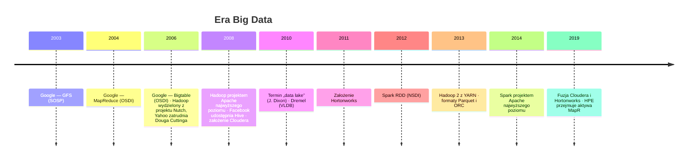
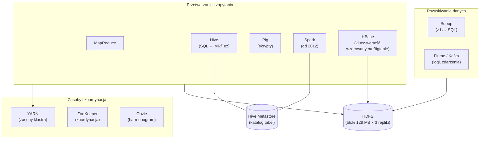
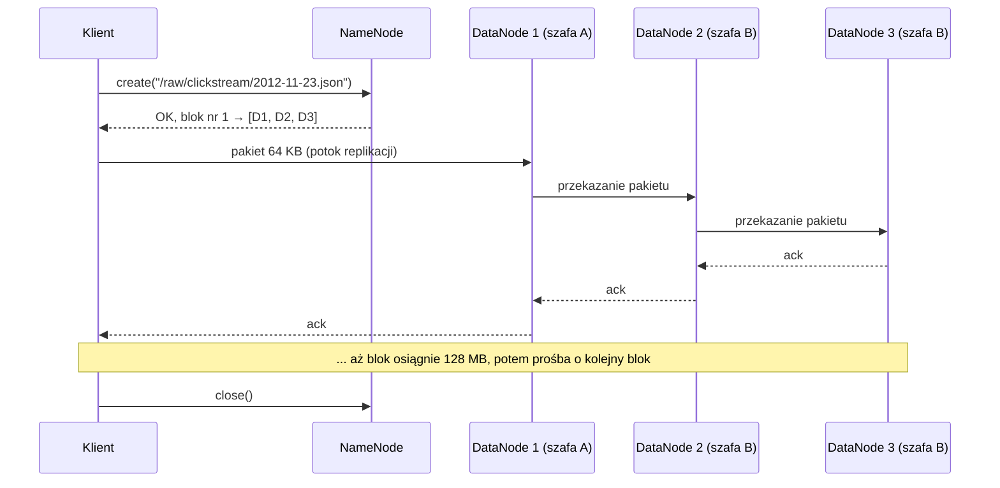

# 01.03 — Era Big Data (2004–2015)

> **Czas:** ~90 min · **Wymaga:** [01.02 — Era hurtowni danych](02-era-hurtowni-danych.md) · **Ostatnia weryfikacja:** 2026-11-07

**W tej lekcji:**

- zrozumiesz, jaki problem Google rozwiązał w publikacjach o GFS, MapReduce i Bigtable i dlaczego te trzy prace zmieniły całą branżę,
- zobaczysz, jak działa HDFS (NameNode, bloki, replikacja) i co dzieje się krok po kroku w zadaniu MapReduce: od splitu przez *shuffle* do reduce,
- napiszesz i uruchomisz mini MapReduce na clickstreamie NovaCart i zmierzysz, jak *combiner* zmniejsza *shuffle* kilkaset razy,
- porównasz *schema-on-write* i *schema-on-read* na plikach przewoźnika, który bez zapowiedzi zmienił format,
- zrozumiesz, dlaczego data lake tak często zamieniał się w *data swamp* i co z tej epoki przetrwało do dziś (więcej, niż myślisz).

---

## 1. Problem

Rok 2012. NovaCart ma hurtownię Teradata z lekcji [01.02](02-era-hurtowni-danych.md) i dobrze działające raporty sprzedaży. Firma uruchamia jednak aplikację mobilną i chce analizować zachowanie użytkowników: co oglądają, czego szukają, gdzie porzucają koszyk. Clickstream to 50 mln zdarzeń dziennie, czyli około 30 GB surowego JSON-a na dobę i 11 TB rocznie.

Zespół hurtowni liczy:

- Licencja appliance'u jest liczona od pojemności. Dołożenie 11 TB rocznie (a po replikacji i indeksach znacznie więcej) to wydatek rzędu ceny całego obecnego systemu.
- Zdarzenia przychodzą w JSON-ie, a aplikacja co dwa tygodnie dodaje nowe pola. Każda zmiana to przeróbka modelu, mapowań ETL i nocnego ładowania. Komitet zmian zbiera się raz w miesiącu.
- Nikt nie wie jeszcze, **jakie pytania** będą zadawane. Analitycy chcą „mieć wszystkie dane i potem zobaczyć”, a hurtownia wymaga, żeby model był zaprojektowany przed załadowaniem danych.

Decyzja: clickstream nie trafi do hurtowni. Zdarzenia są agregowane do kilku liczników dziennie, a surowe logi kasowane po 30 dniach. Rok później dział marketingu pyta, jak zmieniły się ścieżki zakupowe od wprowadzenia nowej wyszukiwarki, i nikt nie potrafi odpowiedzieć, bo danych już nie ma.

Ten sam problem miały w latach 2000. firmy internetowe, ale w skali o kilka rzędów wielkości większej. Google indeksował miliardy stron, a żadna hurtownia na świecie nie mogła ich pomieścić w rozsądnej cenie.

## 2. Intuicja

> [!TIP]
> **Intuicja.** Masz policzyć, ile razy w polskiej literaturze pojawia się słowo „dom”. Książki stoją w 1000 bibliotek w całym kraju. Możesz zwieźć wszystkie książki do jednego czytelnika z ogromną czytelnią (to jest hurtownia: przenieś dane do mocy obliczeniowej). Możesz też wysłać do każdej biblioteki kartkę z instrukcją: „policz słowo ‘dom’ w swoich książkach i odeślij wynik”. Odsyłasz 1000 liczb zamiast milionów książek. **Przenosisz obliczenia do danych, a nie dane do obliczeń.**

Ta zasada (*data locality*, lokalność danych) jest sercem Hadoopa. Każda maszyna w klastrze ma zarówno dyski, jak i procesory, a zadanie uruchamia się tam, gdzie leżą dane.

Analogia przestaje działać przy bardziej złożonych pytaniach. „Ile razy pojawia się każde słowo, posortowane według liczby wystąpień?” wymaga, żeby wyniki dla słowa „dom” ze wszystkich bibliotek trafiły w jedno miejsce. Biblioteki muszą więc wymienić się wynikami częściowymi: słowa na „a–f” do Krakowa, „g–m” do Poznania i tak dalej. Ta wymiana to *shuffle* (przetasowanie danych między maszynami) i to ona, a nie samo liczenie, jest najdroższą częścią obliczeń rozproszonych. Wrócimy do niej w modułach 02, 14 i 19.

## 3. Koncepcja

### 3.1. Pojęcia

| Pojęcie | Znaczenie |
|---|---|
| *GFS* (*Google File System*) | Rozproszony system plików Google opisany w 2003 roku: pliki dzielone na 64 MB fragmenty (*chunks*) replikowane na tanich serwerach. |
| *MapReduce* | Model programowania i framework do przetwarzania wsadowego na tysiącach maszyn. Programista pisze dwie funkcje (`map` i `reduce`), a framework zajmuje się podziałem pracy, *shuffle* i awariami. |
| *Bigtable* | Rozproszona, rzadka, wielowymiarowa mapa posortowana po kluczu, zbudowana na GFS. Prekursor HBase, Cassandry i Cloud Bigtable. |
| *Hadoop* | Otwarta implementacja idei GFS i MapReduce: HDFS + MapReduce, później YARN. |
| *HDFS* (*Hadoop Distributed File System*) | Rozproszony system plików Hadoopa: NameNode (metadane) i DataNode'y (bloki danych). |
| Blok (*block*) | Jednostka podziału pliku w HDFS: domyślnie 128 MB (od Hadoop 2; wcześniej 64 MB), replikowana zwykle 3 razy. |
| *Data locality* | Uruchamianie zadań na maszynach, na których leżą dane, żeby nie przesyłać ich przez sieć. |
| *Shuffle* | Przesłanie wyników fazy map do reducerów tak, by wszystkie wartości danego klucza trafiły do jednego reducera. |
| *Combiner* | Lokalna, wstępna agregacja wyników map przed shuffle. Odpowiednik agregacji dwufazowej z MPP. |
| *YARN* | Menedżer zasobów klastra Hadoop (od Hadoop 2), oddzielający zarządzanie zasobami od MapReduce. |
| *Hive* | Warstwa SQL nad Hadoopem: zapytanie HiveQL kompilowane do zadań MapReduce. Wprowadziła **Hive Metastore**, czyli katalog tabel. |
| *Schema-on-write* | Schemat jest sprawdzany przy zapisie: dane niezgodne nie zostaną załadowane. |
| *Schema-on-read* | Dane zapisuje się w dowolnej postaci, a schemat nakłada się dopiero przy odczycie. |
| *Data lake* | Centralne repozytorium surowych danych w natywnym formacie, z założeniem, że schemat i przeznaczenie określi się później. Termin z 2010 roku (James Dixon). |
| *Data swamp* | Data lake bez katalogu, właścicieli i kontroli jakości. Dane w nim są, ale nikt nie wie, co znaczą i czy są wiarygodne. |

### 3.2. Krótka historia



*Rysunek 3.1. Od publikacji Google do konsolidacji rynku Hadoop. Zauważ, że Dremel (rdzeń BigQuery) i Spark powstały w szczycie popularności MapReduce, jako odpowiedź na jego ograniczenia.*

Trzy publikacje Google są tu kluczowe, bo pokazały nową filozofię budowy systemów danych:

1. **Awarie są normą, a nie wyjątkiem.** Przy tysiącach tanich serwerów codziennie psują się dyski i maszyny. Zamiast drogiego, niezawodnego sprzętu (jak w appliance'ach) używa się taniego i zapewnia niezawodność w oprogramowaniu: replikacja, ponawianie zadań.
2. **Skalowanie w poziomie, a nie w pionie.** Więcej danych? Dokładasz kolejne zwykłe serwery.
3. **Proste API, skomplikowany framework.** Programista pisze dwie funkcje, a framework rozwiązuje problemy rozproszenia: dzieli dane, przesyła je, obsługuje awarie i maruderów (*stragglers*).

### 3.3. Ekosystem Hadoop



*Rysunek 3.2. Ekosystem Hadoop około 2014 roku. Każdy element rozwiązywał jeden problem, a firmy składały z nich własną platformę. To była zarówno siła, jak i główne źródło kosztów utrzymania.*

## 4. 🔍 Pod maską

### 4.1. HDFS: jak zapisuje i czyta dane

HDFS ma dwie role. **NameNode** przechowuje w pamięci RAM całą przestrzeń nazw: drzewo katalogów, listę bloków każdego pliku i położenie replik. **DataNode'y** przechowują bloki jako zwykłe pliki na lokalnych dyskach i regularnie raportują NameNode'owi, jakie bloki mają.

Zapis pliku krok po kroku:



*Rysunek 3.3. Zapis w HDFS: dane płyną potokiem przez trzy DataNode'y, a NameNode tylko przydziela bloki. Zauważ, że dane nigdy nie przechodzą przez NameNode.*

Rozmieszczenie replik uwzględnia szafy (*rack awareness*): pierwsza replika na węźle piszącym (jeśli jest DataNode'em), druga w innej szafie, trzecia w tej samej szafie co druga, ale na innym węźle. Awaria całej szafy nie powoduje więc utraty danych, a zapis między szafami odbywa się tylko raz.

Odczyt jest odwrotny: klient pyta NameNode o położenie bloków i czyta każdy blok z najbliższej repliki. Planista zadań (w MapReduce, później YARN) uruchamia zadanie map **na maszynie, która ma replikę bloku**, a gdy to niemożliwe, w tej samej szafie. To jest *data locality* w praktyce.

Dlaczego bloki są tak duże (128 MB, a nie 4 KB jak w systemie plików)? Z trzech powodów:

1. **Metadane w RAM-ie NameNode'a.** Każdy plik, katalog i blok zajmuje w pamięci NameNode'a około 150 bajtów. Duże bloki oznaczają mało obiektów.
2. **Narzut wyszukania.** Przy dużych blokach czas pozycjonowania głowicy dysku jest pomijalny względem czasu ciągłego odczytu.
3. **Jeden blok = jedno zadanie map.** Duże bloki to rozsądna liczba zadań, a każde zadanie ma narzut uruchomienia (w Hadoop MapReduce: start JVM, kilka sekund).

> [!IMPORTANT]
> **Co z tego wynika w praktyce:** HDFS i jego następcy w chmurze lubią **mało dużych plików**. Milion plików po 100 KB to milion obiektów w pamięci NameNode'a, milion zadań map, każde startujące kilka sekund, i milion operacji otwarcia pliku. Ten sam 100 GB zapisany jako 800 plików po 128 MB przetwarza się kilkadziesiąt razy szybciej. To jest **problem małych plików** (*small files problem*). Wraca on w object storage (moduł 13), w formatach tabel (moduł 05) i w streamingu (moduł 23).

### 4.2. Przebieg zadania MapReduce krok po kroku

Weźmy konkretne zadanie: policz zdarzenia clickstream NovaCart per `(event_type, country)`. Programista pisze tylko dwie funkcje:

```python
# examples/03_mapreduce_from_scratch.py (fragment) — funkcje użytkownika
def map_fn(record: dict) -> Iterator[tuple[str, int]]:
    event_type = record["event_type"] or "<pusty>"
    yield f"{event_type}|{record['country']}", 1


def reduce_fn(key: str, values: Iterator[int]) -> tuple[str, int]:
    return key, sum(values)
```

Wszystko inne robi framework. Oto pełny przebieg w Hadoop MapReduce:

```text
 HDFS: plik podzielony na bloki
 ┌────────┐┌────────┐┌────────┐
 │ blok 1 ││ blok 2 ││ blok 3 │   ① INPUT SPLIT — zwykle 1 blok = 1 split = 1 zadanie map
 └───┬────┘└───┬────┘└───┬────┘
     ▼         ▼         ▼
  ┌──────┐  ┌──────┐  ┌──────┐   ② MAP — RecordReader czyta rekordy, map_fn emituje (klucz, wartość)
  │ map 1│  │ map 2│  │ map 3│
  └──┬───┘  └──┬───┘  └──┬───┘
     ▼         ▼         ▼        ③ PARTITION — reducer = hash(klucz) mod R
  ┌──────────────────────────┐   ④ BUFOR W PAMIĘCI (domyślnie 100 MB); po zapełnieniu w 80%:
  │ sort po (partycja, klucz)│      SORT + [COMBINER] + SPILL na lokalny dysk
  │ [combiner] → spill       │   ⑤ MERGE spilli w jeden posortowany plik na zadanie map,
  └──────────┬───────────────┘      z sekcją dla każdego reducera
             │
  ═══════════╪═══════════════     ⑥ SHUFFLE — każdy reducer pobiera (HTTP) SWOJĄ sekcję
             │                       od KAŻDEGO zadania map: M × R transferów
     ┌───────┴────────┐
     ▼                ▼
  ┌────────┐      ┌────────┐      ⑦ MERGE SORT — reducer scala posortowane strumienie
  │reduce 1│      │reduce 2│      ⑧ REDUCE — reduce_fn(klucz, wszystkie wartości klucza)
  └───┬────┘      └───┬────┘
      ▼               ▼           ⑨ OUTPUT — wynik zapisany do HDFS (znowu 3 repliki)
  part-r-00000    part-r-00001
```

*Rysunek 3.4. Dziewięć etapów zadania MapReduce. Zwróć uwagę, ile razy dane trafiają na dysk: spill, merge, pobranie przez reducer, wynik w HDFS z replikacją.*

Kilka szczegółów, które mają duże znaczenie w praktyce:

- **Partycjonowanie (③)** decyduje, który reducer dostanie klucz. Domyślny partitioner to `hash(klucz) mod R`. Jeśli jeden klucz ma 30% wszystkich wartości, jeden reducer dostanie 30% pracy, niezależnie od tego, ile reducerów uruchomisz.
- **Sortowanie (④, ⑦)** jest wbudowane w model: reducer zawsze dostaje klucze posortowane, a wartości jednego klucza razem. To pozwala przetwarzać dane strumieniowo, bez trzymania wszystkiego w pamięci, ale kosztuje: każde zadanie MapReduce zawiera pełne sortowanie zewnętrzne.
- **Combiner (④)** to `reduce_fn` uruchamiany lokalnie na wyjściu jednego zadania map przed zapisem. Zamiast 300 tys. par `("page_view|PL", 1)` map wysyła jedną parę `("page_view|PL", 300000)`. Działa tylko dla operacji łącznych i przemiennych (suma, minimum, maksimum, licznik), ale nie dla mediany czy średniej liczonej wprost.
- **Shuffle (⑥)** tworzy M × R plików pośrednich i transferów. Przy 10 000 zadań map i 1000 reducerów to 10 milionów małych transferów przez sieć, co samo w sobie staje się problemem.
- **Odporność na awarie** wynika z zapisu na dysk. Jeśli maszyna z zadaniem map padnie, framework uruchamia je ponownie gdzie indziej, bo wejście leży w HDFS w trzech replikach. Jeśli zadanie jest podejrzanie wolne (*straggler*), framework uruchamia jego kopię na innej maszynie (*speculative execution*) i bierze wynik od tej, która skończy pierwsza.

> [!IMPORTANT]
> **Co z tego wynika w praktyce:** koszt zadania rozproszonego jest zdominowany przez **shuffle**, czyli ilość danych przesyłanych między fazami. Dlatego (1) agreguj lokalnie przed shuffle (combiner, agregacja dwufazowa), (2) filtruj i projektuj kolumny jak najwcześniej, (3) uważaj na skośne klucze, które przeciążają jeden reducer. Te same zasady obowiązują w Sparku, BigQuery i Dataflow, tylko inaczej się nazywają.

### 4.3. Dlaczego MapReduce był wolny i co go zastąpiło

MapReduce świetnie radził sobie z jednym przebiegiem przez ogromne dane, np. budową indeksu stron. Był jednak bardzo nieefektywny w dwóch typowych zastosowaniach:

1. **Zapytania SQL.** Zapytanie z kilkoma JOIN-ami i agregacją to łańcuch kilku zadań MapReduce. Każde zapisuje wynik do HDFS (z trzema replikami), a następne go czyta. Proste zapytanie Hive trwało minuty, nawet na małych danych, bo samo uruchomienie zadania zajmowało dziesiątki sekund.
2. **Algorytmy iteracyjne** (uczenie maszynowe, grafy). Każda iteracja to osobne zadanie, które czyta dane z dysku od nowa.

```text
 Hive na MapReduce: SELECT country, SUM(total) FROM orders JOIN customers ... GROUP BY country
 ┌───────────┐  zapis 3×  ┌───────────┐  zapis 3×  ┌───────────┐
 │ Zadanie 1 │ ─► HDFS ─► │ Zadanie 2 │ ─► HDFS ─► │ Zadanie 3 │ ─► wynik
 │  (JOIN)   │            │ (GROUP BY)│            │ (ORDER BY)│
 └───────────┘            └───────────┘            └───────────┘
   start JVM, shuffle       start JVM, shuffle       start JVM, shuffle

 Spark / Tez: jeden DAG, dane pośrednie w pamięci lub lokalnie, bez replikacji
 ┌──────────────────────────────────────────────────────────────┐
 │  scan ─► join ─► shuffle ─► aggregate ─► shuffle ─► sort      │ ─► wynik
 └──────────────────────────────────────────────────────────────┘
```

*Rysunek 3.5. Ten sam plan zapytania w MapReduce (łańcuch zadań z zapisem do HDFS) i w silniku DAG (jeden plan, dane pośrednie bez replikacji).*

Odpowiedzią były silniki **DAG** (skierowany graf acykliczny operacji): Apache Tez pod Hive, a przede wszystkim **Spark** (Zaharia i in., NSDI 2012), który trzymał dane pośrednie w pamięci jako RDD (*Resilient Distributed Datasets*) i odtwarzał je z *lineage* (historii przekształceń) zamiast z replik na dysku. Równolegle Google opublikował **Dremel** (VLDB 2010): interaktywne zapytania SQL na danych zagnieżdżonych w formacie kolumnowym, w sekundach zamiast minut. Z Dremela wyrósł BigQuery, a z jego formatu kolumnowego, przez Twittera i Clouderę, format **Parquet** (2013). Hortonworks w tym samym roku stworzył **ORC** dla Hive.

> [!IMPORTANT]
> **Co z tego wynika w praktyce:** MapReduce jako API praktycznie zniknął, ale jego model myślowy (map → shuffle → reduce) jest fundamentem wszystkich silników rozproszonych. Kiedy w module 19 zobaczysz *stage* w Sparku albo w module 14 etapy wykonania w BigQuery, rozpoznasz w nich granice shuffle z rysunku 3.4.

### 4.4. Hive, Metastore i *schema-on-read*

Hive (Facebook, otwarty w 2008, opisany na VLDB 2009) dodał do Hadoopa SQL i, co ważniejsze, **katalog**. Hive Metastore przechowuje w relacyjnej bazie (MySQL, PostgreSQL) definicje tabel: nazwę, kolumny i typy, format pliku oraz **lokalizację w HDFS**. Tabela to katalog, a partycja to podkatalog o nazwie `kolumna=wartość`:

```text
 hdfs:///warehouse/novacart.db/clickstream/          ← tabela = katalog
 ├── dt=2025-11-01/                                  ← partycja = podkatalog
 │   └── part-00000.parquet
 ├── dt=2025-11-02/
 │   └── part-00000.parquet
 └── ...
```

Rozpoznajesz ten układ? To dokładnie **struktura, którą tworzy generator NovaCart** w `data/s/clickstream/dt=…/`. Tak zwane *hive partitioning* to dziś standard rozumiany przez BigQuery (tabele zewnętrzne, `bq load --hive_partitioning_mode`), Sparka, Trino, DuckDB i Snowflake. Zapytanie z `WHERE dt = '2025-11-28'` czyta tylko jeden katalog, a Metastore wie, jakie partycje istnieją, bez listowania plików.

Hive spopularyzował też **schema-on-read**: tabela to tylko „nakładka” na pliki. `CREATE EXTERNAL TABLE` niczego nie ładuje ani nie sprawdza. Schemat jest stosowany przy odczycie, a rekordy, które do niego nie pasują, dają `NULL` w niepasujących kolumnach. W porównaniu ze sztywnym ETL-em hurtowni to rewolucja: wrzucasz dane od razu, a strukturę ustalasz później. Sekcja 5.2 pokazuje, że ta wolność ma swoją cenę.

> [!NOTE]
> **Pod maską — dla dociekliwych.** Hive Metastore jest jednym z najdłużej żyjących elementów ekosystemu Hadoop. Jego API (Thrift) obsługują dziś Spark, Trino, Flink, Dataproc Metastore w GCP, AWS Glue Data Catalog (zgodny z Hive Metastore) i katalog `HiveCatalog` w Apache Iceberg. Nawet tam, gdzie Hadoopa dawno nie ma, często działa jego katalog. Następców (Unity Catalog, Polaris, BigLake metastore, REST Catalog w Iceberg) omawiamy w module 05.

> [!IMPORTANT]
> **Co z tego wynika w praktyce:** układ katalogów `kolumna=wartość` i katalog tabel to dziedzictwo Hive, które spotkasz w każdym lakehouse. Znajomość tych konwencji pozwala od razu odpytywać pliki z GCS w BigQuery i Sparku bez kopiowania danych (moduły 13 i 17).

### 4.5. Od data lake do data swamp

W 2010 roku James Dixon, CTO firmy Pentaho, opisał ideę *data lake*: zamiast butelkowanej wody (data martów z oczyszczonymi, zapakowanymi danymi) masz jezioro, do którego wpływa woda w naturalnym stanie i z którego każdy może czerpać, jak chce. W połączeniu z tanim HDFS i schema-on-read hasło brzmiało: „zapisz wszystko, pytania przyjdą później”.

W wielu firmach efekt był rozczarowujący. Jezioro zamieniło się w **bagno** (*data swamp*), bo:

| Problem | Skutek | Co to rozwiązuje dziś |
|---|---|---|
| Brak katalogu i opisów | Nikt nie wie, co jest w `/data/raw/export_final_v2/` i czy można tego używać | Katalogi danych, lineage (moduł 30) |
| Brak właścicieli | Gdy plik przestaje przychodzić, nikt tego nie zauważa | Data contracts, data mesh (moduły 29, 01.06) |
| Brak transakcji | Odczyt w trakcie zapisu widzi połowę plików; nieudany zapis zostawia śmieci | Open table formats: Iceberg, Delta, Hudi (moduł 05) |
| Brak aktualizacji i usuwania | Usunięcie danych klienta (RODO) wymaga przepisania całych partycji | `DELETE`/`MERGE` w formatach tabel |
| Schema-on-read bez kontroli | Zmiana formatu u źródła po cichu psuje raporty (sekcja 5.2) | Schema evolution w formatach tabel, testy jakości (moduł 29) |
| Małe pliki | Wydajność spada z każdym tygodniem | Kompakcja, właściwe rozmiary plików |
| Wydajność zapytań | Interaktywne analizy niemożliwe na MapReduce | Silniki MPP na plikach (Impala, Presto/Trino, Spark SQL, BigQuery) |

> [!IMPORTANT]
> **Co z tego wynika w praktyce:** data lake rozwiązał problem kosztu i sztywności hurtowni, ale porzucił to, co hurtownia robiła dobrze: transakcje, schemat, jakość, zarządzanie. Kolejne epoki są próbą połączenia obu światów: tani storage i otwarte formaty z jeziora oraz gwarancje i wydajność z hurtowni. Kulminacją jest lakehouse (lekcja [01.05](05-era-lakehouse.md)).

## 5. 💻 W praktyce

### 5.1. Mini MapReduce od zera

Plik [`examples/03_mapreduce_from_scratch.py`](examples/03_mapreduce_from_scratch.py) implementuje wszystkie etapy z rysunku 3.4 w ~200 liniach Pythona: każdy plik dziennej partycji clickstreamu to split, zadania map i reduce działają w osobnych procesach, a wyniki pośrednie są naprawdę zapisywane na dysk jako posortowane pliki, po jednym na parę (zadanie map, reducer). Skrypt uruchamia zadanie dwa razy, bez combinera i z combinerem, a wynik sprawdza niezależnie w DuckDB.

Rdzeń frameworka, czyli map z partycjonowaniem i spillem oraz reduce z merge sortem:

```python
# examples/03_mapreduce_from_scratch.py (fragment) — framework
def partition(key: str, reducers: int) -> int:
    """Domyślny partitioner Hadoopa: hash(klucz) mod liczba reducerów."""
    return zlib.crc32(key.encode()) % reducers

# map_task: (opcjonalny combiner) → partycjonowanie → sort → spill
if use_combiner:
    local = Counter()
    for record in table.to_pylist():
        for key, value in map_fn(record):
            local[key] += value
    pairs = local.items()
...
for key, value in pairs:
    buffers[partition(key, reducers)].append((key, value))
for r, buf in enumerate(buffers):
    buf.sort()
    with (workdir / f"map-{task_id:04d}-r{r:02d}.tsv").open("w") as f:
        for key, value in buf:
            f.write(f"{key}\t{value}\n")

# reduce_task: shuffle (pobranie plików od wszystkich mapów) → merge → reduce
files = sorted(workdir.glob(f"map-*-r{r:02d}.tsv"))
merged = heapq.merge(*(read_spill(f) for f in files))
out = [reduce_fn(key, (v for _, v in group)) for key, group in groupby(merged, key=lambda kv: kv[0])]
```

```bash
# z katalogu modules/01-ewolucja-architektur-danych/examples/
uv run python 03_mapreduce_from_scratch.py
uv run python 03_mapreduce_from_scratch.py --reducers 8 --workers 8
```

**Wynik** (skala S, 61 plików, 4 reducery, 8 procesów, Apple M4 Max):

```text
Wejście: 61 splitów (plików), reducery: 4, procesy: 8

Metryka                                     bez combinera     z combinerem
rekordy wejściowe                               1,946,266        1,946,266
pary emitowane przez map                        1,946,266        1,946,266
pary zapisane na dysk (spill)                   1,946,266            3,872
pliki pośrednie (map × reduce)                        244              244
bajty przez shuffle                               31.5 MB          71.4 KB
czas fazy map                                      0.38 s           0.29 s
czas całkowity                                     0.70 s           0.30 s

Redukcja shuffle dzięki combinerowi: ×442
Klucze per reducer: [25, 14, 11, 28] (rozkład zależy od hash(klucz) mod R)
MB pobrane przez reducery bez combinera: ['6.3', '5.1', '9.5', '10.6']  ← skew: klucze mają różną liczność

Top 5 kluczy (event_type|country):
  page_view|PL                      302,363
  product_view|PL                   278,974
  page_view|DE                      168,846
  product_view|DE                   156,463
  search|PL                          89,314

Wynik zgodny z DuckDB: 78 kluczy ✓
```

**Interpretacja.**

- **Combiner zmniejszył shuffle 442 razy** (31,5 MB → 71 KB). Bez niego każde z 1,9 mln zdarzeń przechodzi przez dysk i „sieć” jako osobna para. Z nim każde zadanie map wysyła tylko jedną parę na klucz, czyli 61 zadań × ~64 klucze = 3 872 pary. Tak samo działa agregacja dwufazowa w hurtowniach MPP (lekcja [01.02](02-era-hurtowni-danych.md)) i częściowe agregaty w BigQuery i Sparku.
- **Map emituje tyle samo par w obu wariantach.** Combiner nie zmniejsza pracy funkcji `map`, tylko ilość danych, które trzeba posortować, zapisać i przesłać.
- **244 pliki pośrednie** to M × R = 61 × 4. Przy realnych rozmiarach (tysiące mapów i reducerów) liczba plików i połączeń rośnie kwadratowo, dlatego nowoczesne silniki mają osobne usługi shuffle (Spark External Shuffle Service, warstwa shuffle w Dataflow i BigQuery).
- **Reducery dostały różne ilości danych** (5,1–10,6 MB): klucz `page_view|PL` ma 300 tys. wartości, a klucze z małych krajów po kilka tysięcy. Bez combinera reducer z największą porcją kończy ostatni. To ten sam *skew* co w symulacji MPP.
- **Cały przebieg trwa poniżej sekundy**, bo dane są małe i leżą na lokalnym dysku SSD. W prawdziwym Hadoopie samo uruchomienie zadania trwało dziesiątki sekund, a shuffle szedł przez sieć 1 Gb/s.

### 5.2. Schema-on-write vs schema-on-read

Przewoźnik QuickShip 7 grudnia 2025 bez zapowiedzi zmienił format plików: `tracking_id` → `tracking_number`, `weight_grams` → `weight_kg`, plus nowa kolumna `service_level`. To jedna z anomalii, które generator NovaCart wstrzykuje celowo (zapisana w `_manifest.json`). Plik [`examples/04_schema_on_read.py`](examples/04_schema_on_read.py) przetwarza pliki z całego okresu na trzy sposoby.

```text
# examples/04_schema_on_read.py (fragment: Python z osadzonym SQL DuckDB)
# 1) schema-on-write: nagłówek pliku musi pasować do kontraktu, inaczej plik jest odrzucany
EXPECTED_HEADER = ["tracking_id", "order_ref", "status", "event_time", "city", "country_code", "weight_grams"]

# 2) schema-on-read „naiwnie”: wszystkie pliki jednym wzorcem, kolumny łączone po nazwie
CREATE VIEW raw AS
SELECT * FROM read_csv('.../partners/quickship/quickship_*.csv',
                       union_by_name = true, filename = true, header = true)

# 3) schema-on-read z warstwą mapowania: świadoma interpretacja obu wersji
CREATE VIEW quickship_events AS
SELECT coalesce(tracking_id, tracking_number)                          AS tracking_id,
       ...,
       coalesce(weight_grams, CAST(round(weight_kg * 1000) AS BIGINT)) AS weight_grams,
       service_level,
       CASE WHEN tracking_number IS NULL THEN 'v1' ELSE 'v2' END       AS format_version
FROM raw
```

```bash
uv run python 04_schema_on_read.py
```

**Wynik** (skala S):

```text
Pliki QuickShip: 61 (quickship_20251101.csv … quickship_20251231.csv)

1) SCHEMA-ON-WRITE — walidacja przy ładowaniu (jak COPY/LOAD do tabeli w hurtowni)
   załadowane pliki: 36, odrzucone: 25
   wiersze załadowane: 19,989, odrzucone: 15,077
   pierwszy odrzucony plik: quickship_20251207.csv
     brakuje kolumn: ['tracking_id', 'weight_grams']; nieznane kolumny: ['service_level', 'tracking_number', 'weight_kg']
   → problem widać NATYCHMIAST (alert przy ładowaniu), ale dane od tego dnia nie trafiają do hurtowni,
     dopóki ktoś nie zmieni schematu tabeli i procesu ETL.

2) SCHEMA-ON-READ „naiwnie” — wszystkie pliki czytane jednym wzorcem
   kolumny widoczne w widoku: ['tracking_id', 'order_ref', 'status', 'event_time', 'city', 'country_code', 'weight_grams', 'tracking_number', 'weight_kg', 'service_level', 'filename']
   Raport „średnia waga paczki” napisany przez analityka w listopadzie:
    miesiąc  zdarzenia   paczki   śr. kg
     202511     15,327    2,807     8.48
     202512     19,739    1,196     8.62
   → zapytanie DZIAŁA i nie zgłasza błędu, ale 15,077 zdarzeń ma tracking_id = NULL:
     liczba paczek w grudniu jest po cichu zaniżona, a średnia waga liczona tylko z części
     miesiąca. Nikt nie dostał alertu.

3) SCHEMA-ON-READ z warstwą mapowania — interpretacja obu wersji formatu
    miesiąc  zdarzenia   paczki   śr. kg
     202511     15,327    2,807     8.48
     202512     19,739    3,668      8.9
   pierwszy plik w formacie v2: quickship_20251207.csv
   → wynik poprawny, ale tylko dlatego, że KTOŚ wykrył zmianę i dopisał mapowanie.
```

**Interpretacja.** Żadne podejście nie jest „lepsze”. Każde inaczej rozkłada ryzyko:

| | Schema-on-write | Schema-on-read naiwnie | Schema-on-read z mapowaniem |
|---|---|---|---|
| Kiedy dowiadujesz się o zmianie | Natychmiast, przy ładowaniu | Gdy ktoś zauważy dziwny wykres (albo nigdy) | Gdy ktoś zauważy i dopisze mapowanie |
| Dane po zmianie | Nie są dostępne (25 dni, 15 tys. zdarzeń) | Dostępne, ale błędne (paczek w grudniu 1 196 zamiast 3 668) | Dostępne i poprawne |
| Koszt zmiany | Zmiana schematu i ETL przed załadowaniem | Zero na początku, potem błędne decyzje | Zmiana warstwy mapowania (widoku) |
| Najgorszy scenariusz | Opóźnione raporty | **Ciche, błędne liczby w raportach dla zarządu** | Brak, o ile działa monitoring schematu |

Najniebezpieczniejszy jest wariant 2: zapytanie nie zgłasza błędu, a liczba paczek w grudniu jest zaniżona trzykrotnie. Wariant 3 to właściwy kierunek, ale wymaga **wykrycia** zmiany. Dlatego współczesne platformy łączą elastyczność schema-on-read (surowe dane lądują zawsze, w warstwie *raw/bronze*) z kontrolą schematu i testami jakości w kolejnych warstwach (moduły 05 i 29).

> [!WARNING]
> **Pułapka.** `union_by_name`, `autodetect` w BigQuery i `mergeSchema` w Sparku są wygodne, ale **maskują** zmiany schematu. Kolumna o nowej nazwie nie powoduje błędu, tylko pojawia się obok starej, a stara staje się `NULL`. Jeśli używasz autodetekcji, dodaj test sprawdzający, że kluczowe kolumny nie mają nagle `NULL`-i (moduł 29).

## 6. ⚖️ Porównanie platform

Gdzie dziś żyją elementy ekosystemu Hadoop:

| Element epoki Big Data | GCP | AWS | Azure | Snowflake | Databricks | On-prem / OSS |
|---|---|---|---|---|---|---|
| HDFS (storage) | Cloud Storage (Colossus pod spodem) | S3 | ADLS Gen2, OneLake | Wewnętrzny storage na S3/GCS/ADLS | Object storage chmury (Unity Catalog Volumes) | HDFS, Ozone, MinIO, Ceph |
| MapReduce / Spark (compute) | Dataproc, Dataproc Serverless, Dataflow | EMR, EMR Serverless, Glue | HDInsight, Synapse Spark, Fabric Spark | Snowpark (bez Hadoopa) | Spark z Photonem (twórcy Sparka założyli Databricks) | Cloudera Data Platform, Spark na Kubernetes |
| Hive (SQL na plikach) | BigQuery (tabele zewnętrzne, BigLake), Dataproc z Hive | Athena (Trino), Redshift Spectrum | Synapse serverless SQL, Fabric | Tabele zewnętrzne, tabele Iceberg | Databricks SQL | Hive, Trino, Impala |
| Hive Metastore (katalog) | Dataproc Metastore, BigLake metastore | Glue Data Catalog | Hive Metastore w HDInsight, katalog OneLake w Fabric | Horizon Catalog, Snowflake Open Catalog (Polaris) | Unity Catalog | Hive Metastore, Polaris, Nessie |
| Bigtable / HBase | Cloud Bigtable | DynamoDB (inny model), Keyspaces | Cosmos DB | — | — | HBase, Cassandra, ScyllaDB |
| Model kosztowy | Za storage + za czas klastra lub zadań | jw. | jw. | Kredyty | DBU + infrastruktura chmury | Sprzęt, licencje (Cloudera), zespół |

**Wnioski:** HDFS w chmurze został prawie całkowicie zastąpiony przez object storage. To zmienia architekturę, bo object storage jest oddzielony od maszyn obliczeniowych (koniec *data locality*, o czym w lekcji [01.04](04-era-cloud-data-warehouse.md)). MapReduce zastąpiły Spark i silniki SQL, a Hive Metastore przetrwał jako interfejs katalogu. Jedyną platformą bez żadnych korzeni hadoopowych jest Snowflake, ale i on czyta tabele Iceberg, których specyfikacja wyrosła z problemów Hive. Lift-and-shift klastra Hadoop do chmury (np. Dataproc z HDFS na dyskach maszyn) jest możliwy, ale zachowuje stary model kosztowy: płacisz za klaster cały czas. Migracje omawiamy w module 34.

## 7. ⚠️ Antywzorce i pułapki

| Antywzorzec | Objaw | Dlaczego tak się dzieje | Jak naprawić |
|---|---|---|---|
| Małe pliki | Wolne zapytania, przeciążony NameNode, tysiące zadań | Narzut na plik (metadane, otwarcie, zadanie) dominuje nad czytaniem danych | Kompakcja do plików 128 MB – 1 GB; łączenie przy zapisie |
| Data lake bez katalogu i właścicieli | Nikt nie wie, co oznaczają pliki; dane się powielają | Brak metadanych i odpowiedzialności | Katalog, opisy, właściciele, data contracts |
| Zmiana schematu „przyjmowana” bez kontroli | Ciche błędy w raportach | Schema-on-read zamienia brakujące kolumny na `NULL` | Rejestr schematów, testy kluczowych kolumn, alerty |
| Brak combinera / agregacji przed shuffle | Ogromny shuffle, wolne zadania | Każdy rekord przesyłany osobno | Lokalna agregacja; w SQL robi to optymalizator |
| Skośny klucz w reduce | Jeden reducer działa godzinami, reszta skończyła | Partycjonowanie po skrócie nie dzieli jednego klucza | *Salting* klucza, agregacja dwuetapowa (moduł 19) |
| Nadpisywanie partycji w trakcie odczytu | Zapytania widzą część starych i część nowych plików | Brak transakcji w systemie plików | Zapis do nowego katalogu i atomowa podmiana, a docelowo format tabel (moduł 05) |

> [!WARNING]
> **Pułapka.** „Data lake” jako architektura docelowa jest dziś rzadko dobrym pomysłem, a „surowa warstwa w object storage” jako element architektury jest niemal zawsze dobrym. Różnica polega na tym, co jest **nad** plikami: format tabel z transakcjami, katalog, testy i właściciele. Jeśli projektujesz w NovaCart bucket `raw/`, od pierwszego dnia zaplanuj, kto jest właścicielem każdego źródła i jak wykrywasz zmiany schematu.

## 8. 💰 Koszty

Hadoop obiecywał tańsze przechowywanie danych niż hurtownia i często tę obietnicę spełniał w przeliczeniu na terabajt. Pełny koszt był jednak wyższy, niż zakładano:

- **Replikacja 3×**: 1 TB danych to 3 TB dysków, plus miejsce na dane pośrednie shuffle i tymczasowe.
- **Klaster pracujący cały czas**: storage i compute na tych samych maszynach, więc nie można wyłączyć maszyn bez utraty dostępu do danych. Typowe wykorzystanie CPU w klastrach Hadoop było niskie poza nocnymi zadaniami.
- **Ludzie**: utrzymanie kilkunastu komponentów (HDFS, YARN, Hive, HBase, ZooKeeper, Oozie, Kerberos…) wymagało zespołu specjalistów. Często był to największy składnik kosztu.
- **Dystrybucje komercyjne** (Cloudera, Hortonworks, MapR) licencjonowane od węzła.

W chmurze najważniejszą zmianą jest **rozdzielenie**: dane leżą w object storage (płacisz za GB, bez replikacji po swojej stronie, bo dostawca zapewnia trwałość), a klaster uruchamiasz tylko na czas zadania (Dataproc z klastrami efemerycznymi, Dataproc Serverless, EMR Serverless).

> [!CAUTION]
> **Koszt!** Przeniesienie klastra Hadoop do chmury 1:1 (te same maszyny, HDFS na dyskach maszyn wirtualnych, klaster włączony 24/7) daje często **wyższy** koszt niż on-prem: płacisz cenę chmury za model, który z chmury nie korzysta. Zanim migrujesz, przenieś dane do object storage i zaplanuj klastry efemeryczne (moduły 20 i 34).

## 9. Podsumowanie

- Publikacje Google o GFS (2003), MapReduce (2004) i Bigtable (2006) zmieniły filozofię: tani sprzęt, awarie jako norma, skalowanie w poziomie, proste API i złożony framework.
- HDFS dzieli pliki na duże bloki (128 MB) replikowane 3 razy z uwzględnieniem szaf, a NameNode trzyma wszystkie metadane w RAM. Stąd problem małych plików.
- Zadanie MapReduce to split → map → partition → sort/spill (z combinerem) → shuffle → merge → reduce. Koszt dominuje shuffle. Na danych NovaCart combiner zmniejszył shuffle 442 razy.
- Hive dał SQL i katalog (Metastore). Układ katalogów `dt=…` i API Metastore przetrwały do dziś we wszystkich platformach lakehouse.
- Schema-on-read daje elastyczność, ale bez kontroli zamienia zmiany schematu w ciche błędy: w przykładzie liczba paczek w grudniu była zaniżona trzykrotnie bez żadnego alertu.
- Epoka zostawiła tani, skalowalny storage i otwarte formaty, ale też data swamp: brak transakcji, katalogu, jakości i wydajności interaktywnej. Odpowiedzią były cloud data warehouse i lakehouse.

## 🧠 Sprawdź się

<details>
<summary><b>1. Dlaczego bloki w HDFS mają 128 MB, a nie 4 KB jak w lokalnym systemie plików?</b></summary>

Bo NameNode trzyma w RAM-ie metadane każdego bloku (ok. 150 B na obiekt). Małe bloki oznaczałyby miliardy obiektów i wyczerpanie pamięci. Duże bloki sprawiają też, że czas pozycjonowania dysku jest pomijalny w porównaniu z czasem odczytu sekwencyjnego, a jeden blok to rozsądnej wielkości zadanie map (narzut uruchomienia zadania to kilka sekund).

</details>

<details>
<summary><b>2. Chcesz policzyć medianę wartości koszyka per kraj. Czy możesz użyć combinera tak jak przy sumie? Dlaczego?</b></summary>

Nie wprost. Combiner wymaga operacji łącznej i przemiennej, której wynik częściowy da się połączyć z innymi wynikami częściowymi. Suma sum to suma, ale mediana median nie jest medianą. Można przesyłać struktury pozwalające na łączenie: dla średniej parę (suma, liczba), a dla mediany szkic przybliżony (np. t-digest, KLL), co daje wynik przybliżony. Silniki SQL robią to samo: `APPROX_QUANTILES` w BigQuery jest tani właśnie dlatego, że da się go agregować częściowo.

</details>

<details>
<summary><b>3. Zadanie MapReduce ma 10 000 zadań map i 500 reducerów. Ile plików pośrednich i transferów powstaje w fazie shuffle i dlaczego to problem?</b></summary>

10 000 × 500 = 5 mln sekcji (w Hadoopie: 10 000 plików, każdy z 500 sekcjami, i 5 mln pobrań HTTP). Każde pobranie to osobne połączenie i mały, losowy odczyt z dysku. Przy dużej liczbie małych transferów narzut sieci i dysku dominuje nad przesyłanymi danymi. Dlatego nowoczesne silniki stosują osobne usługi shuffle, scalanie bloków (*push-based shuffle*) i adaptacyjne łączenie partycji (Spark AQE).

</details>

<details>
<summary><b>4. Zespół NovaCart chce zbudować „data lake” w GCS, do którego każdy zespół wrzuca dowolne pliki, „a schemat ustalimy później”. Jakie trzy rzeczy zaproponujesz, żeby nie powstał data swamp?</b></summary>

(1) Format tabel z transakcjami i ewolucją schematu (Iceberg/BigLake lub Delta) zamiast luźnych plików w warstwach poza surową. (2) Katalog z opisami i właścicielami każdego zbioru (Dataplex/BigLake metastore) oraz kontrakty danych dla źródeł. (3) Automatyczne testy jakości i schematu na granicy warstwy surowej, z alertami, np. „kluczowa kolumna nagle ma NULL-e” albo „plik nie przyszedł”. Do tego zasady nazewnictwa, partycjonowania i rozmiaru plików.

</details>

<details>
<summary><b>5. Dlaczego Spark okazał się dużo szybszy od MapReduce dla zapytań SQL i uczenia maszynowego, choć oba używają shuffle?</b></summary>

MapReduce wykonuje każde zadanie jako osobny przebieg z zapisem wyniku do HDFS z trzema replikami, a zapytanie SQL czy algorytm iteracyjny to łańcuch wielu takich zadań, każde z narzutem uruchomienia. Spark buduje jeden DAG operacji dla całego zapytania, trzyma dane pośrednie w pamięci lub na lokalnym dysku bez replikacji, a odporność na awarie zapewnia przez *lineage*, czyli ponowne wyliczenie utraconych partycji. Dla iteracji dane wejściowe można zapamiętać w pamięci (*cache*) i nie czytać ich z dysku za każdym razem.

</details>

## 📚 Źródła

1. S. Ghemawat, H. Gobioff, S.-T. Leung, „The Google File System”, SOSP 2003 — [PDF](https://research.google/pubs/the-google-file-system/).
2. J. Dean, S. Ghemawat, „MapReduce: Simplified Data Processing on Large Clusters”, OSDI 2004 — [PDF](https://research.google/pubs/mapreduce-simplified-data-processing-on-large-clusters/).
3. F. Chang i in., „Bigtable: A Distributed Storage System for Structured Data”, OSDI 2006 — [PDF](https://research.google/pubs/bigtable-a-distributed-storage-system-for-structured-data/).
4. K. Shvachko, H. Kuang, S. Radia, R. Chansler, „The Hadoop Distributed File System”, IEEE MSST 2010.
5. A. Thusoo i in., „Hive — A Warehousing Solution Over a Map-Reduce Framework”, VLDB 2009.
6. V. K. Vavilapalli i in., „Apache Hadoop YARN: Yet Another Resource Negotiator”, SoCC 2013.
7. M. Zaharia i in., „Resilient Distributed Datasets: A Fault-Tolerant Abstraction for In-Memory Cluster Computing”, NSDI 2012.
8. S. Melnik i in., „Dremel: Interactive Analysis of Web-Scale Datasets”, VLDB 2010.
9. J. Dixon, „Pentaho, Hadoop, and Data Lakes”, blog, październik 2010.
10. Dokumentacja Apache Hadoop: [HDFS Architecture](https://hadoop.apache.org/docs/stable/hadoop-project-dist/hadoop-hdfs/HdfsDesign.html) (bloki, replikacja, rack awareness).
11. Dokumentacja Apache Hadoop: [MapReduce Tutorial](https://hadoop.apache.org/docs/stable/hadoop-mapreduce-client/hadoop-mapreduce-client-core/MapReduceTutorial.html) i `mapred-default.xml` (`mapreduce.task.io.sort.mb`, `mapreduce.map.sort.spill.percent`).
12. T. White, *Hadoop: The Definitive Guide*, wyd. 4, O'Reilly, 2015 — rozdział o przebiegu zadania MapReduce i shuffle.

---

<sub>← [01.02 — Era hurtowni danych](02-era-hurtowni-danych.md) · [Moduł 01](README.md) · [01.04 — Era cloud data warehouse](04-era-cloud-data-warehouse.md) →</sub>
