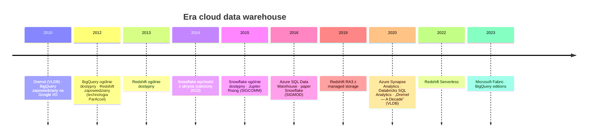
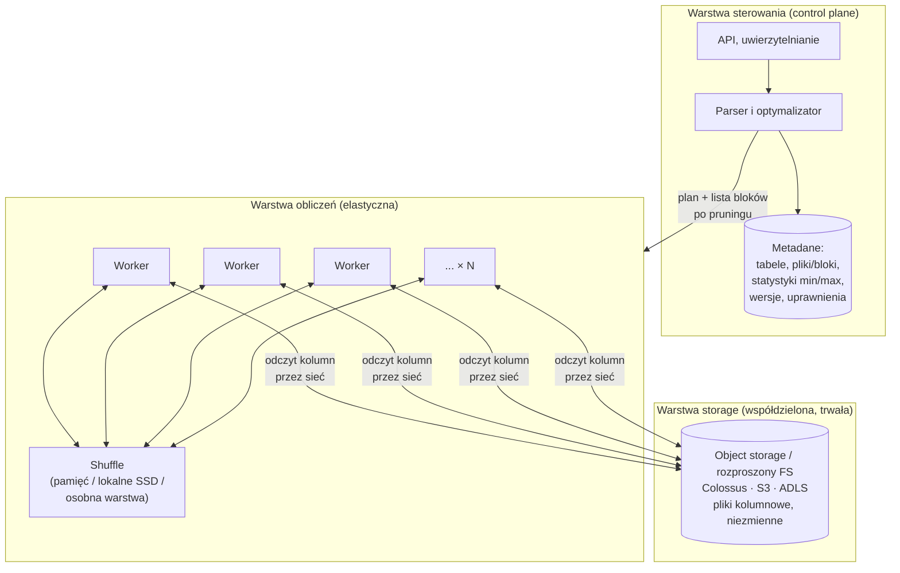
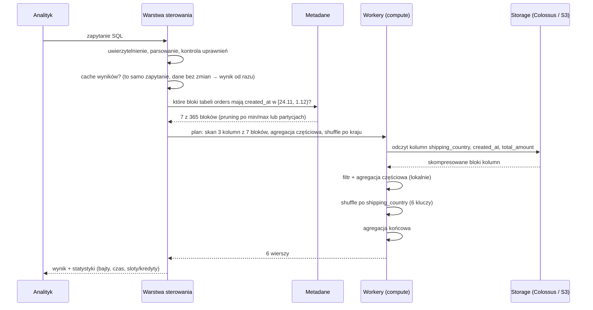

# 01.04 — Era cloud data warehouse (2010+)

> **Czas:** ~85 min · **Wymaga:** [01.03 — Era Big Data](03-era-big-data.md) · **Ostatnia weryfikacja:** 2026-11-07

**W tej lekcji:**

- poznasz historię BigQuery (2010), Redshifta (2012) i Snowflake'a (2014) oraz problemy, które każdy z nich rozwiązywał,
- zrozumiesz, czym jest **separacja storage i compute** i dlaczego stała się możliwa dopiero wtedy, gdy sieć w centrum danych dorównała przepustowością lokalnym dyskom,
- prześledzisz drogę zapytania w architekturze rozdzielonej: metadane, pomijanie danych, cache, object storage, shuffle,
- policzysz na modelu obciążenia NovaCart, kiedy opłaca się stały klaster, kiedy płatność za bajty, a kiedy płatność za sekundy pracy,
- nazwiesz nowe problemy, które ta epoka wprowadziła: nieprzewidywalny rachunek, zamknięte formaty i zależność od dostawcy.

---

## 1. Problem

Rok 2016. NovaCart ma 40-węzłowy klaster Hadoop z lekcji [01.03](03-era-big-data.md) i appliance Teradata z lekcji [01.02](02-era-hurtowni-danych.md). Dane rosną o 35% rocznie. Zespół platformy danych prowadzi statystyki:

- Średnie wykorzystanie CPU klastra Hadoop to 18%. W nocy, między 1:00 a 4:00, klaster jest zapchany zadaniami ELT, a od 9:00 analitycy czekają w kolejce YARN na swoje zapytania Hive.
- W tygodniu Black Friday raporty dla zarządu powstają z 6-godzinnym opóźnieniem, bo zapotrzebowanie rośnie trzykrotnie, a klaster ma stały rozmiar.
- Dysków brakuje szybciej niż procesorów. Dokupienie miejsca oznacza dokupienie całych serwerów, z procesorami, które będą bezczynne.
- Zamówienie nowego sprzętu zajmuje 10 tygodni od decyzji do uruchomienia.

Zarząd zadaje pytanie, na które nikt nie ma dobrej odpowiedzi: „Dlaczego płacimy za klaster na Black Friday przez cały rok, a i tak w Black Friday nie działa?”. Problem jest strukturalny: **storage i compute są związane z tymi samymi maszynami**, więc nie da się ich skalować osobno, a pojemność obliczeniową trzeba kupić z góry, na szczyt.

## 2. Intuicja

> [!TIP]
> **Intuicja.** Firma, która ma własny agregat prądotwórczy, musi kupić go na największe zapotrzebowanie w roku i płaci za niego, nawet gdy stoi. Firma podłączona do sieci energetycznej płaci za zużyte kilowatogodziny, a moc w szczycie dostarcza elektrownia, która obsługuje tysiące odbiorców i rozkłada ich szczyty w czasie.
>
> Cloud data warehouse to „podłączenie do sieci”. Dane leżą w jednym, wspólnym magazynie (storage), a moc obliczeniowa (compute) jest dostarczana wtedy, kiedy jest potrzebna, w potrzebnej ilości, z puli współdzielonej przez wielu klientów.

Analogia oddaje ekonomię: płatność za użycie i współdzielenie szczytów. Pomija jednak warunek, bez którego to wszystko nie działa. Prąd płynie przez sieć przesyłową bez strat. Dane muszą przepłynąć przez **sieć w centrum danych** z magazynu do maszyn obliczeniowych przy **każdym** zapytaniu. Jeśli sieć jest wolniejsza od lokalnego dysku, rozdzielenie storage i compute oznacza wolniejsze zapytania. Hadoop przenosił obliczenia do danych (*data locality*) właśnie dlatego, że w 2004 roku sieć była wąskim gardłem. Sekcja 4.1 pokazuje, co musiało się zmienić.

## 3. Koncepcja

### 3.1. Pojęcia

| Pojęcie | Znaczenie |
|---|---|
| Separacja storage i compute (*disaggregated storage*) | Dane przechowywane w osobnym, współdzielonym systemie storage, a obliczenia wykonywane przez maszyny, które nie są „właścicielami” danych i mogą być dodawane lub usuwane niezależnie. |
| Elastyczność (*elasticity*) | Zdolność do zmiany ilości zasobów w sekundach lub minutach, bez zakupu sprzętu i bez przenoszenia danych. |
| *Serverless* | Model, w którym nie zarządzasz maszynami ani klastrami. Wysyłasz zapytanie, a dostawca przydziela zasoby. Płacisz za użycie, a nie za czas istnienia zasobu. |
| *Multi-tenancy* (wielodostępność) | Wielu klientów współdzieli tę samą infrastrukturę, z izolacją danych i (w różnym stopniu) wydajności. |
| *Slot* (BigQuery) | Jednostka mocy obliczeniowej BigQuery: wirtualny procesor z pamięcią, przydzielany zapytaniom z dużej puli. |
| *Virtual warehouse* (Snowflake) | Nazwany klaster compute (rozmiary XS…6XL), który można uruchomić, zatrzymać i przeskalować niezależnie od danych. |
| Kredyt (*credit*, Snowflake) | Jednostka rozliczeniowa: warehouse rozmiaru XS zużywa 1 kredyt na godzinę pracy, a każdy kolejny rozmiar dwa razy więcej. |
| *Managed storage* | Storage zarządzany przez hurtownię (format, kompresja, replikacja), zwykle zbudowany na object storage chmury. |
| *Bisection bandwidth* (przepustowość przekroju) | Przepustowość sieci mierzona przez „najgorszy” podział maszyn na dwie połowy: ile danych na sekundę może płynąć między nimi jednocześnie. Miara tego, czy każda maszyna może rozmawiać z każdą z pełną prędkością. |
| *Oversubscription* (nadsubskrypcja) | Stosunek przepustowości podłączonych serwerów do przepustowości łączy w górę sieci. Przy 10:1 serwery w jednej szafie mogą razem wysłać poza szafę tylko 1/10 tego, co potrafią ich karty sieciowe. |

### 3.2. Krótka historia



*Rysunek 4.1. Najważniejsze wydarzenia epoki. Zauważ, że Redshift i Azure SQL DW startowały jako klastry MPP z danymi na węzłach, a pełną separację storage i compute dostały kilka lat później.*

Trzy produkty wyznaczyły tę epokę, każdy z innym punktem wyjścia:

**BigQuery** to publiczna wersja wewnętrznego systemu Google **Dremel**, używanego od 2006 roku do interaktywnej analizy logów. Publikacja na VLDB 2010 opisała zapytania SQL nad bilionami wierszy w sekundach, dzięki formatowi kolumnowemu dla danych zagnieżdżonych i drzewu serwerów wykonujących zapytanie. BigQuery zapowiedziano w maju 2010, a ogólnie dostępny był w 2012 roku (źródła podają daty od listopada 2011 do maja 2012, zależnie od tego, co uznają za start). Od początku był **serverless**: nie ma klastra, są tylko zapytania i opłata za przeskanowane bajty.

**Redshift** (zapowiedziany w listopadzie 2012, dostępny od lutego 2013) to klasyczna hurtownia MPP shared-nothing w chmurze, zbudowana na licencjonowanej technologii ParAccel. Dawał to, co Teradata, ale bez zakupu sprzętu, z płatnością za godziny węzłów i możliwością zmiany rozmiaru klastra w godzinach zamiast miesięcy. Dane leżały jednak na dyskach węzłów, więc storage i compute nadal były związane. Separację wprowadziły dopiero węzły **RA3** (2019) z *Redshift Managed Storage* na S3 i lokalnym cache SSD.

**Snowflake** (założony w 2012 roku, publicznie pokazany w październiku 2014, ogólnie dostępny w czerwcu 2015) został od początku zaprojektowany dla chmury przez inżynierów z doświadczeniem w Oracle. Paper na SIGMOD 2016 opisuje trzy warstwy: dane w S3, wirtualne warehouse'y jako niezależne klastry compute i warstwę usług (*cloud services*) z metadanymi, optymalizatorem i transakcjami. To była pierwsza komercyjna hurtownia, która wprost oddzieliła storage od compute i pozwalała kilku zespołom pracować na tych samych danych na osobnych warehouse'ach.

### 3.3. Architektura z lotu ptaka



*Rysunek 4.2. Trzy warstwy hurtowni chmurowej. Kluczowe jest to, że workery nie przechowują trwale żadnych danych. Można je dodać, usunąć albo przydzielić innemu klientowi bez przenoszenia ani jednego bajtu.*

## 4. 🔍 Pod maską

### 4.1. Dlaczego separacja stała się możliwa: sieć dogoniła dysk

W 2004 roku, kiedy powstawał MapReduce, typowy serwer miał kartę sieciową 1 Gb/s (125 MB/s) i kilka dysków HDD, każdy czytający sekwencyjnie około 100 MB/s. Na papierze sieć była porównywalna z jednym dyskiem. W praktyce było znacznie gorzej, bo sieci w centrach danych miały strukturę drzewa z dużą nadsubskrypcją. Publikacje z tamtego okresu (Al-Fares i in., SIGCOMM 2008; Greenberg i in., VL2, SIGCOMM 2009) opisują typowe współczynniki od 1:5 do nawet 1:240 na najwyższych poziomach drzewa. Serwer czytający dane z innej szafy dostawał ułamek przepustowości swojej karty sieciowej.

```text
 Sieć drzewiasta z nadsubskrypcją (typowa w latach 2000.)

                      ┌──────────────┐
                      │ router rdzenia│   ← wąskie gardło: cały ruch między szafami
                      └──────┬───────┘
              ┌──────────────┼──────────────┐
         ┌────┴────┐    ┌────┴────┐    ┌────┴────┐
         │ agregacja│    │ agregacja│    │ agregacja│   łącze w górę: 10 Gb/s
         └────┬────┘    └────┬────┘    └────┬────┘
        ┌─────┴─────┐  ...                          
   ┌────┴───┐  ┌────┴───┐                        
   │ szafa  │  │ szafa  │   40 serwerów × 1 Gb/s = 40 Gb/s
   │ (ToR)  │  │ (ToR)  │   łącze w górę: 2–4 Gb/s  → nadsubskrypcja 10:1–20:1
   └────────┘  └────────┘

 Wniosek: dane z lokalnego dysku (100 MB/s × kilka dysków) są wielokrotnie szybsze
 niż dane z innej szafy (kilka–kilkanaście MB/s na serwer przy pełnym obciążeniu).
 → opłaca się przenosić obliczenia do danych (data locality, Hadoop)
```

*Rysunek 4.3. Dlaczego Hadoop potrzebował data locality: w sieci drzewiastej przepustowość między szafami była wielokrotnie mniejsza niż przepustowość lokalnych dysków.*

Google rozwiązał ten problem, budując własne sieci w topologii **Clos** (wielostopniowa sieć z wielu tanich przełączników zamiast kilku drogich routerów). Publikacja *Jupiter Rising* (Singh i in., SIGCOMM 2015) opisuje pięć generacji sieci budowanych od 2004 roku. Generacja Jupiter osiągnęła ponad **1 Pb/s przepustowości przekroju** (*bisection bandwidth*), czyli pozwalała każdemu z dziesiątek tysięcy serwerów komunikować się z każdym innym z pełną prędkością karty sieciowej. Kolejna publikacja, *Jupiter Evolving* (SIGCOMM 2022), opisuje przejście na przełączniki optyczne (*optical circuit switches*) i pięciokrotny wzrost przepustowości. Google podawał wtedy przepustowość sieci centrum danych przekraczającą 6 Pb/s.

| Okres | Odczyt sekwencyjny lokalnie | Sieć na serwer | Sieć między szafami | Opłacalna architektura |
|---|---|---|---|---|
| ~2004 | HDD ~100 MB/s × kilka dysków | 1 Gb/s (~125 MB/s) | nadsubskrypcja 10:1 i więcej | Data locality (Hadoop, MPP) |
| ~2012 | HDD/SSD 0,1–0,5 GB/s | 10 Gb/s (~1,25 GB/s) | Clos bez nadsubskrypcji (Google) | Separacja możliwa u hiperskalerów |
| ~2025 | NVMe 3–7 GB/s | 100–200 Gb/s (12–25 GB/s) | Clos / optyka, bez nadsubskrypcji | Separacja to standard |

Gdy sieć przestała być wąskim gardłem, rachunek się odwrócił. Dane można trzymać w jednym, trwałym, replikowanym systemie storage (w Google: **Colossus**, następca GFS), a obliczenia uruchamiać na dowolnych maszynach. Publikacja *Dremel: A Decade of Interactive SQL Analysis at Web Scale* (VLDB 2020) opisuje, że Dremel przeszedł z danych na lokalnych dyskach na Colossus już na przełomie lat 2000. i 2010., a w 2014 roku oddzielił też shuffle do osobnej, rozproszonej warstwy w pamięci.

> [!NOTE]
> **Pod maską — dla dociekliwych.** Separacja storage i compute nie oznacza, że lokalność przestała mieć znaczenie. Wszystkie systemy mają warstwę cache blisko obliczeń: Snowflake trzyma ostatnio czytane pliki na lokalnych SSD warehouse'u i przydziela pliki węzłom przez *consistent hashing*, żeby ten sam plik trafiał do tego samego węzła (Vuppalapati i in., NSDI 2020). Redshift RA3 ma lokalny cache SSD nad S3. Databricks ma *disk cache* na dyskach workerów. Różnica polega na tym, że cache można stracić bez utraty danych, bo jedyną trwałą kopią jest storage.

> [!IMPORTANT]
> **Co z tego wynika w praktyce:** architektura podąża za fizyką sprzętu. Data locality miało sens, gdy sieć była wolna, a separacja storage i compute ma sens, gdy sieć jest szybka. Dlatego w chmurze **nie przenosisz danych do klastra**, tylko klaster (albo zapytanie) do danych w object storage. Bucket i obliczenia muszą jednak być w tym samym regionie, bo przepustowość i bezpłatny transfer dotyczą sieci wewnątrz regionu (moduł 10).

### 4.2. Droga zapytania w architekturze rozdzielonej

Prześledźmy jedno zapytanie NovaCart w hurtowni chmurowej. Opis jest uogólniony; różnice między BigQuery, Snowflake i Redshift omawiamy w sekcji 4.3.

```sql
SELECT shipping_country, SUM(total_amount) AS revenue
FROM novacart.orders
WHERE created_at >= '2025-11-24' AND created_at < '2025-12-01'
GROUP BY shipping_country
```



*Rysunek 4.4. Zapytanie w hurtowni chmurowej. Zwróć uwagę, ile pracy wykonuje się, zanim jakikolwiek bajt danych zostanie przeczytany: cache wyników, uprawnienia, pruning na metadanych.*

Kilka obserwacji, które mają bezpośrednie konsekwencje praktyczne:

1. **Metadane są osobnym, krytycznym systemem.** Żeby zrobić pruning, warstwa sterowania musi znać min/max każdej kolumny w każdym bloku. Dla tabel z milionami bloków to samo w sobie problem „big data”. Google opisał rozwiązanie w publikacji *Big Metadata* (VLDB 2021), a Snowflake przechowuje metadane w bazie FoundationDB.
2. **Cache wyników jest darmowy i automatyczny.** Jeśli to samo zapytanie zostanie powtórzone, a dane się nie zmieniły, wynik wraca od razu, bez kosztu obliczeń (w BigQuery i Snowflake cache wyników działa 24 godziny).
3. **Każdy odczyt idzie przez sieć**, ale tylko dla potrzebnych kolumn i bloków. Format kolumnowy z lekcji [01.01](01-oltp-vs-olap.md) i pruning z lekcji [01.02](02-era-hurtowni-danych.md) są tu ważniejsze niż kiedykolwiek, bo bezpośrednio decydują o ilości danych w sieci i o rachunku.
4. **Shuffle odbywa się dynamicznie.** Nie ma klucza dystrybucji (lekcja [01.02](02-era-hurtowni-danych.md), sekcja 6), więc dane są rozdzielane między workery na potrzeby konkretnego zapytania.

> [!IMPORTANT]
> **Co z tego wynika w praktyce:** w hurtowni chmurowej optymalizacja zaczyna się od pytania „ile danych to zapytanie musi przeczytać?”. Najtańsze zapytanie to takie, które trafi w cache wyników. Następne w kolejności to takie, które dzięki partycjonowaniu i clusteringowi czyta mało bloków, a w nich tylko potrzebne kolumny. Moduły 15 i 16 rozwijają to szczegółowo dla BigQuery.

### 4.3. Trzy modele elastyczności: BigQuery, Snowflake, Redshift

Wszystkie trzy systemy oddzielają storage od compute, ale różnią się tym, **jak przydzielają compute** i **za co każą płacić**. Te różnice są fundamentalne.

```text
 BigQuery — wspólna pula slotów (serverless)
 ┌────────────────────────────────────────────────────────────┐
 │  ogromna pula slotów w regionie, współdzielona przez       │
 │  wszystkich klientów; planista (Borg) przydziela sloty      │  ← nie widzisz maszyn
 │  zapytaniom na ułamki sekund, dynamicznie, etap po etapie   │
 └────────────────────────────────────────────────────────────┘
   płacisz: za przeczytane bajty (on-demand)
            albo za sloty × czas (editions, autoskalowanie, zobowiązania)

 Snowflake — wirtualne warehouse'y (klastry na żądanie)
 ┌──────────┐  ┌──────────────┐  ┌──────┐
 │ WH_ETL   │  │ WH_BI (M)    │  │ WH_DS│   ← każdy zespół ma swój warehouse,
 │ (L)      │  │ multi-cluster│  │ (XS) │     dane są wspólne
 └──────────┘  └──────────────┘  └──────┘
   auto-resume przy zapytaniu, auto-suspend po bezczynności
   płacisz: kredyty × sekundy pracy warehouse'u (minimum 60 s po każdym starcie)

 Redshift — klaster lub serverless
 ┌─────────────────────────────┐
 │ klaster RA3: N węzłów       │  ← klasyczny MPP (slices, DISTKEY, SORTKEY),
 │ + managed storage na S3     │    ale dane trwale w S3, lokalnie tylko cache
 └─────────────────────────────┘
   płacisz: węzły × godziny (provisioned) albo RPU × sekundy (Serverless)
```

*Rysunek 4.5. Trzy sposoby przydziału compute. BigQuery przydziela zasoby zapytaniom z puli, Snowflake uruchamia nazwane klastry, Redshift wywodzi się z klasycznego klastra MPP.*

| Cecha | BigQuery | Snowflake | Redshift (RA3 / Serverless) |
|---|---|---|---|
| Jednostka compute | Slot (z puli współdzielonej) | Warehouse XS–6XL (dedykowane maszyny) | Węzeł RA3 lub RPU |
| Czas do uzyskania mocy | Ułamki sekund (pula już działa) | Sekundy (warehouse wznawiany z puli przygotowanych maszyn) | Minuty przy zmianie rozmiaru klastra; sekundy w Serverless |
| Izolacja obciążeń | Rezerwacje i przypisania projektów | Osobne warehouse'y per zespół | Workload management, osobne grupy robocze w Serverless |
| Skalowanie przy wielu użytkownikach | Automatyczne (planista dzieli sloty) | Multi-cluster warehouse (dodaje klastry przy kolejce) | Concurrency scaling |
| Model płatności | Bajty (on-demand) lub sloty × czas | Kredyty × czas warehouse'u | Węzły × czas lub RPU × czas |
| Format danych | Capacitor (zamknięty) w Colossus; obsługa Iceberg przez BigLake | Micro-partitions (zamknięty) w S3/GCS/Azure; obsługa Iceberg | Zamknięty w RMS; zapytania do S3 przez Spectrum |

Do tej grupy w kolejnych latach dołączyły:

- **Azure Synapse Analytics** (ewolucja Azure SQL Data Warehouse): *dedicated SQL pool* ze stałymi 60 dystrybucjami danych w Azure Storage, rozkładanymi na zmienną liczbę węzłów compute, oraz *serverless SQL pool* płatny za przeczytane bajty. Jego następcą jest **Fabric Warehouse** (2023), który przechowuje dane jako tabele Delta w OneLake i wykonuje zapytania silnikiem Polaris (Aguilar-Saborit i in., VLDB 2020).
- **Databricks SQL** (2020): silnik Photon (SIGMOD 2022) nad tabelami Delta w object storage klienta, z warehouse'ami SQL, także w wersji serverless. To już pomost do epoki lakehouse (lekcja [01.05](05-era-lakehouse.md)).

> [!IMPORTANT]
> **Co z tego wynika w praktyce:** wybór hurtowni to w dużej mierze wybór **modelu rozliczeń i izolacji**. W BigQuery on-demand źle napisane zapytanie kosztuje, bo czyta dużo bajtów. W Snowflake kosztuje warehouse, który nie zasypia, albo za duży rozmiar dla małych zapytań. W Redshift provisioned kosztuje klaster dobrany na szczyt. Każdy model wymaga innych nawyków, które omawiamy w modułach 16, 31 i 33.

### 4.4. Ekonomia: kiedy elastyczność się opłaca

Elastyczny compute jest zwykle **droższy w przeliczeniu na jednostkę pracy** niż stały: dostawca bierze premię za to, że utrzymuje pulę zasobów gotowych dla wszystkich. Opłaca się mimo to, bo stały klaster trzeba dobrać do szczytu, a przez większość czasu jest niewykorzystany. Kluczowe pytanie brzmi więc: **jakie jest średnie wykorzystanie stałego klastra?**

Jeśli stały klaster kosztuje `F` za jednostkę-godzinę, a elastyczny `E` (z narzutem na bezczynność przed auto-suspend), to stały klaster wygrywa tylko wtedy, gdy jego średnie wykorzystanie przekracza:

```text
                         F
  próg wykorzystania = ─────
                         E
```

Przy typowych relacjach cen (elastyczne 1,5–2× droższe za jednostkę) próg wynosi 50–65%. Większość klastrów analitycznych ma średnie wykorzystanie poniżej 30%, bo obciążenie ma dobowe i sezonowe szczyty. Sprawdźmy to na modelu NovaCart w sekcji 5.

Model płatności za bajty (BigQuery on-demand) jest jeszcze inny: nie płacisz za czas ani rozmiar, tylko za dane przeczytane przez zapytania. To w pełni przenosi ryzyko wykorzystania na dostawcę, ale wiąże koszt z jakością zapytań. Zapytanie bez filtra po partycji kosztuje tyle, ile przeczytana tabela, niezależnie od tego, jak szybko się wykona.

> [!IMPORTANT]
> **Co z tego wynika w praktyce:** zanim wybierzesz model rozliczeń, zmierz **profil obciążenia**: stosunek szczytu do średniej i średnie wykorzystanie. Przy stałym, wysokim obciążeniu (np. całodobowe przetwarzanie) opłaca się rezerwacja lub zobowiązanie (*commitment*). Przy obciążeniu z wyraźnymi szczytami opłaca się płatność za użycie. Większość firm łączy oba: stałą bazę z rezerwacją i elastyczne szczyty (moduł 39).

## 5. 💻 W praktyce

Plik [`examples/05_storage_compute_economics.py`](examples/05_storage_compute_economics.py) symuluje rok (8 760 godzin) zapytań analitycznych NovaCart i liczy roczny koszt compute w czterech modelach:

- **A1. Stały klaster dobrany na szczyt**: appliance on-prem albo klaster MPP w chmurze, włączony 24/7, z liczbą węzłów pozwalającą obsłużyć najcięższą godzinę roku.
- **A2. Stały klaster dobrany na 90. percentyl**: taniej, ale w godzinach szczytu zapytania czekają w kolejce.
- **B. Płatność za przeczytane bajty**: np. BigQuery on-demand.
- **C. Płatność za sekundy pracy compute z auto-suspend**: np. warehouse Snowflake, Databricks SQL serverless, BigQuery editions z autoskalowaniem.

Dwa profile obciążenia mają **ten sam łączny roczny wolumen**:

- **„stały”**: każda godzina roku identyczna,
- **„realistyczny”**: nocny batch ELT (01–04 UTC, ×6), praca analityków (07–17, ×2), wieczorne dashboardy, weekendy ×0,35, listopad ×1,15, grudzień ×1,4 i tydzień Black Friday ×3.

```python
# examples/05_storage_compute_economics.py (fragment)
@dataclass(frozen=True)
class Prices:
    # Jednostka obliczeniowa (CU) = „jeden węzeł” umownej wielkości.
    tib_per_cu_hour: float = 0.5        # ile TiB skanu przetwarza 1 CU w godzinę
    fixed_cu_hour_usd: float = 2.00     # CU w stałym klastrze (rezerwacja / amortyzacja sprzętu)
    elastic_cu_hour_usd: float = 3.00   # CU elastyczne, płatne za sekundy (premia za elastyczność)
    elastic_idle_overhead: float = 0.15 # +15% za minimalny czas naliczania i bezczynność przed auto-suspend
    on_demand_usd_per_tib: float = 6.25 # rząd wielkości ceny skanu on-demand (BigQuery US, 2026)

for label, size in (("A1. stały klaster na szczyt", cu_needed.max()),
                    ("A2. stały klaster na p90", np.percentile(cu_needed, 90))):
    nodes = max(1, math.ceil(size))
    overloaded = cu_needed > nodes        # godziny, w których praca czeka w kolejce
    usd = nodes * p.fixed_cu_hour_usd * demand.size
```

> [!WARNING]
> Ceny i przepustowości w modelu to **parametry ilustracyjne rzędu wielkości**, a nie cennik konkretnego dostawcy. Model pokazuje **kształt** kosztu, czyli od czego zależy, a nie ranking platform. Zmieniając parametry w klasie `Prices`, możesz sprawdzić wrażliwość wniosków.

```bash
# z katalogu modules/01-ewolucja-architektur-danych/examples/
uv run python 05_storage_compute_economics.py
uv run python 05_storage_compute_economics.py --annual-tib 6000 50000
```

**Wynik:**

```text
=== Roczny skan: 1,500 TiB (~4.1 TiB/dzień), 1 CU = 0.5 TiB/h ===

Profil „stały”: szczyt 0.34 CU, p90 0.34 CU, średnio 0.34 CU, szczyt/średnia ×1.0
  Model                                       koszt/rok  węzły  wykorzystanie  godz. w kolejce
  A1. stały klaster na szczyt                  17,520 $      1            34%                0
  A2. stały klaster na p90                     17,520 $      1            34%                0
  B.  płatność za bajty (on-demand)             9,375 $      —              —                0
  C.  compute za sekundy + auto-suspend        10,350 $      1            87%                0

Profil „realistyczny”: szczyt 4.53 CU, p90 0.61 CU, średnio 0.34 CU, szczyt/średnia ×13.2
  Model                                       koszt/rok  węzły  wykorzystanie  godz. w kolejce
  A1. stały klaster na szczyt                  87,600 $      5             7%                0
  A2. stały klaster na p90                     17,520 $      1            34%              839
  B.  płatność za bajty (on-demand)             9,375 $      —              —                0
  C.  compute za sekundy + auto-suspend        10,350 $      5            87%                0

=== Roczny skan: 20,000 TiB (~54.8 TiB/dzień), 1 CU = 0.5 TiB/h ===

Profil „stały”: szczyt 4.57 CU, p90 4.57 CU, średnio 4.57 CU, szczyt/średnia ×1.0
  Model                                       koszt/rok  węzły  wykorzystanie  godz. w kolejce
  A1. stały klaster na szczyt                  87,600 $      5            91%                0
  A2. stały klaster na p90                     87,600 $      5            91%                0
  B.  płatność za bajty (on-demand)           125,000 $      —              —                0
  C.  compute za sekundy + auto-suspend       138,000 $      5            87%                0

Profil „realistyczny”: szczyt 60.42 CU, p90 8.17 CU, średnio 4.57 CU, szczyt/średnia ×13.2
  Model                                       koszt/rok  węzły  wykorzystanie  godz. w kolejce
  A1. stały klaster na szczyt               1,068,720 $     61             7%                0
  A2. stały klaster na p90                    157,680 $      9            51%              839
  B.  płatność za bajty (on-demand)           125,000 $      —              —                0
  C.  compute za sekundy + auto-suspend       138,000 $     61            87%                0

Próg opłacalności A vs C: stały klaster wygrywa dopiero przy wykorzystaniu > 58%
Koszt 1 TiB przy 100% wykorzystaniu: A 4.00 $, C 6.90 $, B 6.25 $
```

W kolumnie „węzły” dla modelu C podana jest maksymalna liczba jednostek, do której compute musiał się przeskalować w szczycie. W modelu B nie ma węzłów, które byłyby widoczne dla klienta.

**Interpretacja.**

- **Przy realistycznym profilu stały klaster na szczyt jest najdroższy z dużym zapasem.** Szczyt (nocny batch w tygodniu Black Friday) jest 13 razy wyższy od średniej, więc klaster dobrany na szczyt jest wykorzystany w 7%. Przy dużym wolumenie kosztuje ponad milion dolarów rocznie, czyli 7–8 razy więcej niż modele elastyczne. To jest liczbowy obraz pytania zarządu z sekcji 1.
- **Klaster dobrany na 90. percentyl jest tańszy, ale oznacza 839 godzin rocznie (35 dni), w których praca czeka w kolejce.** To dokładnie sytuacja „raporty w Black Friday 6 godzin później”. Przy dużym wolumenie nadal kosztuje więcej niż modele elastyczne.
- **Przy stałym, dużym obciążeniu stały klaster wygrywa** (87 600 $ przy 91% wykorzystania wobec 125–138 tys. $). Elastyczność ma swoją cenę i nie opłaca się, gdy nie jest potrzebna. Dlatego wszystkie hurtownie chmurowe oferują rezerwacje i zobowiązania (BigQuery editions z zobowiązaniem, pojemność w Snowflake, węzły zarezerwowane w Redshift).
- **Przy małym wolumenie nawet stały profil jest tańszy elastycznie**, bo nie da się kupić „jednej trzeciej węzła”. Najmniejsza jednostka stałej pojemności jest zbyt duża dla małego obciążenia. To argument za serverless dla małych zespołów i projektów.
- **Model płatności za bajty nie zależy od profilu.** Koszt B jest identyczny w obu profilach, bo zależy tylko od łącznej liczby przeczytanych bajtów. Zależy natomiast silnie od jakości zapytań: gdyby te same analizy czytały trzy razy więcej danych (np. bez filtrów po partycjach), koszt B wzrósłby trzykrotnie, podczas gdy w modelu A zapytania byłyby po prostu wolniejsze.

> [!TIP]
> **Ćwiczenie.** Zmień w klasie `Prices` wartość `elastic_cu_hour_usd` na 4,00 i `elastic_idle_overhead` na 0,40 (warehouse, który często budzi się dla pojedynczych zapytań i zasypia po 10 minutach). Sprawdź, przy jakim profilu stały klaster zaczyna wygrywać i jak zmienia się próg opłacalności.

## 6. ⚖️ Porównanie platform

| Aspekt | GCP (BigQuery) | AWS (Redshift) | Azure (Synapse / Fabric) | Snowflake | Databricks (SQL) | On-prem / OSS |
|---|---|---|---|---|---|---|
| Separacja storage i compute | Od początku (Colossus + pula slotów) | Od RA3 (2019); wcześniej dane na węzłach | Synapse: dane w Azure Storage, 60 dystrybucji; Fabric: OneLake (Delta) | Od początku (S3/GCS/Azure + warehouse'y) | Od początku (Delta w object storage klienta) | Zwykle brak (MPP z lokalnymi dyskami); możliwa z Trino/Spark + S3-kompatybilnym storage |
| Gdzie są dane | Storage zarządzany przez Google, format Capacitor; BigLake dla Iceberg | Redshift Managed Storage; Spectrum dla S3 | OneLake (Delta Parquet), w Synapse format wewnętrzny | Storage zarządzany przez Snowflake; tabele Iceberg w buckecie klienta | Bucket klienta (Delta, Iceberg przez UniForm) | Dyski węzłów lub własny object storage (MinIO, Ceph) |
| Jednostka compute | Slot | Węzeł / RPU | DWU (Synapse), CU (Fabric) | Warehouse (kredyty) | SQL warehouse (DBU) | Węzeł |
| Elastyczność | Natychmiastowa (pula współdzielona) | Minuty (resize), sekundy (Serverless, concurrency scaling) | Minuty (DWU), Fabric: pojemność współdzielona z *smoothingiem* | Sekundy (resume), multi-cluster | Sekundy (serverless), minuty (classic) | Tygodnie do miesięcy |
| Model kosztowy | Bajty lub sloty × czas | Węzły × czas lub RPU × czas | DWU × czas lub pojemność Fabric | Kredyty × czas | DBU × czas (+ infrastruktura w classic) | CAPEX + utrzymanie |
| Główna pułapka kosztowa | Skany bez pruningu (on-demand) | Klaster dobrany na szczyt | Pojemność niewyłączana; *throttling* po przekroczeniu | Warehouse bez auto-suspend, za duży rozmiar | Warehouse bez auto-stop | Pojemność kupiona na 3 lata |

**Wnioski:** separacja storage i compute stała się standardem, ale dostawcy doszli do niej różnymi drogami, co widać do dziś. BigQuery i Snowflake były projektowane jako rozdzielone od początku. Redshift i Synapse wyrosły z klasycznego MPP i zachowały jego pojęcia (dystrybucja, slices, stałe dystrybucje), co daje większą kontrolę, ale i więcej decyzji projektowych. Fundamentalna różnica, która zostanie z Tobą przez cały kurs, to **jednostka rozliczeń**: bajty (koszt zależy od zapytań), czas compute (koszt zależy od rozmiaru i czasu pracy) albo stała pojemność (koszt zależy od planowania). Zamknięte formaty storage w pierwszych hurtowniach chmurowych stały się z kolei motorem następnej epoki: lakehouse z otwartymi formatami.

## 7. ⚠️ Antywzorce i pułapki

| Antywzorzec | Objaw | Dlaczego tak się dzieje | Jak naprawić |
|---|---|---|---|
| Myślenie „klastrowe” w chmurze (*lift-and-shift*) | Stały klaster lub warehouse działa 24/7 z niskim wykorzystaniem | Przeniesiono model kosztowy appliance'u | Auto-suspend, serverless, rezerwacja tylko na stałą bazę obciążenia |
| `SELECT *` i brak filtrów po partycji w modelu on-demand | Rachunek rośnie szybciej niż dane | Płacisz za każdy przeczytany bajt | Partycjonowanie, clustering, wybór kolumn, *dry run*, `maximum_bytes_billed` |
| Jeden duży warehouse dla wszystkich | Zapytania BI czekają na ELT; trudno przypisać koszty | Brak izolacji obciążeń | Osobne warehouse'y lub rezerwacje per obciążenie i zespół |
| Duży warehouse dla małych zapytań | Wysoki koszt bez poprawy czasu | Zapytanie nie potrafi użyć wszystkich węzłów, a płacisz za wszystkie | Dobierz rozmiar do zapytań; skaluj liczbę klastrów, nie rozmiar |
| Częste wybudzanie warehouse'u na pojedyncze zapytania | Koszt wyższy niż wynika z czasu zapytań | Minimalny czas naliczania po każdym starcie i bezczynność przed uśpieniem | Grupuj zapytania, odpowiednio ustaw czas auto-suspend |
| Dane i compute w różnych regionach | Wolne zapytania, opłaty za transfer | Ruch między regionami jest wolniejszy i płatny | Trzymaj compute i storage w tym samym regionie |

> [!WARNING]
> **Pułapka.** „W chmurze płacimy tylko za to, czego używamy” to prawda tylko wtedy, gdy **zaprojektujesz** system tak, żeby z tego korzystał. Klaster Redshift provisioned, Synapse dedicated pool, rezerwacja slotów BigQuery czy warehouse Snowflake bez auto-suspend dobrane „na szczyt” odtwarzają model kosztowy appliance'u z sekcji 5 (wariant A1), tylko z fakturą co miesiąc. W module 00 ustawiłeś budżet i alerty właśnie po to, żeby takie sytuacje wychwycić.

## 8. 💰 Koszty

Rachunek za hurtownię chmurową ma dwie główne części, rozliczane osobno, i to jest bezpośredni efekt separacji:

- **Storage**: płacisz za GB miesięcznie, zwykle kilka razy taniej za dane długo niezmieniane (np. w BigQuery cena *long-term storage* jest o połowę niższa niż *active* po 90 dniach bez modyfikacji). Storage jest tani w porównaniu z compute, więc opłaca się trzymać pełną historię i surowe dane, czego w epoce appliance'ów nie robiono.
- **Compute**: zależy od modelu (bajty, sloty, kredyty, węzły). To zwykle 70–90% rachunku za hurtownię i główne pole optymalizacji.

Do tego dochodzą koszty mniej oczywiste: transfer danych między regionami i do internetu (*egress*), streaming danych do hurtowni, usługi dodatkowe (zmaterializowane widoki, wyszukiwanie, ML).

Przykład dla NovaCart w skali XL (rząd wielkości): ~500 GB danych w Parquet to w hurtowni kilkaset GB do 1 TB przechowywania, czyli kilkanaście–kilkadziesiąt dolarów miesięcznie. Jedno zapytanie bez filtrów po pełnej tabeli clickstream w modelu on-demand może kosztować kilka dolarów, a dashboard odświeżany co 15 minut z takim zapytaniem to kilkaset dolarów dziennie. Storage prawie nigdy nie jest problemem, compute prawie zawsze.

> [!CAUTION]
> **Koszt!** W modelu on-demand **nie ma górnego limitu** kosztu pojedynczego zapytania, poza tym, co sam ustawisz. Pomyłka w zapytaniu uruchomionym w pętli (np. przez narzędzie BI odświeżające dashboard) potrafi wygenerować tysiące dolarów w ciągu doby. Dlatego w module 00 ustawiasz `maximum_bytes_billed` i dzienny limit zapytań (*custom quota*) na projekt, zanim wykonasz pierwsze zapytanie.

## 9. Podsumowanie

- Cloud data warehouse rozwiązał problem epok wcześniejszych: storage i compute związane z tymi samymi maszynami, pojemność kupowana na szczyt i miesiące oczekiwania na rozbudowę.
- Separacja storage i compute stała się możliwa, gdy sieć w centrum danych przestała być wąskim gardłem: sieci Clos bez nadsubskrypcji (Jupiter: ponad 1 Pb/s przepustowości przekroju w 2015) i karty 10–200 Gb/s dorównały lokalnym dyskom.
- Zapytanie w hurtowni chmurowej wykonuje dużo pracy na metadanych (cache wyników, uprawnienia, pruning), zanim przeczyta dane, a dane czyta przez sieć tylko dla potrzebnych kolumn i bloków.
- BigQuery (pula slotów, płatność za bajty lub sloty), Snowflake (warehouse'y, kredyty za sekundy) i Redshift (klaster MPP z managed storage lub Serverless) różnią się modelem przydziału compute i rozliczeń. To różnice fundamentalne, a nie kosmetyczne.
- Elastyczność jest droższa za jednostkę, ale opłaca się, gdy średnie wykorzystanie stałego klastra jest niskie. W modelu NovaCart próg opłacalności wynosi 58%, a przy realistycznym profilu z szczytem 13× klaster dobrany na szczyt był wykorzystany w 7%.
- Epoka wprowadziła nowe problemy: nieprzewidywalny rachunek, zamknięte formaty storage i zależność od dostawcy. Ten ostatni napędził lakehouse.

## 🧠 Sprawdź się

<details>
<summary><b>1. Dlaczego Hadoop w 2006 roku przenosił obliczenia do danych, a BigQuery w 2012 roku mógł przenosić dane do obliczeń?</b></summary>

Bo zmieniła się relacja przepustowości sieci i dysku. W sieciach drzewiastych z nadsubskrypcją 10:1 i więcej przepustowość między szafami była wielokrotnie mniejsza niż przepustowość lokalnych dysków, więc czytanie danych przez sieć byłoby wąskim gardłem. Google zbudował sieci Clos bez nadsubskrypcji (Jupiter, ponad 1 Pb/s przepustowości przekroju), w których każdy serwer może komunikować się z każdym z pełną prędkością karty sieciowej. Wtedy odczyt danych z rozproszonego storage (Colossus) przez sieć stał się porównywalny z odczytem lokalnym, a zyski z separacji (elastyczność, współdzielenie, trwałość) przeważyły.

</details>

<details>
<summary><b>2. Zespół BI NovaCart ma dashboard odświeżany co 5 minut przez 10 godzin dziennie. Każde odświeżenie trwa 3 sekundy na warehouse'ie XS w Snowflake. Dlaczego rzeczywisty koszt może być kilkanaście razy wyższy niż „3 sekundy × 120 odświeżeń”?</b></summary>

Bo warehouse po każdym wznowieniu nalicza minimum 60 sekund, a potem pracuje do czasu auto-suspend (np. 5 lub 10 minut bezczynności). Przy odświeżaniu co 5 minut warehouse z auto-suspend ustawionym na 10 minut w ogóle nie zaśnie przez 10 godzin, więc zapłacisz za 10 godzin pracy zamiast za 6 minut. Rozwiązania: krótszy auto-suspend, cache wyników (jeśli dane się nie zmieniły, zapytanie nic nie kosztuje), zmaterializowanie wyników, rzadsze odświeżanie albo wspólny warehouse z innymi zapytaniami BI.

</details>

<details>
<summary><b>3. Kiedy stały klaster (lub rezerwacja) jest tańszy niż elastyczne compute? Odwołaj się do wyników symulacji.</b></summary>

Gdy średnie wykorzystanie stałej pojemności przekracza stosunek ceny stałej do elastycznej (w modelu: 2,00 / (3,00 × 1,15) ≈ 58%). W symulacji tak było tylko przy stałym profilu z dużym wolumenem (91% wykorzystania, 87,6 tys. $ wobec 125–138 tys. $). Przy realistycznym profilu ze szczytem 13× średniej klaster dobrany na szczyt był wykorzystany w 7% i kosztował 7–8 razy więcej. W praktyce opłaca się zarezerwować stałą bazę obciążenia (np. całodobowe zadania), a szczyty obsługiwać elastycznie.

</details>

<details>
<summary><b>4. Dlaczego w modelu „płatność za bajty” koszt nie zależy od profilu obciążenia, a mimo to bywa nieprzewidywalny?</b></summary>

Bo zależy tylko od łącznej liczby bajtów przeczytanych przez zapytania, a nie od tego, kiedy zapytania są wykonywane ani ile zasobów zużyją. Szczyty nie kosztują więc dodatkowo, bo ryzyko wykorzystania ponosi dostawca. Koszt zależy natomiast od jakości i liczby zapytań: jedno zapytanie bez filtra po partycji na dużej tabeli albo dashboard odświeżany w pętli może przeczytać terabajty. Dlatego w modelu on-demand kluczowe są limity (`maximum_bytes_billed`, custom quotas), partycjonowanie i monitoring kosztów per zapytanie.

</details>

<details>
<summary><b>5. Redshift i Synapse dedicated pool mają dane w object storage, a mimo to każą wybierać klucz dystrybucji. Dlaczego, skoro BigQuery i Snowflake tego nie wymagają?</b></summary>

Bo wyrosły z klasycznej architektury MPP i zachowały jej model wykonania: dane są logicznie podzielone na stałe jednostki (slices w Redshift, 60 dystrybucji w Synapse) przypisane do węzłów compute, a lokalny JOIN wymaga, by pasujące wiersze leżały w tej samej jednostce. Trwała kopia jest w storage, ale układ danych na węzłach nadal decyduje o tym, ile danych przejdzie przez sieć przy JOIN-ie. BigQuery i Snowflake zaprojektowano bez takiego przypisania, więc każde zapytanie dzieli dane dynamicznie i płaci za to shuffle przez szybką sieć.

</details>

## 📚 Źródła

1. S. Melnik i in., „Dremel: Interactive Analysis of Web-Scale Datasets”, VLDB 2010 — [PDF](https://research.google/pubs/dremel-interactive-analysis-of-web-scale-datasets-2/).
2. S. Melnik i in., „Dremel: A Decade of Interactive SQL Analysis at Web Scale”, VLDB 2020 — [PDF](https://www.vldb.org/pvldb/vol13/p3461-melnik.pdf).
3. P. Edara, M. Pasumansky, „Big Metadata: When Metadata is Big Data”, VLDB 2021.
4. A. Singh i in., „Jupiter Rising: A Decade of Clos Topologies and Centralized Control in Google's Datacenter Network”, SIGCOMM 2015 — [PDF](https://research.google/pubs/jupiter-rising-a-decade-of-clos-topologies-and-centralized-control-in-googles-datacenter-network/).
5. L. Poutievski i in., „Jupiter Evolving: Transforming Google's Datacenter Network via Optical Circuit Switches and Software-Defined Networking”, SIGCOMM 2022 — [strona publikacji](https://research.google/pubs/jupiter-evolving-transforming-googles-datacenter-network-via-optical-circuit-switches-and-software-defined-networking/).
6. Google Cloud Blog, [„The evolution of Google's Jupiter data center network”](https://cloud.google.com/blog/topics/systems/the-evolution-of-googles-jupiter-data-center-network), 2022.
7. M. Al-Fares, A. Loukissas, A. Vahdat, „A Scalable, Commodity Data Center Network Architecture”, SIGCOMM 2008.
8. A. Greenberg i in., „VL2: A Scalable and Flexible Data Center Network”, SIGCOMM 2009.
9. B. Dageville i in., „The Snowflake Elastic Data Warehouse”, SIGMOD 2016.
10. M. Vuppalapati i in., „Building An Elastic Query Engine on Disaggregated Storage”, NSDI 2020.
11. A. Gupta i in., „Amazon Redshift and the Case for Simpler Data Warehouses”, SIGMOD 2015.
12. N. Armenatzoglou i in., „Amazon Redshift Re-invented”, SIGMOD 2022.
13. J. Aguilar-Saborit i in., „POLARIS: The Distributed SQL Engine in Azure Synapse”, VLDB 2020.
14. A. Behm i in., „Photon: A Fast Query Engine for Lakehouse Systems”, SIGMOD 2022.
15. Cennik BigQuery: [BigQuery pricing](https://cloud.google.com/bigquery/pricing) (on-demand, editions, storage aktywny i długoterminowy).
16. Dokumentacja Snowflake: [Warehouse considerations](https://docs.snowflake.com/en/user-guide/warehouses-considerations) i [Understanding compute cost](https://docs.snowflake.com/en/user-guide/cost-understanding-compute) (naliczanie za sekundy, minimum 60 s).
17. Dokumentacja Amazon Redshift: [RA3 nodes and managed storage](https://docs.aws.amazon.com/redshift/latest/mgmt/working-with-clusters.html#rs-ra3-node-types).

---

<sub>← [01.03 — Era Big Data](03-era-big-data.md) · [Moduł 01](README.md) · [01.05 — Era lakehouse](05-era-lakehouse.md) →</sub>
