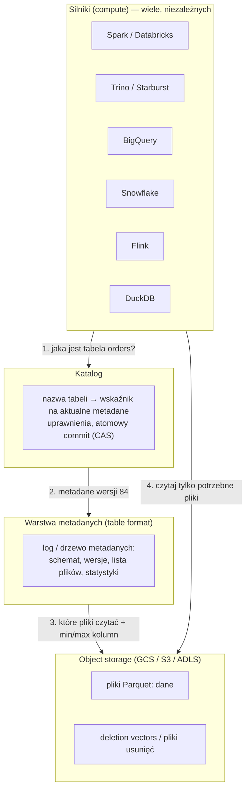
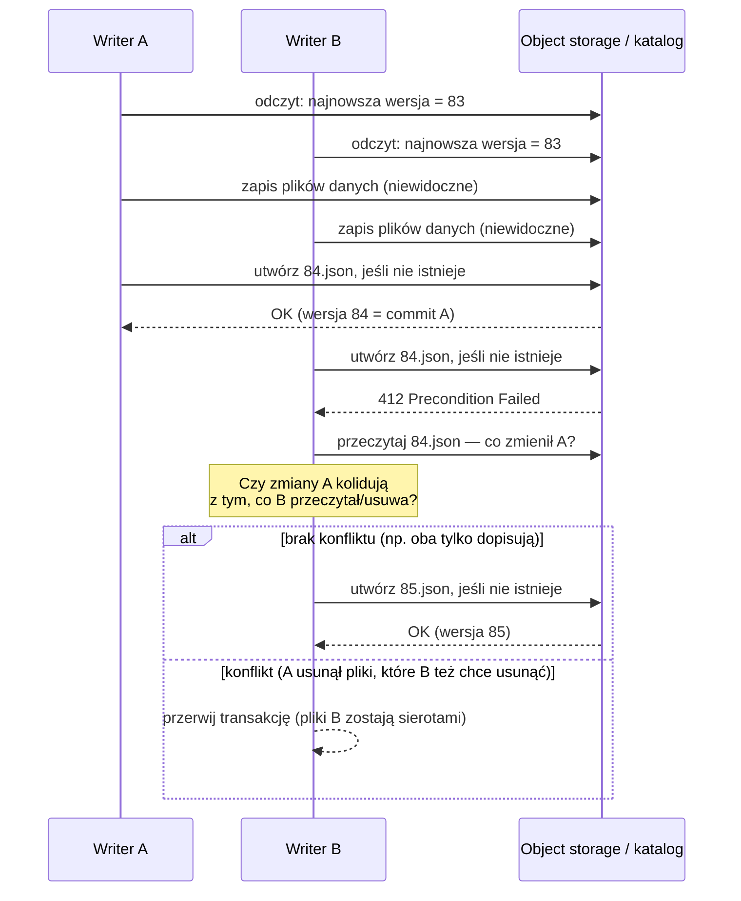

# 01.05 — Era lakehouse (2019+)

> **Czas:** ~90 min · **Wymaga:** [Lekcja 01.03 — Era Big Data](03-era-big-data.md), [Lekcja 01.04 — Era cloud data warehouse](04-era-cloud-data-warehouse.md) · **Ostatnia weryfikacja:** 2026-11-07

**W tej lekcji:**

- zrozumiesz, dlaczego katalog plików Parquet na *object storage* nie jest jeszcze tabelą i jakich gwarancji mu brakuje,
- zobaczysz, jak Delta Lake, Apache Iceberg i Apache Hudi dodają transakcje ACID za pomocą **logu metadanych** i **atomowego commitu**,
- prześledzisz krok po kroku *optimistic concurrency control*, snapshoty i *time travel* na własnym, 250-liniowym „table formacie”,
- poznasz rolę **katalogu** (Hive Metastore, Unity Catalog, Polaris, BigLake metastore, Glue) i dowiesz się, dlaczego wojna formatów przeniosła się właśnie tam,
- nauczysz się oceniać, kiedy lakehouse ma sens, a kiedy wystarczy hurtownia.

---

## 1. Problem

Jest rok 2021. NovaCart ma dwie kopie tych samych danych. Surowy clickstream i pliki od przewoźników lądują w Cloud Storage jako Parquet (*data lake*), bo tak taniej i bo zespół data science czyta je Sparkiem. Raporty finansowe i dashboardy działają na BigQuery, więc co noc job kopiuje „oczyszczone” dane z jeziora do hurtowni. Dwie kopie oznaczają dwa rachunki za storage, dwa zestawy uprawnień i regularne kłótnie o to, która liczba jest prawdziwa.

W poniedziałek po Black Friday job Sparka przeliczał partycję `dt=2025-11-28` w jeziorze: usunął stare pliki i zaczął zapisywać nowe. Po 40 minutach executor padł z braku pamięci. Przez godzinę, do ręcznej naprawy, model rekomendacji uczył się na danych, w których największy dzień roku miał 698 zamówień zamiast 1046. Nikt nie dostał błędu. Czytelnicy po prostu widzieli to, co akurat leżało w katalogu.

Tydzień później przyszedł wniosek RODO: usunąć dane klienta 184 223. W hurtowni wystarczył `DELETE`. W jeziorze trzeba było znaleźć wszystkie pliki z tym klientem, przepisać je bez jego wierszy i podmienić, a w tym czasie trzy inne joby czytały i dopisywały do tych samych katalogów.

Ta lekcja jest o tym, jak branża rozwiązała ten problem: zamiast dwóch światów (jezioro + hurtownia) jedna kopia danych w otwartym formacie na tanim object storage, ale **z gwarancjami tabeli**. To jest *lakehouse*.

## 2. Intuicja

> [!TIP]
> **Intuicja.** Wyobraź sobie biuro rachunkowe. Faktury (pliki danych) leżą w segregatorze, ale **ważne** są tylko te, które zostały wpisane do ponumerowanego dziennika księgowego. Księgowy może włożyć do segregatora nową fakturę i jeszcze jej nie zaksięgować: nikt jej wtedy nie bierze pod uwagę. Korekta to nowy wpis w dzienniku „faktura 17 anulowana, w jej miejsce faktura 17a”, a nie wyrywanie kartek. Żeby sprawdzić stan na koniec marca, czytasz dziennik do ostatniego wpisu z marca.

Ta analogia oddaje trzy najważniejsze idee *table formatu*:

1. **Plik w katalogu nie znaczy nic, dopóki nie wskazuje go log.** Dzięki temu można zapisywać duże pliki powoli, a „ogłosić” je jednym, małym, atomowym wpisem.
2. **Nic się nie nadpisuje.** Zmiana to nowy wpis, który usuwa (logicznie) stare pliki i dodaje nowe. Stare wersje leżą dalej, więc możliwy jest *time travel*.
3. **Kolejny numer strony dziennika może zająć tylko jeden księgowy.** Jeśli dwóch próbuje jednocześnie zapisać stronę 85, jeden wygrywa, a drugi musi sprawdzić, czy jego wpis nadal ma sens, i spróbować na stronie 86.

Gdzie analogia przestaje działać? Dziennik księgowy jest jeden i leży na biurku. W lakehouse „dziennik” to pliki na rozproszonym object storage, gdzie nie ma blokad ani biurka, a jedyne, na co możesz liczyć, to kilka bardzo konkretnych gwarancji API storage'u. Cała sztuka polega na tym, żeby z tych kilku gwarancji zbudować transakcje.

## 3. Koncepcja

### 3.1. Pojęcia

| Pojęcie | Znaczenie |
|---|---|
| *object storage* (magazyn obiektów) | Usługa przechowująca niezmienne obiekty pod kluczami w płaskiej przestrzeni nazw: GCS, S3, Azure Blob/ADLS. Tania, praktycznie nieskończona, dostępna przez HTTP. Nie jest systemem plików (szczegóły w module 03). |
| *data lake* (jezioro danych) | Dane w otwartych formatach plików (Parquet, ORC, Avro, JSON) na object storage lub HDFS, czytane przez wiele silników. Tabela to konwencja katalogów (`dt=…/`), a nie obiekt z gwarancjami. |
| *open table format* (otwarty format tabel) | Specyfikacja metadanych, które zamieniają zbiór plików w tabelę z transakcjami, schematem, wersjami i statystykami: **Delta Lake**, **Apache Iceberg**, **Apache Hudi**. |
| *lakehouse* | Architektura, w której jedna kopia danych w otwartym formacie tabel na object storage obsługuje zarówno BI/SQL, jak i data science/ML. Termin spopularyzował paper z CIDR 2021. |
| *transaction log* / metadane tabeli | Uporządkowana sekwencja commitów opisujących, które pliki tworzą tabelę w danej wersji (Delta: `_delta_log/`, Iceberg: drzewo `metadata.json` → *manifest list* → *manifests*, Hudi: *timeline* w `.hoodie/`). |
| *commit* | Atomowe przejście tabeli z wersji N do N+1. Albo jest widoczne w całości, albo wcale. |
| *snapshot* | Stan tabeli w konkretnej wersji: lista aktywnych plików danych (i plików usunięć) plus schemat. |
| *optimistic concurrency control* (OCC, optymistyczna kontrola współbieżności) | Writer nie blokuje tabeli. Pracuje na snapshocie, a przy commicie sprawdza, czy ktoś w międzyczasie nie zmienił czegoś, od czego zależy. Jeśli tak, ponawia albo przerywa. |
| *put-if-absent* / *compare-and-swap* (CAS) | Prymityw storage'u lub katalogu: „utwórz obiekt X tylko, jeśli nie istnieje” albo „podmień wskaźnik tylko, jeśli nadal wskazuje na wersję N”. Fundament atomowego commitu. |
| *time travel* | Odczyt tabeli w stanie z wcześniejszej wersji lub chwili. Działa, dopóki stare pliki nie zostaną fizycznie usunięte. |
| *VACUUM* / *expire snapshots* | Usuwanie plików, do których nie odwołuje się już żadna zachowana wersja. Kończy możliwość time travel do starszych wersji. |
| *copy-on-write* (CoW) / *merge-on-read* (MoR) | Dwie strategie `UPDATE`/`DELETE`: przepisać cały plik z poprawionymi wierszami (drogi zapis, tani odczyt) albo zapisać osobno informację o usunięciu/zmianie i scalać ją przy odczycie (tani zapis, droższy odczyt). |
| *deletion vector* | Bitmapa „wiersze 17, 2051 i 9000 pliku X są usunięte”. Najpopularniejsza dziś forma merge-on-read (Delta, Iceberg v3). |
| *catalog* (katalog) | Usługa, która zna nazwy tabel i wskazuje ich aktualne metadane: Hive Metastore, AWS Glue Data Catalog, Unity Catalog, Apache Polaris, Nessie, BigLake metastore. W Icebergu katalog wykonuje też atomowy commit. |

### 3.2. Jak to działa — widok z lotu ptaka



*Rysunek 05.1. Lakehouse to cztery warstwy. Zauważ, że silników jest wiele, a dane są jedne. Spójność zapewnia nie silnik ani storage, tylko warstwa metadanych razem z katalogiem.*

Odczyt wygląda tak: silnik pyta katalog o tabelę `sales.orders`, dostaje wskaźnik na aktualne metadane, z metadanych odczytuje listę plików z wersji 84 (razem ze statystykami min/max każdej kolumny), odrzuca pliki, które na pewno nie zawierają szukanych wierszy, i czyta tylko pozostałe. Nie listuje katalogów na object storage, co przy milionach plików oszczędza minuty.

Zapis jest odwrotny: silnik zapisuje nowe pliki danych (są niewidoczne), potem przygotowuje nowe metadane i próbuje je atomowo „opublikować”. Jeśli mu się uda, wszyscy kolejni czytelnicy widzą nową wersję w całości.

## 4. 🔍 Pod maską

### 4.1. Dlaczego object storage nie jest systemem plików

Hive (2008–2010) zdefiniował tabelę jako katalog: `orders/dt=2025-11-28/part-00000.parquet`. Metastore pamiętał tylko listę **partycji** (katalogów), a listę **plików** silnik ustalał, listując katalog w chwili zapytania. Na HDFS to działało znośnie, bo HDFS ma prawdziwe katalogi i atomową operację `rename`. Standardowy protokół zapisu Hadoopa (`FileOutputCommitter`) zapisywał wyniki do katalogu tymczasowego i na koniec robił `rename` do docelowego.

Na object storage ten model się sypie, bo:

| Cecha | HDFS / lokalny system plików | Object storage (klasyczny) | Skutek dla „tabeli z katalogów” |
|---|---|---|---|
| Katalogi | prawdziwe obiekty w namenode | tylko prefiks klucza (`orders/dt=2025-11-28/`) | „Katalog” nie istnieje sam w sobie, więc nie da się go atomowo podmienić |
| `rename` katalogu | atomowa operacja metadanych, O(1) | kopiowanie każdego obiektu + usunięcie, O(liczba plików) | Commit przez rename trwa minuty i nie jest atomowy |
| Listowanie | szybkie, spójne | stronicowane (do 1000 kluczy na żądanie), kosztuje (operacja płatna) | Planowanie zapytania na 1 mln plików = 1000 żądań HTTP |
| Spójność | silna | S3 do grudnia 2020: *eventual consistency* listowania; GCS: silna od lat | Czytelnik mógł nie zobaczyć świeżo zapisanego pliku albo widzieć usunięty |
| Nadpisanie | w miejscu | obiekt jest niezmienny; „nadpisanie” = nowy obiekt pod tym samym kluczem | Brak transakcji obejmujących wiele obiektów |

> [!NOTE]
> **Pod maską — dla dociekliwych.** Amazon S3 przez 14 lat oferował silną spójność tylko dla nowych obiektów, a listowanie i nadpisania były *eventually consistent*. Netflix zbudował S3mper, a społeczność Hadoopa S3Guard (osobna tabela DynamoDB z listą plików), żeby to obejść. Od grudnia 2020 S3 zapewnia *strong read-after-write consistency* dla wszystkich operacji, także listowania. Usunęło to jedną klasę błędów, ale nie dało transakcji obejmujących wiele plików. Google Cloud Storage od dawna ma silną spójność operacji na obiektach i listowania. Mimo to, jak zobaczysz w sekcji 5, sama spójność pojedynczych operacji nie wystarcza.

Do tego dochodzą problemy, których nie rozwiązuje nawet idealnie spójny storage:

- **Brak izolacji czytelnika od writera.** Czytelnik, który listuje katalog w trakcie podmiany plików, widzi stan pośredni (w NovaCart: 0, potem 698, potem 1046 zamówień).
- **Brak atomowości przy awarii.** Writer, który padnie w połowie, zostawia część nowych plików i (zależnie od kolejności) część starych.
- **Brak schematu.** Schemat jest w plikach, a każdy plik może mieć inny. Hive Metastore przechowuje schemat „deklarowany”, ale nikt nie pilnuje zgodności z plikami (*schema-on-read*, lekcja 01.03).
- **Brak statystyk na poziomie tabeli.** Żeby pominąć nieistotne pliki, trzeba je najpierw wylistować i otworzyć ich stopki.

> [!IMPORTANT]
> **Co z tego wynika w praktyce:** konwencja „tabela = katalog plików” daje Ci tylko tyle gwarancji, ile ma pojedyncza operacja na pojedynczym obiekcie. Każda operacja dotykająca wielu plików (overwrite partycji, compaction, `DELETE` dla RODO) jest na takiej „tabeli” nieatomowa i niewidocznie psuje dane czytelnikom. Jeśli w jeziorze więcej niż jeden proces pisze lub ktoś czyta w trakcie zapisu, potrzebujesz table formatu albo hurtowni.

### 4.2. Log transakcji: lista plików zamiast listowania katalogów

Wszystkie trzy formaty robią to samo w różnych strukturach: **przenoszą listę plików tabeli z systemu plików do metadanych**, które same są plikami na tym samym storage'u.

**Delta Lake** (Databricks; open source od kwietnia 2019; opisany w paperze VLDB 2020) ma najprostszy model. Log to katalog `_delta_log/` z ponumerowanymi plikami JSON. Każdy zawiera listę akcji:

```text
orders/
├── _delta_log/
│   ├── 00000000000000000000.json      ← metaData (schemat, partycjonowanie), protocol, add × N
│   ├── 00000000000000000001.json      ← add part-a1.parquet
│   ├── 00000000000000000002.json      ← remove part-0.parquet, add part-b1.parquet, add part-b2.parquet
│   ├── …
│   ├── 00000000000000000010.checkpoint.parquet   ← pełny stan tabeli po wersji 10
│   └── _last_checkpoint                ← „najnowszy checkpoint to 10”
├── dt=2025-11-28/part-0.parquet        ← usunięty logicznie w wersji 2, fizycznie leży do VACUUM
├── dt=2025-11-28/part-b1.parquet
└── dt=2025-11-28/part-b2.parquet
```

*Rysunek 05.2. Struktura tabeli Delta. Stan wersji N to suma akcji `add` minus `remove` z plików 0…N. Checkpoint co 10 commitów (domyślnie) pozwala zacząć od stanu po wersji 10 zamiast odtwarzać cały log.*

Akcja `add` zawiera nie tylko ścieżkę, ale też rozmiar, wartości kolumn partycjonujących i **statystyki**: liczbę wierszy oraz min/max/null count dla kolumn. Dzięki temu silnik może pominąć plik bez jego otwierania (*data skipping*).

**Apache Iceberg** (zaczęty w Netflixie w 2017 r. przez Ryana Blue i Dana Weeksa, przekazany do Apache Incubator w 2018 r., *top-level project* od 2020 r.) ma model drzewiasty, zaprojektowany pod tabele z milionami plików:

```text
katalog:  sales.orders  ──►  s3://…/orders/metadata/00084-7a1f.metadata.json
                                      │  schematy (z historią), partition specs, sort orders,
                                      │  lista snapshotów, current-snapshot-id = 84
                                      ▼
                             snap-84-…-manifest-list.avro       (1 na snapshot)
                                      │  manifest A: partycje dt 2025-11-01…11-15, 0 usuniętych
                                      │  manifest B: partycje dt 2025-11-16…11-30, …
                                      ▼
                             manifest-B.avro                     (współdzielone między snapshotami)
                                      │  data file: dt=2025-11-28/…-00001.parquet
                                      │    record_count, file_size, lower/upper bounds kolumn
                                      ▼
                             pliki Parquet z danymi
```

*Rysunek 05.3. Drzewo metadanych Icebergu. Commit zapisuje nowy `metadata.json` i atomowo przestawia na niego wskaźnik w katalogu. Manifesty niezmienione od poprzedniej wersji są współdzielone, więc commit dotykający jednej partycji nie przepisuje metadanych całej tabeli.*

Dwuwarstwowa struktura (manifest list → manifests) pozwala odrzucić całe manifesty na podstawie zakresów partycji, zanim silnik w ogóle przeczyta wpisy plików. Iceberg wprowadził też **hidden partitioning**: partycjonujesz po `days(created_at)`, a zapytanie z filtrem na `created_at` korzysta z partycji, chociaż użytkownik nie zna kolumny `dt`. Możliwa jest też **ewolucja partycjonowania** bez przepisywania danych (stare pliki zostają w starym układzie).

**Apache Hudi** (Uber, 2016; open source 2017; Apache Incubator 2019, *top-level project* 2020) powstał z innego problemu: Uber potrzebował **upsertów** na ogromnych tabelach (status przejazdu zmienia się wielokrotnie) z opóźnieniem minut, a nie dób. Dlatego Hudi ma klucze rekordów, indeksy (gdzie leży rekord o danym kluczu) i dwa typy tabel: *Copy-on-Write* i *Merge-on-Read* (pliki bazowe Parquet + pliki logów Avro z ostatnimi zmianami, scalane okresowo przez *compaction*). Log nazywa się *timeline* i składa się z *instants* w stanach `requested → inflight → completed`.

> [!IMPORTANT]
> **Co z tego wynika w praktyce:** w table formacie źródłem prawdy o zawartości tabeli jest log, a nie zawartość katalogu. Dwie konsekwencje: (1) planowanie zapytania nie wymaga listowania object storage'u, a statystyki z logu pozwalają pominąć większość plików; (2) **nigdy nie czytaj katalogu tabeli Delta/Iceberg/Hudi „zwykłym” czytnikiem Parquet** ani nie kopiuj/usuwaj plików ręcznie. W przykładzie z sekcji 5 taki czytnik widzi 4873 wiersze zamiast 1774.

### 4.3. Atomowy commit: jedna operacja, na której wszystko stoi

Log rozwiązuje problem listowania, ale przenosi problem atomowości w jedno miejsce: **zapis kolejnej wersji logu musi być atomowy i wyłączny**. Jeśli dwóch writerów zapisze `00000000000000000085.json` jednocześnie i drugi nadpisze pierwszego, commit pierwszego zginie bez śladu (*lost update*).

Potrzebny jest więc prymityw „utwórz, tylko jeśli nie istnieje” albo „podmień, tylko jeśli nikt nie zmienił”. Różne storage'e i katalogi dają go na różne sposoby:

| Mechanizm | Gdzie | Jak działa |
|---|---|---|
| *put-if-absent* na obiekcie | **GCS**: precondition `ifGenerationMatch=0`; **Azure Blob**: `If-None-Match: *`; **S3**: `If-None-Match: *` (*conditional writes*, od sierpnia 2024) | Zapis obiektu kończy się błędem `412 Precondition Failed`, jeśli obiekt już istnieje. Delta tak tworzy kolejne pliki logu. |
| `rename` bez nadpisania | HDFS, lokalny system plików, ADLS Gen2 z hierarchiczną przestrzenią nazw | Zapisz plik tymczasowy, potem atomowo zmień nazwę, przy czym operacja zawodzi, gdy cel istnieje. Tak robi nasz przykład (`os.link`). |
| zewnętrzny koordynator | S3 przed 2024 r.: Delta `S3DynamoDBLogStore` (warunkowy zapis w DynamoDB) | Storage nie umie CAS, więc robi to baza obok. |
| CAS wskaźnika w katalogu | Iceberg: Hive Metastore (blokada), JDBC catalog (transakcja SQL), Glue (wersja tabeli), REST catalog (Polaris, Unity, BigLake metastore, S3 Tables) | Katalog przestawia `current-metadata-location` z wersji N na N+1 tylko wtedy, gdy nadal wskazuje N. |



*Rysunek 05.4. Optimistic concurrency control. Nikt niczego nie blokuje. Przegrany sprawdza, czy jego transakcja nadal jest poprawna względem zmian zwycięzcy, i albo próbuje na kolejnym numerze, albo się wycofuje.*

> [!NOTE]
> **Pod maską — dla dociekliwych.** Paper o Delta Lake (VLDB 2020) opisuje wprost, że na S3 bez put-if-absent Databricks musiał używać osobnej usługi koordynującej commity. Dlatego wprowadzenie *conditional writes* w S3 w 2024 r. było dla ekosystemu lakehouse dużą zmianą: pozwala uprościć architekturę i usunąć zależność od DynamoDB. Na GCS ten problem nie istniał, bo preconditions na generacji obiektu są dostępne od lat.

> [!IMPORTANT]
> **Co z tego wynika w praktyce:** gwarancje table formatu są dokładnie tak mocne jak prymityw commitu na Twoim storage'u lub katalogu. Zanim wdrożysz lakehouse z wieloma writerami, sprawdź, czego używa Twoja konfiguracja (*LogStore* w Delcie, typ katalogu w Icebergu). Konfiguracja „Iceberg z `HadoopCatalog` na S3” albo „Delta na S3 bez koordynatora” przy dwóch writerach może tracić commity bez żadnego błędu.

### 4.4. Konflikty: kiedy ponowić, a kiedy się poddać

Gdy commit przegra wyścig, writer musi zdecydować, czy jego zmiana nadal jest poprawna. Reguła ogólna: **konflikt jest wtedy, gdy zwycięzca zmienił dane, które przegrany przeczytał lub usuwa**.

| Para operacji | Konflikt? | Dlaczego |
|---|---|---|
| append + append | nie | Żaden nie czytał danych drugiego (*blind append*); wystarczy ponowić commit pod kolejnym numerem |
| append + overwrite innej partycji | nie | Rozłączne zbiory plików |
| overwrite partycji X + overwrite partycji X | **tak** | Obaj usuwają te same pliki. Gdyby drugi przeszedł, „usunąłby” pliki już usunięte i dodał swoje obok plików pierwszego, czyli tabela miałaby podwójne dane |
| `DELETE WHERE customer_id = 184223` + compaction tych samych plików | **tak** | Compaction przepisała pliki, z których DELETE chciał usunąć wiersze. Ponowienie bez ponownego odczytu wskrzesiłoby usunięte wiersze |
| `UPDATE` na partycji X + append do partycji X | zależy od poziomu izolacji | Delta: przy `WriteSerializable` (domyślnie) nie, przy `Serializable` tak |

Liczba ponowień jest ograniczona (np. Iceberg `commit.retry.num-retries`, domyślnie 4), a każde ponowienie oznacza ponowne czytanie logu. Przy wielu małych commitach naraz kolizje stają się regułą, a nie wyjątkiem. W przykładzie z sekcji 5 dwa procesy dopisujące po 40 commitów zaliczyły **74 kolizje na 80 commitów**. To jest główny powód, dla którego **streaming do table formatu robi się mikro-batchami** (np. co 1–5 minut), a nie rekord po rekordzie.

> [!IMPORTANT]
> **Co z tego wynika w praktyce:** projektuj zapisy tak, żeby rzadko kolidowały: jeden writer na partycję, *appendy* zamiast overwrite, compaction poza godzinami pracy jobów piszących albo na partycjach, do których już nikt nie pisze. Częstotliwość commitów to parametr architektury: im częściej, tym świeższe dane, ale więcej konfliktów, małych plików i metadanych.

### 4.5. Snapshoty, time travel i VACUUM

Ponieważ żaden commit niczego fizycznie nie usuwa, każdą wcześniejszą wersję można odtworzyć, odgrywając log do wybranego numeru. Stąd *time travel* (`VERSION AS OF 3`, `FOR SYSTEM_TIME AS OF '2025-11-28 06:00'`), audyt zmian i szybki *rollback* po błędnym jobie (przestawienie wskaźnika na poprzedni snapshot).

Ceną jest storage. Każda przepisana partycja zostawia stare pliki. Tabela przepisywana codziennie w całości po 30 dniach zajmuje ~30× więcej miejsca, niż wynika z jej rozmiaru logicznego. Dlatego istnieją operacje sprzątające:

- **Delta:** `VACUUM` usuwa pliki niewskazywane przez wersje młodsze niż `delta.deletedFileRetentionDuration` (domyślnie 7 dni). Log jest przycinany osobno (`delta.logRetentionDuration`, domyślnie 30 dni).
- **Iceberg:** procedury `expire_snapshots` (usuwa stare snapshoty i nieużywane pliki) oraz `remove_orphan_files` (pliki bez commitu, np. po awarii writera).
- **Hudi:** *cleaner* z polityką liczby zachowywanych commitów lub wersji plików.

> [!WARNING]
> **Pułapka: RODO a time travel.** `DELETE FROM customers WHERE customer_id = 184223` w table formacie usuwa klienta **z najnowszej wersji**. Dane osobowe dalej leżą w starych plikach Parquet i są dostępne przez time travel aż do VACUUM/expire. Jeśli obiecujesz usunięcie danych w ciągu 30 dni, Twój proces musi obejmować `DELETE` **i** sprzątanie starszych wersji w tym terminie, a retencja time travel musi być od tego terminu krótsza. Wrócimy do tego w module 11.

> [!IMPORTANT]
> **Co z tego wynika w praktyce:** retencja wersji to decyzja biznesowa, a nie domyślna wartość. Ustal ją świadomie (ile dni wstecz potrzebujesz do rollbacku i audytu?), zautomatyzuj VACUUM/expire i monitoruj stosunek rozmiaru fizycznego do logicznego tabeli.

### 4.6. Zmiany wierszy: copy-on-write, merge-on-read, deletion vectors

Pliki Parquet są niezmienne. Żeby zmienić jeden wiersz, możesz:

```text
Copy-on-write (CoW)                         Merge-on-read (MoR) z deletion vector
───────────────────                         ─────────────────────────────────────
part-17.parquet  (128 MB, 1 mln wierszy)    part-17.parquet  (bez zmian)
      │  UPDATE 1 wiersza                         │  UPDATE 1 wiersza
      ▼                                           ▼
part-17b.parquet (128 MB, przepisany)       dv-17.bin: {wiersz 40213 usunięty}   (kilka bajtów)
log: remove 17, add 17b                     part-new.parquet: 1 nowa wersja wiersza
                                            log: add dv dla 17, add part-new
koszt zapisu:  128 MB                       koszt zapisu: ~kilka KB
koszt odczytu: bez zmian                    koszt odczytu: + wczytanie bitmapy, + 1 mały plik
```

*Rysunek 05.5. Zmiana jednego wiersza w dwóch strategiach. Zauważ asymetrię: CoW przenosi koszt na zapis, MoR na odczyt, aż do compaction, która scali bitmapy i małe pliki.*

Delta wprowadziła *deletion vectors* w 2023 r. (Delta 2.3+, domyślne w Databricks dla nowych tabel). Iceberg v2 miał *position deletes* i *equality deletes* w osobnych plikach, a specyfikacja v3 (2025) wprowadziła deletion vectors w formacie Puffin, zgodne koncepcyjnie z Deltą. To jeden z przejawów zbliżania się formatów.

> [!IMPORTANT]
> **Co z tego wynika w praktyce:** dla tabel z częstymi, rozproszonymi zmianami (CDC z bazy NovaCart, status zamówień) wybierz MoR/deletion vectors i zaplanuj regularną compaction. Dla tabel zmienianych rzadko, ale czytanych intensywnie (fakty sprzedaży po zamknięciu dnia), CoW jest prostsze i szybsze w odczycie.

### 4.7. Katalog: dlaczego wojna formatów przeniosła się właśnie tam

Sam format odpowiada na pytanie „co jest w tabeli w wersji N”. Ktoś musi jeszcze odpowiedzieć na pytania: **jakie tabele istnieją, gdzie leżą ich metadane, kto może je czytać i kto koordynuje commity**. To rola katalogu.

| Katalog | Pochodzenie | Formaty | Uwagi |
|---|---|---|---|
| Hive Metastore (HMS) | Hive, ok. 2010; serwis Thrift + baza relacyjna | Hive, Iceberg, Hudi, Delta (przez integracje) | De facto standard ery Hadoop; brak nowoczesnego modelu uprawnień; wąskie gardło przy dużej liczbie partycji |
| AWS Glue Data Catalog | AWS, 2017; API zgodne z HMS | Iceberg, Delta, Hudi | Zarządzany HMS; razem z Lake Formation daje uprawnienia na poziomie kolumn i wierszy |
| Unity Catalog | Databricks, 2021–2022; open source od czerwca 2024 (LF AI & Data) | Delta, Iceberg (REST, także przez UniForm) | Łączy katalog z governance (uprawnienia, lineage, audyt); wersja OSS rozwija się wolniej niż komercyjna |
| Apache Polaris | Snowflake, open source lipiec 2024; Apache Incubator sierpień 2024; *top-level project* od lutego 2026 | Iceberg (REST) | Implementacja specyfikacji Iceberg REST Catalog; komercyjnie jako Snowflake Open Catalog |
| Project Nessie | Dremio | Iceberg | Semantyka gita: gałęzie i commity obejmujące wiele tabel |
| BigLake metastore | Google Cloud | Iceberg | Bezserwerowy katalog; interfejs Iceberg REST Catalog jest GA od listopada 2025; tabele widoczne w BigQuery i Sparku |
| S3 Tables | AWS, grudzień 2024 | Iceberg | „Table bucket”: storage + katalog + automatyczna compaction jako jedna usługa |

Iceberg zdefiniował **REST Catalog API**, czyli otwartą specyfikację HTTP do odczytu metadanych i commitów. Dzięki temu dowolny silnik implementujący klienta REST może pracować z dowolnym katalogiem implementującym serwer. To przesunęło konkurencję: skoro format danych jest otwarty i coraz bardziej wymienny, przewagę daje **kontrola nad katalogiem**, czyli nad uprawnieniami, governance i miejscem, z którego silniki „widzą” dane.

> [!NOTE]
> **Pod maską — dla dociekliwych.** Rok 2024 był przełomowy dla „wojny formatów”. W czerwcu Databricks kupił firmę Tabular, założoną przez twórców Icebergu. Snowflake w tym samym tygodniu ogłosił Polaris, a Databricks otworzył kod Unity Catalog. Delta wprowadziła UniForm (zapis metadanych Icebergu obok logu Delty, żeby jedna kopia plików była czytelna jako obie tabele), a projekt Apache XTable (inkubowany w ASF) tłumaczy metadane między wszystkimi trzema formatami. W efekcie wybór formatu przestał być tak dramatyczną decyzją jak w 2021 r. Decyzja o katalogu jest dziś ważniejsza.

> [!IMPORTANT]
> **Co z tego wynika w praktyce:** wybierając platformę lakehouse, pytaj najpierw o katalog: czy ma otwarte API (Iceberg REST), czy inne silniki mogą przez niego **pisać**, a nie tylko czytać, i gdzie są egzekwowane uprawnienia. Jedna tabela zarejestrowana w dwóch katalogach, które oba pozwalają na zapis, to przepis na *split brain* (dwie rozbieżne historie tej samej tabeli).

### 4.8. Paper „Lakehouse” — co właściwie zaproponowano

Michael Armbrust, Ali Ghodsi, Reynold Xin i Matei Zaharia w paperze *Lakehouse: A New Generation of Open Platforms that Unify Data Warehousing and Advanced Analytics* (CIDR 2021) postawili tezę, że architektura dwuwarstwowa (jezioro + hurtownia) ma cztery systemowe wady:

1. **Niezawodność:** dwie kopie i ciągłe ETL między nimi to więcej punktów awarii i rozjazdów.
2. **Nieaktualność danych (*staleness*):** hurtownia jest dniami za jeziorem.
3. **Ograniczone wsparcie ML:** biblioteki ML (TensorFlow, PyTorch, XGBoost) czytają pliki, a nie wyniki SQL przez ODBC. Eksport z hurtowni jest wolny.
4. **Koszt:** dwie kopie storage'u i opłata za ETL.

Proponowane rozwiązanie składa się z trzech elementów: (a) warstwy metadanych na otwartych plikach, dającej transakcje, wersjonowanie i governance; (b) technik wydajnościowych znanych z hurtowni, ale zastosowanych do otwartych formatów (cache na SSD, statystyki i *data skipping*, klastrowanie danych, np. Z-order); (c) deklaratywnego API DataFrame, które pozwala bibliotekom ML korzystać z optymalizacji silnika.

Najważniejsza, często pomijana obserwacja z papera: hurtownie były szybkie nie dzięki zamkniętemu formatowi, tylko dzięki **metadanym, statystykom, cache'owi i układowi danych**, a to wszystko da się zbudować na otwartym formacie. Benchmarki w paperze (TPC-DS na Delta + silnik Databricks) pokazywały wydajność porównywalną z hurtowniami chmurowymi. Pamiętaj jednak, że autorzy są założycielami Databricks i porównywali własny silnik.

> [!IMPORTANT]
> **Co z tego wynika w praktyce:** lakehouse to nie „jezioro, tylko lepsze”, ale przeniesienie **mechanizmów hurtowni** (transakcje, statystyki, układ danych, governance) na otwarte pliki. Jeśli wdrażasz lakehouse bez compaction, klastrowania, statystyk i katalogu z uprawnieniami, masz stare jezioro z nowym logiem.

## 5. 💻 W praktyce

Najlepszy sposób, żeby zrozumieć table format, to napisać go samodzielnie. Plik `examples/06_toy_table_format.py` (ok. 250 linii) implementuje „Deltę w miniaturze”: pliki Parquet z zamówieniami NovaCart, log JSON z akcjami `add`/`remove`, atomowy commit przez put-if-absent (`os.link`, które zawodzi, gdy plik wersji już istnieje), optimistic concurrency z walidacją konfliktów i time travel.

Rdzeń to dwie metody, odczyt snapshotu i commit:

```python
# examples/06_toy_table_format.py (fragment)
def snapshot(self, version: int | None = None) -> dict[str, dict]:
    """Odtwarza listę aktywnych plików, „odgrywając” log od wersji 0 do `version`."""
    version = self.latest_version() if version is None else version
    files: dict[str, dict] = {}
    for v in range(version + 1):
        for action in json.loads((self.log / f"{v:020d}.json").read_text())["actions"]:
            if "add" in action:
                files[action["add"]["path"]] = action["add"]
            else:
                files.pop(action["remove"]["path"], None)
    return files

def commit(self, adds, removes, read_version, op):
    ...
    while True:
        # Walidacja: czy wszystkie pliki, które usuwamy, nadal są aktywne w wersji version-1?
        if removes and not set(removes) <= set(self.snapshot(version - 1)):
            raise CommitConflict(f"{op}: pliki do usunięcia zmieniły się przed wersją {version}")
        tmp = self.log / f".tmp-{uuid.uuid4().hex}"
        tmp.write_bytes(payload)
        try:
            os.link(tmp, self.log / f"{version:020d}.json")   # put-if-absent
        except FileExistsError:   # ktoś był szybszy → kolejny numer
            attempt, version = attempt + 1, version + 1
            continue
        finally:
            tmp.unlink()
        return version, attempt
```

Uruchomienie (potrzebne dane w skali S: `cd datasets && uv run novacart generate --scale s -o ../data/s`):

```bash
cd modules/01-ewolucja-architektur-danych/examples
uv run python 06_toy_table_format.py
```

**Wynik** (skala S, seed 42; liczba kolizji i zwycięzca w kroku 4 zależą od przeplotu procesów):

```text
[1] Naiwny „katalog plików” — przepisanie partycji dt=2025-11-28 trzema plikami
    stan początkowy:                   czytelnik widzi  1046 wierszy
    po usunięciu starego pliku:        czytelnik widzi     0 wierszy
    po zapisie 2 z 3 nowych plików:    czytelnik widzi   698 wierszy   ← AWARIA tutaj = trwale zła tabela
    po zakończeniu:                    czytelnik widzi  1046 wierszy

[2] Tabela z logiem — te same operacje
    wersja 2: 1955 wierszy, 3 aktywnych plików
    po awarii writera (plik bez commitu): czytelnik widzi 1955 wierszy; na dysku 4 plików, aktywnych 3 (sierota czeka na VACUUM)
    wersja 3: overwrite dt=2025-11-28 bez anulowanych → 1918 wierszy (stara i nowa wersja nigdy nie są widoczne jednocześnie)

[3] Dwa procesy dopisują równolegle po 40 małych commitów (optimistic concurrency)
    wersje 3 → 83 (+80), ponowień po kolizji: 74 (liczba zależy od przeplotu procesów)
    wiersze: 1918 → 2718 (+800, oczekiwano +800); żaden commit nie zginął

[4] Dwa nadpisania tej samej partycji jednocześnie (konflikt logiczny)
    writer A (tylko delivered)   ODRZUCONY: overwrite dt=2025-11-28: pliki do usunięcia zmieniły się przed wersją 85
    writer B (tylko returned)    commit OK → wersja 84

[5] Time travel — liczba wierszy partycji dt=2025-11-28 w kolejnych wersjach
    wersja  operacja                      wiersze dt=2025-11-28
         0  append                                            0
         1  append                                         1046
         2  append                                         1046
         3  overwrite dt=2025-11-28                        1009
         …  80 × append (krok 3)                      bez zmian
        84  overwrite dt=2025-11-28                          65

Log: 85 commitów, 11.9 KiB; pliki danych: 87
Czytnik ignorujący log widzi 4873 wierszy zamiast 1774 (usunięte wersje, sieroty po awarii i dane sprzed nadpisań)
```

Co tu widać:

| Krok | Obserwacja | Mechanizm z sekcji 4 |
|---|---|---|
| [1] | Czytelnik „zwykłego” katalogu widzi 0, potem 698 wierszy: dokładnie scenariusz NovaCart z sekcji 1 | 4.1: brak izolacji i atomowości w konwencji katalogów |
| [2] | Plik zapisany przez writera, który „padł” przed commitem, jest niewidoczny. Overwrite podmienia 1046 → 1009 wierszy jednym commitem | 4.2: tylko log decyduje o zawartości tabeli |
| [3] | 80 commitów z dwóch procesów, 74 kolizje, zero utraconych zmian | 4.3–4.4: put-if-absent + ponowienie dla blind append |
| [4] | Drugi overwrite tej samej partycji zostaje odrzucony, a nie „sklejony” z pierwszym | 4.4: walidacja konfliktu logicznego |
| [5] | Każdą wersję da się odczytać | 4.5: snapshoty i time travel |
| ostatnia linia | Czytnik ignorujący log widzi 2,7× za dużo wierszy | 4.2: antywzorzec „czytam pliki z pominięciem formatu” |

Zauważ też, czego nasz format **nie** ma, a co prawdziwe formaty muszą mieć: checkpointów (nasz `snapshot()` czyta cały log, więc koszt rośnie liniowo z liczbą commitów), statystyk w akcjach `add`, schematu w logu i jego ewolucji, wersjonowania protokołu, deletion vectors i compaction. Każda z tych rzeczy to osobny rozdział specyfikacji Delty lub Icebergu.

Te same operacje na prawdziwych platformach mają mniej więcej taką składnię (szczegóły w modułach 5, 15, 31 i 32):

| Operacja | Delta (Spark/Databricks) | Iceberg (Spark) | BigQuery | Snowflake |
|---|---|---|---|---|
| Historia | `DESCRIBE HISTORY t` | `SELECT * FROM t.snapshots` | brak listy wersji; zmiany widać w `INFORMATION_SCHEMA.JOBS` | brak listy wersji; zmiany widać w `QUERY_HISTORY` |
| Time travel | `SELECT … FROM t VERSION AS OF 3` | `SELECT … FROM t VERSION AS OF <snapshot_id>` | `SELECT … FROM t FOR SYSTEM_TIME AS OF TIMESTAMP '…'` | `SELECT … FROM t AT(OFFSET => -3600)` (po czasie lub `BEFORE(STATEMENT => …)`) |
| Rollback | `RESTORE TABLE t TO VERSION AS OF 3` | `CALL system.rollback_to_snapshot('t', id)` | odtworzenie z time travel (`CREATE TABLE … AS SELECT … FOR SYSTEM_TIME AS OF`) | `CREATE TABLE … CLONE t AT(…)` |
| Sprzątanie | `VACUUM t RETAIN 168 HOURS` | `CALL system.expire_snapshots(…)` | automatyczne (okno time travel 2–7 dni + fail-safe) | automatyczne (Time Travel + Fail-safe) |

## 6. ⚖️ Porównanie platform

| Aspekt | GCP | AWS | Azure | Snowflake | Databricks | On-prem / OSS |
|---|---|---|---|---|---|---|
| Natywny format tabel | BigQuery: własny format kolumnowy (Capacitor) w Colossusie, zamknięty | Redshift: własny format w Redshift Managed Storage | Fabric/OneLake: **Delta Lake** jako format natywny | Własne mikropartycje (zamknięte) | **Delta Lake** | Iceberg / Delta / Hudi na HDFS, MinIO, Ceph |
| Tabele w otwartym formacie | BigQuery tables for Apache Iceberg (zapis i odczyt przez BigQuery), tabele zewnętrzne BigLake na Iceberg/Delta/Hudi | Athena, EMR, Glue, Redshift Spectrum na Iceberg/Delta/Hudi; **S3 Tables** (zarządzany Iceberg) | OneLake shortcuts, Fabric czyta Iceberg (wirtualizacja metadanych) | Iceberg tables (GA 2024), zapis i odczyt, z katalogiem Snowflake lub zewnętrznym | UniForm: Delta czytelna jako Iceberg; zarządzane tabele Iceberg | Dowolny silnik: Spark, Trino, Flink, Dremio, StarRocks, DuckDB |
| Katalog | BigLake metastore (Iceberg REST), Dataplex Universal Catalog | Glue Data Catalog, S3 Tables, Lake Formation | OneLake catalog, Purview | Horizon, Snowflake Open Catalog (Polaris) | Unity Catalog | Hive Metastore, Polaris, Nessie, Unity Catalog OSS |
| Mechanizm atomowego commitu | GCS precondition `ifGenerationMatch` / CAS w katalogu | S3 conditional writes (od 2024) / katalog / dawniej DynamoDB | Blob `If-None-Match`, rename w ADLS Gen2 (HNS) | Wewnętrzny serwis metadanych (FoundationDB) | Put-if-absent + serwis koordynacji commitów | Rename na HDFS, CAS w HMS/JDBC/REST |
| Kto robi compaction i sprzątanie | Zarządzane w tabelach BigQuery for Iceberg; ręcznie dla zewnętrznych | S3 Tables automatycznie; poza tym Ty (Glue/EMR) | Fabric: częściowo automatycznie; poza tym Ty | Snowflake dla tabel zarządzanych | *Predictive optimization* (automatycznie) lub Ty | Ty (joby Sparka, harmonogram) |
| Model kosztowy | Storage GCS + compute BigQuery (bajty lub sloty) | Storage S3 + compute wybranego silnika + opłaty S3 Tables | Pojemność Fabric (CU) + storage OneLake | Kredyty compute + storage; dla Iceberg storage płacisz u dostawcy chmury | DBU + VM-y/serverless + storage w Twojej chmurze | Sprzęt + ludzie do utrzymania |

**Wnioski:** różnica fundamentalna przebiega między platformami, których **natywny** storage jest zamknięty (BigQuery, Snowflake, Redshift), a tymi, które od początku zbudowano na otwartym formacie (Databricks, Fabric). Te pierwsze dodają tabele Iceberg jako drugą klasę obywateli. Zwykle działają one bardzo dobrze, ale część funkcji (np. pełne DML, streaming, niektóre optymalizacje) pojawia się w nich później. Te drugie muszą z kolei dogonić hurtownie w wydajności i zarządzaniu współbieżnością. Zbieżność jest wyraźna: wszyscy wspierają Iceberg przez REST catalog, a rywalizacja przeniosła się na katalog, governance i automatyczne utrzymanie tabel (compaction, klastrowanie, sprzątanie). Na GCP wybór sprowadza się zwykle do pytania: czy dane muszą być czytane i zapisywane przez silniki spoza BigQuery? Jeśli nie, natywne tabele BigQuery są prostsze. Jeśli tak, BigQuery tables for Apache Iceberg z BigLake metastore.

## 7. ⚠️ Antywzorce i pułapki

| Antywzorzec | Objaw | Dlaczego tak się dzieje | Jak naprawić |
|---|---|---|---|
| Czytanie lub modyfikowanie plików tabeli z pominięciem formatu (`gsutil rm`, `read_parquet('…/orders/*')`) | Zduplikowane lub „wskrzeszone” wiersze, uszkodzona tabela | Log nie wie o zmianach, a czytelnik nie wie o logu | Wszystkie operacje wyłącznie przez silnik/bibliotekę formatu; uprawnienia do bucketu tylko dla kont serwisowych silników |
| Commit co sekundę ze streamingu | Miliony małych plików, rosnący log, wolne planowanie, konflikty | Każdy commit = nowe pliki + nowa wersja metadanych; patrz 74 kolizje na 80 commitów w przykładzie | Mikro-batche co 1–5 min, compaction w tle, MoR dla upsertów |
| Brak VACUUM / expire snapshots | Storage rośnie liniowo z liczbą przepisań, dane po „usunięciu” RODO nadal dostępne | Stare pliki są potrzebne do time travel, więc nic ich nie usuwa automatycznie | Automatyczne sprzątanie z retencją uzgodnioną z biznesem i działem prawnym |
| Dwa katalogi z prawem zapisu do tej samej tabeli | Rozbieżne wersje, „zgubione” commity | Każdy katalog prowadzi własny wskaźnik na metadane | Jeden katalog jest właścicielem zapisu, pozostałe mają tylko odczyt (lub federację) |
| Wybór formatu „bo jest modny” | Brak wsparcia w kluczowym silniku, migracja po roku | Każdy format ma inne mocne strony (Hudi: upserty, Iceberg: wielosilnikowość, Delta: ekosystem Databricks) | Zacznij od wymagań: jakie silniki piszą, jakie czytają, jaki katalog |
| Lakehouse bez warstwy „house” | Wolne zapytania BI, brak uprawnień kolumnowych | Sam log nie daje statystyk, klastrowania, cache ani governance | Compaction, klastrowanie, statystyki, katalog z uprawnieniami |
| Jedna tabela Iceberg/Delta + niezależna kopia w hurtowni „dla wydajności” | Powrót do dwóch kopii i rozjazdów | Brak zaufania do wydajności otwartego formatu | Zmierz. Jeśli kopia jest potrzebna, niech będzie produktem pochodnym z lineage, a nie drugim źródłem prawdy |

> [!WARNING]
> **Pułapka.** Najczęstszy kosztowny błąd: zespół migruje jezioro do table formatu, ale zostawia stare joby, które czytają katalogi bezpośrednio (Spark `spark.read.parquet("gs://…/orders")`, tabele zewnętrzne Hive). Przez pierwsze dni wszystko się zgadza, bo nie było jeszcze overwrite'ów ani compaction. Po pierwszym przepisaniu partycji stare joby zaczynają liczyć część wierszy podwójnie. Taki błąd potrafi przetrwać tygodnie, bo sumy „prawie się zgadzają”. Przy migracji zidentyfikuj **wszystkich** czytelników (logi dostępu do bucketu, *audit logs*) i odetnij bezpośredni dostęp do plików.

## 8. 💰 Koszty

Lakehouse obiecuje niższy koszt dzięki jednej kopii danych i taniemu storage'owi. To prawda, ale pojawiają się nowe pozycje:

| Pozycja | Skąd się bierze | Przykład dla NovaCart (skala L, ~45 GB Parquet clickstreamu na 2 lata) |
|---|---|---|
| Storage danych | Rozmiar logiczny × liczba zachowanych wersji | Partycje przepisywane raz dziennie przez 7 dni retencji: do ~7× rozmiaru dnia dla każdej przepisywanej partycji |
| Operacje na object storage | Każdy zapis pliku, odczyt manifestu, listowanie to płatna operacja | 1 commit/min ze streamingu = ~43 tys. commitów miesięcznie, każdy kilka zapisów i odczytów metadanych |
| Compaction i sprzątanie | Compute do przepisywania małych plików i usuwania starych | Codzienny job compaction na ostatnich partycjach |
| Katalog | Usługa zarządzana lub utrzymanie HMS | Zwykle niewielki w porównaniu z compute |
| Egress | Silnik w innej chmurze/regionie niż bucket | Snowflake na AWS czytający Iceberg z GCS w innym regionie |

Dla porównania: w BigQuery z natywnymi tabelami nie płacisz osobno za operacje, compaction ani sprzątanie, bo są wliczone w cenę storage'u i compute. Płacisz za to więcej, gdy dane musi czytać inny silnik (eksport lub Storage Read API).

> [!CAUTION]
> **Koszt!** Najdroższy błąd w lakehouse to silnik w innym regionie lub innej chmurze niż dane. Odczyt 10 TB miesięcznie między chmurami to opłata za egress liczona w setkach USD, czyli często więcej niż cały storage. Zawsze umieszczaj compute w tym samym regionie co bucket i sprawdzaj, gdzie fizycznie działa silnik „zarządzany” przez dostawcę.

## 9. Podsumowanie

- Katalog plików Parquet na object storage nie jest tabelą: nie daje atomowości, izolacji, schematu ani statystyk, co w NovaCart objawiło się widocznym w raportach „pustym” Black Friday.
- Delta Lake, Iceberg i Hudi rozwiązują to tak samo: przenoszą listę plików do logu metadanych, a zmianę tabeli zamieniają w jeden atomowy commit oparty na put-if-absent lub CAS w katalogu.
- Współbieżność jest optymistyczna: writerzy nie blokują się, przegrany waliduje konflikt i ponawia albo się wycofuje. Częste małe commity oznaczają częste kolizje (74 na 80 w naszym przykładzie).
- Niezmienne pliki dają time travel i rollback, ale kosztują storage i komplikują RODO. Retencja wersji i automatyczne sprzątanie to decyzje projektowe.
- Formaty się do siebie zbliżają (UniForm, XTable, deletion vectors w Iceberg v3), a o przewadze platformy coraz bardziej decyduje katalog: otwarte API, uprawnienia i automatyczne utrzymanie tabel.
- Lakehouse to mechanizmy hurtowni przeniesione na otwarte pliki. Bez compaction, statystyk i governance zostaje jezioro z logiem.

## 🧠 Sprawdź się

<details>
<summary><b>Dlaczego silna spójność S3 od grudnia 2020 nie wystarczyła, żeby „katalog plików” stał się bezpieczną tabelą?</b></summary>

Silna spójność dotyczy pojedynczych operacji: po zapisie obiektu każdy odczyt i listowanie go zobaczą. Overwrite partycji to jednak wiele operacji (usuń N plików, zapisz M plików), a object storage nie ma transakcji obejmujących wiele obiektów. Czytelnik, który wylistuje katalog między tymi operacjami, zobaczy stan pośredni, a awaria writera zostawi tabelę w takim stanie na stałe. Potrzebny jest jeden atomowy punkt przełączenia, czyli commit w logu.

</details>

<details>
<summary><b>Dwa joby jednocześnie wykonują compaction i <code>DELETE</code> dla RODO na tej samej partycji tabeli Delta. Co się stanie i dlaczego to dobrze?</b></summary>

Oba czytają tę samą wersję i przepisują te same pliki. Pierwszy commit wygrywa. Drugi przy walidacji wykryje, że pliki, które chce usunąć, zostały już usunięte przez zwycięzcę, i zostanie przerwany z błędem konfliktu (w Delcie `ConcurrentDeleteReadException`/`ConcurrentDeleteDeleteException`). To dobrze: gdyby przeszedł, compaction mogłaby przywrócić wiersze klienta usunięte przez DELETE (albo DELETE zostawiłby duplikaty). Job, który przegrał, trzeba po prostu uruchomić ponownie na nowej wersji.

</details>

<details>
<summary><b>Klient NovaCart został usunięty z tabeli Iceberg 1 marca. Czy 20 marca jego dane mogą nadal być do odczytania? Od czego to zależy?</b></summary>

Tak, jeśli istnieją snapshoty sprzed 1 marca, a ich pliki nie zostały usunięte. `DELETE` tworzy nowy snapshot bez wierszy klienta, ale stare pliki Parquet zostają i są dostępne przez time travel do czasu `expire_snapshots` (oraz usunięcia plików). Zależy to więc od polityki retencji snapshotów i od tego, czy sprzątanie faktycznie się wykonuje. Proces RODO musi obejmować oba kroki.

</details>

<details>
<summary><b>Dlaczego streaming zapisujący do tabeli Iceberg co sekundę jest złym pomysłem, nawet jeśli storage jest szybki?</b></summary>

Każdy commit tworzy nowe małe pliki danych, nowy manifest list i nowy `metadata.json`, a do tego wymaga CAS w katalogu. Przy wielu writerach rośnie liczba kolizji i ponowień (patrz krok [3] przykładu). Mnożą się też małe pliki, metadane i snapshoty, więc planowanie zapytań zwalnia, a compaction i sprzątanie stają się kosztowne. Typowy kompromis to commit co 1–5 minut i compaction w tle.

</details>

<details>
<summary><b>Kiedy dla NovaCart na GCP wybrał(a)byś natywne tabele BigQuery zamiast BigQuery tables for Apache Iceberg?</b></summary>

Gdy wszystkie silniki czytające i piszące to BigQuery (lub narzędzia czytające przez BigQuery API), nie ma wymogu „otwartego formatu” i zależy Ci na pełnym DML, streamingu (Storage Write API) oraz braku utrzymania tabel. Iceberg ma sens, gdy te same dane muszą być zapisywane lub czytane bezpośrednio przez Sparka, Flinka, Trino czy Snowflake'a bez kopiowania albo gdy strategia firmy wymaga niezależności od dostawcy.

</details>

## 📚 Źródła

1. M. Armbrust, A. Ghodsi, R. Xin, M. Zaharia, „Lakehouse: A New Generation of Open Platforms that Unify Data Warehousing and Advanced Analytics”, CIDR 2021.
2. M. Armbrust i in., „Delta Lake: High-Performance ACID Table Storage over Cloud Object Stores”, PVLDB 13(12), 2020.
3. Specyfikacja Delta Lake Transaction Protocol: <https://github.com/delta-io/delta/blob/master/PROTOCOL.md>
4. Specyfikacja Apache Iceberg Table Spec (v1–v3) i REST Catalog API: <https://iceberg.apache.org/spec/>
5. Dokumentacja Apache Hudi — Timeline, Table Types: <https://hudi.apache.org/docs/>
6. Google Cloud, „Request preconditions” (Cloud Storage, `ifGenerationMatch=0`): <https://docs.cloud.google.com/storage/docs/request-preconditions> — dostęp 2026-11-07
7. AWS, „How to prevent object overwrites with conditional writes” (S3): <https://docs.aws.amazon.com/AmazonS3/latest/userguide/conditional-writes.html>
8. AWS, „Amazon S3 now delivers strong read-after-write consistency”, What's New, grudzień 2020.
9. Google Cloud Blog, „BigLake metastore now supports Iceberg REST Catalog” (GA), listopad 2025: <https://cloud.google.com/blog/products/data-analytics/biglake-metastore-now-supports-iceberg-rest-catalog/>
10. Apache Polaris, „Apache Polaris graduates to Top-Level Project”, luty 2026: <https://polaris.apache.org/blog/2026/02/19/apache-polaris-graduates-to-top-level-project/>
11. Dokumentacja Delta Lake: „Remove files no longer referenced by a Delta table” (VACUUM, domyślne retencje): <https://docs.delta.io/latest/delta-utility.html>
12. Dokumentacja Delta Lake: „Concurrency control” (poziomy izolacji, typy konfliktów): <https://docs.delta.io/latest/concurrency-control.html>

---

<sub>← [01.04 — Era cloud data warehouse](04-era-cloud-data-warehouse.md) · [Moduł 01](README.md) · [01.06 — Kierunki organizacyjne i nowe trendy](06-kierunki-organizacyjne-i-trendy.md) →</sub>
