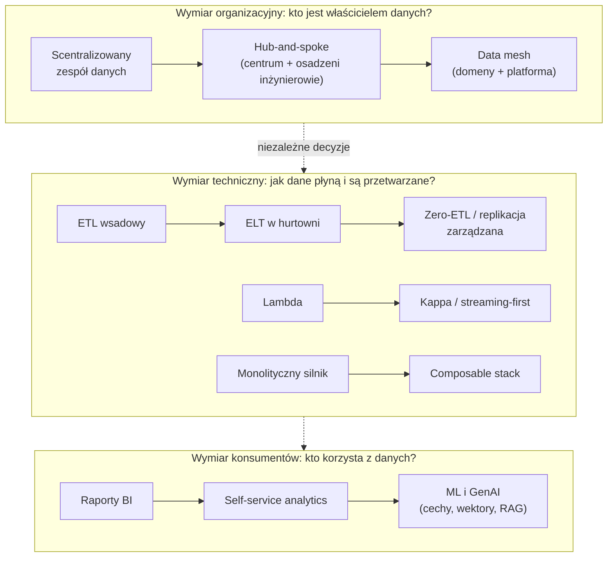
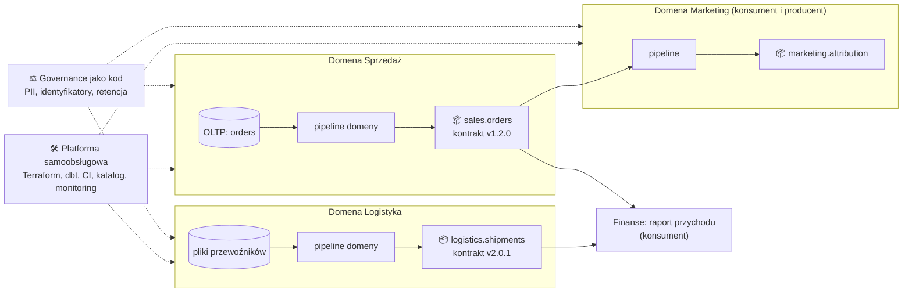
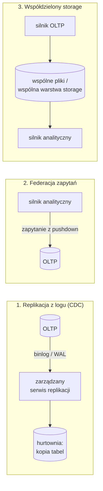

# 01.06 — Kierunki organizacyjne i nowe trendy

> **Czas:** ~90 min · **Wymaga:** [Lekcja 01.05 — Era lakehouse](05-era-lakehouse.md) · **Ostatnia weryfikacja:** 2026-11-07

**W tej lekcji:**

- odróżnisz trendy **organizacyjne** (data mesh) od **technicznych** (zero-ETL, streaming-first, composable stack) i **marketingowych** (część tego, co sprzedaje się jako „data fabric”),
- zrozumiesz, co technicznie musi istnieć, żeby data mesh działał, i dlaczego bez tego zostaje tylko zmiana nazw zespołów,
- zajrzysz pod maskę „zero-ETL” i zobaczysz, że to nadal ETL, tylko wykonywany i rozliczany przez dostawcę,
- porównasz architektury Lambda i Kappa oraz ocenisz, kiedy streaming-first ma sens,
- poznasz komponenty *composable data stack* (Arrow, Substrait, Velox, DataFusion) i wymagania „danych dla AI”,
- sprawdzisz na danych NovaCart, jak działa kontrakt produktu danych, i zobaczysz, że naiwna reguła jakości myli Black Friday z awarią.

---

## 1. Problem

Jest 2026 rok. NovaCart działa w sześciu krajach, a centralny zespół danych liczy 8 osób. W backlogu czeka 40 zgłoszeń, a średni czas od prośby do gotowej tabeli wynosi trzy tygodnie. Zespół marketingu nie czeka: analityk sam zbudował w arkuszu i skryptach Pythona „własną” atrybucję kampanii, która w listopadzie pokazała 18% więcej przychodu niż raport finansowy. Nikt nie wie, która liczba jest prawdziwa, bo w każdej inaczej liczy się anulowane zamówienia i zwroty.

W tym samym czasie do CTO dzwonią dostawcy. Jeden obiecuje, że *data fabric* „automatycznie połączy wszystkie źródła dzięki AI”. Drugi, że dzięki *zero-ETL* „pipeline'y przestaną być potrzebne”. Konsultant poleca *data mesh*, a zespół ML chce bazy wektorowej, bo „bez tego nie zrobimy asystenta zakupowego”.

Każdy z tych pomysłów ma racjonalne jądro i każdy, wdrożony bez zrozumienia, może pogorszyć sytuację. Ta lekcja daje Ci narzędzia, żeby ocenić, co rozwiązuje który trend, jakie ma warunki wstępne i ile kosztuje.

## 2. Intuicja

> [!TIP]
> **Intuicja.** Pomyśl o rozwoju miasta. Na początku jedna firma komunalna buduje wszystko: drogi, wodociągi, budynki. Gdy miasto rośnie, staje się wąskim gardłem. Rozwiązaniem nie jest pozwolenie każdemu na budowanie, jak chce, bo powstałby chaos niekompatybilnych gniazdek i rur. Rozwiązanie to **dzielnice budujące samodzielnie**, ale według **wspólnego prawa budowlanego** (standardy), na **wspólnej infrastrukturze** (sieć wodociągowa, energetyczna) i z **urzędem**, który sprawdza zgodność automatycznie, a nie ręcznie każdy projekt.

To jest data mesh w jednym akapicie: domeny (dzielnice) budują i utrzymują produkty danych, platforma (infrastruktura miejska) daje im narzędzia samoobsługowe, a federacyjne governance (prawo budowlane egzekwowane automatycznie) pilnuje interoperacyjności.

Analogia ma granice. Miasto ma ustawy i sądy, a firma ma tylko budżety i priorytety. Dzielnica, która nie ma budowlańców (domena bez inżynierów danych), nic nie zbuduje, niezależnie od tego, jak dobre jest prawo. Większość nieudanych wdrożeń data mesh rozbija się właśnie o ten punkt.

Pozostałe trendy też mają proste intuicje:

| Trend | Intuicja |
|---|---|
| *Data fabric* | Inteligentna mapa miasta: wie, gdzie co jest, i podpowiada drogę. Nie buduje dróg. |
| *Zero-ETL* | Rura zamontowana przez dostawcę wody zamiast własnej. Woda nadal płynie, tylko nie widzisz rury i płacisz w rachunku. |
| *Streaming-first* | Wodociąg zamiast beczkowozu raz dziennie. Świetny, gdy potrzebujesz wody w każdej chwili; drogi, jeśli pijesz raz dziennie. |
| *Composable data stack* | Standardowe gniazdka i wtyczki: możesz wymienić czajnik bez zmiany instalacji. |
| Dane dla AI | Nowy typ odbiorcy, który zamiast tabel potrzebuje kontekstu, czyli tekstów, wektorów i cech liczonych w punkcie czasu. |

## 3. Koncepcja

### 3.1. Pojęcia

| Pojęcie | Znaczenie |
|---|---|
| *data mesh* | Podejście socjotechniczne (Zhamak Dehghani, 2019): odpowiedzialność za dane analityczne przechodzi do domen biznesowych, które publikują je jako produkty, korzystając z samoobsługowej platformy i federacyjnego governance. |
| *data product* (produkt danych) | Jednostka publikacji w mesh: dane + kod, który je tworzy + metadane + kontrakt + SLO + właściciel. Ma konsumentów i jest rozwijany jak produkt. |
| *data contract* (kontrakt danych) | Maszynowo sprawdzalna umowa między producentem a konsumentami: schemat, semantyka, reguły jakości, SLO świeżości, właściciel, wersjonowanie. |
| *federated computational governance* | Wspólne reguły (np. format identyfikatorów, klasyfikacja PII) ustalane przez przedstawicieli domen i platformy, egzekwowane automatycznie przez platformę (*policy as code*). |
| *data fabric* | Wizja (promowana głównie przez Gartnera) architektury opartej na „aktywnych metadanych”: katalog, lineage, grafy wiedzy i automatyzacja integracji. Podejście technologiczne, a nie organizacyjne. |
| *zero-ETL* | Termin marketingowy dla zarządzanej integracji danych między bazą operacyjną a analityczną (replikacja z logu, federacja zapytań albo współdzielony storage), bez pipeline'u utrzymywanego przez klienta. |
| *Lambda architecture* | Równoległe warstwy: wsadowa (dokładna, wolna) i strumieniowa (przybliżona, szybka), scalane w warstwie serwującej (Nathan Marz, 2011). |
| *Kappa architecture* | Jedna ścieżka strumieniowa nad trwałym, odtwarzalnym logiem. Przeliczenie historii = ponowne odtworzenie logu (Jay Kreps, 2014). |
| *composable data stack* | System danych złożony z wymiennych komponentów połączonych otwartymi standardami: format w pamięci (Arrow), plan zapytania (Substrait), silnik wykonawczy (Velox, DataFusion), format tabel (Iceberg/Delta). |
| *embedding* (osadzenie wektorowe) | Wektor liczb (np. 768 wymiarów) reprezentujący znaczenie tekstu lub obrazu; podobne znaczenia → bliskie wektory. |
| *RAG* (*retrieval-augmented generation*) | Wzorzec, w którym model językowy dostaje w zapytaniu fragmenty dokumentów wyszukane dla danego pytania. Jakość odpowiedzi zależy od jakości i aktualności danych. |
| *feature store* | System przechowujący cechy (*features*) dla modeli ML: wersja offline do treningu (*point-in-time correct*) i online do serwowania z niskim opóźnieniem. |

### 3.2. Jak to działa — widok z lotu ptaka



*Rysunek 06.1. Trzy niezależne osie zmian. Najczęstszy błąd to mylenie osi: data mesh nie wymaga streamingu, zero-ETL nie rozwiązuje problemu własności danych, a baza wektorowa nie poprawi jakości dokumentów.*

## 4. 🔍 Pod maską

### 4.1. Data mesh: cztery zasady i to, co musi istnieć technicznie

Zhamak Dehghani (wtedy w Thoughtworks) opisała data mesh w artykule *How to Move Beyond a Monolithic Data Lake to a Distributed Data Mesh* (martinfowler.com, maj 2019), rozwinęła w *Data Mesh Principles and Logical Architecture* (grudzień 2020) i w książce *Data Mesh* (O'Reilly, 2022). Diagnoza była trafna: scentralizowany zespół danych jest wąskim gardłem, bo musi rozumieć semantykę wszystkich domen, a jednocześnie nie ma wpływu na systemy źródłowe, które psują mu dane.

Cztery zasady i ich techniczne „warunki konieczne”:

| Zasada | Co oznacza | Co musi istnieć technicznie | NovaCart: przykład |
|---|---|---|---|
| **1. Domain ownership** | Domena, która tworzy dane w systemie operacyjnym, odpowiada też za ich wersję analityczną | Izolacja zasobów per domena (projekty, datasety, budżety), CI/CD per domena, on-call per domena | Domena Sprzedaż utrzymuje `sales.orders`, Logistyka `logistics.shipments` |
| **2. Data as a product** | Dane mają właściciela, konsumentów, dokumentację, SLO i wersjonowanie | Kontrakty danych sprawdzane automatycznie, katalog z opisem i właścicielem, metryki użycia, wersjonowanie schematów (semver) | `sales.orders` v1.2.0 ze SLO „dane za dzień D do 06:00 UTC” |
| **3. Self-serve data platform** | Zespół platformy daje domenom narzędzia, żeby nie budowały infrastruktury od zera | Szablony (Terraform, dbt/Dataform), zarządzany storage i compute, monitoring, katalog, CI. Nowy produkt danych ma powstawać w godziny, a nie tygodnie | `novacart-platform`: moduł Terraform „produkt danych” tworzy dataset, konta serwisowe, budżet, alerty |
| **4. Federated computational governance** | Wspólne zasady ustalane federacyjnie, egzekwowane automatycznie | *Policy as code* (tagi PII → maskowanie, retencja), globalne identyfikatory (`customer_id`), wspólne typy (waluta, czas UTC), lineage | Kolumny z tagiem `pii` automatycznie maskowane dla ról spoza domeny |



*Rysunek 06.2. Data mesh w NovaCart. Zwróć uwagę, że produkty danych łączą się przez kontrakty, a nie przez wspólne tabele pośrednie. Platforma i governance obejmują wszystkie domeny.*

Dlaczego wdrożenia się nie udają? Najczęstsze przyczyny w kolejności częstości:

1. **Domeny bez kompetencji.** Domena Logistyka ma programistów systemu magazynowego, ale nikogo, kto zna modelowanie wymiarowe i Sparka. Produkt danych powstaje źle albo wcale.
2. **Brak platformy.** Każda domena buduje własny stos, więc koszty rosną N razy, a standardy się rozjeżdżają. To „rozproszony monolit” bez zalet centralizacji.
3. **Governance tylko na papierze.** Zasady są w Confluence, ale nic ich nie egzekwuje. Po roku `customer_id` ma trzy formaty.
4. **Za mała skala.** Mesh rozwiązuje problem koordynacji wielu zespołów. Przy 1–2 zespołach danych narzut (kontrakty, wersjonowanie, platforma) przewyższa zysk.

> [!NOTE]
> **Pod maską — dla dociekliwych.** Data mesh to w dużej mierze zastosowanie **prawa Conwaya** (Melvin Conway, 1968: „organizacje projektują systemy, które odwzorowują ich strukturę komunikacji”) i **Domain-Driven Design** (Eric Evans, 2003) do danych analitycznych. Te same idee doprowadziły wcześniej do mikroserwisów. Mesh dziedziczy też ich problemy: koszt integracji, trudność zmian przekrojowych i potrzebę silnej platformy. Książka *Team Topologies* (Skelton, Pais, 2019) daje słownik do opisu takich organizacji, do którego wrócimy w lekcji 01.08.

> [!IMPORTANT]
> **Co z tego wynika w praktyce:** zanim zaproponujesz data mesh, policz zespoły i sprawdź dwie rzeczy. Czy masz w domenach ludzi, którzy potrafią utrzymać produkt danych? Czy masz (lub zbudujesz) platformę, na której nowy produkt powstaje w godziny? Jeśli którakolwiek odpowiedź brzmi „nie”, zacznij od modelu *hub-and-spoke*: centralna platforma + inżynierowie danych osadzeni w domenach + kontrakty danych. To daje większość korzyści przy ułamku ryzyka.

### 4.2. Kontrakty danych: jedyny element mesh, który opłaca się zawsze

Niezależnie od modelu organizacyjnego kontrakt danych rozwiązuje najczęstszy problem: producent zmienia dane, a konsument dowiaduje się o tym z zepsutego raportu. Kontrakt przenosi to wykrycie **przed publikację**.

Typowy kontrakt zawiera:

```text
┌──────────────────────────────────────────────────────────────────────┐
│ Produkt: sales.orders   wersja: 1.2.0   właściciel: domena Sprzedaż │
├──────────────────────────────────────────────────────────────────────┤
│ Schemat        kolumny, typy, NULL-owalność, klucze                 │ ← łamiąca zmiana = nowa wersja MAJOR
│ Semantyka      „total_amount = subtotal − discount + shipping”      │
│                „created_at w UTC”, „waluta wg kraju klienta”        │
│ Jakość         unikalność, dozwolone wartości, reguły między tab.   │
│ SLO            świeżość ≤ 8 h, partycja D gotowa do 06:00 UTC D+1   │
│ Wolumen        oczekiwany zakres + znane wydarzenia (Black Friday)  │
│ Bezpieczeństwo klasyfikacja PII, kto może czytać                    │
│ Konsumenci     finanse (raport przychodów), marketing (atrybucja)  │
└──────────────────────────────────────────────────────────────────────┘
```

*Rysunek 06.3. Anatomia kontraktu danych. Każda sekcja musi być sprawdzalna automatycznie. Opis, którego nie da się zweryfikować, jest dokumentacją, a nie kontraktem.*

Istnieją otwarte standardy zapisu kontraktów, z których najpopularniejszy to **Open Data Contract Standard (ODCS)** rozwijany przez projekt Bitol pod parasolem Linux Foundation AI & Data (wersja 3.x). Narzędzia takie jak Data Contract CLI, Great Expectations, Soda czy testy dbt potrafią sprawdzać części kontraktu. Szczegóły i wdrożenie w potoku CI omawiamy w module 29.

Kluczowa decyzja to **gdzie** sprawdzać kontrakt:

| Miejsce | Zaleta | Wada |
|---|---|---|
| W CI producenta (przed wdrożeniem zmiany kodu) | Łamiąca zmiana schematu nie trafia na produkcję | Nie wykryje problemów w danych (tylko w kodzie) |
| Przed publikacją partycji (*write-audit-publish*) | Konsumenci nigdy nie widzą złych danych | Opóźnia publikację; wymaga mechanizmu „staging → publish” (np. gałęzie w Nessie, *swap* tabel, snapshoty table formatu) |
| Po publikacji (monitoring) | Prosty, nic nie blokuje | Konsumenci mogą już użyć złych danych |

> [!IMPORTANT]
> **Co z tego wynika w praktyce:** zacznij od kontraktów dla 3–5 najważniejszych produktów danych (w NovaCart: zamówienia, płatności, klienci), sprawdzanych **przed publikacją**. Reguły wolumenowe muszą znać kalendarz biznesowy, inaczej zespół szybko nauczy się ignorować alarmy (patrz sekcja 5).

### 4.3. Data fabric: wizja metadanych, nie produkt

*Data fabric* to termin, który przez lata promował głównie Gartner, a za nim producenci narzędzi integracyjnych i katalogowych (Informatica, IBM, Talend, Denodo). Rdzeń idei: zamiast ręcznie budować każdą integrację, wykorzystać **aktywne metadane** (katalog, lineage, statystyki użycia, klasyfikacje, graf wiedzy o tym, co z czym się łączy), żeby automatyzować odkrywanie danych, rekomendować złączenia, egzekwować polityki i w części przypadków odpytywać dane w miejscu przez wirtualizację.

Porównanie z mesh:

| | Data mesh | Data fabric |
|---|---|---|
| Natura | Socjotechniczna (organizacja + platforma) | Technologiczna (metadane + automatyzacja) |
| Odpowiedź na problem skali | Decentralizacja własności | Automatyzacja integracji |
| Kluczowe artefakty | Produkty danych, kontrakty, domeny | Katalog, graf wiedzy, wirtualizacja, polityki |
| Ryzyko | Domeny bez kompetencji, koszty N platform | Kupno „magicznego” produktu, który nie rozwiązuje problemu własności |
| Czy się wykluczają? | Nie: dobra platforma mesh zawiera elementy fabric (katalog, lineage, polityki) | |

W GCP najbliżej tej wizji jest **Dataplex Universal Catalog** (katalog, lineage, profilowanie, jakość danych, tagi polityk). W Azure **Microsoft Purview** i katalog **OneLake** w Fabric (sama nazwa „Fabric” to produkt, a nie implementacja wizji Gartnera). W AWS **Amazon DataZone / SageMaker Catalog** i **Glue Data Catalog** z Lake Formation.

> [!IMPORTANT]
> **Co z tego wynika w praktyce:** traktuj „data fabric” jako listę kontrolną możliwości metadanych (katalog, lineage, klasyfikacja, polityki, profilowanie), a nie jako produkt do kupienia. Żadne narzędzie nie zdecyduje za Ciebie, kto jest właścicielem `orders` ani która definicja przychodu jest prawdziwa.

### 4.4. Zero-ETL pod maską: nadal ETL, tylko cudzy

„Zero-ETL” to obietnica, że dane z bazy operacyjnej są dostępne do analizy bez budowania pipeline'u. Pod maską kryje się jeden z trzech mechanizmów:



*Rysunek 06.4. Trzy mechanizmy zero-ETL. Tylko trzeci rzeczywiście nie kopiuje danych. Pierwszy to klasyczne CDC (moduł 26) wykonywane przez dostawcę, a drugi obciąża bazę operacyjną zapytaniami analitycznymi.*

| Mechanizm | Przykłady | Opóźnienie | Obciążenie źródła | Ograniczenia |
|---|---|---|---|---|
| Replikacja z logu | AWS: Aurora MySQL → Redshift (zapowiedź re:Invent 2022, GA listopad 2023), później Aurora PostgreSQL, RDS, DynamoDB; GCP: **Datastream for BigQuery** (Cloud SQL, AlloyDB, Oracle, MySQL, PostgreSQL, SQL Server → BigQuery); Azure: **Fabric mirroring** (Azure SQL, Cosmos DB, Snowflake i inne) | sekundy do minut | niskie (czytanie logu) | Brak transformacji (kopiujesz model OLTP), limity typów i DDL, koszty replikacji i storage'u po stronie hurtowni |
| Federacja zapytań | BigQuery `EXTERNAL_QUERY` do Cloud SQL/AlloyDB, zapytania federacyjne do Spannera (z **Data Boost**, czyli izolowanym compute po stronie Spannera); Redshift federated query; Trino | zero (dane „na żywo”) | **wysokie**, chyba że jest izolowany compute (Data Boost) | Wydajność ograniczona przez źródło, ryzyko spowolnienia produkcji |
| Współdzielony storage / zero-copy | Snowflake ↔ Salesforce Data Cloud (*zero-copy data sharing*), tabele Iceberg czytane przez wiele silników, Fabric OneLake shortcuts | zero lub bliskie zeru | brak (osobne compute) | Wymaga wspólnego formatu i katalogu; uprawnienia w dwóch systemach |

> [!NOTE]
> **Pod maską — dla dociekliwych.** AWS podaje dla integracji Aurora MySQL → Redshift opóźnienie rzędu sekund (p50 poniżej 15 s) i brak dodatkowej opłaty za samą integrację. Płacisz jednak za zasoby Aurory i Redshifta, które przetwarzają zmiany. To typowy wzorzec: „zero-ETL” rzadko oznacza „zero kosztów”, częściej „koszt ukryty w innych pozycjach rachunku”.

Czego zero-ETL **nie** robi: nie modeluje danych (dostajesz tabele w kształcie OLTP, z kolumną `status` zmieniającą się w czasie zamiast historii zdarzeń), nie łączy źródeł, nie czyści, nie odpowiada na pytanie „co to jest przychód”. Transformacje (moduł 28) są nadal potrzebne. Zmienia się tylko pierwszy krok: *extract & load* przejmuje dostawca.

> [!IMPORTANT]
> **Co z tego wynika w praktyce:** zero-ETL jest świetnym zamiennikiem **własnoręcznie pisanego** kroku *extract & load* z baz operacyjnych. Przed wdrożeniem sprawdź trzy rzeczy: obsługiwane typy i zmiany DDL, zachowanie przy dużych transakcjach (np. masowy `UPDATE`) i pełny koszt (replikacja + storage + compute po stronie celu). Nie traktuj go jako uzasadnienia do pominięcia warstwy modelowania.

### 4.5. Lambda, Kappa i streaming-first

**Lambda** (Nathan Marz, *How to beat the CAP theorem*, 2011; rozwinięte w książce *Big Data*, Manning 2015) powstała w czasach, gdy systemy strumieniowe (Storm) dawały szybkie, ale przybliżone wyniki, a Hadoop dokładne, ale z opóźnieniem dób. Rozwiązanie: oba naraz.

**Kappa** (Jay Kreps, *Questioning the Lambda Architecture*, O'Reilly Radar, lipiec 2014) zauważyła, że największym kosztem Lambdy jest utrzymywanie **dwóch implementacji tej samej logiki**, które rozjeżdżają się przy każdej zmianie. Skoro Kafka przechowuje log trwale, przeliczenie historii to po prostu ponowne odtworzenie logu przez nową wersję tego samego jobu strumieniowego.

```text
LAMBDA                                              KAPPA
──────                                              ─────
            ┌──► warstwa batch (Hadoop/Spark) ──┐               ┌──────────────────────────┐
zdarzenia ──┤    dokładnie, co 24 h             ├─► serving     │ log (Kafka / Pub/Sub     │
            └──► warstwa speed (Storm/Flink) ───┘   (scalanie)  │ z retencją / tabela)     │
                 przybliżenie, sekundy                          └──────┬───────────────────┘
                                                                       │ job v1 ─► tabela_v1
  2 bazy kodu, 2 zestawy błędów,                                       │ job v2 (replay od 0) ─► tabela_v2
  ręczne scalanie wyników                                              ▼ przełączenie konsumentów
```

*Rysunek 06.5. Lambda i Kappa. Lambda płaci dwiema implementacjami za odporność na błędy streamingu. Kappa płaci koniecznością przechowywania i odtwarzania całej historii.*

Dzisiejsze „streaming-first” jest możliwe, bo trzy problemy, które uzasadniały Lambdę, zostały rozwiązane: silniki strumieniowe dają *exactly-once* (efektywnie) i obsługę czasu zdarzeń (*The Dataflow Model*, VLDB 2015, wrócimy do niego w modułach 21 i 23), log może być tani i długi (tiered storage w Kafce, tabele Iceberg/Delta jako źródło), a ten sam kod może działać wsadowo i strumieniowo (Apache Beam, Spark Structured Streaming, Flink).

Na GCP typowa ścieżka streaming-first to Pub/Sub → Dataflow → BigQuery (Storage Write API), a coraz częściej też **BigQuery continuous queries** i ciągłe przetwarzanie w samym silniku. Odpowiedniki: Snowflake *Dynamic Tables* i Snowpipe Streaming, Databricks *Lakeflow Declarative Pipelines* (dawniej Delta Live Tables), AWS Kinesis/MSK + Flink, Azure Event Hubs + Fabric Real-Time Intelligence.

Kiedy **nie** iść w streaming-first? Gdy konsumenci patrzą na dane raz dziennie. W NovaCart raport finansowy, rozliczenia ze sprzedawcami i większość dashboardów marketingowych nie zyskuje nic na sekundowej świeżości, a płaci za stale działające zasoby i trudniejsze debugowanie. Streaming ma sens dla wykrywania oszustw płatniczych, stanów magazynowych, personalizacji w sesji i monitoringu (np. anomalii `clickstream_android_drop`, którą lepiej wykryć w 10 minut niż następnego dnia).

> [!IMPORTANT]
> **Co z tego wynika w praktyce:** decyzję o streamingu podejmuj **per przypadek użycia**, na podstawie wymaganej świeżości i kosztu opóźnienia, a nie dla całej platformy. Unikaj Lambdy z dwiema bazami kodu. Jeśli potrzebujesz obu trybów, użyj frameworka z jednym modelem programowania (Beam, Spark) albo traktuj tabelę z table formatem jako log i odtwarzaj z niej.

### 4.6. Composable data stack: rozbieranie bazy danych na części

Przez dekady baza danych była monolitem: parser, optymalizator, silnik wykonawczy, format w pamięci i storage od jednego dostawcy, nierozłączne. Od ok. 2016 r. trwa rozbieranie jej na wymienne komponenty połączone otwartymi standardami:

```text
  warstwa                  standard / komponent                         kto używa (przykłady)
  ───────────────────────  ───────────────────────────────────────────  ──────────────────────────────
  język / API              SQL (dialekty), DataFrame (pandas, Polars)   wszyscy
  plan zapytania (IR)      Substrait (2021)                             DuckDB, DataFusion, Velox, Ibis
  optymalizator            Apache Calcite, optymalizator DataFusion     Flink, Hive, Druid, Dremio
  silnik wykonawczy        Velox (Meta, C++), DataFusion (Rust),        Presto C++ (Prestissimo), Gluten
                           DuckDB (C++, embedded)                       (Spark), InfluxDB 3, Comet
  format w pamięci         Apache Arrow (2016)                          prawie wszyscy; BigQuery Storage
                                                                        Read API, Snowflake (wyniki),
                                                                        pandas 2+, Polars, Spark (UDF)
  transport                Arrow Flight / Flight SQL, ADBC              Dremio, InfluxDB, Snowflake (ADBC)
  format tabel             Iceberg, Delta, Hudi                         patrz lekcja 01.05
  format plików            Parquet, ORC                                 wszyscy
```

*Rysunek 06.6. Warstwy composable data stack. Zauważ, że w każdej warstwie jest jeden lub dwa dominujące standardy. To one, a nie konkretne silniki, decydują o wymienności.*

Najważniejszy komponent to **Apache Arrow**: kolumnowy format danych **w pamięci**, identyczny we wszystkich językach. Jeśli dwa systemy rozmawiają Arrow, przekazanie miliona wierszy nie wymaga serializacji: odbiorca czyta te same bufory (*zero-copy*). Przykład z życia: pobranie wyniku z BigQuery do pandas przez Storage Read API w formacie Arrow jest wielokrotnie szybsze niż przez JSON/REST.

**Velox** (Meta; paper VLDB 2022) i **DataFusion** (Apache, *top-level project* od 2024 r.) to biblioteki wykonawcze. Nie są gotowymi bazami, tylko silnikami, na których buduje się bazy. Meta użyła Velox do przyspieszenia Presto i Sparka. Projekty Gluten (dla Sparka, od 2026 r. *top-level project* ASF) i Comet podmieniają wykonanie Sparka na natywne. Manifest *The Composable Data Management System Manifesto* (Pedreira i in., VLDB 2023) przekonuje, że dalsze budowanie każdego silnika od zera jest marnotrawstwem.

> [!IMPORTANT]
> **Co z tego wynika w praktyce:** dla data engineera composable stack oznacza dwie rzeczy. Po pierwsze, **wymienność**: jeśli dane są w Parquet + Iceberg, a wymiana odbywa się w Arrow, możesz zmienić silnik (np. przetwarzać małe dane w DuckDB, a duże w BigQuery) bez migracji. Po drugie, **szybkie przejścia między narzędziami**: zawsze wybieraj ścieżki oparte na Arrow (Storage Read API, ADBC, `to_arrow()`), a nie eksport do CSV/JSON.

### 4.7. Dane dla AI: nowy konsument z nowymi wymaganiami

Modele ML i aplikacje GenAI to konsumenci danych o innych potrzebach niż raporty BI:

| Wymaganie | BI | ML (trening i serwowanie) | GenAI (RAG, agenci) |
|---|---|---|---|
| Kształt danych | Tabele, agregaty | Cechy per encja, często w punkcie czasu | Fragmenty tekstu (*chunks*), wektory, metadane |
| Poprawność czasowa | Stan „na dziś” | **Point-in-time correctness**: cecha w treningu musi mieć wartość z chwili zdarzenia, inaczej model „widzi przyszłość” (*data leakage*) | Aktualność dokumentów (np. regulamin zwrotów zmienił się z 14 na 30 dni) |
| Opóźnienie | Sekundy–minuty na zapytanie | Online: milisekundy na odczyt cech | Dziesiątki ms na wyszukiwanie wektorowe |
| Uprawnienia | Na poziomie tabel/kolumn | Na poziomie cech | **Na poziomie dokumentu i fragmentu**: asystent nie może zacytować dokumentu, którego użytkownik nie może czytać |
| Jakość | Sumy się zgadzają | Rozkłady stabilne (*drift*) | Brak duplikatów, sprzecznych wersji, śmieci z OCR |

Infrastruktura wektorowa trafiła do głównych platform: BigQuery (`VECTOR_SEARCH`, indeksy wektorowe, generowanie embeddingów przez modele Vertex AI z poziomu SQL), AlloyDB i Cloud SQL (`pgvector`, w AlloyDB także indeks ScaNN), Snowflake Cortex Search, Databricks Vector Search, Azure AI Search, Amazon OpenSearch i S3 Vectors. Feature store'y (pionierem był Michelangelo w Uberze, 2017; open source **Feast**, 2019) są dostępne jako Vertex AI Feature Store, Databricks Feature Store / Feature Engineering w Unity Catalog, SageMaker Feature Store.

Generator NovaCart zawiera komponent `documents` z regulaminami w kilku wersjach, w tym `zwroty-v1` (14 dni) i `zwroty-v2` (30 dni). To celowo przygotowany problem dla modułu 42: system RAG, który nie rozumie wersjonowania dokumentów, będzie cytował nieaktualne zasady.

> [!IMPORTANT]
> **Co z tego wynika w praktyce:** dane dla AI to przede wszystkim problem **data engineeringu**, a nie wyboru bazy wektorowej. Jakość odpowiedzi asystenta zależy od tego, czy dokumenty są aktualne, deduplikowane, wersjonowane i mają uprawnienia, a jakość modelu od point-in-time correctness cech. Dla małych zbiorów (tysiące–setki tysięcy dokumentów) wyszukiwanie wektorowe w istniejącej bazie lub hurtowni zwykle wystarcza. Osobna baza wektorowa to decyzja na później.

### 4.8. Jak oceniać trend: pięć pytań

Zanim zarekomendujesz którykolwiek z powyższych trendów, odpowiedz na piśmie:

1. **Jaki konkretny problem rozwiązuje u nas?** Nazwij metrykę: czas dostarczenia tabeli (3 tygodnie), liczba rozbieżności w raportach, koszt pipeline'ów, opóźnienie danych.
2. **Jakie są warunki wstępne?** Ludzie (kompetencje w domenach), platforma, dojrzałość procesów (CI, testy, monitoring).
3. **Ile kosztuje wejście i utrzymanie?** Licencje, compute (np. stale działający streaming), ludzie.
4. **Czy decyzja jest odwracalna?** Zero-ETL łatwo wyłączyć. Reorganizację na domeny trudno.
5. **Co jest najmniejszym krokiem, który zweryfikuje hipotezę?** Jeden produkt danych z kontraktem, jedna integracja zero-ETL, jeden przypadek streamingowy.

> [!IMPORTANT]
> **Co z tego wynika w praktyce:** najlepsze architektury danych są „nudne” tam, gdzie mogą, i innowacyjne tam, gdzie muszą. Wybieraj trend, który rozwiązuje zmierzony problem, i wdrażaj go od najmniejszego eksperymentu.

## 5. 💻 W praktyce

Sprawdźmy, jak kontrakt danych z sekcji 4.2 działa na danych NovaCart. Plik `examples/07_data_product_contract.py` zawiera kontrakt produktu `sales.orders` zapisany w TOML (właściciel, konsumenci, schemat, reguły jakości, SLO, oczekiwany wolumen ze znanymi wydarzeniami biznesowymi) i sprawdza go zapytaniami DuckDB na danych w skali S.

Fragment kontraktu:

```python
# examples/07_data_product_contract.py (fragment)
CONTRACT = tomllib.loads("""
[product]
name        = "sales.orders"
version     = "1.2.0"
owner       = "zespół domeny Sprzedaż (sales-data@novacart.example)"
consumers   = ["finanse: raport przychodów", "marketing: atrybucja kampanii"]

[quality]
unique          = ["order_id"]
allowed_status  = ["created", "paid", "shipped", "delivered", "returned", "cancelled"]

[slo]
freshness_hours = 8          # najnowsze zamówienie nie starsze niż 8 h w chwili sprawdzenia

[volume]
max_ratio_to_7d_median = 2.0
min_ratio_to_7d_median = 0.5
[volume.known_events]
"2025-11-28" = [2.0, 4.0]   # Black Friday
"2025-12-24" = [0.3, 0.8]   # Wigilia
""")
```

Reguła spójności między tabelami produktu (pozycje muszą sumować się do nagłówka zamówienia):

```sql
-- examples/07_data_product_contract.py (zapytanie w check_quality)
WITH items AS (SELECT order_id, sum(line_amount) AS lines FROM order_items GROUP BY 1)
SELECT o.dt, count(*) FROM orders o JOIN items i USING (order_id)
WHERE o.subtotal_amount - o.discount_amount <> i.lines GROUP BY 1 ORDER BY 1
```

Uruchomienie:

```bash
cd modules/01-ewolucja-architektur-danych/examples
uv run python 07_data_product_contract.py
```

**Wynik** (skala S, seed 42):

```text
Produkt danych: sales.orders v1.2.0
Właściciel:     zespół domeny Sprzedaż (sales-data@novacart.example)
Konsumenci:     finanse: raport przychodów, marketing: atrybucja kampanii
Sprawdzenie:    2026-01-01 06:00 UTC

  ✅ schemat zgodny z kontraktem                      9 kolumn zgodnych
  ✅ unikalność order_id                              0 duplikatów
  ✅ NOT NULL                                         6 kolumn bez NULL
  ✅ dozwolone wartości status                        OK
  ✅ dozwolone wartości currency                      OK
  ✅ total = subtotal − discount + shipping           0 zamówień niezgodnych
  ❌ Σ order_items.line_amount = subtotal − discount  2025-11-30: 115 zamówień
  ✅ customer_id istnieje w customers                 0 sierot
  ✅ świeżość ≤ 8 h                                   opóźnienie 6 h 19 min
  ✅ kompletność: partycja za D-1 istnieje            najnowsza partycja 2025-12-31
  ✅ wolumen (ze znanymi wydarzeniami)                OK

Naiwna reguła wolumenowa (bez known_events) zgłosiłaby alarm dla:
     2025-11-28:  1046 zamówień, mediana 7 dni   333, ×3.14
     2025-12-01:   767 zamówień, mediana 7 dni   358, ×2.14
     2025-12-24:   194 zamówień, mediana 7 dni   400, ×0.48
     2025-12-25:   177 zamówień, mediana 7 dni   400, ×0.44
     2025-12-26:   169 zamówień, mediana 7 dni   395, ×0.43

Wynik: 10/11 reguł spełnionych → PUBLIKACJA WSTRZYMANA
```

Interpretacja:

- **Kontrakt złapał prawdziwy błąd.** 30 listopada 115 zamówień ma pozycje, które nie sumują się do nagłówka. To anomalia `order_items_price_in_minor_units` wstrzyknięta przez generator (jeden sprzedawca wysłał ceny w groszach, ×100). Zwróć uwagę, że **żadna reguła na pojedynczej tabeli by jej nie wykryła**: `orders` jest wewnętrznie spójne, a ceny w `order_items` są po prostu większe. Wykrywa ją dopiero reguła semantyczna między tabelami, czyli wiedza domeny zapisana w kontrakcie. Możesz to porównać z `_manifest.json` (anomalia z `seller_id = 24`).
- **Naiwna reguła wolumenowa dałaby 5 fałszywych alarmów na 61 dni.** Black Friday (×3,14), Cyber Monday i święta to normalny biznes, a nie awarie. Zespół, który dostaje alarm co 12 dni, przestaje na nie reagować i przegapi prawdziwy problem. Kalendarz wydarzeń w kontrakcie to wiedza, którą ma domena, a nie centralny zespół danych. To dobry argument za zasadą „data as a product” z sekcji 4.1.
- **SLO świeżości jest spełnione z małym zapasem** (6 h 19 min przy limicie 8 h). Ostatnie zamówienie wpłynęło tuż przed północą, a sprawdzenie odbyło się o 6:00. Gdyby pipeline uruchamiał się o 7:00, kontrakt byłby łamany codziennie. SLO to wymaganie wobec harmonogramu, a nie tylko wobec danych.

## 6. ⚖️ Porównanie platform

| Aspekt | GCP | AWS | Azure | Snowflake | Databricks | On-prem / OSS |
|---|---|---|---|---|---|---|
| Wsparcie data mesh (domeny, produkty, udostępnianie) | Projekty/datasety per domena, **Analytics Hub** (BigQuery sharing), Dataplex (domeny, *data products*) | Konta per domena, **DataZone / SageMaker Catalog**, Lake Formation, Redshift data sharing | Fabric: workspaces + *domains*, Purview | Konta/bazy per domena, **Secure Data Sharing**, Marketplace, Horizon | Unity Catalog (catalogs per domena), **Delta Sharing** (otwarty protokół, 2021) | Ręcznie: osobne schematy/klastry, DataHub/OpenMetadata jako katalog |
| Kontrakty i jakość | Dataplex data quality, Dataform assertions | Glue Data Quality, DataZone | Purview Data Quality | Data Metric Functions, Horizon | Lakeflow expectations, Lakehouse Monitoring | dbt tests, Great Expectations, Soda, Data Contract CLI (ODCS) |
| Zero-ETL z baz operacyjnych | Datastream for BigQuery; federacja do Cloud SQL/AlloyDB/Spanner (Data Boost) | Zero-ETL do Redshift (Aurora, RDS, DynamoDB) | Fabric mirroring | Konektory Openflow/partnerskie, Hybrid Tables (Unistore) | Lakeflow Connect, Lakebase (Postgres) | Debezium + Kafka Connect |
| Streaming-first | Pub/Sub, Dataflow, BigQuery Storage Write API, continuous queries | Kinesis, MSK, Managed Flink | Event Hubs, Fabric Real-Time Intelligence | Snowpipe Streaming, Dynamic Tables | Structured Streaming, Lakeflow Declarative Pipelines | Kafka, Flink, Spark |
| Dane dla AI | BigQuery `VECTOR_SEARCH`, AlloyDB ScaNN, Vertex AI Feature Store | OpenSearch, S3 Vectors, SageMaker Feature Store | Azure AI Search | Cortex Search, Cortex AI | Vector Search, Feature Engineering w UC | pgvector, Milvus, Qdrant, Feast |
| Model kosztowy „nowych” funkcji | Zwykle compute BigQuery/Dataflow + opłaty usług | Często „bez dodatkowej opłaty”, ale płacisz za zasoby źródła i celu | Pojemność Fabric (CU) | Kredyty (w tym serverless) | DBU (serverless lub klasyczne) | Ludzie + sprzęt |

**Wnioski:** wszystkie platformy oferują dziś podobny zestaw „trendów”, więc różnice dotyczą głównie **granic**: gdzie kończy się zarządzana integracja i zaczyna Twój kod, oraz jak łatwo dane przechodzą między platformami. Udostępnianie danych to obszar, w którym różnice są fundamentalne. Snowflake i BigQuery udostępniają dane w obrębie własnej platformy (bez kopiowania, ale konsument musi mieć konto). Delta Sharing i tabele Iceberg z REST catalog pozwalają udostępniać ponad granicami platform. Organizacyjnej części data mesh żadna platforma nie dostarczy, bo daje tylko klocki: projekty, katalog, udostępnianie, polityki.

## 7. ⚠️ Antywzorce i pułapki

| Antywzorzec | Objaw | Dlaczego tak się dzieje | Jak naprawić |
|---|---|---|---|
| „Mesh przez zmianę nazw” | Zespoły nazywają się domenami, ale dane robi nadal ten sam centralny zespół | Brak kompetencji i budżetu w domenach | Najpierw platforma + osadzeni inżynierowie danych, potem stopniowe przejmowanie własności |
| Mesh bez platformy | Każda domena ma własny stos i inny sposób wdrażania; koszty rosną | Zasada 3 pominięta jako „techniczny detal” | Platforma jest warunkiem koniecznym: szablony, CI, katalog, monitoring |
| Governance w dokumentach | Trzy formaty `customer_id`, PII w niezabezpieczonych tabelach | Brak egzekwowania automatycznego | Policy as code: tagi, polityki maskowania, testy w CI |
| Zero-ETL jako koniec modelowania | Raporty bezpośrednio na replikach tabel OLTP, logika biznesowa w każdym dashboardzie | Replikacja kopiuje model OLTP, a nie model analityczny | Replika jako warstwa *raw/bronze*, transformacje i model wymiarowy nad nią |
| Federacja do produkcyjnej bazy OLTP bez izolacji | Spowolnienie sklepu w trakcie raportowania | Zapytania analityczne konkurują o CPU i I/O z transakcjami | Replika do odczytu, izolowany compute (Data Boost) albo replikacja CDC |
| Lambda z dwiema bazami kodu | Wyniki batch i speed różnią się o kilka procent, nikt nie wie dlaczego | Dwie implementacje tej samej logiki | Jeden model programowania (Beam/Spark) lub Kappa z replayem |
| Streaming „bo nowoczesne” | Stale działające klastry dla raportów oglądanych raz dziennie | Brak analizy wymaganej świeżości | Świeżość jako wymaganie per przypadek użycia, z kosztem |
| Baza wektorowa przed jakością dokumentów | Asystent cytuje nieaktualny regulamin | Problem jest w danych, nie w wyszukiwaniu | Wersjonowanie, deduplikacja, uprawnienia i świeżość dokumentów przed wyborem bazy |
| Reguły jakości bez kalendarza biznesowego | Alarmy w każde święto i Black Friday, zespół je ignoruje | Statystyka nie zna biznesu | Znane wydarzenia w kontrakcie (sekcja 5) albo modele sezonowe |

> [!WARNING]
> **Pułapka.** Najdroższy błąd w tej lekcji to reorganizacja firmy na data mesh jako pierwszy krok. Reorganizacja jest trudna do odwrócenia, a jej efekty widać po 12–24 miesiącach. Jeśli w tym czasie nie powstanie platforma i kompetencje w domenach, firma kończy z gorszą jakością danych niż przed zmianą i z kosztownym powrotem do centralizacji. Kolejność, która działa: kontrakty dla kluczowych produktów → platforma samoobsługowa → pilotaż jednej dojrzałej domeny → stopniowe rozszerzanie.

## 8. 💰 Koszty

| Trend | Gdzie powstają koszty | Na co uważać |
|---|---|---|
| Data mesh | Ludzie w domenach, zespół platformy, duplikacja compute między domenami | Koszty platformy rosną z liczbą domen. Budżety i etykiety per domena są konieczne, żeby wiedzieć, kto ile wydaje (moduł 39) |
| Zero-ETL | Replikacja (compute źródła i celu), storage repliki, czasem opłaty za usługę | „Bez dodatkowej opłaty” zwykle oznacza opłaty w innych pozycjach. Duże transakcje w źródle mogą wywołać skoki kosztów |
| Streaming-first | Stale działające workery, minimalne rozmiary klastrów | Job Dataflow z 2 workerami działający 24/7 to ~1460 worker-godzin miesięcznie, nawet gdy ruch jest bliski zeru w nocy |
| Composable stack | Zwykle oszczędności (np. DuckDB zamiast klastra dla małych danych) | Koszt integracji i utrzymania wielu komponentów |
| Dane dla AI | Generowanie embeddingów (wywołania modeli), indeksy wektorowe, feature store online | Ponowne generowanie embeddingów po zmianie modelu = przeliczenie całego korpusu |

> [!CAUTION]
> **Koszt!** Federacyjne zapytania z hurtowni do produkcyjnej bazy operacyjnej mogą kosztować więcej niż rachunek: spowolnienie sklepu w Black Friday to utracona sprzedaż. Zanim włączysz federację do bazy OLTP, sprawdź, czy zapytanie trafi do repliki albo do izolowanego compute.

## 9. Podsumowanie

- Trendy dzielą się na organizacyjne (data mesh), techniczne (zero-ETL, streaming-first, composable stack) i wizje metadanych (data fabric). Mylenie tych osi to najczęstszy błąd w dyskusjach architektonicznych.
- Data mesh rozwiązuje problem skali organizacji, a nie technologii. Wymaga kompetencji w domenach, platformy samoobsługowej i governance egzekwowanego automatycznie. Bez nich kończy się „rozproszonym monolitem”.
- Kontrakty danych opłacają się niezależnie od modelu organizacyjnego. Na danych NovaCart kontrakt wykrył anomalię cen w groszach, której nie złapałaby żadna reguła na pojedynczej tabeli.
- Zero-ETL to nadal integracja danych: replikacja z logu, federacja albo współdzielony storage. Upraszcza extract & load, ale nie zastępuje modelowania ani transformacji.
- Kappa i jeden model programowania wyparły Lambdę, ale streaming wybiera się per przypadek użycia, na podstawie wymaganej świeżości i kosztu.
- Composable stack (Arrow, Substrait, Velox, DataFusion, Iceberg) zwiększa wymienność silników. Dane dla AI to przede wszystkim problem jakości, wersjonowania i uprawnień danych, a nie wyboru bazy wektorowej.

## 🧠 Sprawdź się

<details>
<summary><b>Firma z jednym, 6-osobowym zespołem danych chce wdrożyć data mesh, „bo backlog rośnie”. Co doradzisz?</b></summary>

Data mesh rozwiązuje problem koordynacji wielu zespołów i domen. Przy jednym zespole narzut (platforma, kontrakty, wersjonowanie produktów) przewyższy zysk, a domeny prawdopodobnie nie mają ludzi do utrzymania produktów danych. Lepiej: zmierzyć, skąd bierze się backlog, wprowadzić kontrakty dla kluczowych produktów, zautomatyzować powtarzalną pracę (szablony, samoobsługa dla analityków, np. dbt/Dataform) i ewentualnie osadzić jednego inżyniera w najbardziej wymagającej domenie (hub-and-spoke).

</details>

<details>
<summary><b>Dostawca twierdzi, że dzięki zero-ETL „nie będziesz już potrzebować pipeline'ów”. Jakie trzy pytania zadasz?</b></summary>

(1) Jaki mechanizm jest pod spodem: replikacja z logu, federacja czy współdzielony storage, i jakie jest opóźnienie oraz obciążenie źródła? (2) Co się dzieje przy zmianach DDL, nieobsługiwanych typach i dużych transakcjach? (3) Jaki jest pełny koszt: replikacja, storage i compute po stronie celu? Do tego uwaga, że zero-ETL kopiuje model OLTP, więc transformacje i modelowanie nadal są potrzebne.

</details>

<details>
<summary><b>Dlaczego reguła „liczba zamówień dziennie w zakresie 0,5–2× mediany z 7 dni” jest zła dla NovaCart i jak ją poprawić?</b></summary>

Bo biznes NovaCart ma przewidywalne odchylenia: Black Friday ×3,14, Cyber Monday ×2,14, święta ×0,43–0,48. Na 61 dniach danych reguła dała 5 fałszywych alarmów, więc zespół szybko zacznie je ignorować. Poprawka: kalendarz znanych wydarzeń z osobnymi zakresami (w kontrakcie, utrzymywany przez domenę) albo model sezonowy (np. porównanie z tym samym dniem tygodnia i rokiem wcześniej, prognoza).

</details>

<details>
<summary><b>Kiedy architektura Lambda nadal może mieć sens?</b></summary>

Gdy system strumieniowy ze swojej natury daje wyniki przybliżone lub niekompletne (np. szkice probabilistyczne typu HyperLogLog dla unikalnych użytkowników w czasie rzeczywistym, dane uzupełniane z opóźnieniem przez partnerów), a jednocześnie biznes potrzebuje zarówno szybkiego przybliżenia, jak i dokładnego rozliczenia. Nawet wtedy warto mieć jedną bazę kodu (Beam/Spark) uruchamianą w dwóch trybach, a nie dwie implementacje.

</details>

## 📚 Źródła

1. Z. Dehghani, „How to Move Beyond a Monolithic Data Lake to a Distributed Data Mesh”, martinfowler.com, maj 2019: <https://martinfowler.com/articles/data-monolith-to-mesh.html>
2. Z. Dehghani, „Data Mesh Principles and Logical Architecture”, martinfowler.com, grudzień 2020: <https://martinfowler.com/articles/data-mesh-principles.html>
3. Z. Dehghani, *Data Mesh: Delivering Data-Driven Value at Scale*, O'Reilly, 2022.
4. N. Marz, „How to beat the CAP theorem”, blog, październik 2011; N. Marz, J. Warren, *Big Data*, Manning, 2015.
5. J. Kreps, „Questioning the Lambda Architecture”, O'Reilly Radar, lipiec 2014.
6. T. Akidau i in., „The Dataflow Model”, PVLDB 8(12), 2015.
7. P. Pedreira i in., „Velox: Meta's Unified Execution Engine”, PVLDB 15(12), 2022.
8. P. Pedreira i in., „The Composable Data Management System Manifesto”, PVLDB 16(10), 2023.
9. Apache Arrow: <https://arrow.apache.org/>; Substrait: <https://substrait.io/>; Apache DataFusion: <https://datafusion.apache.org/>
10. Bitol, Open Data Contract Standard (ODCS) v3: <https://github.com/bitol-io/open-data-contract-standard>
11. AWS, „Amazon Aurora MySQL zero-ETL integration with Amazon Redshift is now generally available”, AWS News Blog, listopad 2023: <https://aws.amazon.com/blogs/aws/amazon-aurora-mysql-zero-etl-integration-with-amazon-redshift-is-now-generally-available/>
12. Google Cloud, dokumentacja Datastream for BigQuery: <https://cloud.google.com/datastream/docs>
13. Google Cloud, „Spanner federated queries” i „Data Boost overview”: <https://cloud.google.com/spanner/docs/databoost/databoost-overview>
14. M. Conway, „How Do Committees Invent?”, Datamation, 1968.
15. M. Skelton, M. Pais, *Team Topologies*, IT Revolution, 2019.

---

<sub>← [01.05 — Era lakehouse](05-era-lakehouse.md) · [Moduł 01](README.md) · [01.07 — Architektury równoległego przetwarzania](07-architektury-rownoleglego-przetwarzania.md) →</sub>
