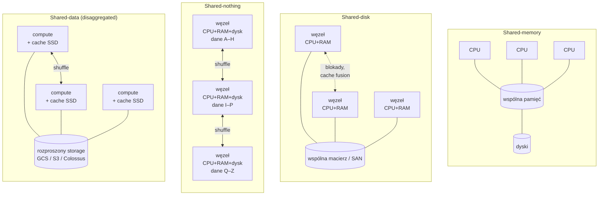

# 01.07 — Architektury równoległego przetwarzania

> **Czas:** ~75 min · **Wymaga:** [Lekcja 01.02 — Era hurtowni danych](02-era-hurtowni-danych.md), [Lekcja 01.04 — Era cloud data warehouse](04-era-cloud-data-warehouse.md) · **Ostatnia weryfikacja:** 2026-11-07

**W tej lekcji:**

- poznasz cztery architektury równoległego przetwarzania danych: *shared-memory*, *shared-disk*, *shared-nothing* i *shared-data* (*disaggregated storage*),
- dla każdej zobaczysz, gdzie leży jej wąskie gardło i dlaczego właśnie tam,
- policzysz na prostym modelu, jak skaluje się każda z nich, ile danych trzeba przenieść przy dodaniu węzła i dlaczego możliwość „wyłączenia” compute zmienia rachunek,
- nauczysz się rozpoznawać te same idee w produktach z różnych epok: Oracle RAC, Teradata, Hadoop, Snowflake, BigQuery, Aurora, AlloyDB,
- zrozumiesz, dlaczego **sieć** zdecydowała o zwycięstwie shared-data w chmurze.

---

## 1. Problem

Rok 2015. NovaCart ma analityczną kopię bazy PostgreSQL na jednym serwerze: 32 rdzenie, 512 GB RAM, macierz SSD. Raport „sprzedaż wg kategorii i kraju za ostatnie 90 dni” trwa 40 minut, a w grudniu, gdy danych przybywa najszybciej, przestaje się mieścić w nocnym oknie. Zespół ma na stole cztery propozycje:

1. **Większy serwer:** 128 rdzeni, 4 TB RAM. Wydajność wzrośnie, ale ile razy i co potem?
2. **Klaster z bazą na wspólnej macierzy** (jak Oracle RAC): wiele serwerów, jedna kopia danych na SAN.
3. **Hurtownia MPP** (jak Greenplum albo Teradata): 16 węzłów, każdy z własnymi dyskami i własnym kawałkiem danych.
4. **Hurtownia w chmurze** (BigQuery albo Snowflake): dane na rozproszonym storage'u, compute dobierany do zapytania.

Każda propozycja ma swoich zwolenników i każda działa w czyimś środowisku. Żeby wybrać, trzeba rozumieć, **co** w każdej z nich jest współdzielone, a co rozproszone. Od tego zależy, gdzie powstanie wąskie gardło przy wzroście danych 35% rok do roku i przy Black Friday ×2,8.

Ta lekcja daje Ci model, do którego wrócisz przy BigQuery (moduł 14), Sparku (moduł 19), Snowflake'u (moduł 31) i bazach operacyjnych (moduł 25).

## 2. Intuicja

> [!TIP]
> **Intuicja.** Wyobraź sobie kuchnię restauracji, która musi przygotować 1000 obiadów.
>
> - **Shared-memory:** jeden kucharz z wieloma rękami przy jednym ogromnym stole. Każda ręka sięga po wszystko. Działa świetnie, dopóki rąk nie jest tyle, że zaczynają sobie przeszkadzać, a stołu nie da się powiększyć.
> - **Shared-disk:** wielu kucharzy, ale jedna wspólna lodówka. Kucharze pracują niezależnie, ale kolejka do lodówki rośnie z każdym nowym kucharzem. Do tego muszą się ciągle umawiać, kto właśnie wziął ostatnią paczkę masła.
> - **Shared-nothing:** każdy kucharz ma własną lodówkę z własną częścią składników. Brak kolejek, ale gdy danie wymaga składników z dwóch lodówek, trzeba je przenosić między stanowiskami. Dodanie kucharza oznacza przepakowanie wszystkich lodówek.
> - **Shared-data:** centralny magazyn z ogromną liczbą wydawek i dobrą drogą dojazdową, a przy każdym stanowisku mała lodówka na składniki używane najczęściej. Kucharzy można dodać lub odesłać do domu w minutę, bo niczego nie trzeba przepakowywać. Wszystko zależy od drogi: jeśli dowóz jest wolny, kucharze stoją.

Analogia dobrze oddaje, **co** jest wspólne, ale ma granice. W prawdziwych systemach przenoszenie „składników” między stanowiskami (*shuffle*) jest potrzebne we wszystkich architekturach rozproszonych, także w shared-data. A „centralny magazyn” w chmurze to sam w sobie system shared-nothing (Colossus, S3) ukryty za API.

## 3. Koncepcja

### 3.1. Pojęcia

| Pojęcie | Znaczenie |
|---|---|
| *scale-up* (skalowanie w górę) | Większa maszyna: więcej rdzeni, pamięci, dysków w jednej obudowie. |
| *scale-out* (skalowanie w poziomie) | Więcej maszyn współpracujących przez sieć. |
| *SMP* (*symmetric multiprocessing*) | Wiele procesorów ze wspólną pamięcią i jednym systemem operacyjnym. |
| *NUMA* (*non-uniform memory access*) | Odmiana SMP, w której każdy procesor ma „bliską” i „daleką” pamięć; dostęp do dalekiej jest wolniejszy, zwykle ok. 1,5–2×. Tak zbudowane są dziś praktycznie wszystkie serwery wieloprocesorowe. |
| *cache coherence* (spójność pamięci podręcznych) | Protokół sprzętowy (np. MESI), który pilnuje, żeby rdzenie nie widziały różnych wartości tej samej komórki pamięci. Kosztuje ruch na magistrali. |
| *SAN* (*storage area network*) | Sieć łącząca serwery ze wspólną macierzą dyskową; dla serwera wygląda jak lokalny dysk. |
| *distributed lock manager* (DLM) | Serwis koordynujący blokady między węzłami w architekturze shared-disk. |
| *MPP* (*massively parallel processing*) | Baza złożona z wielu węzłów, z których każdy przetwarza swoją część danych; najczęściej shared-nothing. |
| *distribution key* (klucz dystrybucji) | Kolumna, której hash decyduje, na którym węźle leży wiersz (np. `DISTRIBUTED BY (customer_id)` w Greenplumie). |
| *redistribution* / *shuffle* | Przesłanie wierszy między węzłami tak, żeby wiersze z tym samym kluczem joinu/agregacji trafiły na ten sam węzeł. |
| *broadcast* | Wysłanie całej (małej) tabeli do wszystkich węzłów, żeby uniknąć redystrybucji dużej. |
| *disaggregated storage* / *shared-data* | Storage jest osobną, rozproszoną usługą sieciową, a węzły compute są bezstanowe (poza cache). |
| *speedup* / *scaleup* | Speedup: ile razy szybciej działa **to samo** zadanie na N razy większym systemie. Scaleup: czy N razy większe zadanie wykona się w tym samym czasie na N razy większym systemie (definicje za DeWittem i Grayem, 1992). |
| *elasticity* (elastyczność) | Zdolność do szybkiego dodawania i odejmowania zasobów, idealnie do zera. |

### 3.2. Jak to działa — widok z lotu ptaka



*Rysunek 07.1. Cztery architektury. Zwróć uwagę, co jest wspólne (zaznaczone jako baza danych) i gdzie pojawiają się strzałki komunikacji między węzłami. Każda strzałka to potencjalne wąskie gardło.*

| Architektura | Co jest wspólne | Co jest rozproszone | Typowi przedstawiciele |
|---|---|---|---|
| Shared-memory | pamięć i dyski | tylko rdzenie | PostgreSQL/MySQL na jednym serwerze, SQL Server, DuckDB, SAP HANA (scale-up) |
| Shared-disk | dyski | CPU i pamięć | Oracle RAC, IBM Db2 pureScale, Exadata (hybryda) |
| Shared-nothing | nic (poza siecią) | CPU, pamięć, dyski | Teradata, Greenplum, Netezza, Vertica (Enterprise), Redshift DC2, Hadoop/HDFS + MapReduce, Citus |
| Shared-data | storage jako usługa | compute (bezstanowy) + cache | Snowflake, BigQuery, Redshift RA3, Vertica Eon, Databricks/Spark na object storage, Aurora, AlloyDB, Neon |

## 4. 🔍 Pod maską

### 4.1. Shared-memory: dlaczego jedna maszyna przestaje rosnąć

W architekturze shared-memory każdy rdzeń ma dostęp do całej pamięci i wszystkich dysków. Programista nie myśli o rozpraszaniu: join to join w pamięci, a hash table jest jedna. To najprostszy i najtańszy w koordynacji model, dlatego **zawsze** warto sprawdzić, czy problem nie mieści się na jednej maszynie.

Wąskie gardła pojawiają się w trzech miejscach:

1. **Przepustowość pamięci i dysków jest wspólna.** Gdy 64 rdzenie skanują dane, łączna przepustowość pamięci i macierzy NVMe jednej maszyny staje się limitem, niezależnie od liczby rdzeni.
2. **Spójność cache i NUMA.** Każda modyfikacja współdzielonej struktury (licznik, blokada, hash table) unieważnia linie cache w innych rdzeniach. Na serwerze z wieloma gniazdami połowa pamięci jest „daleka”. Silniki, które o tym nie wiedzą, skalują się gorzej niż liniowo.
3. **Obudowa ma koniec.** Największe dostępne maszyny mają setki rdzeni i dziesiątki TB pamięci, ale cena rośnie nieliniowo, a powyżej pewnego rozmiaru nie da się kupić nic większego. Do tego jedna maszyna to jeden punkt awarii.

```text
       gniazdo 0                         gniazdo 1
┌───────────────────────┐        ┌───────────────────────┐
│ rdzenie 0–31          │        │ rdzenie 32–63         │
│ L3 cache              │◄──────►│ L3 cache              │   łącze między gniazdami:
│ kontroler pamięci     │  UPI/  │ kontroler pamięci     │   każdy dostęp do „dalekiej”
└──────────┬────────────┘ Inf.F. └──────────┬────────────┘   pamięci i każda unieważniona
           │                                │                linia cache przechodzi tędy
   RAM „bliski” dla 0–31            RAM „bliski” dla 32–63
```

*Rysunek 07.2. Serwer dwuprocesorowy NUMA. Shared-memory nie jest „płaskie”: rdzeń 5 czyta pamięć gniazda 1 wolniej niż własną, a zapisy do wspólnych struktur generują ruch na łączu między gniazdami.*

Ciekawostka z ostatnich lat: shared-memory wraca. Pojedyncze serwery mają dziś więcej pamięci niż całe klastry Hadoopa sprzed dekady, a silniki takie jak **DuckDB** potrafią przetwarzać setki GB na laptopie. Jordan Tigani (współtwórca BigQuery, później założyciel MotherDuck) w głośnym tekście *Big Data is Dead* (2023) argumentował, że większość firmowych zapytań dotyczy danych, które mieszczą się na jednej maszynie.

> [!IMPORTANT]
> **Co z tego wynika w praktyce:** zanim zaprojektujesz system rozproszony, oszacuj **roboczy** rozmiar danych (ile czyta typowe zapytanie, a nie ile leży na dysku). W NovaCart w skali M całe zamówienia z roku to kilkadziesiąt MB. Jedna maszyna z DuckDB obsłuży to szybciej niż jakikolwiek klaster, bo nie płaci kosztu koordynacji. Rozpraszaj dopiero wtedy, gdy jedna maszyna przestaje wystarczać pod względem przepustowości, dostępności albo izolacji obciążeń.

### 4.2. Shared-disk: wspólne dane, wspólne blokady

Shared-disk rozwiązuje problem „za małej obudowy”: CPU i pamięć skalują się przez dodawanie węzłów, a wszystkie widzą te same dyski. Nie trzeba decydować, gdzie leżą dane, a awaria węzła nie powoduje utraty dostępu do danych. Dlatego shared-disk dominował (i nadal jest mocny) w **systemach OLTP wysokiej dostępności**: Oracle RAC, IBM Db2 pureScale, wcześniej VAXcluster.

Ceną jest **koordynacja**. Gdy węzeł 1 chce zmodyfikować blok danych, który węzeł 2 trzyma w swoim buforze, ktoś musi to zsynchronizować. W Oracle RAC robi to mechanizm *Cache Fusion*: blok jest przesyłany przez szybkie łącze (*interconnect*) bezpośrednio z pamięci węzła 2 do węzła 1, a globalna usługa blokad pilnuje, kto jest właścicielem bloku. Każdy węzeł dodany do klastra zwiększa liczbę potencjalnych konfliktów.

Drugie wąskie gardło to **przepustowość wspólnego storage'u**. Przy analityce każdy węzeł czyta dużo danych, a wszystkie czytają z tej samej macierzy. W modelu z sekcji 5 macierz o przepustowości 8 GB/s ogranicza klaster: powyżej 16 węzłów czas zapytania przestaje spadać.

> [!NOTE]
> **Pod maską — dla dociekliwych.** Oracle **Exadata** (od 2008 r.) to ciekawa hybryda, która pokazuje, że architektury się mieszają. Węzły bazy danych są shared-disk (RAC), ale „dyski” to inteligentne serwery storage (*storage cells*) z własnymi CPU. Mechanizm *Smart Scan* wypycha filtrowanie i projekcję kolumn do storage cells, więc przez sieć do bazy płyną tylko pasujące wiersze. To ta sama idea co *predicate pushdown* w BigQuery, Parquecie i S3 Select: przenieś obliczenia do danych, a nie dane do obliczeń.

> [!IMPORTANT]
> **Co z tego wynika w praktyce:** shared-disk jest dobrym wyborem dla OLTP z wymaganiem wysokiej dostępności, a słabym dla analityki na dużą skalę, bo wszystkie węzły walczą o tę samą przepustowość storage'u. Jeśli spotkasz go w firmie (np. Exadata z hurtownią), wąskim gardłem będzie zwykle storage i interconnect, a nie CPU. Dokładanie węzłów bazy niewiele wtedy da.

### 4.3. Shared-nothing: skala liniowa za cenę redystrybucji

Michael Stonebraker w krótkim artykule *The Case for Shared Nothing* (IEEE Database Engineering Bulletin, 1986) argumentował, że tylko architektura, w której węzły nie dzielą niczego poza siecią, może skalować się praktycznie bez ograniczeń przy użyciu taniego, standardowego sprzętu. Historia przyznała mu rację na 25 lat: Teradata (DBC/1012, 1984), Gamma (DeWitt i in., 1986), później Netezza, Greenplum, Vertica, ParAccel (z którego wyrósł Redshift) i Hadoop to shared-nothing.

Mechanika: każdy wiersz tabeli trafia na węzeł wybrany przez hash klucza dystrybucji. Skan i filtr działają na wszystkich węzłach równolegle, każdy na swoich danych z lokalnych dysków. Problem pojawia się przy joinie lub agregacji po kluczu innym niż klucz dystrybucji:

```text
orders  DISTRIBUTED BY (order_id)              customers  DISTRIBUTED BY (customer_id)
┌──────────┬──────────┬──────────┐             ┌──────────┬──────────┬──────────┐
│ węzeł 1  │ węzeł 2  │ węzeł 3  │             │ węzeł 1  │ węzeł 2  │ węzeł 3  │
│ order 1  │ order 2  │ order 3  │             │ cust 101 │ cust 102 │ cust 103 │
│ cust=102 │ cust=101 │ cust=102 │             │          │          │          │
└────┬─────┴────┬─────┴────┬─────┘             └──────────┴──────────┴──────────┘

SELECT … FROM orders o JOIN customers c USING (customer_id)

Opcja A — redistribute orders BY customer_id:   każdy węzeł wysyła (N−1)/N swoich zamówień przez sieć
Opcja B — broadcast customers:                  każdy węzeł dostaje CAŁĄ tabelę customers (dobre, gdy mała)
Opcja C — co-located join:                      obie tabele DISTRIBUTED BY (customer_id) → zero ruchu
```

*Rysunek 07.3. Join w shared-nothing. Wybór klucza dystrybucji decyduje, czy zapytanie wymaga przesłania danych przez sieć. Projektanci hurtowni MPP spędzali na tej decyzji tygodnie.*

Trzy słabości shared-nothing, które zobaczysz w każdej technologii rozproszonej:

1. **Skew (skośność danych).** Węzeł z „gorącym” kluczem (np. największy sprzedawca NovaCart przy rozkładzie Zipfa) ma więcej pracy, a zapytanie kończy się wtedy, gdy skończy najwolniejszy węzeł. W modelu z sekcji 5 przyjęliśmy, że najwolniejszy węzeł ma 25% więcej pracy, przez co 2 węzły są tylko 1,6× szybsze od jednego.
2. **Rebalancing.** Dodanie węzła wymaga przeniesienia części danych na nowy węzeł. Przy naiwnym rozmieszczeniu `hash mod N` przenosi się prawie wszystko (89% danych przy przejściu z 8 na 9 węzłów). Przy *consistent hashing* tylko minimum (11%), ale nawet to przy 100 TB oznacza godziny migracji w trakcie normalnej pracy.
3. **Compute i storage są nierozłączne.** Nie możesz „wyłączyć” klastra na noc, bo na jego dyskach leżą dane. Nie możesz też dodać samego storage'u bez compute ani odwrotnie. Gdy danych przybywa szybciej niż zapytań, płacisz za bezczynne CPU.

> [!IMPORTANT]
> **Co z tego wynika w praktyce:** w każdej technologii shared-nothing (i w każdym rozproszonym silniku przy shuffle) pierwsze pytanie projektowe brzmi „po czym rozmieścić dane”. Dobry klucz dystrybucji ma dużą liczbę unikalnych wartości, równomierny rozkład i pokrywa się z najczęstszymi joinami. To samo pytanie wróci jako *partition key* w Kafce (moduł 22), *distribution style* w Redshifcie (moduł 33), *partitioning* w Sparku (moduł 19) i *primary key* w Spannerze i Bigtable (moduł 25).

### 4.4. Shared-data: storage jako usługa sieciowa

Shared-data wygląda jak powrót do shared-disk (wspólne dane), ale ze strukturalną różnicą: wspólny storage nie jest macierzą z ograniczoną przepustowością, tylko **ogromnym, rozproszonym systemem** (Colossus, S3, Azure Storage), który sam jest zbudowany jako shared-nothing z tysięcy serwerów. Jego łączna przepustowość jest dla pojedynczego klienta praktycznie nieograniczona. Ograniczeniem staje się przepustowość **sieci każdego węzła compute**.

Do tego dochodzi kluczowa zasada: **dane w storage'u są niezmienne** (pliki/mikropartycje zapisywane raz, zmiany przez nowe wersje i metadane, patrz lekcja 01.05). Dzięki temu węzły compute nie potrzebują rozproszonego lock managera do odczytu, czyli problem shared-disk znika. Koordynacja zapisu przenosi się do warstwy metadanych.

Dlaczego shared-data wygrało dopiero w chmurze? Bo wymaga sieci, która jest **szybsza niż lokalny dysk**:

| Rok | Typowa sieć serwera | Przepustowość | Typowe lokalne dyski serwera | Wniosek |
|---|---|---|---|---|
| ~2005 | 1 Gb/s | ~0,1 GB/s | 6–12 HDD: ~0,5–1 GB/s | Sieć 5–10× wolniejsza od dysków → *data locality* (Hadoop: „przenieś obliczenia do danych”) |
| ~2014 | 10 Gb/s | ~1,2 GB/s | HDD/SSD: ~1–2 GB/s | Porównywalnie → shared-data możliwe przy dobrym cache |
| dziś | 25–100+ Gb/s w chmurze | 3–12+ GB/s | NVMe: kilka GB/s | Sieć nie jest już wąskim gardłem dla skanu → compute może być bezstanowe |

Do tego dochodzi przepustowość **całej** sieci centrum danych. Paper *Jupiter Rising* (SIGCOMM 2015) opisuje sieć Google z przepustowością bisekcji ponad 1 Pb/s. To właśnie pozwala Dremelowi (BigQuery) czytać dane z Colossusa i robić shuffle przez osobną warstwę w pamięci bez lokalnych dysków.

Implementacje różnią się szczegółami, ale mają wspólny wzór:

| System | Storage | Compute | Cache i sztuczki |
|---|---|---|---|
| **Snowflake** (SIGMOD 2016) | Mikropartycje na S3/GCS/Azure Blob; metadane w FoundationDB | *Virtual warehouses* (klastry VM), uruchamiane i wstrzymywane na żądanie | Lokalny SSD cache; pliki przypisane do węzłów przez **consistent hashing**, żeby ten sam plik trafiał do tego samego węzła (cache affinity) |
| **BigQuery** (Dremel) | Format Capacitor w Colossusie | *Sloty* współdzielone przez wielu klientów (multi-tenant) | Osobna warstwa shuffle w pamięci (disaggregated memory); brak lokalnego stanu w workerach |
| **Redshift RA3** (od grudnia 2019) | Redshift Managed Storage na S3 | Węzły RA3 | Lokalny SSD jako cache z automatycznym przenoszeniem gorących bloków |
| **Aurora** (SIGMOD 2017) | Rozproszona warstwa storage: 6 kopii w 3 strefach, zapis z kworum 4/6 | Jeden węzeł zapisujący + repliki odczytu | „The log is the database”: do storage'u płyną tylko rekordy logu, a strony odtwarza storage |
| **AlloyDB** | Rozproszona warstwa storage Google | PostgreSQL (primary + pule odczytu) | Kolumnowy cache w pamięci dla analityki |
| **Neon** (od 2025 r. część Databricks, podstawa Lakebase) | Pageservers + safekeepers na object storage | Bezstanowy PostgreSQL, skalowany do zera | Rozgałęzianie bazy (*branching*) dzięki niezmiennym warstwom storage'u |
| **Vertica Eon Mode** | Object storage (S3, także on-prem, np. MinIO) | Węzły z *depot* (cache) | Przykład, że shared-data działa też poza chmurą publiczną |

> [!NOTE]
> **Pod maską — dla dociekliwych.** Shared-data nie eliminuje shuffle. Join dwóch dużych tabel w Snowflake'u czy BigQuery nadal wymaga redystrybucji wierszy między węzłami compute, dokładnie jak w shared-nothing. Różnica polega na tym, że **dane bazowe** nie są przypisane na stałe do węzłów, więc rozkład pracy można zmieniać dynamicznie dla każdego zapytania (BigQuery dzieli pracę na małe porcje i przydziela je slotom w trakcie wykonania, co łagodzi skew). Szczegóły w modułach 14 i 16.

> [!IMPORTANT]
> **Co z tego wynika w praktyce:** w shared-data myśl o trzech rzeczach, których w shared-nothing nie było: **cache** (pierwsze zapytanie po uruchomieniu warehouse'u jest wolniejsze, a wstrzymanie warehouse'u w Snowflake'u traci cache), **sieć i region** (compute w innym regionie niż storage = wolno i drogo) oraz **koszt za użycie** (możesz płacić tylko za czas pracy, ale też łatwo zapłacić za zapytania, których nikt nie optymalizuje).

### 4.5. Speedup, scaleup i granica Amdahla

David DeWitt i Jim Gray w artykule *Parallel Database Systems: The Future of High Performance Database Systems* (Communications of the ACM, 1992) zdefiniowali dwie miary, których używamy do dziś:

- **liniowy speedup:** N razy więcej sprzętu → to samo zadanie N razy szybciej,
- **liniowy scaleup:** N razy więcej sprzętu → N razy większe zadanie w tym samym czasie.

Wskazali też trzy bariery: **koszt uruchomienia** (*startup*, czyli czas na rozdzielenie pracy), **interferencję** (walka o wspólne zasoby, np. macierz w shared-disk albo pamięć w shared-memory) i **skew** (najwolniejszy węzeł wyznacza czas całości).

Do tego dochodzi **prawo Amdahla**: jeśli część *s* zadania musi wykonać się sekwencyjnie, maksymalne przyspieszenie wynosi 1/*s*, niezależnie od liczby węzłów. Przy 5% części sekwencyjnej (np. planowanie zapytania, końcowe scalanie wyników, zapis jednego pliku wynikowego) nie przyspieszysz więcej niż 20×. Szczegółowo, z prawem Gustafsona i kosztem koordynacji, omawiamy to w module 02.

> [!IMPORTANT]
> **Co z tego wynika w praktyce:** gdy zapytanie przestaje przyspieszać mimo dokładania zasobów (więcej slotów, większy warehouse, więcej executorów), szukaj jednej z czterech przyczyn: część sekwencyjna (Amdahl), wspólny zasób (interferencja), najwolniejszy węzeł (skew) albo narzut uruchomienia przy małych zadaniach. Dokładanie zasobów żadnej z nich nie usunie.

## 5. 💻 W praktyce

Plik `examples/08_parallel_architectures_sim.py` to **model analityczny**, a nie benchmark. Liczy czas zapytania czytającego 1 TB (skan, filtr i join z redystrybucją 20% danych) dla czterech architektur przy rosnącej liczbie węzłów. Wszystkie założenia są jawne na początku pliku:

```python
# examples/08_parallel_architectures_sim.py (fragment: parametry)
DATA_GB = 1_000  # zapytanie czyta 1 TB (po kompresji)
CPU_GBPS = 0.5  # ile GB/s jeden węzeł potrafi zdekompresować i przefiltrować
SHUFFLE_FRACTION = 0.2  # jaka część przeczytanych danych przechodzi przez join/agregację z redystrybucją
SKEW = 1.25  # najwolniejszy węzeł ma 25% więcej pracy niż średnia (data skew)

SMP_MAX_NODES = 64  # shared-memory: jedna maszyna, max 64 „jednostki” (np. 2 × 32 rdzenie)
SMP_STORAGE_GBPS = 12  # lokalne NVMe jednej maszyny
SAN_GBPS = 8  # shared-disk: wspólna macierz/SAN, przepustowość łączna
LOCAL_DISK_GBPS = 2.0  # shared-nothing: lokalne dyski jednego węzła
NET_GBPS = 12.5  # sieć na węzeł: 100 Gb/s ≈ 12,5 GB/s (centrum danych chmury)
```

```python
# examples/08_parallel_architectures_sim.py (fragment: dwie z czterech architektur)
def shared_nothing(n: int, write_share: float = 0.0) -> float:
    per_node = min(CPU_GBPS, LOCAL_DISK_GBPS)
    return SKEW * DATA_GB / (n * per_node) + shuffle_s(n) if n > 1 else DATA_GB / per_node


def shared_data(
    n: int, write_share: float = 0.0, hit: float = 0.8, net: float = OBJECT_PER_NODE_GBPS
) -> float:
    io = 1 / (hit / CACHE_GBPS + (1 - hit) / net)
    per_node = min(CPU_GBPS, io)
    # Systemy shared-data dzielą pracę dynamicznie (małe porcje, work stealing), więc skew jest mniejszy.
    skew = 1.05 if n > 1 else 1.0
    return skew * DATA_GB / (n * per_node) + shuffle_s(n)
```

Uruchomienie (nie wymaga danych NovaCart):

```bash
cd modules/01-ewolucja-architektur-danych/examples
uv run python 08_parallel_architectures_sim.py
```

### 5.1. Skalowanie przy rosnącej liczbie węzłów

```text
[1] Czas zapytania [s] dla 1000 GB — tylko odczyt (analityka)
     węzły   shared-memory     shared-disk  shared-nothing     shared-data
         1            2000            2000            2000            2000
         2            1004            1004            1254            1054
         4             506             503             628             528
         8             257             252             314             264
        16             132             126             157             132
        32              94             125              79              66
        64             104             125              39              33
       128               —             125              20              17

[1] Czas zapytania [s] dla 1000 GB — obciążenie mieszane, 20% zapisów
     węzły   shared-memory     shared-disk  shared-nothing     shared-data
         1            2000            2000            2000            2000
         2            1004            1064            1254            1054
         4             506             593             628             528
         8             257             357             314             264
        16             132             238             157             132
        32              94             358              79              66
        64             104             598              39              33
       128               —            1078              20              17

    Przyspieszenie przy 64 węzłach względem 1 węzła (tylko odczyt):
      shared-memory   × 19.2
      shared-disk     × 16.0
      shared-nothing  × 50.9
      shared-data     × 60.5
```

Jak to czytać:

- **Do 16 węzłów wszystkie architektury są podobne.** Przy małej skali różnice wynikają z drobnych narzutów (skew w shared-nothing, cache w shared-data). Dlatego wiele firm przez lata nie odczuwało różnicy między nimi.
- **Shared-memory** zatrzymuje się na ~94 s, a przy 64 jednostkach zwalnia (104 s). Przepustowość storage'u jednej maszyny (12 GB/s) jest wyczerpana, a koszt spójności cache dalej rośnie. Wiersz 128 nie istnieje, bo takiej maszyny nie ma w modelu.
- **Shared-disk** trafia na sufit macierzy (8 GB/s → 125 s) już przy 16 węzłach. Przy obciążeniu mieszanym jest gorzej: koszt koordynacji blokad rośnie z liczbą węzłów, więc **dodawanie węzłów spowalnia** system (16 węzłów: 238 s, 128 węzłów: 1078 s).
- **Shared-nothing i shared-data** skalują się niemal liniowo. Shared-data jest nieco szybsze, bo w modelu dynamiczny podział pracy zmniejsza skew (1,05 zamiast 1,25). W prawdziwych systemach ta przewaga zależy od jakości planisty.

### 5.2. Dlaczego shared-data wygrało dopiero teraz

```text
[2] Shared-data: przepustowość I/O węzła [GB/s] vs sieć i trafienia w cache
    (węzeł przetwarza max 0.5 GB/s — powyżej tej wartości I/O przestaje być wąskim gardłem)
    cache hit    1 Gb/s (2008)   10 Gb/s (2014)  100 Gb/s (dziś)
           0%             0.09             0.88             6.00
          50%             0.17             1.44             4.80
          80%             0.40             2.33             4.29
          95%             1.24             3.39             4.07
```

Przy sieci 1 Gb/s węzeł bez cache czyta 0,09 GB/s, czyli ponad 5× wolniej, niż potrafi przetwarzać (0,5 GB/s). Shared-data byłoby wtedy wąskim gardłem, chyba że prawie wszystko trafia w cache (95% → 1,24 GB/s). To dokładnie uzasadnienie *data locality* w Hadoopie: w 2008 r. przenoszenie danych przez sieć było zbyt drogie. Przy 10 Gb/s już 0% trafień daje 0,88 GB/s, więcej niż węzeł przetwarza. Przy 100 Gb/s cache przestaje być konieczny dla przepustowości, a zostaje ważny dla **opóźnienia** pierwszego bajtu i dla kosztu operacji na object storage.

### 5.3. Elastyczność: rebalancing i bezczynność

```text
[3] Dodanie węzłów do klastra shared-nothing z 100 TB danych
    (migracja 0.5 GB/s na węzeł; w shared-data przenosi się 0 B, tylko cache się „rozgrzewa”)
      zmiana   minimum  hash mod N  consistent  czas mod N  czas consistent
      8→9        11.1%       88.8%       11.1%       6.2 h            0.8 h
      8→16       50.0%       49.9%       49.9%       3.5 h            3.5 h
     16→17        5.9%       94.1%        5.7%       3.3 h            0.2 h

[4] Węzło-godziny w miesiącu: klaster 16 węzłów, obciążenie 6 h dziennie
    shared-nothing (dane na węzłach, klaster musi działać):  11520 węzło-h
    shared-data (compute wyłączany poza pracą):               2880 węzło-h  (×4 mniej + koszt storage)
```

Tabela [3] jest wynikiem prawdziwej symulacji na 200 000 kluczach. Przy `hash mod N` dodanie **jednego** węzła przenosi prawie wszystkie dane (88,8% przy 8→9). Consistent hashing przenosi tylko minimum. Ale nawet minimum to 50 TB przy podwojeniu klastra, czyli 3,5 h migracji obciążającej dyski i sieć. W shared-data ta tabela nie istnieje: nowe węzły zaczynają pracę od razu, tylko z pustym cache.

Tabela [4] pokazuje najważniejszą ekonomiczną różnicę. Jeśli obciążenie trwa 6 h dziennie, klaster shared-nothing i tak musi działać 24 h, bo trzyma dane. Compute w shared-data można wyłączyć, co daje 4× mniej węzło-godzin. To jest **główny powód**, dla którego hurtownie chmurowe wyparły klasyczne MPP w firmach o zmiennym obciążeniu, takich jak NovaCart z Black Friday.

> [!WARNING]
> **Pamiętaj o ograniczeniach modelu.** Model ignoruje koszty uruchomienia zapytania, opóźnienia sieci, kompresję, optymalizacje planisty i wiele innych czynników. Jego celem jest pokazanie, **gdzie przesuwa się wąskie gardło** przy zmianie parametrów. Zmień `SAN_GBPS`, `NET_GBPS` albo `SKEW` i sprawdź, jak zmienia się tabela. Liczby bezwzględne nie opisują żadnego konkretnego produktu.

## 6. ⚖️ Porównanie platform

| Aspekt | GCP | AWS | Azure | Snowflake | Databricks | On-prem / OSS |
|---|---|---|---|---|---|---|
| Hurtownia analityczna | **BigQuery**: shared-data, multi-tenant, sloty, shuffle w osobnej warstwie pamięci | **Redshift**: DC2 shared-nothing → RA3 i Serverless shared-data z cache SSD | **Synapse dedicated SQL pool**: MPP z 60 dystrybucjami na Azure Storage; **Fabric Warehouse**: shared-data na OneLake | Shared-data: virtual warehouses + mikropartycje na object storage | Spark/Photon na object storage (shared-data) | Teradata, Greenplum, Vertica (shared-nothing lub Eon = shared-data), ClickHouse |
| Baza operacyjna | **AlloyDB**, **Spanner** (dane w Colossusie, właścicielem każdego *splitu* jest jeden serwer), Cloud SQL (shared-memory) | **Aurora** (disaggregated storage), RDS (shared-memory) | Azure SQL Hyperscale (disaggregated: page servers + log service) | Hybrid Tables (Unistore) | Lakebase (Postgres na architekturze Neon) | PostgreSQL/MySQL (shared-memory), Oracle RAC (shared-disk), Citus (shared-nothing) |
| Klucz dystrybucji: czy musisz go wybrać? | Nie (BigQuery); partycjonowanie i clustering jako optymalizacja | Tak w Redshift (`DISTKEY`/`AUTO`) | Tak w Synapse (`DISTRIBUTION = HASH(…)`) | Nie; *clustering keys* opcjonalnie | Nie dla danych; *liquid clustering* jako optymalizacja | Tak w MPP (`DISTRIBUTED BY`) |
| Skalowanie do zera | Tak (on-demand: płacisz za zapytania) | Redshift Serverless: tak; RA3: pauza | Synapse: pauza; Fabric: pauza pojemności | Tak (auto-suspend warehouse) | Tak (serverless, auto-termination) | Nie |
| Elastyczność przy szczycie | Automatyczna (sloty) lub autoscaling rezerwacji | Concurrency scaling, Serverless | Skalowanie DWU / pojemności Fabric | Multi-cluster warehouses | Autoscaling klastrów | Zakup sprzętu z wyprzedzeniem |

**Wnioski:** fundamentalny podział przebiega dziś między **shared-data** (wszystkie nowoczesne hurtownie chmurowe i lakehouse) a **shared-memory** (pojedyncze bazy i silniki embedded jak DuckDB). Czysty shared-nothing przetrwał głównie on-premise i w systemach, gdzie lokalne dyski dają przewagę opóźnienia (ClickHouse, Citus). Shared-disk pozostaje niszą OLTP wysokiej dostępności. Różnice między dostawcami chmurowymi dotyczą szczegółów: czy compute jest współdzielony między klientów (BigQuery) czy dedykowany (Snowflake, Redshift), czy musisz wybierać klucz dystrybucji (Redshift, Synapse) i jak działa cache.

## 7. ⚠️ Antywzorce i pułapki

| Antywzorzec | Objaw | Dlaczego tak się dzieje | Jak naprawić |
|---|---|---|---|
| Klucz dystrybucji o niskiej kardynalności lub skośny (np. `country` w NovaCart) | Jeden węzeł pracuje, reszta czeka; zapytanie nie przyspiesza po dodaniu węzłów | Wszystkie wiersze PL trafiają na jeden węzeł | Klucz o wysokiej kardynalności i równym rozkładzie (`order_id`, `customer_id`), co-location dla najczęstszych joinów |
| Dokładanie węzłów do shared-disk dla analityki | Brak przyspieszenia albo spowolnienie | Wąskim gardłem jest macierz i koordynacja blokad | Pushdown do storage (Exadata), osobna hurtownia lub przejście na shared-data |
| Rozpraszanie danych mieszczących się na jednej maszynie | Klaster wolniejszy od laptopa z DuckDB | Narzut koordynacji, shuffle i uruchomienia przewyższa zysk | Zmierz roboczy rozmiar danych; zacznij od jednej maszyny |
| Założenie, że shared-data nie ma shuffle | Zaskakująco drogie i wolne joiny dużych tabel | Redystrybucja między węzłami compute nadal jest potrzebna | Filtruj przed joinem, korzystaj z broadcastu małych tabel, klastruj po kluczach joinu |
| Ignorowanie zimnego cache | Pierwsze zapytanie dnia trwa 3× dłużej; agresywny auto-suspend pogarsza wyniki | Cache SSD jest tracony przy wstrzymaniu compute | Dobierz auto-suspend do wzorca ruchu; rozgrzewaj krytyczne zapytania |
| Compute w innym regionie niż storage | Wolne skany, duże opłaty za transfer | Shared-data opiera się na sieci | Ten sam region dla compute i danych (moduł 10) |
| `hash mod N` w samodzielnie pisanym rozpraszaniu | Dodanie węzła przenosi prawie wszystkie dane | Zmiana N zmienia przypisanie niemal każdego klucza | Consistent hashing z wirtualnymi węzłami (moduł 02) |

> [!WARNING]
> **Pułapka.** Najkosztowniejszy błąd przy migracji z on-prem MPP do chmury to przeniesienie wzorców projektowych bez zrozumienia architektury. Zespół, który przez lata optymalizował `DISTRIBUTED BY` w Greenplumie, w BigQuery szuka odpowiednika, a nie zauważa, że teraz płaci **za bajty przeczytane przez każde zapytanie**. Nieużywane partycjonowanie i `SELECT *` kosztują więcej niż jakikolwiek błąd dystrybucji. Każda architektura ma inne dźwignie optymalizacji: w shared-nothing to rozmieszczenie danych, w shared-data z modelem płatności za bajty to ilość czytanych danych.

## 8. 💰 Koszty

Architektura determinuje **model** kosztowy, a nie tylko jego wysokość:

| Architektura | Model | Za co płacisz | Ryzyko |
|---|---|---|---|
| Shared-memory (on-prem lub VM) | Stały | Maszyna 24/7, niezależnie od obciążenia | Przewymiarowanie (płacisz za szczyt cały rok) |
| Shared-disk (on-prem) | Stały, wysoki | Serwery + macierz + licencje (często per rdzeń) | Licencje rosną z każdym węzłem |
| Shared-nothing | Stały | Węzły 24/7, bo trzymają dane; storage i compute kupowane razem | Płacisz za compute, gdy potrzebujesz tylko storage'u, i odwrotnie |
| Shared-data | Zmienny | Storage osobno (tanio, za GB) + compute za czas lub za przeczytane bajty | Niekontrolowane zapytania i zapomniane, działające zasoby |

Przykład dla NovaCart: obciążenie analityczne trwa ok. 6 h dziennie, a w listopadzie i grudniu rośnie 3×. Klaster shared-nothing musi być zwymiarowany na grudniowy szczyt i działać przez cały rok. Shared-data płaci za szczyt tylko w szczycie. Z tabeli [4] w sekcji 5 wynika 4× mniej węzło-godzin w typowym miesiącu. Uwzględnienie sezonowości zwiększa tę różnicę.

> [!CAUTION]
> **Koszt!** Zmienny model shared-data działa w obie strony. Jedno nieprzemyślane zapytanie skanujące całą tabelę co 5 minut z dashboardu może kosztować więcej niż roczny serwer. W module 00 ustawiłeś budżety i limity; w modułach 16 i 39 nauczysz się je projektować świadomie.

## 9. Podsumowanie

- Cztery architektury różnią się tym, **co jest współdzielone**: pamięć (shared-memory), dyski (shared-disk), nic (shared-nothing) albo storage jako usługa sieciowa z niezmiennymi danymi (shared-data).
- Wąskie gardło przesuwa się razem z architekturą: przepustowość jednej maszyny, wspólna macierz i koordynacja blokad, redystrybucja i skew, a w shared-data sieć i cache.
- Shared-nothing skaluje się prawie liniowo, ale wiąże compute ze storage'em: rebalancing przy dodaniu węzłów trwa godziny, a klastra nie da się wyłączyć.
- Shared-data stało się opłacalne, gdy sieć serwera przegoniła lokalne dyski. Dlatego jest podstawą BigQuery, Snowflake'a, Redshift RA3, Aurory i AlloyDB.
- Shuffle nie znika w żadnej rozproszonej architekturze. Shared-data pozwala jedynie dynamicznie rozdzielać pracę i niezależnie skalować compute.
- Zanim rozproszysz system, sprawdź, czy dane robocze mieszczą się na jednej maszynie. Koordynacja zawsze kosztuje.

## 🧠 Sprawdź się

<details>
<summary><b>Dlaczego dodanie węzłów do klastra Oracle RAC wykonującego analityczne skany może nie przyspieszyć zapytań?</b></summary>

Bo RAC jest shared-disk: wszystkie węzły czytają z tej samej macierzy. Gdy jej przepustowość jest wyczerpana, kolejne węzły tylko dzielą się tym samym strumieniem danych (w modelu: sufit 125 s od 16 węzłów). Przy obciążeniu z zapisami dochodzi koszt koordynacji (Cache Fusion, globalne blokady), który rośnie z liczbą węzłów, więc system może nawet zwolnić.

</details>

<details>
<summary><b>NovaCart ma klaster Greenplum z tabelą <code>order_items DISTRIBUTED BY (seller_id)</code>. Raporty po sprzedawcach są szybkie, ale wszystko inne wolne, a jeden węzeł ma 3× więcej danych niż reszta. Co się dzieje?</b></summary>

Popularność produktów i sprzedawców w NovaCart ma rozkład Zipfa, więc największy sprzedawca ma nieproporcjonalnie wiele pozycji. Wszystkie trafiają na jeden węzeł (skew), który wyznacza czas każdego zapytania. Joiny po `order_id` z tabelą `orders` wymagają redystrybucji `order_items`. Rozwiązanie: dystrybucja po `order_id` (wysoka kardynalność, równy rozkład, co-location z `orders`), a dla raportów po sprzedawcach agregaty lub redystrybucja tylko w tych zapytaniach.

</details>

<details>
<summary><b>Snowflake i BigQuery są shared-data. Czy to znaczy, że join dwóch tabel po 5 TB nie wymaga przesyłania danych przez sieć?</b></summary>

Nie. Dane bazowe nie są przypisane do węzłów, więc każdy węzeł i tak czyta je z sieciowego storage'u. Join wymaga jednak, żeby wiersze z tym samym kluczem spotkały się na tym samym węźle, więc nadal potrzebna jest redystrybucja (shuffle) między węzłami compute. BigQuery robi to przez osobną warstwę shuffle w pamięci, a Snowflake między węzłami warehouse'u. Shared-data zmienia sposób czytania danych bazowych, a nie potrzebę shuffle.

</details>

<details>
<summary><b>Dlaczego Hadoop (2006) promował „przenoszenie obliczeń do danych”, a BigQuery i Snowflake robią odwrotnie?</b></summary>

W 2006 r. typowa sieć serwera miała 1 Gb/s (~0,1 GB/s), a lokalne dyski dawały kilka razy więcej. Czytanie danych przez sieć byłoby wąskim gardłem (w modelu: 0,09 GB/s bez cache przy 0,5 GB/s potrzebnych do przetwarzania). Dziś sieć w chmurze ma 25–100+ Gb/s, a przepustowość bisekcji centrów danych liczy się w petabitach. Czytanie z sieciowego storage'u jest więc wystarczająco szybkie, a zyskuje się elastyczność: niezależne skalowanie compute i storage'u oraz możliwość wyłączenia compute.

</details>

## 📚 Źródła

1. M. Stonebraker, „The Case for Shared Nothing”, IEEE Database Engineering Bulletin 9(1), 1986.
2. D. DeWitt, J. Gray, „Parallel Database Systems: The Future of High Performance Database Systems”, Communications of the ACM 35(6), 1992.
3. D. DeWitt i in., „GAMMA — A High Performance Dataflow Database Machine”, VLDB 1986.
4. B. Dageville i in., „The Snowflake Elastic Data Warehouse”, SIGMOD 2016.
5. A. Verbitski i in., „Amazon Aurora: Design Considerations for High Throughput Cloud-Native Relational Databases”, SIGMOD 2017.
6. S. Melnik i in., „Dremel: A Decade of Interactive SQL Analysis at Web Scale”, PVLDB 13(12), 2020.
7. A. Singh i in., „Jupiter Rising: A Decade of Clos Topologies and Centralized Control in Google's Datacenter Network”, SIGCOMM 2015.
8. N. Armenatzoglou i in., „Amazon Redshift Re-invented”, SIGMOD 2022.
9. M. Vandiver i in., „Eon Mode: Bringing the Vertica Columnar Database to the Cloud”, SIGMOD 2018.
10. J. Tigani, „Big Data is Dead”, blog MotherDuck, luty 2023: <https://motherduck.com/blog/big-data-is-dead/>
11. G. Amdahl, „Validity of the single processor approach to achieving large scale computing capabilities”, AFIPS 1967.

---

<sub>← [01.06 — Kierunki organizacyjne i nowe trendy](06-kierunki-organizacyjne-i-trendy.md) · [Moduł 01](README.md) · [01.08 — Role w zespołach danych](08-role-w-zespolach-danych.md) →</sub>
