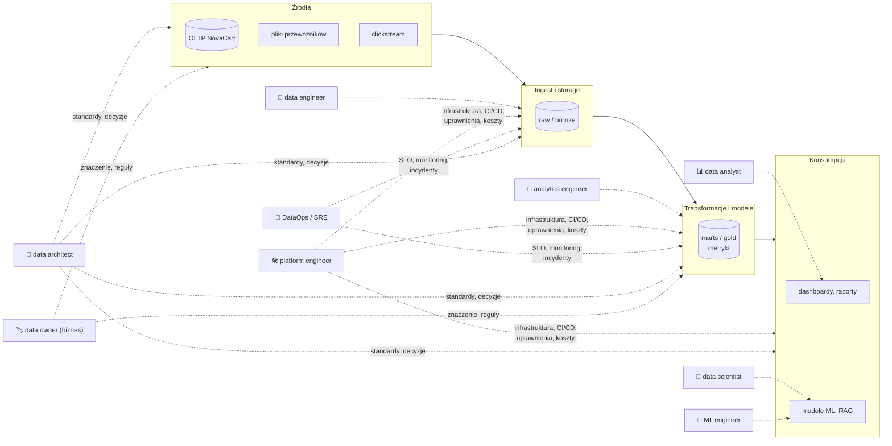

# 01.08 — Role w zespołach danych

> **Czas:** ~60 min · **Wymaga:** [Lekcja 01.06 — Kierunki organizacyjne i nowe trendy](06-kierunki-organizacyjne-i-trendy.md) · **Ostatnia weryfikacja:** 2026-11-07

**W tej lekcji:**

- poznasz zakresy odpowiedzialności ról: data engineer, analytics engineer, platform engineer, ML engineer, data scientist, data analyst, data architect i DataOps/SRE,
- zobaczysz, jak role zmieniały się razem z epokami architektur z lekcji 01.02–01.06,
- nauczysz się mapować role na **warstwy architektury** i **granice własności**, bo tam powstaje większość konfliktów,
- zbudujesz macierz RACI dla pipeline'u „zamówienia → raport przychodu” w NovaCart i przejdziesz przez incydent z prawdziwą anomalią z danych,
- porównasz, jak platformy (GCP, AWS, Azure, Snowflake, Databricks) kodują role w swoich modelach uprawnień.

---

## 1. Problem

Poniedziałek, 1 grudnia 2025, godzina 9:40. Dyrektor finansowa NovaCart pisze na kanale `#dane`: „Przychód z niedzieli w raporcie zarządczym jest o 23% wyższy niż w systemie księgowym. Kto to sprawdzi?”.

Przez następną godzinę dzieje się to, co w wielu firmach:

- analityk z działu finansów odpowiada, że „raport tylko czyta tabelę `marts.revenue_daily`”,
- analytics engineer, który zbudował model w dbt, twierdzi, że „model się nie zmienił, problem jest w danych źródłowych”,
- data engineer odpowiedzialny za ingest odpowiada, że „pipeline przeszedł na zielono, wszystkie pliki się załadowały”,
- inżynier platformy sprawdza, że „BigQuery działało, Composer działał”,
- zespół integracji sprzedawców nawet nie wie, że jest kanał `#dane`.

Przyczyna, którą znasz z lekcji 01.06: 30 listopada jeden sprzedawca wysłał ceny w groszach zamiast w złotych. Każdy z uczestników miał rację w swoim zakresie. Problem polegał na tym, że **nikt nie był właścicielem całości**, a granice między rolami nie były nazwane.

Ta lekcja nie jest o tym, jak nazwać stanowiska. Jest o tym, jak podzielić odpowiedzialność za warstwy architektury tak, żeby taki incydent został wykryty przed publikacją raportu, a jeśli nie, to rozwiązany w 30 minut przez jedną, z góry wiadomą osobę.

## 2. Intuicja

> [!TIP]
> **Intuicja.** Pomyśl o przedsiębiorstwie wodociągowym. Są ludzie, którzy budują i utrzymują ujęcia i rury (data engineers), ludzie, którzy projektują sieć i normy (data architects), ludzie od stacji uzdatniania, którzy pilnują, żeby woda nadawała się do picia w każdym kranie (analytics engineers), dyspozytornia, która monitoruje ciśnienie i reaguje na awarie (DataOps/SRE), firma, która dostarcza wszystkim narzędzia, pojazdy i standardowe złączki (platform engineers), i wreszcie odbiorcy: restauracje, browary i laboratoria, które z wody robią produkty (analitycy, data scientists, ML engineers).

Analogia ma dwie granice. Po pierwsze, w wodociągach jakość wody jest jedna i dobrze zdefiniowana, a w danych „poprawność” zależy od odbiorcy (przychód dla finansów i dla marketingu to różne liczby). Po drugie, w małych firmach jedna osoba pełni kilka ról naraz. To nie jest błąd, o ile wiadomo, którą rolę pełni w danej chwili.

## 3. Koncepcja

### 3.1. Pojęcia

| Pojęcie | Znaczenie |
|---|---|
| *data engineer* | Projektuje, buduje i utrzymuje potoki pozyskania, przetwarzania i przechowywania danych: ingest, CDC, streaming, przetwarzanie wsadowe, modele storage'u, wydajność i koszt. |
| *analytics engineer* | Zamienia dane surowe w modele analityczne gotowe do użycia: transformacje SQL (dbt, Dataform), modelowanie wymiarowe, definicje metryk, testy i dokumentacja. Termin spopularyzowany ok. 2019 r. przez społeczność dbt. |
| *platform engineer* (data platform engineer) | Buduje platformę, z której korzystają pozostali: infrastruktura jako kod, CI/CD, uprawnienia, orkiestracja, observability, szablony, koszty. Klientem są inni inżynierowie. |
| *ML engineer* | Doprowadza modele ML do produkcji: pipeline'y treningowe, serwowanie, monitoring modeli, feature store, MLOps. |
| *data scientist* | Buduje modele statystyczne i ML, prowadzi eksperymenty (A/B testy), odpowiada na pytania przyczynowe i predykcyjne. |
| *data analyst* | Odpowiada na pytania biznesowe na podstawie danych: analizy ad hoc, raporty, dashboardy, interpretacja. |
| *data architect* | Projektuje architekturę danych przekrojowo: wybór technologii, standardy modelowania, granice domen, decyzje zapisane jako ADR. |
| *DataOps* / *data reliability engineer* | Odpowiada za niezawodność danych w produkcji: SLO, monitoring, alerty, on-call, procesy incydentów i postmortemy. |
| *data steward* / *data owner* | Biznesowy właściciel danych w domenie: definiuje znaczenie, zasady jakości, kto ma dostęp. |
| RACI | Macierz odpowiedzialności: **R**esponsible (wykonuje), **A**ccountable (jeden, rozlicza się z wyniku), **C**onsulted (konsultowany przed), **I**nformed (informowany po). |

### 3.2. Jak to działa — widok z lotu ptaka



*Rysunek 08.1. Role przypisane do warstw architektury. Zauważ, że role „pionowe” (data engineer, analytics engineer, analityk) odpowiadają za warstwy, a role „poziome” (platforma, DataOps, architekt, właściciel danych) przecinają wszystkie warstwy. Konflikty pojawiają się na granicach.*

## 4. 🔍 Pod maską

### 4.1. Jak role zmieniały się razem z architekturą

Role nie powstają w próżni. Każda epoka z lekcji 01.02–01.06 przesunęła granice odpowiedzialności, bo zmieniła to, **co jest trudne**:

| Epoka | Co było trudne | Dominujące role | Co zniknęło lub się zmieniło |
|---|---|---|---|
| Hurtownie danych (lata 90. i 2000.) | Integracja źródeł, wydajność na drogim sprzęcie | DBA, ETL developer (Informatica, DataStage), BI developer, architekt hurtowni (Inmon/Kimball) | — |
| Big Data (2006–2015) | Rozproszone przetwarzanie, utrzymanie klastrów Hadoop | Hadoop/big data engineer, administrator klastra, data scientist („najseksowniejszy zawód XXI wieku”, Harvard Business Review, 2012) | ETL developer w GUI ustępuje programiście (Java, Scala, Python) |
| Cloud data warehouse (2012+) | Modelowanie i jakość przy taniej mocy obliczeniowej; ELT zamiast ETL | **data engineer** (tekst Maxime'a Beauchemina *The Rise of the Data Engineer*, 2017), **analytics engineer** (ok. 2019, dbt) | Administrator klastra zbędny (usługi zarządzane); transformacje przechodzą do SQL w hurtowni |
| Lakehouse, mesh, AI (2019+) | Skala organizacji, governance, niezawodność, dane dla ML/AI | **platform engineer**, **ML engineer**, data reliability engineer, data product manager | Granica „DE vs AE” rozmywa się; rośnie znaczenie ról przekrojowych |

Wzorzec jest powtarzalny: **gdy coś staje się usługą zarządzaną, rola, która to utrzymywała, przesuwa się w górę stosu**. Administrator Hadoopa nie zniknął, tylko stał się platform engineerem, który zamiast DataNode'ów konfiguruje Terraform, IAM i budżety. ETL developer nie zniknął, tylko pisze modele dbt jako analytics engineer albo pipeline'y w Pythonie jako data engineer.

> [!IMPORTANT]
> **Co z tego wynika w praktyce:** gdy oceniasz nową technologię (lekcja 01.06), zapytaj też: **czyja praca zniknie, a czyja powstanie?** Przejście z Hadoopa na BigQuery zmniejsza zapotrzebowanie na administrację klastrem, ale zwiększa na zarządzanie kosztami (FinOps) i uprawnieniami. Plan migracji bez planu zmian ról kończy się tym, że nikt nie odpowiada za nowe ryzyka.

### 4.2. Granice własności: gdzie powstają konflikty

Większość nieporozumień dotyczy nie tego, **co** robi dana rola, tylko **gdzie kończy się jej odpowiedzialność**. Oto granice, które w NovaCart (i prawie wszędzie) wymagają jawnej decyzji:

```text
 źródło ──────► raw ──────► staging ──────► marts ──────► dashboard / model
   │            │             │               │               │
   │   (1)      │     (2)     │      (3)      │      (4)      │
   ▼            ▼             ▼               ▼               ▼
 Kto odpowiada, gdy:
 (1) system źródłowy zmienił schemat bez uprzedzenia?     zespół źródła ↔ data engineer
 (2) dane się załadowały, ale są semantycznie błędne?      data engineer ↔ analytics engineer
 (3) metryka „przychód” ma dwie definicje?                 analytics engineer ↔ data owner / analityk
 (4) dashboard pokazuje złą liczbę z poprawnej tabeli?     analityk ↔ analytics engineer
 (*) pipeline działa, ale kosztuje 3× więcej niż w zeszłym miesiącu?   wszyscy ↔ platform engineer
 (*) nikt nie odebrał alertu o 3:00 w nocy?                DataOps ↔ właściciel pipeline'u
```

*Rysunek 08.2. Granice odpowiedzialności w potoku danych. Każda strzałka „↔” to miejsce, w którym bez jawnej umowy powstaje luka („myślałem, że to wasze”) albo konflikt („to nasze, nie dotykajcie”).*

Trzy narzędzia, które zamieniają granice w umowy:

1. **Kontrakty danych** (lekcja 01.06, moduł 29) na granicach (1) i (2): zespół źródła zobowiązuje się do schematu i semantyki, data engineer do świeżości i kompletności.
2. **Warstwa semantyczna / definicje metryk** (moduł 28) na granicy (3): jedna definicja przychodu, z właścicielem biznesowym.
3. **SLO z jednym właścicielem** (moduł 38): każdy produkt danych ma dokładnie jedną osobę lub zespół *Accountable* i jasną rotację on-call.

> [!NOTE]
> **Pod maską — dla dociekliwych.** Książka *Team Topologies* (Matthew Skelton, Manuel Pais, 2019) opisuje cztery typy zespołów, które dobrze pasują do organizacji danych: **stream-aligned** (zespół dostarczający wartość dla jednej domeny, np. „dane sprzedaży”), **platform** (platforma danych jako produkt wewnętrzny), **enabling** (zespół, który czasowo pomaga innym nabyć kompetencje, np. „guild” modelowania danych) i **complicated-subsystem** (specjaliści od wąskiej, trudnej dziedziny, np. silnik rekomendacji). Opisuje też trzy tryby interakcji: współpraca, *X-as-a-service* i *facilitating*. Data mesh to w praktyce stream-aligned zespoły domenowe + zespół platformy działający w trybie X-as-a-service.

> [!IMPORTANT]
> **Co z tego wynika w praktyce:** każda granica na rysunku 08.2 powinna mieć zapisaną odpowiedź: kto wykrywa problem, kto go naprawia, kto komunikuje się z odbiorcami. Najprostsza forma to macierz RACI dla kluczowych produktów danych, przechowywana razem z kodem (README produktu danych, metadane w katalogu).

### 4.3. Jak struktura zespołów odbija się w architekturze

Prawo Conwaya z lekcji 01.06 działa w obie strony: struktura zespołów kształtuje architekturę, a architektura wymusza strukturę zespołów.

| Model organizacyjny | Jak wygląda architektura | Mocne strony | Słabe strony |
|---|---|---|---|
| **Scentralizowany zespół danych** | Jedna platforma, jeden zestaw pipeline'ów, warstwy raw → marts | Spójne standardy, niski koszt, łatwy start | Wąskie gardło przy wielu domenach, słaba znajomość semantyki domen |
| **Hub-and-spoke** (centrum + osadzeni inżynierowie) | Wspólna platforma, pipeline'y domenowe w jednym repozytorium lub kilku, wspólne standardy | Balans spójności i znajomości domeny | Osadzeni inżynierowie „rozdarci” między centrum a domeną |
| **Data mesh** (domeny + platforma) | Produkty danych per domena, kontrakty, katalog, udostępnianie między domenami | Skaluje się z liczbą domen, własność przy źródle | Wysoki koszt platformy i governance, wymaga kompetencji w domenach |
| **Rozproszony bez platformy** (anty-wzorzec) | Każdy dział ma własne narzędzia i kopie danych | Szybki start lokalnie | Chaos definicji, koszty, ryzyka bezpieczeństwa |

> [!IMPORTANT]
> **Co z tego wynika w praktyce:** projektując architekturę, narysuj obok diagramu technicznego diagram zespołów. Jeśli komponent nie ma zespołu-właściciela albo ma dwa, to sygnał, że architektura i organizacja się rozjechały. W zadaniu końcowym tego modułu każdy wariant architektury NovaCart ma mieć wskazanych właścicieli komponentów.

### 4.4. Umiejętności i ścieżki rozwoju

Granice ról w praktyce wynikają z umiejętności. Poniższa macierz pokazuje typowy **rdzeń** każdej roli (●) i umiejętności **pomocnicze** (○):

| Umiejętność | DE | AE | Platform | ML Eng | DS | Analyst | Architect | DataOps |
|---|---|---|---|---|---|---|---|---|
| SQL i modelowanie wymiarowe | ○ | ● | | | ○ | ● | ● | |
| Python / programowanie | ● | ○ | ● | ● | ● | ○ | ○ | ○ |
| Systemy rozproszone (Spark, Beam, Kafka) | ● | | ○ | ○ | | | ● | ○ |
| Infrastruktura jako kod, sieć, IAM | ○ | | ● | ○ | | | ○ | ○ |
| CI/CD, testy, inżynieria oprogramowania | ● | ● | ● | ● | ○ | | ○ | ● |
| Monitoring, SLO, incydenty | ○ | ○ | ● | ○ | | | | ● |
| Statystyka i ML | | | | ● | ● | ○ | | |
| Wiedza domenowa i komunikacja z biznesem | ○ | ● | | ○ | ● | ● | ● | |
| Koszty chmury (FinOps) | ● | ○ | ● | ○ | | | ● | ○ |
| Bezpieczeństwo i governance | ○ | ○ | ● | | | | ● | ○ |

Ścieżki rozwoju w praktyce najczęściej prowadzą: analityk → analytics engineer → data engineer; data engineer → platform engineer lub data architect; data scientist → ML engineer. Na poziomach senior/staff/principal różnica między rolami maleje, a rośnie znaczenie umiejętności przekrojowych: projektowania systemów, podejmowania decyzji z kompromisami (ADR) i wpływu na wiele zespołów. Ten kurs celuje właśnie w ten poziom.

> [!IMPORTANT]
> **Co z tego wynika w praktyce:** w małym zespole (2–5 osób) jedna osoba pełni kilka ról, więc najważniejsze jest pokrycie wszystkich wierszy macierzy przez **kogokolwiek** w zespole. Szczególnie często brakuje wierszy „monitoring i incydenty”, „koszty” oraz „bezpieczeństwo i governance”. To dokładnie te obszary, w których NovaCart traci pieniądze i reputację.

### 4.5. Jak platformy kodują role w uprawnieniach

Modele uprawnień platform to „zamrożone” wyobrażenia producentów o tym, kto co robi. Warto je znać, bo wymuszają pewien podział ról:

| Platforma | Model | Typowe „persony” wbudowane w produkt |
|---|---|---|
| **GCP / BigQuery** | IAM na poziomie organizacji, folderu, projektu, datasetu, tabeli; dodatkowo *policy tags* (kolumny) i *row access policies* | Rozdzielenie **danych** i **compute**: `roles/bigquery.dataViewer` / `dataEditor` / `dataOwner` (dostęp do danych) vs `roles/bigquery.jobUser` / `user` (prawo uruchamiania zapytań, czyli wydawania pieniędzy w projekcie); `roles/datacatalog.categoryFineGrainedReader` dla kolumn z PII |
| **AWS** | IAM + Lake Formation (uprawnienia do tabel, kolumn i wierszy przez LF-Tags) | *Data lake administrator* (Lake Formation), producenci i konsumenci w DataZone/SageMaker Catalog |
| **Azure / Fabric** | Entra ID + role workspace'u + uprawnienia OneLake | Role workspace'u: Admin, Member, Contributor, Viewer; domeny i ich administratorzy |
| **Snowflake** | RBAC z hierarchią ról; wszystko ma właściciela (rolę) | Role systemowe: `ORGADMIN`, `ACCOUNTADMIN`, `SECURITYADMIN`, `USERADMIN`, `SYSADMIN`, `PUBLIC`; zalecane role funkcjonalne (np. `ANALYST`, `TRANSFORMER`) i dostępowe |
| **Databricks** | Unity Catalog: hierarchia metastore → catalog → schema → table; własność obiektów; uprawnienia `USE CATALOG`, `USE SCHEMA`, `SELECT`, `MODIFY` | Account admin, metastore admin, workspace admin, właściciele katalogów (często = domeny) |

Zwróć uwagę na rozdzielenie w BigQuery: **czytanie danych** i **uruchamianie zapytań** to osobne uprawnienia, często w różnych projektach. Analityk może mieć `dataViewer` na danych w projekcie `novacart-prod-sales` i `jobUser` w projekcie `novacart-analytics`, gdzie są rozliczane koszty jego zapytań. To bezpośrednie odbicie podziału ról „właściciel danych” i „konsument” oraz granicy kosztowej. Szczegóły w module 09.

> [!IMPORTANT]
> **Co z tego wynika w praktyce:** projektuj uprawnienia wokół **ról funkcjonalnych** (grupy: `grp-data-engineers-sales`, `grp-analysts-finance`), a nie wokół osób, i trzymaj je w Terraform. Gdy podział ról jest zapisany w IAM jako kod, rozmowa „kto za co odpowiada” ma konkretny artefakt do przeglądu.

## 5. 💻 W praktyce

> [!NOTE]
> Ta lekcja nie ma przykładu kodu. Temat jest organizacyjny, a artefaktem praktycznym jest **macierz RACI** i **przebieg incydentu**. Oba poniżej opierają się na prawdziwej anomalii z danych NovaCart, którą wykryliśmy kontraktem w lekcji 01.06 (`examples/07_data_product_contract.py`). Uprawnienia jako kod (Terraform) ćwiczysz w modułach 09 i 12.

### 5.1. RACI dla produktu „przychód dzienny”

Potok: zamówienia w OLTP → CDC/ingest do `raw` → model `sales.orders` (produkt danych z kontraktem) → `marts.revenue_daily` → raport zarządczy.

| Czynność | Zespół integracji sprzedawców | Data engineer (Sprzedaż) | Analytics engineer | Platform engineer | DataOps / on-call | Analityk finansowy | Data owner (Dyr. sprzedaży) |
|---|---|---|---|---|---|---|---|
| Zmiana formatu danych od sprzedawców | **A/R** | C | I | | | | I |
| Ingest i CDC do `raw`, świeżość | C | **A/R** | I | C | I | | |
| Kontrakt `sales.orders` (reguły, SLO) | C | **R** | C | | C | C | **A** |
| Model `marts.revenue_daily`, definicja przychodu | | C | **R** | | | C | **A** |
| Infrastruktura, uprawnienia, koszty | | C | C | **A/R** | C | | |
| Monitoring, alerty, pierwsza reakcja na incydent | | C | C | C | **A/R** | | I |
| Raport zarządczy i jego interpretacja | | | C | | | **A/R** | C |
| Komunikacja z odbiorcami podczas incydentu | | I | I | | **R** | C | **A** |

Zasady, które sprawdzasz w każdej macierzy RACI:

- w każdym wierszu jest **dokładnie jedno A**,
- każdy wiersz ma co najmniej jedno R (A może być jednocześnie R),
- żadna kolumna nie ma samych A bez R (ktoś, kto tylko „odpowiada”, ale nic nie robi, to sygnał problemu),
- kolumna zespołu źródłowego **nie jest pusta**: zespół integracji sprzedawców jest właścicielem jakości danych u źródła.

### 5.2. Incydent z 1 grudnia — przebieg z i bez jasnych ról

| Czas | Bez jasnych ról (sekcja 1) | Z macierzą RACI i kontraktem |
|---|---|---|
| 30.11, 23:59 | Sprzedawca 24 wysyła ceny w groszach | to samo |
| 01.12, 05:30 | Pipeline ładuje dane, wszystkie testy schematu przechodzą | Kontrakt `sales.orders` wykrywa 115 zamówień, w których Σ pozycji ≠ nagłówek; **publikacja wstrzymana** |
| 05:31 | — | Alert trafia do on-call DataOps (A dla monitoringu) |
| 06:00 | Raport zarządczy publikuje zawyżony przychód | Raport pokazuje dane do 29.11 z adnotacją „dane za 30.11 w weryfikacji” (właściciel danych zatwierdził taki tryb wcześniej) |
| 06:15 | — | DataOps przekazuje do data engineera Sprzedaży; ten zawęża problem do `seller_id = 24` |
| 07:00 | — | Zespół integracji sprzedawców (A dla formatu danych) potwierdza błąd i poprawia mapowanie |
| 07:40 | — | Dane przeliczone, kontrakt przechodzi, publikacja |
| 09:40 | Dyrektor finansowa wykrywa rozbieżność | — |
| 10:40+ | Szukanie winnego na kanale `#dane` | Postmortem bez szukania winnych: dodać walidację jednostek po stronie integracji sprzedawców |

Różnica nie wynika z technologii, bo kontrakt to ~190 linii Pythona i SQL. Wynika z tego, że **ktoś był właścicielem reguły**, **ktoś był na dyżurze** i **wiadomo było, kto decyduje o wstrzymaniu publikacji**.

## 6. ⚖️ Porównanie platform

| Aspekt | GCP | AWS | Azure | Snowflake | Databricks | On-prem / OSS |
|---|---|---|---|---|---|---|
| Jednostka izolacji zespołu / domeny | Projekt (+ folder) | Konto AWS (+ OU) | Workspace / domena Fabric, subskrypcja | Baza / schemat, czasem osobne konto | Katalog Unity Catalog, workspace | Schemat, klaster, namespace K8s |
| Rozdzielenie „dostęp do danych” vs „płacenie za compute” | Tak, wprost (`dataViewer` vs `jobUser`, różne projekty) | Częściowo (Lake Formation vs uprawnienia do silnika) | Przez pojemności Fabric przypisane do workspace'ów | Tak (role vs `USAGE` na warehouse) | Tak (uprawnienia UC vs uprawnienia do compute) | Zwykle brak (jeden klaster) |
| Model ról | IAM: role predefiniowane i własne, grupy | IAM + LF-Tags | Entra ID + role workspace'u | Hierarchiczne RBAC, własność obiektów | Własność i przywileje w UC, grupy kont | LDAP/Kerberos + Ranger/Sentry (Hadoop), GRANT w bazach |
| Uprawnienia kolumnowe i wierszowe | Policy tags, row access policies, maskowanie | Lake Formation (kolumny, wiersze, komórki) | OneLake security, RLS/CLS w Warehouse | Masking i row access policies, tagi | Column masks, row filters | Apache Ranger, widoki |
| Koszty per zespół | Projekty + etykiety + budżety | Konta + tagi + budżety | Pojemności i tagi | Warehouse per zespół + resource monitors | Tagi klastrów, budżety (serverless) | Trudne: wspólne zasoby |

**Wnioski:** różnice architektoniczne między platformami w tym temacie sprowadzają się do tego, **co jest jednostką izolacji** (projekt, konto, workspace, katalog) i czy platforma oddziela prawo do danych od prawa do wydawania pieniędzy. GCP i Snowflake robią to wprost, co ułatwia model „domena jest właścicielem danych, konsument płaci za swoje zapytania”. Na każdej platformie podział ról musi zaprojektować człowiek. Platforma daje tylko mechanizmy, a domyślne role (np. `ACCOUNTADMIN`, właściciel projektu) są zwykle zbyt szerokie do codziennej pracy.

## 7. ⚠️ Antywzorce i pułapki

| Antywzorzec | Objaw | Dlaczego tak się dzieje | Jak naprawić |
|---|---|---|---|
| „Zespół danych” odpowiada za jakość danych źródłowych | Ciągłe gaszenie pożarów, zespół źródła nie wie o problemach | Odpowiedzialność za jakość jest tam, gdzie problem widać, a nie tam, gdzie powstaje | Kontrakty i alerty kierowane do zespołu źródła (A dla formatu u źródła) |
| Wiele A w jednym wierszu RACI | „Myślałem, że ty się tym zajmujesz” | Współodpowiedzialność = brak odpowiedzialności | Dokładnie jedno A na czynność |
| Data scientist jako „człowiek do wszystkiego” | Modele w notebookach, ręczne eksporty, brak produkcji | Brak data engineera i ML engineera | Rozdziel role lub przynajmniej czynności: eksperyment vs produkcja |
| Platform engineer bez klientów | Platforma, z której nikt nie korzysta, bo nie rozwiązuje problemów zespołów | Platforma budowana „od technologii” | Traktuj platformę jak produkt: wywiady z użytkownikami, metryki adopcji |
| Brak on-call dla danych | Awarie wykrywa zarząd w raportach | „Dane to nie produkcja” | SLO, alerty i dyżury dla krytycznych produktów danych (moduł 38) |
| Uprawnienia per osoba, nadawane ręcznie | Nikt nie wie, kto ma dostęp do PII; odejście pracownika = ryzyko | Brak modelu ról funkcjonalnych | Grupy funkcjonalne, IAM w Terraform, regularny przegląd |
| Tytuły zamiast odpowiedzialności | „Analytics engineer” robi to samo co „data engineer” w innym zespole, a nikt nie robi monitoringu | Nazwy ról przejęte z rynku bez definicji zakresu | Zdefiniuj zakresy przez warstwy i granice (rysunki 08.1 i 08.2) |

> [!WARNING]
> **Pułapka.** Najczęstszy kosztowny błąd: przypisanie odpowiedzialności za jakość danych **wyłącznie** zespołowi danych. Zespół danych może wykryć problem (kontrakt, monitoring), ale nie może go trwale naprawić, bo źródło jest poza jego kontrolą. Jeśli zespół źródłowy nie ma w RACI litery A dla jakości swoich danych i nie dostaje alertów, każdy incydent będzie się powtarzał, a zespół danych utonie w ręcznych poprawkach.

## 8. 💰 Koszty

Koszty organizacyjne są trudniejsze do zmierzenia niż rachunek za chmurę, ale często większe:

- **Brak właściciela kosztów:** bez etykiet i budżetów per zespół (moduł 00, moduł 39) rachunek chmurowy jest „wspólny”, więc nikt go nie optymalizuje.
- **Czas incydentów:** w scenariuszu z sekcji 5.2 różnica to kilka godzin pracy kilku osób plus koszt decyzji podjętych na złych danych.
- **Koszt rotacji:** wiedza, która istnieje tylko w głowie jednej osoby (brak dokumentacji, brak kodu infrastruktury), znika razem z nią.

> [!CAUTION]
> **Koszt!** Uprawnienia typu `roles/owner` albo `ACCOUNTADMIN` przyznane „na chwilę” całemu zespołowi to ryzyko finansowe (każdy może uruchomić dowolnie drogie zasoby) i bezpieczeństwa. Zasada najmniejszych uprawnień jest też zasadą kontroli kosztów.

## 9. Podsumowanie

- Role w zespołach danych najlepiej definiować przez **warstwy architektury** (ingest, transformacje, konsumpcja) i **obszary przekrojowe** (platforma, niezawodność, architektura, własność biznesowa), a nie przez tytuły.
- Każda epoka przesuwała role w górę stosu: gdy coś staje się usługą zarządzaną, praca przesuwa się do projektowania, jakości, kosztów i governance.
- Konflikty powstają na granicach. Kontrakty danych, definicje metryk i SLO z jednym właścicielem zamieniają granice w umowy.
- Macierz RACI z dokładnie jednym A w każdym wierszu i z udziałem zespołów źródłowych to najprostsze narzędzie, które skraca incydenty z godzin do minut.
- Platformy kodują role w modelach uprawnień. Projektuj je wokół ról funkcjonalnych, jako kod, z oddzieleniem dostępu do danych od prawa do wydawania pieniędzy.

## 🧠 Sprawdź się

<details>
<summary><b>Kto w NovaCart powinien być „Accountable” za to, że sprzedawca wysłał ceny w groszach, i dlaczego nie zespół danych?</b></summary>

Zespół odpowiedzialny za integrację sprzedawców, bo to on kontroluje źródło i może trwale naprawić przyczynę (walidacja jednostek przy przyjmowaniu danych). Zespół danych jest odpowiedzialny za **wykrycie** problemu przed publikacją (kontrakt, monitoring) i za wstrzymanie publikacji, ale nie może zapobiec kolejnym wystąpieniom. Odpowiedzialność za jakość musi leżeć tam, gdzie problem powstaje.

</details>

<details>
<summary><b>Czym różni się praca analytics engineera od data engineera w NovaCart? Podaj po dwa artefakty, które każdy z nich utrzymuje.</b></summary>

Data engineer odpowiada za pozyskanie i niezawodne przetwarzanie danych: np. pipeline CDC z bazy zamówień do `raw` i job wczytujący pliki SpeedPost w Windows-1250 z czasem lokalnym. Analytics engineer zamienia dane w modele analityczne z definicjami biznesowymi: np. model `marts.revenue_daily` z definicją przychodu (bez anulowanych, z uwzględnieniem zwrotów) i testy dbt sprawdzające tę definicję. Granica przebiega między „dane są dostarczone kompletne i świeże” a „dane znaczą to, co biznes myśli, że znaczą”.

</details>

<details>
<summary><b>Dlaczego w BigQuery warto przyznać analitykowi <code>roles/bigquery.dataViewer</code> w projekcie z danymi i <code>roles/bigquery.jobUser</code> w innym projekcie?</b></summary>

Bo to rozdziela dostęp do danych od rozliczania kosztów. Dane należą do domeny (projekt produkcyjny), a koszty zapytań analityka są naliczane w projekcie analitycznym z własnym budżetem i limitami (custom quotas). Właściciel danych kontroluje, kto czyta, a właściciel budżetu analitycznego kontroluje, ile to kosztuje. Dzięki temu nie trzeba dawać analitykom uprawnień do uruchamiania zapytań w projekcie produkcyjnym.

</details>

<details>
<summary><b>Pięcioosobowy zespół danych startupu ma same osoby z tytułem „data engineer”. Jakie obszary prawdopodobnie są niepokryte i jak to sprawdzisz?</b></summary>

Najczęściej: monitoring i incydenty (SLO, on-call), koszty (FinOps), bezpieczeństwo i governance (PII, uprawnienia) oraz definicje metryk biznesowych. Sprawdzenie: przejdź macierz umiejętności z sekcji 4.4 i macierz RACI z sekcji 5.1 dla 2–3 kluczowych produktów danych. Każdy wiersz bez R/A albo bez osoby z umiejętnością ● to luka, którą trzeba świadomie przypisać.

</details>

## 📚 Źródła

1. M. Beauchemin, „The Rise of the Data Engineer”, freeCodeCamp / Medium, styczeń 2017.
2. M. Kaminsky, „The Analytics Engineer”, Locally Optimistic, 2019; C. Carroll, „What is analytics engineering?”, dbt Labs, 2019.
3. T. Davenport, D. J. Patil, „Data Scientist: The Sexiest Job of the 21st Century”, Harvard Business Review, październik 2012.
4. M. Skelton, M. Pais, *Team Topologies: Organizing Business and Technology Teams for Fast Flow*, IT Revolution, 2019.
5. J. Reis, M. Housley, *Fundamentals of Data Engineering*, O'Reilly, 2022 (rozdział o rolach i cyklu życia danych).
6. Google Cloud, „BigQuery IAM roles and permissions”: <https://cloud.google.com/bigquery/docs/access-control>
7. Snowflake, „Overview of Access Control” (role systemowe, hierarchia ról): <https://docs.snowflake.com/en/user-guide/security-access-control-overview>
8. Databricks, „Unity Catalog privileges and securable objects”: <https://docs.databricks.com/en/data-governance/unity-catalog/manage-privileges/privileges.html>
9. AWS, „Lake Formation permissions reference”: <https://docs.aws.amazon.com/lake-formation/latest/dg/lf-permissions-reference.html>
10. Microsoft, „Roles in Microsoft Fabric workspaces”: <https://learn.microsoft.com/fabric/fundamentals/roles-workspaces>

---

<sub>← [01.07 — Architektury równoległego przetwarzania](07-architektury-rownoleglego-przetwarzania.md) · [Moduł 01](README.md) · [🧪 Zadanie końcowe](exercise/README.md) →</sub>
