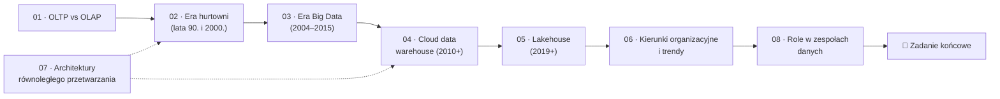

# Moduł 01 — Ewolucja architektur danych

> Dzisiejsze platformy danych to warstwy odpowiedzi na problemy z poprzednich 40 lat. Gdy wiesz, *który* problem rozwiązywała każda epoka i *jaki nowy* wprowadziła, przestajesz wybierać technologie z nagłówków i zaczynasz je wybierać z wymagań.

| | |
|---|---|
| **Część** | Część I — Fundamenty teoretyczne |
| **Szacowany czas** | ~15 h (lekcje z przykładami ~11 h, zadanie 4–6 h) |
| **Poziom** | ★★☆☆ |
| **Wymaga** | [Moduł 00](../00-wprowadzenie/README.md) |
| **Koszt zadań** | 0 USD (przykłady działają lokalnie, zadanie jest koncepcyjne) |
| **Ostatnia weryfikacja** | 2026-11-07 |

---

## 🎯 Cele modułu

Po ukończeniu modułu będziesz umieć:

1. **Wyjaśnić**, dlaczego obciążenia OLTP i OLAP wymagają innego układu danych na dysku, i zmierzyć tę różnicę na danych NovaCart.
2. **Opisać** dla każdej epoki (hurtownie MPP, Hadoop, cloud data warehouse, lakehouse) problem, który rozwiązała, mechanizm, który to umożliwił, i problem, który wprowadziła.
3. **Porównać** architektury shared-memory, shared-disk, shared-nothing i shared-data pod kątem wąskiego gardła, skalowania i kosztu dodania węzła.
4. **Wyjaśnić**, dlaczego separacja storage i compute stała się opłacalna dopiero przy odpowiedniej przepustowości sieci w centrach danych.
5. **Wyjaśnić**, jak *open table format* zapewnia atomowe transakcje na object storage, który ich nie oferuje.
6. **Ocenić krytycznie** koncepcje organizacyjne (data mesh, data fabric, zero-ETL) i wskazać warunki, w których się nie sprawdzą.
7. **Zaprojektować** architekturę NovaCart w trzech wariantach epokowych i uzasadnić wybór w formie *Architecture Decision Record*.

## 📋 Zanim zaczniesz

- **Wiedza:** SQL na poziomie JOIN-ów i agregacji; ogólne pojęcie, czym jest indeks w bazie danych.
- **Środowisko:** Python z `uv` z [modułu 00](../00-wprowadzenie/04-narzedzia-lokalne.md). Przykłady działają lokalnie (DuckDB, SQLite, PyArrow), bez chmury.
- **Dane:** wygeneruj dane NovaCart w skali S:

  ```bash
  cd datasets
  uv run novacart generate --scale s --components all -o ../data/s
  ```

  Przykłady instalują zależności przy pierwszym uruchomieniu:

  ```bash
  cd modules/01-ewolucja-architektur-danych/examples
  uv run python 01_row_vs_column.py
  ```

## 🧭 Dlaczego ten moduł

Zarząd NovaCart zadał zespołowi danych proste pytanie: „Na czym budujemy platformę danych na najbliższe pięć lat?”. W ciągu tygodnia na stole leżały cztery propozycje. Dział IT chciał rozbudować serwer PostgreSQL („przecież działa”), konsultant proponował Snowflake, nowy architekt lakehouse na Iceberg, a ktoś z zespołu przeczytał o data mesh i chciał zacząć od reorganizacji zespołów. Każda propozycja miała slajd z hasłami „skalowalność”, „elastyczność” i „niski koszt”.

Bez znajomości historii nie da się tych propozycji ocenić. Rozbudowa PostgreSQL powtarza problem z lat 80., kiedy jedna baza miała obsługiwać i transakcje, i raporty. Lakehouse na Iceberg rozwiązuje problemy, które NovaCart może mieć dopiero przy kilku silnikach czytających te same dane. Data mesh zakłada platformę samoobsługową, której NovaCart jeszcze nie ma. Ten moduł daje Ci język do takiej rozmowy: dla każdej architektury wiesz, *z jakiego problemu się wzięła*, *jaki mechanizm techniczny ją umożliwił* i *jaki koszt przeniosła gdzie indziej*.

Ten moduł nie uczy żadnego narzędzia. Uczy modeli myślowych, do których wracamy w całym kursie: rozdziału obciążeń, układu kolumnowego, *shuffle*, separacji storage i compute oraz logu transakcji na object storage.

## 🗺️ Mapa modułu



*Rysunek 01.1. Lekcje 01–06 tworzą oś czasu. Lekcja 07 jest przekrojowa: opisuje cztery architektury równoległe, które pojawiają się w każdej epoce. Możesz ją przeczytać po lekcji 02 albo na końcu.*

| # | Lekcja | Czas | Najważniejsze pojęcia |
|---|---|---|---|
| 01 | [OLTP vs OLAP](01-oltp-vs-olap.md) | 75 min | wzorce dostępu, *row store* vs *column store*, B-drzewo, kompresja kolumnowa, HTAP |
| 02 | [Era hurtowni danych](02-era-hurtowni-danych.md) | 80 min | Inmon vs Kimball, ETL, appliance'y MPP, klucz dystrybucji, redystrybucja |
| 03 | [Era Big Data](03-era-big-data.md) | 90 min | GFS, MapReduce, HDFS, Hive, *schema-on-read*, *shuffle*, *data swamp* |
| 04 | [Era cloud data warehouse](04-era-cloud-data-warehouse.md) | 85 min | separacja storage i compute, przepustowość sieci, *serverless*, modele kosztowe |
| 05 | [Era lakehouse](05-era-lakehouse.md) | 90 min | *open table formats*, log transakcji, *optimistic concurrency*, katalogi, *time travel* |
| 06 | [Kierunki organizacyjne i nowe trendy](06-kierunki-organizacyjne-i-trendy.md) | 90 min | data mesh, data fabric, zero-ETL, Lambda vs Kappa, composable data stack, dane dla AI |
| 07 | [Architektury równoległego przetwarzania](07-architektury-rownoleglego-przetwarzania.md) | 75 min | shared-memory, shared-disk, shared-nothing, shared-data, prawo Amdahla |
| 08 | [Role w zespołach danych](08-role-w-zespolach-danych.md) | 60 min | data / analytics / platform / ML engineer, RACI, punkty styku |
| — | [Przykłady kodu](examples/README.md) | 30 min | |
| — | [🧪 Zadanie końcowe](exercise/README.md) | 4–6 h | |

## ⚖️ Porównanie epok — podsumowanie modułu

Konspekt kursu zapowiada tu porównanie **epok**, a nie platform. Platformy są w lekcjach (każda lekcja ma własną tabelę porównawczą), a tutaj zestawiamy całe generacje architektur.

| Aspekt | OLTP jako hurtownia (lata 80.) | Hurtownia MPP (lata 90.–2000.) | Hadoop / data lake (2006–2015) | Cloud data warehouse (2010+) | Lakehouse (2019+) |
|---|---|---|---|---|---|
| **Typowy stos** | Oracle, DB2, SQL Server; raporty na replice | Teradata, Netezza, Exadata, Greenplum; Informatica, DataStage | HDFS, MapReduce, Hive, później Spark; YARN | BigQuery, Redshift, Snowflake, Synapse | Parquet + Delta / Iceberg / Hudi na S3, GCS, ADLS; Spark, Trino, Databricks, BigQuery, Snowflake |
| **Przechowywanie** | Wiersze, B-drzewa | Wiersze, później kolumny; dyski lokalne węzłów | Pliki w HDFS (bloki 128 MB, 3 repliki), zwykle bez transakcji | Kolumnowy format własny w rozproszonym storage dostawcy | Otwarte pliki kolumnowe + log transakcji w object storage |
| **Skalowanie** | Pionowe (większy serwer) | Poziome, ale skokowe (zakup węzłów, redystrybucja danych) | Poziome, tanim sprzętem; storage i compute razem | Elastyczne; storage i compute oddzielnie | Elastyczne; wiele silników nad tymi samymi danymi |
| **Model kosztowy** | Licencja + serwer | Duży CAPEX: appliance i licencja | Sprzęt + zespół operacyjny; licencja opcjonalna | OPEX: za bajty, za czas *warehouse* albo za sloty | OPEX: object storage + compute wybranego silnika |
| **Główny rozwiązany problem** | Komputeryzacja transakcji | Raporty nie blokują OLTP; zintegrowany, historyczny widok firmy | Skala i koszt dla danych nieustrukturyzowanych i bardzo dużych | Brak operacji, elastyczność, płacenie za użycie | Jedna kopia danych dla BI i ML, otwarty format, brak zamknięcia u dostawcy |
| **Główny wprowadzony problem** | Raporty spowalniają transakcje | Koszt, sztywność, długie projekty ETL, skalowanie skokowe | Złożoność, *data swamp*, brak ACID, małe pliki, wolne zapytania ad hoc | Zamknięcie u dostawcy, nieprzewidywalny rachunek, kopie danych dla ML | Złożoność katalogów i formatów, utrzymanie tabel (kompakcja), konkurencja standardów |
| **Lekcja** | [01](01-oltp-vs-olap.md) | [02](02-era-hurtowni-danych.md) | [03](03-era-big-data.md) | [04](04-era-cloud-data-warehouse.md) | [05](05-era-lakehouse.md) |

**Wnioski:** każda epoka przesuwała ten sam zestaw kompromisów: gdzie leżą dane, kto za nie płaci i kiedy, kto pilnuje ich spójności i jak drogo jest dodać moc obliczeniową. Fundamentalne zmiany wynikały z technologii, a nie z mody. Tani sprzęt i awaryjność na dużą skalę dały Hadoopa. Szybka sieć w centrach danych dała separację storage i compute. Silnie spójny object storage i formaty z logiem transakcji dały lakehouse. Zmiany nazw usług przy tym samym mechanizmie (np. kolejne odsłony hurtowni Microsoftu) są kosmetyczne. Wybierając architekturę, pytaj: *który problem z tabeli powyżej jest dziś najdroższy dla mojej organizacji?*

## 📌 Najważniejsze wnioski

1. OLTP czyta i zapisuje pojedyncze wiersze po kluczu, a OLAP czyta kilka kolumn z milionów wierszy. Układ wierszowy optymalizuje pierwsze, układ kolumnowy drugie. Na ~490 tys. zamówień NovaCart DuckDB liczy agregację ok. 50 razy szybciej niż SQLite, a SQLite odczytuje pojedyncze zamówienie po kluczu ok. 50 razy szybciej niż DuckDB ([lekcja 01](01-oltp-vs-olap.md)).
2. Hurtownie MPP wprowadziły shared-nothing i klucz dystrybucji. Ich problemem był koszt i skalowanie skokowe: dodanie węzłów oznaczało zakup sprzętu i przesunięcie danych.
3. Hadoop obniżył koszt przechowywania o rząd wielkości dzięki tanim serwerom i replikacji programowej. Zapłacił za to złożonością, brakiem transakcji i podejściem *schema-on-read*, które bez dyscypliny kończy się *data swamp*.
4. Separacja storage i compute nie jest pomysłem marketingowym. Stała się opłacalna, gdy przepustowość sieci w centrum danych zrównała się z przepustowością lokalnych dysków, a dane zaczęto czytać w dużych, kolumnowych blokach z cache po stronie compute.
5. Lakehouse to w gruncie rzeczy **log transakcji nad plikami**. Atomowy commit (np. *put-if-absent* na object storage albo operacja w katalogu) daje ACID, snapshoty i *time travel* na storage, który sam ich nie oferuje.
6. Data mesh jest zmianą organizacyjną, a nie technologiczną. Bez samoobsługowej platformy i federacyjnego governance kończy się rozproszeniem odpowiedzialności, a nie jej przeniesieniem.
7. Shared-nothing skaluje się dobrze, dopóki dane są równomiernie rozłożone, a zapytania nie wymagają redystrybucji. Shared-data płaci za elastyczność siecią i cache. Te same kompromisy wracają w BigQuery, Snowflake, Sparku i Kafce.

## 🧠 Pytania kontrolne

<details>
<summary><b>1. Dlaczego zapytanie „suma przychodu per kraj za miesiąc” jest szybsze w bazie kolumnowej, a „pobierz zamówienie 1 012 345 ze wszystkimi polami” w bazie wierszowej?</b> ★☆☆</summary>

Agregacja potrzebuje 2–3 kolumn z wszystkich wierszy. Baza kolumnowa czyta tylko te kolumny, dobrze skompresowane (wartości jednego typu obok siebie), i przetwarza je wektorowo. Baza wierszowa musi przeczytać całe strony z wierszami, w tym kolumny, których nie potrzebuje. Odczyt pojedynczego zamówienia to odwrotna sytuacja: indeks B-drzewa prowadzi do jednej strony, na której leży cały wiersz. Baza kolumnowa musi złożyć wiersz z wielu kolumn, często z wielu bloków. Pomiar na danych NovaCart znajdziesz w [lekcji 01](01-oltp-vs-olap.md).

</details>

<details>
<summary><b>2. Co rozwiązało podejście <i>schema-on-read</i> i dlaczego w wielu firmach skończyło się <i>data swamp</i>?</b> ★☆☆</summary>

*Schema-on-read* pozwoliło zapisywać dane bez wcześniejszego projektowania schematu, więc ładowanie było szybkie i tanie, a dane nieustrukturyzowane nie musiały pasować do tabel. Koszt przesunął się na moment odczytu: każdy konsument musiał sam interpretować format, obsługiwać zmiany schematu i brudne rekordy. Bez katalogu, właścicieli i kontraktów nikt nie wiedział, co leży w jeziorze, czy jest aktualne i czy można temu ufać. Pliki QuickShip ze zmianą schematu w danych NovaCart pokazują ten problem w małej skali ([lekcja 03](03-era-big-data.md)).

</details>

<details>
<summary><b>3. Dlaczego separacja storage i compute nie była popularna w 2005 roku, skoro idea była znana?</b> ★★☆</summary>

Bo sieć była wąskim gardłem. Przy sieciach 1 Gb/s i architekturach drzewiastych z dużym *oversubscription* odczyt danych z innej maszyny był wielokrotnie wolniejszy niż z lokalnego dysku. Dlatego MapReduce i HDFS przenosiły obliczenia do danych (*data locality*). Gdy centra danych przeszły na sieci typu Clos z dużą przepustowością przekrojową (np. Jupiter w Google), a formaty kolumnowe zmniejszyły liczbę czytanych bajtów, odczyt z sieci przestał być wolniejszy od odczytu lokalnego. Wtedy elastyczność separacji zaczęła przeważać nad jej kosztem ([lekcja 04](04-era-cloud-data-warehouse.md)).

</details>

<details>
<summary><b>4. Dwa zadania Spark jednocześnie dopisują dane do tej samej tabeli Delta lub Iceberg. Jak format zapewnia, że żaden commit nie zostanie zgubiony?</b> ★★☆</summary>

Przez *optimistic concurrency control*. Każdy writer zapisuje pliki danych bez blokad, a potem próbuje atomowo utworzyć kolejny wpis w logu (np. plik `00000000000000000011.json` w Delcie przez *put-if-absent* albo zamianę wskaźnika metadanych w katalogu w Iceberg). Tylko jeden writer wygra wyścig o dany numer wersji. Przegrany odczytuje nowy stan, sprawdza, czy zmiany kolidują, i jeśli nie, ponawia commit z kolejnym numerem. Pliki danych, które nie trafiły do logu, są niewidoczne dla czytelników i zostaną usunięte przez sprzątanie ([lekcja 05](05-era-lakehouse.md)).

</details>

<details>
<summary><b>5. W klastrze shared-nothing NovaCart tabela <code>order_items</code> jest rozłożona po <code>seller_id</code>. Co się stanie z zapytaniem łączącym ją z <code>orders</code> po <code>order_id</code> i z obciążeniem węzłów w Black Friday?</b> ★★☆</summary>

JOIN po `order_id` wymaga redystrybucji: wiersze `order_items` muszą trafić na węzły, na których są odpowiadające im zamówienia (albo obie tabele muszą zostać przetasowane po `order_id`). To ruch sieciowy proporcjonalny do rozmiaru tabeli. Dodatkowo popularność sprzedawców jest skośna (rozkład Zipfa w danych NovaCart), więc węzeł z największymi sprzedawcami dostanie nieproporcjonalnie dużo wierszy i stanie się *stragglerem*, czyli najwolniejszym ogniwem, na które czeka całe zapytanie. W Black Friday ruch rośnie ok. 2,8 razy i skośność się pogłębia. Lepszy klucz dystrybucji to `order_id` dla obu tabel (kolokacja) ([lekcje 02](02-era-hurtowni-danych.md) i [07](07-architektury-rownoleglego-przetwarzania.md)).

</details>

<details>
<summary><b>6. Twój zespół chce „wdrożyć data mesh”. Jakie trzy warunki muszą być spełnione, żeby miało to sens w firmie wielkości NovaCart?</b> ★★☆</summary>

(1) Wystarczająco dużo domen i zespołów, żeby centralny zespół danych był wąskim gardłem; przy kilku osobach od danych mesh dodaje koordynacji zamiast ją usuwać. (2) Samoobsługowa platforma, na której domena może opublikować produkt danych bez pomocy zespołu centralnego: storage, compute, katalog, CI/CD, monitoring. (3) Federacyjne governance z automatycznie egzekwowanymi standardami (kontrakty, schematy, SLO, klasyfikacja PII). Bez tych warunków mesh zamienia centralny bałagan w rozproszony ([lekcja 06](06-kierunki-organizacyjne-i-trendy.md)).

</details>

<details>
<summary><b>7. Dlaczego dodanie węzła do klastra shared-nothing jest kosztowne, a w architekturze shared-data prawie darmowe? Jaką cenę płaci za to shared-data?</b> ★★★</summary>

W shared-nothing każdy węzeł jest właścicielem części danych. Nowy węzeł musi przejąć swoją część, więc trzeba przenieść około 1/N danych przez sieć (przy naiwnym haszowaniu modulo nawet większość danych), a w trakcie klaster działa wolniej. W shared-data dane leżą we wspólnym storage, a węzły compute są bezstanowe, więc nowy węzeł zaczyna pracę od razu i tylko „rozgrzewa” lokalny cache. Ceną jest zależność od przepustowości i opóźnień sieci, chłodny cache po skalowaniu, koszt żądań do object storage oraz potrzeba osobnej, silnie spójnej usługi metadanych (np. FoundationDB w Snowflake, Spanner/Colossus w BigQuery) ([lekcja 07](07-architektury-rownoleglego-przetwarzania.md)).

</details>

<details>
<summary><b>8. NovaCart ma 3 osoby od danych, jeden PostgreSQL i 50 GB danych analitycznych. Konsultant proponuje lakehouse na Iceberg z trzema silnikami. Jakie argumenty przemawiają za, a jakie przeciw?</b> ★★★</summary>

**Za:** otwarty format bez zamknięcia u dostawcy, możliwość dołożenia silników w przyszłości, niski koszt storage. **Przeciw:** przy 50 GB i jednym zespole głównym problemem jest obciążenie OLTP przez raporty i brak modelu danych, a nie skala czy wielosilnikowość. Lakehouse wymaga utrzymania katalogu, kompakcji, wygasania snapshotów i kompetencji w kilku silnikach, co przy 3 osobach zje czas potrzebny na dostarczanie wartości. Rozsądniejszy pierwszy krok to replikacja (CDC) do serverless cloud data warehouse z płatnością za użycie. Do lakehouse można przejść później, np. przez tabele Iceberg zarządzane przez tę samą hurtownię. Decyzję warto zapisać jako ADR z warunkami ponownej oceny (np. „gdy pojawi się drugi silnik albo dane przekroczą X TB”).

</details>

<details>
<summary><b>9. Kto w NovaCart powinien odpowiadać za to, że kolumna <code>unit_price</code> w <code>order_items</code> przez jeden dzień przyszła w groszach zamiast w złotych: data engineer, analytics engineer czy zespół sprzedawców?</b> ★★☆</summary>

Źródłem błędu jest system sprzedawcy, więc przyczynę naprawia zespół właściciela źródła. Data engineer odpowiada za to, żeby pipeline wykrył naruszenie kontraktu (np. test zgodności sumy pozycji z `total_amount` zamówienia) i nie przepuścił błędnych danych do warstwy raportowej. Analytics engineer odpowiada za testy w modelach i komunikację z odbiorcami raportów. Dobre rozwiązanie to kontrakt danych z jasno przypisanym właścicielem i automatyczna kontrola na wejściu ([lekcje 06](06-kierunki-organizacyjne-i-trendy.md) i [08](08-role-w-zespolach-danych.md); szerzej w module 29).

</details>

## 🧪 Zadanie końcowe

**[Trzy epoki, jedna NovaCart: architektura i ADR](exercise/README.md)**: zaprojektuj platformę danych NovaCart jako (a) on-prem 2010 (Hadoop + hurtownia MPP), (b) cloud data warehouse i (c) lakehouse, porównaj przepływy, punkty awarii, skalowanie i koszty, a wybór uzasadnij w *Architecture Decision Record*.

## 📚 Dalsza lektura

**Publikacje i specyfikacje**
- S. Ghemawat, H. Gobioff, S.-T. Leung, „The Google File System”, SOSP 2003: fundament HDFS i pierwszy opis rozproszonego storage na tanim sprzęcie.
- J. Dean, S. Ghemawat, „MapReduce: Simplified Data Processing on Large Clusters”, OSDI 2004: model programowania, który zdefiniował erę Big Data.
- S. Melnik i in., „Dremel: Interactive Analysis of Web-Scale Datasets”, VLDB 2010: zapytania interaktywne na danych kolumnowych, rdzeń BigQuery.
- B. Dageville i in., „The Snowflake Elastic Data Warehouse”, SIGMOD 2016: separacja storage i compute w praktyce komercyjnej.
- M. Armbrust i in., „Delta Lake: High-Performance ACID Table Storage over Cloud Object Stores”, VLDB 2020: jak zbudować transakcje na object storage.
- M. Armbrust, A. Ghodsi, R. Xin, M. Zaharia, „Lakehouse: A New Generation of Open Platforms that Unify Data Warehousing and Advanced Analytics”, CIDR 2021: manifest architektury lakehouse.
- M. Stonebraker, „The Case for Shared Nothing”, IEEE Database Engineering Bulletin, 1986: klasyczny argument za architekturą, która zdominowała systemy analityczne.
- A. Singh i in., „Jupiter Rising: A Decade of Clos Topologies and Centralized Control in Google's Datacenter Network”, SIGCOMM 2015: sieć, która umożliwiła separację storage i compute w Google.

**Książki i wystąpienia**
- M. Kleppmann, M. Riccomini, *Designing Data-Intensive Applications*, O'Reilly, wyd. 2 (2026): rozdziały o storage, replikacji i przetwarzaniu wsadowym.
- R. Kimball, M. Ross, *The Data Warehouse Toolkit*, Wiley, wyd. 3 (2013): kanon modelowania wymiarowego.
- J. Reis, M. Housley, *Fundamentals of Data Engineering*, O'Reilly (2022): cykl życia danych i role w zespołach.
- Z. Dehghani, *Data Mesh: Delivering Data-Driven Value at Scale*, O'Reilly (2022): źródłowe ujęcie data mesh.
- Wybrane lektury do każdej epoki znajdziesz w sekcji „Źródła” odpowiedniej lekcji.

---

<sub>Poprzedni moduł: [00 — Wprowadzenie](../00-wprowadzenie/README.md) · Następny moduł: 02 — Systemy rozproszone dla data engineera (w przygotowaniu) · [Spis treści kursu](../../README.md)</sub>
