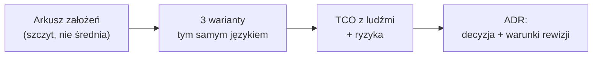
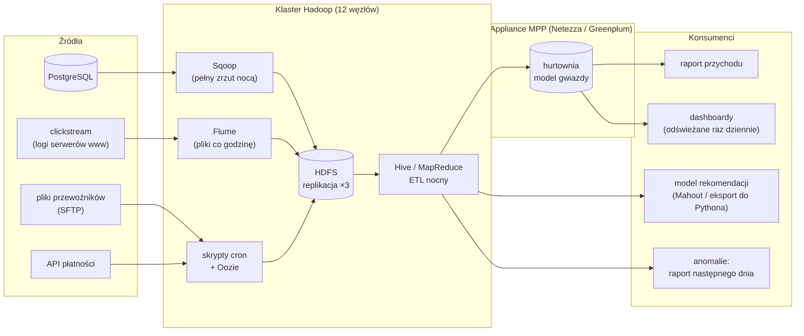
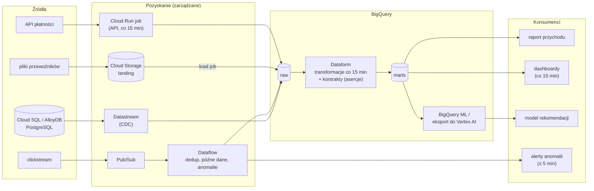
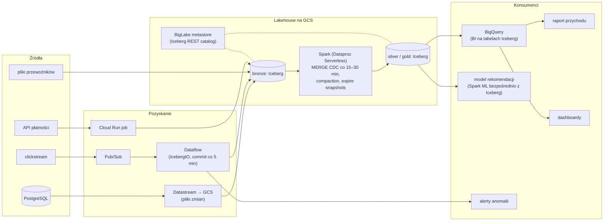

# Rozwiązanie — Trzy epoki, jedna NovaCart: architektura i ADR

> [!WARNING]
> Zajrzyj tutaj dopiero po samodzielnej próbie. Największa wartość zadania to samodzielne zmierzenie się z problemem, także z błędnymi podejściami.

## Podejście w skrócie

Rozwiązanie zaczyna się od liczb, a nie od technologii. Przy skali XL NovaCart generuje w szczytowej godzinie Black Friday ok. 580 zdarzeń na sekundę, a cały clickstream z trzech lat zajmuje w Parquecie ok. 460 GB. To są dane **średniej** wielkości. Mieszczą się wygodnie w każdej hurtowni chmurowej, a nawet na jednej dużej maszynie. Dlatego o wyborze architektury nie decyduje skala, tylko trzy inne czynniki: **świeżość** (anomalie w ≤ 15 min), **model kosztów** (sezonowość, Black Friday) i **ludzie** (kompetencje i liczba etatów, które w TCO ważą więcej niż infrastruktura).

Wzorcowa rekomendacja: **wariant (b), hurtownia chmurowa na BigQuery**, z jawnie opisanym „wyjściem awaryjnym” w stronę lakehouse (tabele BigQuery for Apache Iceberg dla danych, które w przyszłości będą musiały być zapisywane przez inne silniki). Inne rekomendacje też mogą być poprawne, jeśli są uzasadnione liczbami i kompromisami.



## Kluczowe decyzje

| Decyzja | Wybór | Odrzucone alternatywy | Uzasadnienie |
|---|---|---|---|
| Wymiarowanie | Na szczyt Black Friday przy skali XL: ~580 zdarzeń/s (godzina), ~1 700/s (skok) | Średnia dzienna (~88 zdarzeń/s przy XL) | Średnia ukrywa 6,5× różnicę; w on-prem kupujesz sprzęt na szczyt |
| Jednostka porównania kosztów | TCO 3 lata z ludźmi, koszt stały vs zmienny | Sam rachunek za infrastrukturę | W wariantach (b) i (c) ludzie to > 80% kosztu |
| Rekomendowany wariant | (b) cloud DW (BigQuery) | (a) on-prem 2010, (c) lakehouse | Najniższe TCO, najmniej etatów, spełnia SLA anomalii; skala nie uzasadnia wielosilnikowości |
| „Wyjście awaryjne” | Tabele BigQuery for Apache Iceberg dla wybranych danych + warunki rewizji w ADR | Pełny lakehouse od razu | Opcja na przyszłość bez płacenia za nią dziś |
| Wykrywanie anomalii | Strumieniowo (Pub/Sub → Dataflow), okno 5 min | Wsadowo co godzinę | Wymaganie ≤ 15 min; sekcja 4.5 lekcji 01.06: streaming per przypadek użycia, a nie dla całej platformy |

## Krok po kroku

### 1. Liczby, od których wszystko zależy

| Wielkość | Skala L (dziś) | Skala XL (za 3 lata) |
|---|---|---|
| Zdarzenia/s: średnio | ~13 | ~88 |
| Zdarzenia/s: szczytowa godzina BF / skok | ~80 / ~250 | ~580 / ~1 700 |
| Clickstream: Parquet / JSON | ~43 GB / ~0,6 TB | ~460 GB / ~6,1 TB |
| Zamówienia dziennie: średnio / BF | ~14 tys. / ~42 tys. | ~100 tys. / ~300 tys. |
| Zdarzenia CDC (zamówienia) | ~39 mln | ~415 mln |

Wniosek, który warto napisać wprost w raporcie: **największym wyzwaniem NovaCart nie jest wolumen, tylko różnorodność źródeł** (CDC, pliki w trzech formatach, API, streaming), **jakość** (duplikaty, spóźnione zdarzenia, anomalie) i **sezonowość**. Architektura powinna optymalizować te trzy rzeczy.

Wspólne założenia kosztowe (wszystkie oznaczone jako założenia; przed prezentacją zarządowi trzeba je sprawdzić w aktualnych cennikach):

| Założenie | Wartość | Uwagi |
|---|---|---|
| Pełny koszt etatu (FTE) | 100 tys. USD/rok | Rząd wielkości; w Polsce zwykle mniej, w USA więcej. Ważne, żeby był ten sam we wszystkich wariantach |
| BigQuery on-demand | ~6,25 USD/TiB | Cennik BigQuery (multi-region US/EU) |
| BigQuery storage aktywny | ~0,02 USD/GiB/mies. | Long-term ~0,01 USD; pierwsze 10 GiB bez opłat |
| Cloud Storage Standard | ~0,02–0,026 USD/GB/mies. | Zależnie od regionu |
| Compute zarządzany (Dataflow, Dataproc Serverless) | ~0,06–0,10 USD/vCPU-h z pamięcią | Rząd wielkości |
| BI (Looker / inne) | pominięte | Taki sam koszt we wszystkich wariantach |

### 2. Wariant (a) — on-premise 2010: Hadoop + hurtownia MPP



*Wariant (a): wszystko kręci się wokół nocnego okna ETL. Zauważ, że żaden konsument nie dostaje danych szybciej niż raz na dobę.*

**Przepływ zamówienia złożonego o 10:00:** zapis w PostgreSQL (0) → pełny zrzut Sqoop o 01:00 (+15 h) → Hive ETL 02:00–05:00 (+3 h) → ładowanie do MPP 05:00–06:00 (+1 h) → raport o 07:00. **Łącznie ~21 h** (zakres 7–31 h zależnie od godziny złożenia).

**Punkty awarii:**

| # | Co się psuje | Wpływ | Wykrycie | Mitygacja |
|---|---|---|---|---|
| 1 | NameNode HDFS (przed Hadoop 2.x HA nie miał automatycznego przełączania) | Cały klaster niedostępny, nocny ETL nie rusza | Monitoring (Nagios/Ganglia) | Secondary NameNode z backupem metadanych, ręczna procedura; w 2012+ HA NameNode |
| 2 | Nocny ETL nie mieści się w oknie (BF: ×2,8 danych) | Raport o 07:00 bez danych z poprzedniego dnia | Status jobów Oozie rano | Zapas mocy kupiony na szczyt, priorytetyzacja jobów finansowych |
| 3 | Pełny zrzut Sqoop obciąża produkcyjny PostgreSQL | Spowolnienie sklepu w nocy (ryzyko przy globalnej sprzedaży) | Metryki bazy | Zrzut z repliki; zrzut przyrostowy po `updated_at` |
| 4 | Awaria dysku / węzła | Spadek przepustowości, rebalancing | HDFS fsck, monitoring | Replikacja ×3, zapasowe dyski |
| 5 | Zmiana schematu u QuickShip | Job Hive pada albo ładuje NULL-e w nowych kolumnach | Brak automatyki; zgłoszenie od użytkownika | Ręczne poprawki DDL |

**Skalowanie:** Black Friday wymaga mocy, którą trzeba **kupić z wyprzedzeniem**: klaster i appliance są wymiarowane na grudniowy szczyt i przez resztę roku działają w ~30%. Wzrost do XL (×10) to zakup kolejnych węzłów (czas dostawy 6–12 tygodni + instalacja + rebalancing HDFS na godziny, patrz lekcja 01.07) i najpewniej większego appliance'u MPP (projekt migracyjny liczony w miesiącach).

**TCO 3 lata (założenia, rząd wielkości):**

| Kategoria | Pozycja | Założenie | Koszt 3 lata |
|---|---|---|---|
| Sprzęt | 12 serwerów Hadoop + sieć, rozbudowa w roku 3 | ~10 tys. USD/serwer, +8 serwerów w roku 3 | ~0,25 mln USD |
| Licencje | Appliance MPP (najmniejszy) + wsparcie ~20%/rok | 0,4 mln + 3 × 0,08 mln | ~0,65 mln USD |
| Centrum danych | Szafy, zasilanie, chłodzenie, łącza | ~40 tys. USD/rok | ~0,12 mln USD |
| Ludzie | 2 adminów Hadoop, 1 DBA hurtowni, 3 ETL/data engineers | 6 FTE × 3 lata × 100 tys. | ~1,8 mln USD |
| **Razem** | | | **~2,8 mln USD**, z czego ~95% stałe |

**Mocne strony:** pełna kontrola nad danymi i sprzętem, przewidywalny koszt, brak zależności od dostawcy chmury, w 2010 r. dojrzały i sprawdzony stos. **Słabe strony:** świeżość raz na dobę, brak elastyczności, wysoki koszt stały, dużo pracy operacyjnej, wykrywanie anomalii w ≤ 15 min niemożliwe bez dodania Storma (czyli architektury Lambda z dwiema bazami kodu).

**RODO:** dane klienta leżą w PostgreSQL, w surowych zrzutach Sqoop na HDFS (każdy dzień osobno!), w tabelach Hive, w MPP i w eksportach do ML. Usunięcie wymaga przepisania partycji na HDFS (Hive w 2010 r. nie miał `DELETE`), więc zwykle przyjmuje się retencję surowych zrzutów krótszą niż 30 dni. **Ceny w groszach:** wykryte przez analityka w raporcie następnego dnia; poprawa = ponowne uruchomienie nocnego ETL dla danego dnia.

### 3. Wariant (b) — cloud data warehouse (BigQuery)



*Wariant (b): jeden storage analityczny, wszystkie źródła trafiają do BigQuery, a jedynym komponentem działającym stale jest strumień clickstreamu.*

**Przepływ zamówienia złożonego o 10:00:** zapis w bazie (0) → Datastream do `raw` (~1–2 min) → przebieg Dataform (co 15 min, ~3 min) → `marts.revenue_daily` → raport/dashboard. **Łącznie ~15–20 min.**

**Punkty awarii:**

| # | Co się psuje | Wpływ | Wykrycie | Mitygacja |
|---|---|---|---|---|
| 1 | Opóźnienie lub zatrzymanie Datastream (np. zmiana DDL, brak miejsca na WAL w źródle) | Dashboardy przestają się odświeżać; ryzyko zapełnienia dysku bazy | Metryka świeżości (kontrakt SLO), alert na lag | Monitoring slotu replikacji, runbook backfillu |
| 2 | Dataflow nie nadąża w szczycie (gorące klucze, za mało workerów) | Opóźnione alerty anomalii | Metryki *system lag* i *data freshness* | Autoscaling z górnym limitem, testy obciążeniowe przed BF |
| 3 | Kosztowne zapytanie (dashboard bez filtra partycji na surowym clickstreamie) | Rachunek ×10 w tydzień | Budżety, `INFORMATION_SCHEMA.JOBS`, custom quotas (moduł 00) | Dashboardy tylko na marts, `require_partition_filter`, limity bajtów |
| 4 | Awaria regionu | Brak dostępu do danych | Status GCP | Multi-region EU dla datasetów krytycznych; plan DR (moduł 40) |
| 5 | Zmiana schematu QuickShip | Load job pada | Błąd joba + alert | Ładowanie do `raw` jako tekst/JSON, kontrakt na wyjściu staging |

**Skalowanie:** Black Friday bez działań ręcznych: Pub/Sub i Dataflow skalują się w minutach (ustaw górny limit workerów, żeby kontrolować koszt), a BigQuery w modelu on-demand przydziela sloty dynamicznie. Do wzrostu XL nie trzeba kupować sprzętu. Zmienia się koszt i warto wtedy przeliczyć on-demand vs rezerwacje slotów (BigQuery Editions, moduł 16).

**TCO 3 lata (założenia, rząd wielkości; wartości średnie z narastaniem L → XL):**

| Kategoria | Pozycja | Założenie | Koszt 3 lata |
|---|---|---|---|
| Storage | BigQuery: średnio ~2–3 TiB logicznie (clickstream surowy 13 mies. + zamówienia 5 lat + marts) | ~0,02 USD/GiB/mies. | ~2 tys. USD |
| Compute: zapytania | Dashboardy na marts (~10 TB/mies. przy XL), ad hoc (~120 TB/mies.), transformacje (~30 TB/mies.), ML (~6 TB/mies.) | ~6,25 USD/TiB; przy L ~10× mniej | ~25–40 tys. USD |
| Compute: streaming | Dataflow: 2–4 workery 24/7 | ~0,8–1 tys. USD/mies. | ~30–35 tys. USD |
| Usługi | Datastream, Pub/Sub, Cloud Run, orkiestracja | rząd wielkości setek USD/mies. | ~10–20 tys. USD |
| Ludzie | 2 data engineers, 1 analytics engineer, 0,5 platform | 3,5 FTE × 3 lata × 100 tys. | ~1,05 mln USD |
| **Razem** | | | **~1,1–1,15 mln USD**, z czego ~90% to ludzie; infrastruktura ~70–100 tys. USD i w większości zmienna |

> [!IMPORTANT]
> Ta sama hurtownia, w której dashboardy czytają **surowy** clickstream z 7 dni zamiast agregatów, przy skali XL skanowałaby ~50 TB dziennie, czyli ~9–10 tys. USD miesięcznie samych zapytań dashboardów. W wariancie (b) największą dźwignią kosztową jest modelowanie danych (moduł 07), a nie wybór technologii.

**Mocne strony:** świeżość w minutach, zerowa administracja infrastrukturą, koszt zmienny i elastyczny, najmniej etatów, wbudowane ML i governance (policy tags, row access). **Słabe strony:** zależność od jednego dostawcy i formatu, koszt rośnie z niekontrolowanymi zapytaniami, inne silniki czytają dane przez API (płatnie) lub eksport.

**RODO:** `DELETE` w BigQuery w tabelach `raw` i `marts`, ale dane zostają w time travel (do 7 dni) i fail-safe (kolejne 7 dni), poza zasięgiem użytkownika. Trzeba to uwzględnić w terminie 30 dni. Do tego pliki w landing na GCS (polityka cyklu życia) i backupy bazy źródłowej. **Ceny w groszach:** kontrakt (asercja Dataform) na `sales.orders` wstrzymuje publikację marts za 30.11 w ciągu kilku minut; po poprawce u źródła Datastream dostarcza korekty, a przebieg Dataform przelicza dzień.

### 4. Wariant (c) — lakehouse (Iceberg na GCS)



*Wariant (c): jedna kopia danych w otwartym formacie, czytana i zapisywana przez kilka silników. Zwróć uwagę na dodatkowe zadania utrzymaniowe (compaction, expire snapshots), których w (b) wykonuje za Ciebie BigQuery.*

**Przepływ zamówienia złożonego o 10:00:** zapis w bazie (0) → Datastream zapisuje plik zmian na GCS (~1–2 min) → Spark `MERGE` do tabeli Iceberg (co 15–30 min; częstsze commity to więcej konfliktów i małych plików, patrz lekcja 01.05) → transformacje silver/gold → BigQuery czyta tabele Iceberg przez BigLake. **Łącznie ~30–45 min.**

**Punkty awarii:**

| # | Co się psuje | Wpływ | Wykrycie | Mitygacja |
|---|---|---|---|---|
| 1 | Konflikt commitów (`MERGE` CDC vs compaction na tej samej partycji) | Nieudane joby, opóźnienia | Błędy *commit conflict* w logach | Compaction tylko na partycjach „zamkniętych”, harmonogram bez nakładania |
| 2 | Zaległa compaction / małe pliki po BF | Wolne zapytania BI, wyższe koszty operacji GCS | Liczba plików na partycję, czas planowania | Automatyczna compaction, alert na liczbę plików |
| 3 | Dwa katalogi lub zapis z pominięciem katalogu | Rozbieżne wersje tabeli, utracone commity | Trudne; audyt zapisów do bucketu | Jeden katalog z prawem zapisu, zakaz zapisu do bucketu poza silnikami |
| 4 | Niezgodność wersji specyfikacji Iceberg między silnikami (np. v3 vs v2) | Silnik nie czyta tabeli | Błąd zapytania | Pinning wersji formatu, testy kompatybilności w CI |
| 5 | Brak expire snapshots | Storage rośnie, dane „usunięte” dla RODO nadal dostępne | Stosunek rozmiaru fizycznego do logicznego | Automatyczne `expire_snapshots` z retencją < 30 dni |

**Skalowanie:** jak w (b) dla Pub/Sub, Dataflow i BigQuery; Spark Serverless skaluje się per batch. Do tego rośnie praca utrzymaniowa: więcej tabel i partycji do compaction, więcej snapshotów do sprzątania.

**TCO 3 lata (założenia, rząd wielkości):**

| Kategoria | Pozycja | Założenie | Koszt 3 lata |
|---|---|---|---|
| Storage | GCS: podobny wolumen jak w (b) + stare snapshoty | ~0,02–0,026 USD/GB/mies. | ~2–4 tys. USD |
| Compute: zapytania BI | BigQuery na tabelach Iceberg | jak w (b) | ~25–40 tys. USD |
| Compute: Spark | MERGE co 15–30 min, compaction, sprzątanie | ~1–2 tys. USD/mies. przy XL | ~30–50 tys. USD |
| Compute: streaming | Dataflow | jak w (b) | ~30–35 tys. USD |
| Usługi | Datastream, Pub/Sub, katalog, operacje GCS | | ~15–25 tys. USD |
| Ludzie | 2,5 DE (Spark, utrzymanie tabel), 1 AE, 1 platform | 4,5 FTE × 3 lata × 100 tys. | ~1,35 mln USD |
| **Razem** | | | **~1,45–1,5 mln USD** |

**Mocne strony:** jedna kopia danych w otwartym formacie, niezależność od silnika (Spark, BigQuery, Trino, Snowflake mogą czytać te same tabele), naturalne środowisko dla ML na Sparku, łatwiejsza zmiana dostawcy w przyszłości. **Słabe strony:** więcej elementów do utrzymania (katalog, compaction, sprzątanie, zgodność wersji), więcej etatów, gorsza świeżość przy rozsądnej częstotliwości commitów, część funkcji BigQuery działa na tabelach Iceberg z ograniczeniami.

**RODO:** `DELETE` w Sparku (deletion vectors lub przepisanie plików), potem obowiązkowo `expire_snapshots` i usunięcie plików w terminie. Retencja time travel musi być krótsza niż termin RODO. **Ceny w groszach:** kontrakt w jobie Sparka przed commitem do warstwy gold (*write-audit-publish*: zapis do gałęzi lub tabeli staging, walidacja, publikacja). Po poprawce: przeliczenie partycji i commit.

### 5. Porównanie

| Kryterium | (a) On-prem 2010 | (b) Cloud DW | (c) Lakehouse |
|---|---|---|---|
| Świeżość raportu przychodu | ~7–31 h | ~15–20 min | ~30–45 min |
| Anomalie ≤ 15 min | Nie (bez Lambdy) | Tak (~5 min) | Tak (~5 min) |
| Koszt stały vs zmienny | ~95% stały | infrastruktura zmienna; ludzie stali | infrastruktura zmienna; ludzie stali |
| TCO 3 lata (rząd wielkości) | ~2,8 mln USD | ~1,1 mln USD | ~1,5 mln USD |
| Etaty | 6 FTE | 3,5 FTE | 4,5 FTE |
| Elastyczność na Black Friday | Zakup na szczyt | Automatyczna | Automatyczna + więcej utrzymania |
| Czas wdrożenia | 6–12 mies. (zakupy, instalacja) | 2–4 mies. | 4–6 mies. |
| Kompetencje | Java/Hadoop, administracja | SQL, Dataform/dbt, podstawy streamingu | SQL + Spark + utrzymanie table formatu |
| ML / AI | Eksporty, słabe | BigQuery ML, Vertex AI, wektory w BigQuery | Najlepsze dla Sparka, dobre dla innych |
| Governance i RODO | Ręczne, wiele kopii | Wbudowane (policy tags, RLS), jasny model | Zależne od katalogu; wymaga dyscypliny w sprzątaniu |
| Uzależnienie od dostawcy | Od dostawcy appliance'u | Wysokie (format i silnik BigQuery) | Niskie (Iceberg) |

### 6. ADR wzorcowy

```markdown
# ADR-001: Wybór architektury platformy danych NovaCart na lata 2026–2028

| Status | Zaakceptowany | Data | 2026-11-07 |
| Decydenci | CTO, Dyrektor finansowa, Lead Data Engineer |

## Kontekst
NovaCart ma dziś 2 lata historii (skala L: ~10 mln zamówień, ~0,8 mld zdarzeń clickstream)
i planuje 10-krotny wzrost w ciągu 3 lat (skala XL: ~580 zdarzeń/s w szczytowej godzinie
Black Friday, ~460 GB clickstreamu w Parquecie). Obecne rozwiązanie (kopia PostgreSQL + pliki
w GCS) nie zapewnia świeżości, jakości ani kontroli kosztów. Zespół danych: 4 osoby, silne SQL,
podstawy Pythona, brak doświadczenia ze Sparkiem.

## Czynniki decyzji
1. Wykrywanie anomalii clickstreamu ≤ 15 min; raport przychodu świeży ≤ 1 h.
2. TCO 3 lata, w tym etaty; preferencja kosztu zmiennego (sezonowość ×2,8).
3. Wykonalność dla obecnego zespołu w ≤ 4 miesiące.
4. Governance i RODO (usunięcie danych ≤ 30 dni).
5. Ryzyko uzależnienia od dostawcy.

## Rozważone opcje
(a) on-prem Hadoop + MPP, (b) cloud DW na BigQuery, (c) lakehouse Iceberg na GCS z BigLake metastore.

## Decyzja
Wybieramy (b): BigQuery jako jedyny storage analityczny, Datastream (CDC), Pub/Sub + Dataflow
(clickstream i anomalie), Dataform (transformacje i kontrakty). Spełnia czynniki 1–4 przy
najniższym TCO (~1,1 mln USD / 3 lata) i najmniejszej liczbie etatów (3,5 FTE).
Ryzyko z czynnika 5 ograniczamy: tabele, które w przyszłości mogą być potrzebne innym silnikom
(clickstream historyczny, zamówienia), tworzymy jako BigQuery tables for Apache Iceberg.

## Odrzucone alternatywy
- (a) On-prem: nie spełnia czynnika 1 (świeżość dobowa), koszt ~2,8 mln USD w ~95% stały,
  zakup mocy na szczyt, 6–12 miesięcy wdrożenia.
- (c) Lakehouse: spełnia 1–5, ale +1 FTE i ~+0,35 mln USD TCO, wymaga kompetencji Spark
  i utrzymania table formatu. Skala NovaCart (setki GB) nie wymaga wielu silników,
  a dziś nie ma drugiego silnika, który musiałby ZAPISYWAĆ te same dane.

## Konsekwencje
+ Świeżość w minutach, brak administracji infrastrukturą, koszt rośnie z użyciem.
+ Jeden model uprawnień i governance (policy tags, row access policies).
− Zależność od BigQuery; ograniczona przez tabele Iceberg dla kluczowych danych.
− Ryzyko niekontrolowanych kosztów zapytań → budżety, custom quotas, dashboardy tylko na marts.
− Konieczność szkolenia z Dataflow (streaming) → moduły 21–23.

## Warunki rewizji
- Pojawia się drugi silnik, który musi zapisywać te same dane (np. platforma ML na Sparku,
  przejęcie firmy na Snowflake'u).
- Koszt compute BigQuery > 5 tys. USD/mies. przez 3 kolejne miesiące mimo optymalizacji.
- Wymóg zarządu lub regulatora dotyczący przenaszalności danych / niezależności od dostawcy.
- Wolumen przekracza 10× skalę XL.
```

## Weryfikacja

| Kryterium | Oczekiwana wartość | Jak sprawdzić |
|---|---|---|
| Szczyt zdarzeń przy XL | ~580/s (godzina BF), ~1 700/s (skok) | 23 mln zdarzeń BF × 9% / 3600 s; ×3 dla skoku |
| Rozmiar clickstreamu XL | ~460 GB Parquet, ~6 TB JSON | `novacart info` × 55 B; pomiar JSON na skali S (~735 B/zdarzenie) |
| Świeżość raportu | (a) godziny–doba; (b) minuty; (c) dziesiątki minut | Suma opóźnień w tabeli przepływu |
| TCO | (a) > (c) > (b); ludzie > 80% w (b) i (c) | Tabele TCO z jawnymi założeniami |
| ADR | ≥ 2 odrzucone alternatywy, mierzalne warunki rewizji | Sekcje ADR |

Twoje liczby mogą się różnić (inne założenia FTE, cen, liczby zapytań). Ważne, żeby **kolejność i proporcje** wynikały z założeń, a założenia były jawne.

## Wyniki i koszty

| Wariant | Świeżość raportu | Anomalie ≤ 15 min | TCO 3 lata | Udział kosztów stałych |
|---|---|---|---|---|
| (a) On-prem 2010 | ~21 h (7–31 h) | nie | ~2,8 mln USD | ~95% |
| (b) Cloud DW | ~15–20 min | tak | ~1,1 mln USD | ~90% (głównie ludzie) |
| (c) Lakehouse | ~30–45 min | tak | ~1,5 mln USD | ~90% (głównie ludzie) |

Rzeczywisty koszt wykonania rozwiązania wzorcowego: **0 USD** (praca koncepcyjna; generator w skali S uruchomiony lokalnie, 2026-11-07).

## Typowe błędy

1. **Ocenianie wariantu 2010 dzisiejszą technologią.** W 2010 r. nie było Sparka w produkcji (pierwsze wydanie Apache Spark 1.0 to 2014 r.), Kafka była projektem wewnętrznym LinkedIna, a HDFS nie miał HA NameNode. Wariant (a) ma pokazać realia epoki, a nie to, „jak byśmy dziś zbudowali on-prem”.
2. **TCO bez ludzi.** Porównanie samych rachunków za infrastrukturę (~0,1 mln USD vs ~1 mln USD sprzętu i licencji) ukrywa, że w chmurze największą pozycją są etaty, a różnica w etatach między (b) i (c) jest większa niż cała różnica w infrastrukturze.
3. **Średnie zamiast szczytów.** ~88 zdarzeń/s przy XL brzmi jak nic, ale w BF jest to ~580/s, a chwilowo ~1 700/s. Wymiarowanie on-prem i limity autoscalingu wynikają ze szczytu.
4. **Pominięcie kopii danych w scenariuszu RODO.** Zrzuty na HDFS, time travel i fail-safe w BigQuery, snapshoty Iceberga, pliki w landing, backupy bazy. Każda kopia musi mieć mechanizm usunięcia albo retencję krótszą niż termin RODO.
5. **Lakehouse, „bo Netflix”.** Netflix ma setki petabajtów i dziesiątki silników. NovaCart ma setki gigabajtów i zespół SQL. Wybór (c) jest uzasadniony tylko wtedy, gdy wymienisz konkretny silnik, który musi zapisywać te same dane.
6. **ADR bez warunków rewizji.** Decyzja bez mierzalnych warunków ponownego otwarcia staje się dogmatem. Warunki rewizji to sposób na to, żeby za rok rozmowa zaczęła się od danych, a nie od opinii.
7. **Komponenty bez właściciela.** Najczęściej: katalog, compaction i sprzątanie w (c), koszty zapytań w (b), on-call dla streamingu we wszystkich wariantach.

## Co dalej

Rekomendowana architektura (b) wyznacza drogę przez kolejne części kursu: projekt GCP i IAM (moduły 09–12), BigQuery od środka (14–18), streaming dla clickstreamu i anomalii (21–24), CDC z Datastream (26), Dataform i kontrakty (28–29). Wariant (c) wraca w modułach 05 (table formats) i 32 (Databricks), a analiza kosztów w module 39 (FinOps). W projekcie końcowym (moduł 43) możesz wrócić do tego ADR i sprawdzić, czy któryś z warunków rewizji się spełnił.
