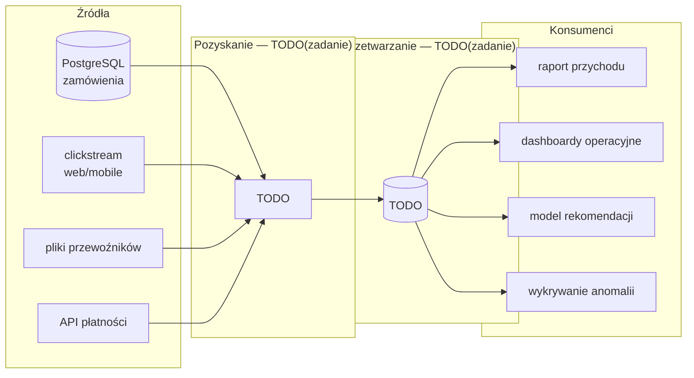

# Warianty architektury danych NovaCart

Skopiuj sekcję „Wariant X” trzy razy: (a) on-premise 2010, (b) cloud data warehouse, (c) lakehouse. Usuń wszystkie znaczniki `TODO(zadanie)`.

---

## Wariant X — TODO(zadanie): nazwa wariantu

**Epoka i założenia:** TODO(zadanie): rok, w którym wariant jest osadzony, i najważniejsze ograniczenia technologiczne tego czasu (np. sieć 1 Gb/s, brak usług zarządzanych).

### Diagram

*TODO(zadanie): jedno zdanie podpisu — co czytelnik ma zauważyć na diagramie.*

### Przepływ jednego zamówienia

| Krok | Komponent | Co się dzieje | Opóźnienie |
|---|---|---|---|
| 1 | sklep → PostgreSQL | zamówienie zapisane w OLTP | 0 |
| 2 | TODO(zadanie) | | |
| 3 | TODO(zadanie) | | |
| … | raport przychodu | zamówienie widoczne w raporcie | **łącznie: TODO(zadanie)** |

### Punkty awarii (co najmniej 3)

| # | Co się psuje | Wpływ na konsumentów | Jak wykryć | Mitygacja |
|---|---|---|---|---|
| 1 | TODO(zadanie) | | | |
| 2 | TODO(zadanie) | | | |
| 3 | TODO(zadanie) | | | |

### Skalowanie

| Scenariusz | Który komponent nasyci się pierwszy? | Co trzeba zrobić | Ile to trwa | Kto to robi |
|---|---|---|---|---|
| Black Friday (×2,8 dziennie, skok ~250 zdarzeń/s przy skali L) | TODO(zadanie) | | | |
| Wzrost do skali XL (×10, skok ~1 700 zdarzeń/s) | TODO(zadanie) | | | |

### Model kosztowy (TCO 3 lata, skala L → XL)

| Kategoria | Pozycja | Ilość | Cena jednostkowa (źródło) | Koszt 3 lata |
|---|---|---|---|---|
| Storage | TODO(zadanie) | | | |
| Compute | TODO(zadanie) | | | |
| Licencje / usługi | TODO(zadanie) | | | |
| Ludzie | TODO(zadanie) | | | |
| **Razem** | | | | **TODO(zadanie)** |

Koszt stały vs zmienny: TODO(zadanie): jaka część kosztu nie zależy od ruchu?

### Właściciele komponentów

| Komponent | Rola-właściciel (lekcja 01.08) |
|---|---|
| TODO(zadanie) | |

### Scenariusze

- **Wniosek RODO o usunięcie klienta:** TODO(zadanie): gdzie leżą jego dane (wszystkie kopie!), jak je usuwasz, ile to trwa, co z kopiami historycznymi / backupami / time travel.
- **Sprzedawca przysyła ceny w groszach:** TODO(zadanie): w którym miejscu architektury to wykryjesz, kiedy (przed czy po publikacji raportu) i jak poprawisz dane historyczne.

### Mocne i słabe strony

| Mocne strony | Słabe strony |
|---|---|
| TODO(zadanie) | TODO(zadanie) |

---

## Porównanie wariantów

| Kryterium | (a) On-prem 2010 | (b) Cloud DW | (c) Lakehouse |
|---|---|---|---|
| Świeżość danych dla dashboardów | TODO(zadanie) | | |
| Wykrywanie anomalii ≤ 15 min | | | |
| Koszt stały vs zmienny | | | |
| TCO 3 lata (rząd wielkości) | | | |
| Elastyczność na Black Friday | | | |
| Czas wdrożenia | | | |
| Wymagane kompetencje zespołu | | | |
| Obsługa ML / AI | | | |
| Governance i RODO | | | |
| Ryzyko uzależnienia od dostawcy | | | |
