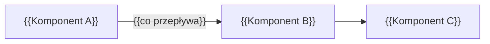
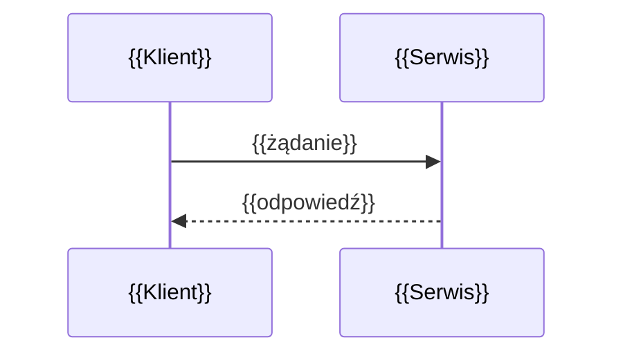

<!--
AUTOR: Szablon lekcji. Jedna lekcja = jeden spójny temat na 30–90 minut lektury.
Zmień nazwę pliku na NN-slug-lekcji.md (kebab-case, bez polskich znaków).
Struktura prowadzi po „drabinie głębokości” z templates/README.md:
problem → intuicja → model → pod maską → konsekwencje → praktyka.
Sekcje oznaczone (opcjonalne) można pominąć, jeśli nie pasują do tematu.
Usuń wszystkie komentarze AUTOR i znaczniki {{…}} przed publikacją.
-->

# {{NN}}.{{LL}} — {{Tytuł lekcji}}

> **Czas:** ~{{N}} min · **Wymaga:** {{[Lekcja 14.01](01-…md)}} · **Ostatnia weryfikacja:** {{RRRR-MM-DD}}

**W tej lekcji:**

- {{Co czytelnik zrozumie — 3 do 5 punktów}}
- {{…}}
- {{…}}

---

## 1. Problem

<!--
AUTOR: Zacznij od konkretnej sytuacji w NovaCart, w której brak tej wiedzy boli.
Pokaż objaw (wolne zapytanie, rachunek, duplikaty, awaria), najlepiej z liczbami.
2–4 akapity. Nie zdradzaj jeszcze rozwiązania.
-->

{{Przykład: „Dashboard sprzedaży NovaCart odświeża się co 15 minut i za każdym razem skanuje 2,3 TB tabeli `clickstream`. Miesięczny rachunek za to jedno zapytanie przekroczył…”}}

## 2. Intuicja

> [!TIP]
> **Intuicja.** {{Analogia ze świata poza IT albo uproszczony model, który czytelnik zapamięta. Np. „Partycjonowanie to jak segregator z przegródkami na każdy miesiąc: jeśli szukasz faktury z marca, nie przeglądasz całego roku.”}}

{{1–2 akapity rozwijające analogię i pokazujące, gdzie przestaje ona działać. To ważne, bo każda analogia ma granice.}}

## 3. Koncepcja

<!--
AUTOR: Model pojęciowy. Definicje kluczowych terminów (angielskie terminy kursywą przy
pierwszym użyciu + wyjaśnienie). Diagram architektury lub przepływu.
Odpowiedz na pytanie: z jakich elementów składa się rozwiązanie i jak się ze sobą łączą?
-->

### 3.1. Pojęcia

| Pojęcie | Znaczenie |
|---|---|
| *{{termin angielski}}* ({{polskie wyjaśnienie}}) | {{Definicja w jednym–dwóch zdaniach.}} |
| {{…}} | {{…}} |

### 3.2. Jak to działa — widok z lotu ptaka



*Rysunek {{LL}}.1. {{Co czytelnik ma zauważyć na diagramie.}}*

{{Opis diagramu: przepływ krok po kroku.}}

## 4. 🔍 Pod maską

<!--
AUTOR: Najważniejsza sekcja kursu. Jak to jest zbudowane: struktury danych, algorytmy,
formaty, protokoły, decyzje projektowe i ich uzasadnienie. Prowadź krok po kroku,
najlepiej na konkretnym przykładzie (np. „prześledźmy jedno zapytanie / jeden zapis”).
Po KAŻDEJ podsekcji obowiązkowo dodaj blok „Co z tego wynika w praktyce”.
Rozróżniaj fakty (źródło: dokumentacja, paper) od wniosków („można przypuszczać…”).
-->

### 4.1. {{Mechanizm 1 — np. „Co dzieje się podczas zapisu”}}

{{Opis krok po kroku. Diagram ASCII dla struktur danych, Mermaid sequenceDiagram dla interakcji.}}

```text
{{Diagram ASCII, np. układ pliku / drzewa / bloków:
┌──────────────┐
│   nagłówek   │
├──────────────┤
│   blok 1     │
└──────────────┘}}
```

> [!IMPORTANT]
> **Co z tego wynika w praktyce:** {{1–3 konkretne reguły projektowe wynikające z mechanizmu.}}

### 4.2. {{Mechanizm 2}}



{{Opis.}}

> [!NOTE]
> **Pod maską — dla dociekliwych.** {{Opcjonalna dygresja: szczegół z papera, historia decyzji projektowej, ciekawostka implementacyjna. Można ją pominąć bez utraty wątku.}}

> [!IMPORTANT]
> **Co z tego wynika w praktyce:** {{…}}

## 5. 💻 W praktyce

<!--
AUTOR: Działający kod na danych NovaCart. Każdy fragment pochodzi z pliku w examples/
(podaj ścieżkę w pierwszej linii). Pokaż oczekiwany wynik. Najlepiej: wersja „przed”
i „po” z pomiarem efektu (bajty, czas, koszt), bo to buduje intuicję.
-->

### 5.1. {{Krok 1 — np. „Pomiar punktu wyjścia”}}

```sql
-- examples/01_baseline.sql
SELECT {{…}}
FROM `{{projekt}}.novacart.{{tabela}}`
WHERE {{…}};
```

**Wynik** (skala {{M}}):

```text
{{fragment wyniku, np. bytes processed: 1.2 GB, slot ms: 45 000}}
```

### 5.2. {{Krok 2 — np. „Po optymalizacji”}}

```python
# examples/02_{{nazwa}}.py
{{kod}}
```

| Wariant | {{Bajty}} | {{Czas}} | {{Koszt}} |
|---|---|---|---|
| Przed | {{…}} | {{…}} | {{…}} |
| Po | {{…}} | {{…}} | {{…}} |

{{Interpretacja wyników: dlaczego tak wyszło, nawiązanie do sekcji „Pod maską”.}}

## 6. ⚖️ Porównanie platform

<!--
AUTOR: Jak ten sam problem rozwiązują inne platformy i DLACZEGO inaczej.
Nie lista nazw usług. Pomiń kolumny bez sensu w danym temacie. Pod tabelą wnioski.
-->

| Aspekt | GCP | AWS | Azure | Snowflake | Databricks | On-prem / OSS |
|---|---|---|---|---|---|---|
| {{Mechanizm / nazwa}} | | | | | | |
| {{Kluczowa różnica architektoniczna}} | | | | | | |
| {{Model kosztowy}} | | | | | | |
| {{Ograniczenia}} | | | | | | |

**Wnioski:** {{2–5 zdań: co jest fundamentalnie różne i z czego to wynika.}}

## 7. ⚠️ Antywzorce i pułapki

| Antywzorzec | Objaw | Dlaczego tak się dzieje | Jak naprawić |
|---|---|---|---|
| {{np. Filtr na funkcji kolumny partycjonującej}} | {{Pełny skan mimo filtra}} | {{Optymalizator nie może wyliczyć zakresu partycji}} | {{Filtr bezpośrednio na kolumnie}} |
| {{…}} | | | |

> [!WARNING]
> **Pułapka.** {{Najczęstszy i najbardziej kosztowny błąd z tej lekcji, opisany szerzej.}}

## 8. 💰 Koszty (opcjonalne)

<!-- AUTOR: Model kosztowy mechanizmu, dźwignie optymalizacji, przykładowe wyliczenie dla NovaCart. -->

{{Za co płacisz i jak to policzyć. Przykład: „Dla tabeli 5 TB odpytywanej 200 razy dziennie…”.}}

> [!CAUTION]
> **Koszt!** {{Operacja, która może wygenerować duży rachunek lub jest nieodwracalna.}}

## 9. Podsumowanie

- {{Najważniejsza rzecz z lekcji — pełne zdanie}}
- {{…}}
- {{…}}

## 🧠 Sprawdź się

<details>
<summary><b>{{Pytanie 1}}</b></summary>

{{Odpowiedź.}}

</details>

<details>
<summary><b>{{Pytanie 2 — scenariusz „co się stanie, jeśli…”}}</b></summary>

{{Odpowiedź.}}

</details>

## 📚 Źródła

<!-- AUTOR: Każde twierdzenie o limicie, cenie lub zachowaniu usługi musi mieć tu źródło. -->

1. {{Dokumentacja: [Tytuł](https://…) — dostęp {{RRRR-MM-DD}}}}
2. {{Paper: Autorzy, „Tytuł”, Konferencja Rok}}

---

<sub>← [{{Poprzednia lekcja}}]({{plik.md}}) · [Moduł {{NN}}](README.md) · [{{Następna lekcja}}]({{plik.md}}) →</sub>
