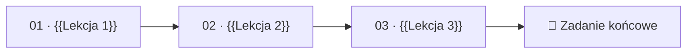

<!--
AUTOR: Szablon strony głównej modułu. Skopiuj katalog templates/module do modules/NN-slug.
Zastąp wszystkie znaczniki {{…}} i usuń komentarze oznaczone AUTOR.
Treść modułu wynika z konspektu w głównym README.md; ta strona to „mapa” modułu,
a właściwa wiedza jest w plikach lekcji.
-->

# Moduł {{NN}} — {{Tytuł modułu}}

> {{Jedno–dwa zdania: o czym jest moduł i dlaczego ma znaczenie dla data engineera.}}

| | |
|---|---|
| **Część** | {{Część X — Nazwa części}} |
| **Szacowany czas** | {{N}} h (lektura ~{{N}} h, przykłady ~{{N}} h, zadanie ~{{N}} h) |
| **Poziom** | {{★★☆☆ / ★★★☆ / ★★★★}} |
| **Wymaga** | {{[Moduł 06](../06-silnik-zapytan/README.md), [Moduł 08](../08-…/README.md)}} |
| **Koszt zadań** | {{np. ~2 USD przy skali M; mieści się w darmowych kredytach}} |
| **Ostatnia weryfikacja** | {{RRRR-MM-DD}} |

---

## 🎯 Cele modułu

Po ukończeniu modułu będziesz umieć:

<!--
AUTOR: 4–8 celów. Każdy zaczyna się od czasownika opisującego OBSERWOWALNĄ umiejętność
(wyjaśnić, zaprojektować, zdiagnozować, porównać, zaimplementować, oszacować),
a nie „znać” czy „rozumieć”. Każdy cel musi być sprawdzany przez pytanie kontrolne lub zadanie.
-->

1. **Wyjaśnić** {{…}}
2. **Zdiagnozować** {{…}}
3. **Zaprojektować** {{…}}
4. **Porównać** {{…}} w {{GCP}} z {{Snowflake / Databricks / AWS / Azure / on-prem}}
5. **Oszacować koszt** {{…}}

## 📋 Zanim zaczniesz

- **Wiedza:** {{pojęcia z poprzednich modułów, które będą potrzebne, z linkami}}
- **Środowisko:** {{np. projekt GCP z modułu 00, `bq` CLI, DuckDB}}
- **Dane:** wygeneruj dane NovaCart dla tego modułu:

  ```bash
  cd datasets
  uv run novacart generate --scale {{s|m|l}} --components {{entities,orders,clickstream}} -o ../data/{{NN}}
  ```

## 🧭 Dlaczego ten moduł

<!--
AUTOR: 1–3 akapity motywacji z perspektywy NovaCart. Jaki problem ma zespół danych NovaCart,
który ten moduł pozwoli rozwiązać? Pokaż stawkę: koszt, awarię, opóźnienie, ryzyko.
-->

{{Scenariusz: „Zespół danych NovaCart zauważył, że…”}}

## 🗺️ Mapa modułu



| # | Lekcja | Czas | Najważniejsze pojęcia |
|---|---|---|---|
| 01 | [{{Tytuł lekcji}}](01-nazwa-lekcji.md) | {{45 min}} | {{pojęcie 1, pojęcie 2}} |
| 02 | [{{Tytuł lekcji}}](02-nazwa-lekcji.md) | {{60 min}} | {{…}} |
| 03 | [{{Tytuł lekcji}}](03-nazwa-lekcji.md) | {{60 min}} | {{…}} |
| — | [Przykłady kodu](examples/README.md) | {{…}} | |
| — | [🧪 Zadanie końcowe](exercise/README.md) | {{…}} | |

## ⚖️ Porównanie platform — podsumowanie modułu

<!--
AUTOR: Zbiorcza tabela dla całego modułu (szczegóły w lekcjach). Wiersze to aspekty
istotne dla tematu; pomiń kolumny, które nie mają sensu. Pod tabelą 3–5 zdań wniosków.
-->

| Aspekt | GCP | AWS | Azure | Snowflake | Databricks | On-prem / OSS |
|---|---|---|---|---|---|---|
| {{Aspekt 1}} | | | | | | |
| {{Aspekt 2}} | | | | | | |
| {{Model kosztowy}} | | | | | | |

**Wnioski:** {{Gdzie różnice są fundamentalne (architektura), a gdzie kosmetyczne (nazewnictwo)? Kiedy która platforma ma przewagę?}}

## 📌 Najważniejsze wnioski

<!-- AUTOR: 5–8 punktów. Każdy punkt to pełne zdanie z konkretem, nie hasło. -->

1. {{…}}
2. {{…}}
3. {{…}}

## 🧠 Pytania kontrolne

<!--
AUTOR: 8–12 pytań w stylu rozmowy technicznej, od prostych do trudnych.
Odpowiedź w <details>. Pytania trudne (★★★) wymagają łączenia wiedzy z kilku lekcji.
-->

<details>
<summary><b>1. {{Pytanie sprawdzające rozumienie podstaw}}</b> ★☆☆</summary>

{{Odpowiedź: 2–6 zdań z uzasadnieniem, odwołanie do lekcji.}}

</details>

<details>
<summary><b>2. {{Pytanie wymagające zastosowania wiedzy w scenariuszu}}</b> ★★☆</summary>

{{Odpowiedź.}}

</details>

<details>
<summary><b>3. {{Pytanie projektowe / „co by było, gdyby”}}</b> ★★★</summary>

{{Odpowiedź z omówieniem kompromisów.}}

</details>

## 🧪 Zadanie końcowe

**[{{Tytuł zadania}}](exercise/README.md)** — {{jedno zdanie opisu}}.

## 📚 Dalsza lektura

<!-- AUTOR: Najpierw źródła pierwotne (papers, specyfikacje), potem dokumentacja, książki, wystąpienia. -->

**Publikacje i specyfikacje**
- {{Autorzy, „Tytuł”, konferencja rok — [link]() — dlaczego warto przeczytać (1 zdanie)}}

**Dokumentacja**
- {{[Tytuł strony dokumentacji]() — co tam znajdziesz}}

**Książki i wystąpienia**
- {{…}}

---

<sub>Poprzedni moduł: [{{NN-1 — Tytuł}}](../{{NN-1-slug}}/README.md) · Następny moduł: [{{NN+1 — Tytuł}}](../{{NN+1-slug}}/README.md) · [Spis treści kursu](../../README.md)</sub>
