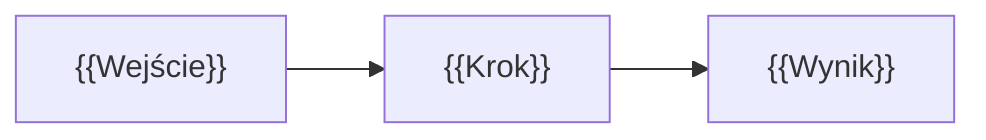

<!--
AUTOR: Omówienie rozwiązania wzorcowego. Najważniejsze są DECYZJE i ich uzasadnienie,
a nie sam kod. Pokaż też alternatywy, typowe błędy uczestników i rzeczywisty koszt.
-->

# Rozwiązanie — {{Tytuł zadania}}

> [!WARNING]
> Zajrzyj tutaj dopiero po samodzielnej próbie. Największa wartość zadania to samodzielne zmierzenie się z problemem, także z błędnymi podejściami.

## Podejście w skrócie

{{3–5 zdań: główna idea rozwiązania.}}



## Kluczowe decyzje

| Decyzja | Wybór | Odrzucone alternatywy | Uzasadnienie |
|---|---|---|---|
| {{np. Strategia partycjonowania}} | {{DAY na `created_at`}} | {{HOUR; ingestion-time}} | {{pomiar / argument}} |
| {{…}} | | | |

## Krok po kroku

### 1. {{Krok}}

{{Opis + kluczowy fragment kodu (pełny kod w plikach obok).}}

```sql
-- {{plik}}
{{…}}
```

### 2. {{Krok}}

{{…}}

## Weryfikacja

{{Jak sprawdzić, że kryteria akceptacji są spełnione: zapytania kontrolne, testy, oczekiwane wartości dla skali {{M}} i seed 42.}}

| Kryterium | Oczekiwana wartość | Jak sprawdzić |
|---|---|---|
| {{…}} | {{…}} | {{…}} |

## Wyniki i koszty

| Wariant | {{Metryka 1}} | {{Metryka 2}} | Koszt |
|---|---|---|---|
| {{Punkt wyjścia}} | | | |
| {{Rozwiązanie}} | | | |

Rzeczywisty koszt wykonania rozwiązania wzorcowego: **{{X USD}}** ({{data pomiaru}}).

## Typowe błędy

1. **{{Błąd}}** — {{objaw i dlaczego to nie działa}}.
2. **{{Błąd}}** — {{…}}.

## Co dalej

{{Jak rozwinąć rozwiązanie w kierunku produkcyjnym; powiązanie z kolejnymi modułami.}}
